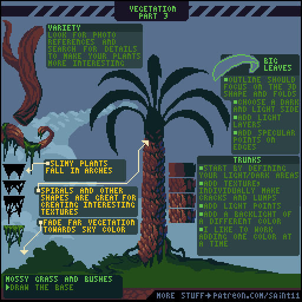
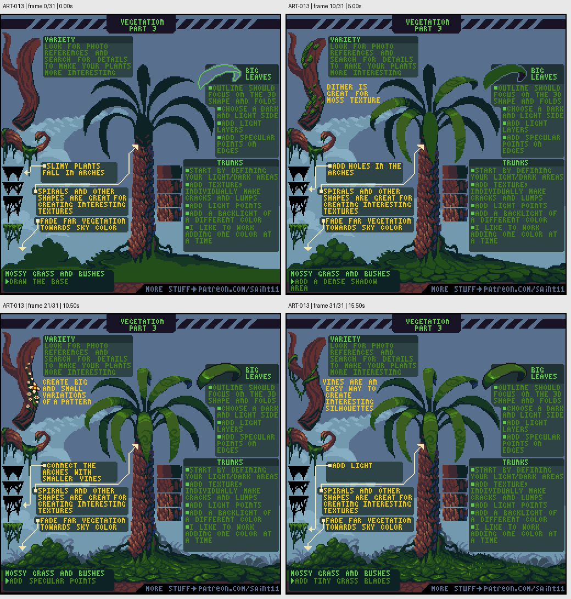

# ART-013 · 植物多样性：叶形、茎干与远近层次

观察真实植物的结构差异，把大叶、细茎和树干转化成可复用的像素形状规则。

## 使用前先读

**适用层级：** 进阶。**前置：** ART-011、ART-014。

本篇依据原图中的主要说明和示例编写中文讲解，保留原始英文动态图；不是逐字全文OCR。原作者的经验性建议不自动等于所有项目的硬性规则。练习、验收与适用边界是整理者补充。

## 学习目标

- 按植物类型选择轮廓与纹理
- 沿叶片三维形体安排明暗
- 降低远景植被的对比

## 原始图文教程

图1：Pedro Medeiros / Saint11 原始GIF，512×512，32帧，总时长16.00秒。原文件未改像素或重编码。部分阅读器只显示首帧，请结合下面的静态图和说明。

图2：整理者从原GIF按时间抽取的静态辅助图，阅读顺序为左上→右上→左下→右下。只选取四个时间点，并不代表完整动画或所有中间步骤；原始帧未缩放，标签加在图外。

## 图示读法

中心棕榈展示叶片弧线与树干分层；右侧独立叶片先描轮廓再填亮暗；左侧细茎、螺旋和远处植物说明不同结构与空间层次。

## 关键概念

植物多样性首先来自生长结构，不是给同一棵树换色。原图建议参考照片，观察能使植物有辨识度的细节。

## 根据原图整理的步骤

1. 从参考中找大叶、细茎、树皮或苔藓等主要结构，先确定它们怎样生长和弯曲。

2. 大叶先画出反映三维弯折的外形，再选暗面、亮面和中间层次，最后用少量高光说明表面。

3. 细长植物可以按弧线下垂；螺旋或其他重复形状可以提供有趣纹理，但需符合该植物结构。

4. 树干先划出明暗区域，再添树皮；沿形体处理裂纹、起伏和暗点，并用单个颜色层逐步推进。

5. 远处植被逐渐接近天空颜色，减少对比与细节。前景草丛和苔藓先有底形，再做小尺度变化。

## 实作练习（整理者补充）

整理者练习：为同一乡村场景画芭蕉、竹丛和低矮灌木三类植物。每类写三条结构规则，分别输出前景版与远景版；远景版只改变对比和细节，不随意改变投影。

## 验收清单（整理者补充）

- [ ] 仅看轮廓即可区分三类植物
- [ ] 叶片高光沿其弯曲形体变化
- [ ] 树干纹理服从主干方向
- [ ] 远景比前景更接近背景色、细节更少

## 适用边界与常见误区（整理者补充）

不要用同一套圆球树冠模板代表所有植物；照片帮助观察结构，但不能替代项目统一的像素尺度与视角。

## 来源与授权

- 原作者：**Pedro Medeiros（Saint11）**。
- 原图：[固定版本的 Vegetation3.gif](https://github.com/saint11/Saint11Tutorials/blob/ce1393eb2c46441d917134a9fd52e15575ee10a7/Vegetation3.gif)；[原始文件](https://raw.githubusercontent.com/saint11/Saint11Tutorials/ce1393eb2c46441d917134a9fd52e15575ee10a7/Vegetation3.gif)。
- 作者教程入口：[Pixel Art Tutorials](https://saint11.art/blog/pixel-art-tutorials/)。
- 授权：[Creative Commons Attribution 4.0 International](https://creativecommons.org/licenses/by/4.0/)。
- 授权证据：[仓库README固定版本](https://github.com/saint11/Saint11Tutorials/blob/ce1393eb2c46441d917134a9fd52e15575ee10a7/README.md)；[本地证据副本](../../licenses/saint11-README.md)。
- 固定提交：`ce1393eb2c46441d917134a9fd52e15575ee10a7`。收集日期：`2026-10-29`。
- 原始GIF SHA-256：`2c2587f4f01fadd2e5a030971b1ce100807ef2c154c49653c2d3a04f239744d6`。
- 变更声明：原始GIF字节保留；新增中文解释性转述、练习、验收和适用范围说明；另从GIF抽帧生成静态辅助图。新增中文整理和派生图按CC BY 4.0提供，继续署名原作者并说明这些改动。
- 使用边界：这份开放授权针对仓库中的教程图文；教程中出现的软件名称和商标仍属于其权利人。授权不表示原作者认可本中文整理。
