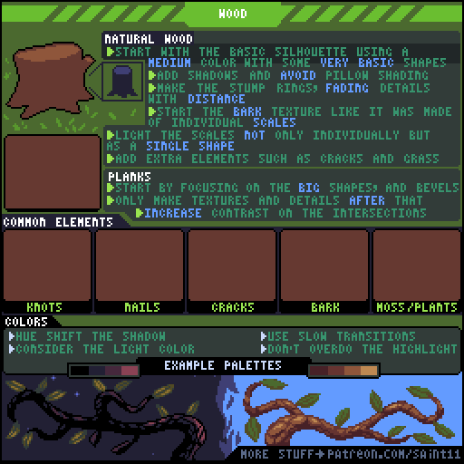
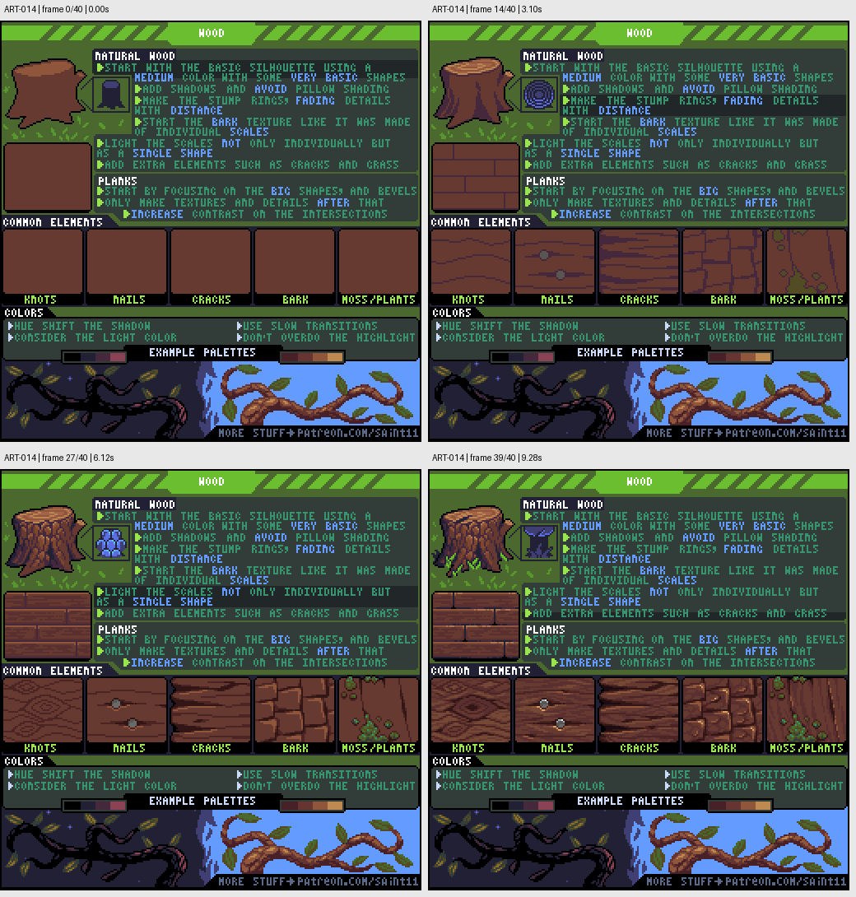

# ART-014 · 木材：树桩、木板、年轮和木纹

先确定木制物的体块与倒角，再用方向明确的年轮、树皮和裂纹说明材质。

## 使用前先读

**适用层级：** 进阶。**前置：** ART-003。

本篇依据原图中的主要说明和示例编写中文讲解，保留原始英文动态图；不是逐字全文OCR。原作者的经验性建议不自动等于所有项目的硬性规则。练习、验收与适用边界是整理者补充。

## 学习目标

- 区分自然木材与加工木板
- 让木纹遵循物体方向
- 控制木材高光和细节对比

## 原始图文教程

图1：Pedro Medeiros / Saint11 原始GIF，512×512，41帧，总时长9.44秒。原文件未改像素或重编码。部分阅读器只显示首帧，请结合下面的静态图和说明。

图2：整理者从原GIF按时间抽取的静态辅助图，阅读顺序为左上→右上→左下→右下。只选取四个时间点，并不代表完整动画或所有中间步骤；原始帧未缩放，标签加在图外。

## 图示读法

动图左上逐步完成树桩，左中逐步完成木板。中间五个小窗分别展示木节、钉子、裂纹、树皮和苔藓；下方树枝对比不同照明和配色。

## 关键概念

自然木材的年轮与树皮、加工木板的接缝与倒角承担不同信息。原图强调先形后纹，避免枕头式从四周向中央均匀变亮。

## 根据原图整理的步骤

1. 用中间色和基本形状建立树桩剪影，再按固定光源加阴影。避免围着外边缘一圈圈加暗形成枕头光。

2. 在切面上画年轮，并让远离观者的细节减弱。先保证切面与侧面可区分。

3. 树皮可以从独立鳞片般的小面开始组织，但要把它们当成同一整体受光，而不是每块都独立发亮。

4. 木板先画大形、接缝和倒角，再加纹理；在板缝、连接与交叉处增加必要对比。

5. 根据物件故事添加木节、钉子、裂缝、树皮或苔藓。调色时考虑光源与暗部色相变化，并节制高光。

## 实作练习（整理者补充）

整理者练习：制作32×32木桶、树桩和木门，使用同一木色色阶。给每件只选两种细节元素；把纹理关闭后先检查体块，再恢复纹理并确认没有改变主光方向。

## 验收清单（整理者补充）

- [ ] 木纹或年轮方向符合构造
- [ ] 树皮小块共享整体受光
- [ ] 板缝清楚但没有把整个表面切碎
- [ ] 高光不使木头误读为金属或塑料

## 适用边界与常见误区（整理者补充）

同一木材不需要每个像素都出现纹理。小物件更需要代表性木纹和清楚的边界。

## 来源与授权

- 原作者：**Pedro Medeiros（Saint11）**。
- 原图：[固定版本的 Wood.gif](https://github.com/saint11/Saint11Tutorials/blob/ce1393eb2c46441d917134a9fd52e15575ee10a7/Wood.gif)；[原始文件](https://raw.githubusercontent.com/saint11/Saint11Tutorials/ce1393eb2c46441d917134a9fd52e15575ee10a7/Wood.gif)。
- 作者教程入口：[Pixel Art Tutorials](https://saint11.art/blog/pixel-art-tutorials/)。
- 授权：[Creative Commons Attribution 4.0 International](https://creativecommons.org/licenses/by/4.0/)。
- 授权证据：[仓库README固定版本](https://github.com/saint11/Saint11Tutorials/blob/ce1393eb2c46441d917134a9fd52e15575ee10a7/README.md)；[本地证据副本](../../licenses/saint11-README.md)。
- 固定提交：`ce1393eb2c46441d917134a9fd52e15575ee10a7`。收集日期：`2026-10-29`。
- 原始GIF SHA-256：`26cbd8243340c661223fd9f12e111c928e9fe8a62150cb32dc0bb399664c8529`。
- 变更声明：原始GIF字节保留；新增中文解释性转述、练习、验收和适用范围说明；另从GIF抽帧生成静态辅助图。新增中文整理和派生图按CC BY 4.0提供，继续署名原作者并说明这些改动。
- 使用边界：这份开放授权针对仓库中的教程图文；教程中出现的软件名称和商标仍属于其权利人。授权不表示原作者认可本中文整理。
