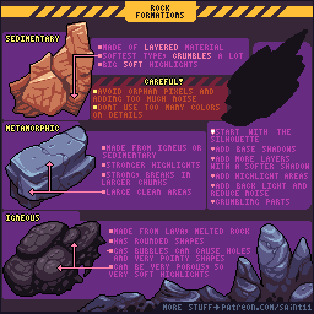
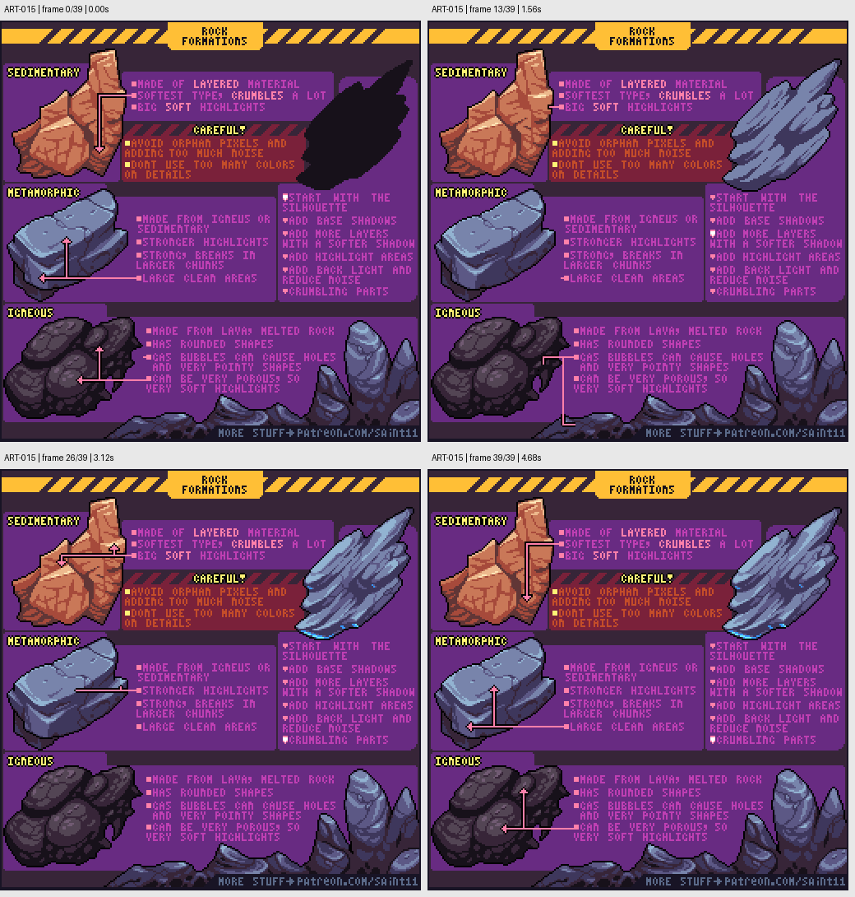

# ART-015 · 岩石：大面、层理与不同地质形状

用不同的大形与断面语言区分岩石类型，避免用随机噪点代替结构。

## 使用前先读

**适用层级：** 进阶。**前置：** ART-001、ART-003。

本篇依据原图中的主要说明和示例编写中文讲解，保留原始英文动态图；不是逐字全文OCR。原作者的经验性建议不自动等于所有项目的硬性规则。练习、验收与适用边界是整理者补充。

## 学习目标

- 区分层理、块状断面与孔洞
- 按大面组织岩石光影
- 限制小碎点和无意义色阶

## 原始图文教程

图1：Pedro Medeiros / Saint11 原始GIF，512×512，40帧，总时长4.80秒。原文件未改像素或重编码。部分阅读器只显示首帧，请结合下面的静态图和说明。

图2：整理者从原GIF按时间抽取的静态辅助图，阅读顺序为左上→右上→左下→右下。只选取四个时间点，并不代表完整动画或所有中间步骤；原始帧未缩放，标签加在图外。

## 图示读法

左侧三种岩石以形状和高光宽度区分；右上黑色剪影对应逐步加明暗的流程；中央警示指出应控制孤立像素、噪点及颜色数量。

## 关键概念

图中借沉积岩、变质岩和火成岩提供视觉设计参照。自然岩石种类复杂，教程描述用于造型练习，不是完整地质分类规则。

## 根据原图整理的步骤

1. 从剪影开始选择岩石外形，避免先撒纹理。用大暗面解释主要朝向。

2. 沉积层风格可强调层叠结构、易碎边缘和较宽软高光；不要把每层都画成相同厚度条纹。

3. 较块状的断面示例保留大而干净的面，配合强高光和较大碎块关系。

4. 熔岩形成的示例可以出现圆润轮廓、孔洞与尖锐破口，用它们描述材质历史，而非全部混在每块石头上。

5. 在基本暗面之上加较软的次级层、亮部、少量反射光与崩落部分，最后清理孤立像素和过多颜色。

## 实作练习（整理者补充）

整理者练习：用统一6色色阶画三块32×32石头：层状、块状断裂、多孔。每块限制两种结构特征，先交剪影与明暗版，再交纹理版，确保它们不用标签也能区分。

## 验收清单（整理者补充）

- [ ] 各石头有清楚的大亮面和暗面
- [ ] 纹理不会盖过断面结构
- [ ] 孔洞、层理或裂缝各有明确方向
- [ ] 没有靠随机点填满空白区域

## 适用边界与常见误区（整理者补充）

教程对岩石类型的概括不应作为地质事实数据库。这里提取的是视觉结构与像素绘制顺序。

## 来源与授权

- 原作者：**Pedro Medeiros（Saint11）**。
- 原图：[固定版本的 Rock.gif](https://github.com/saint11/Saint11Tutorials/blob/ce1393eb2c46441d917134a9fd52e15575ee10a7/Rock.gif)；[原始文件](https://raw.githubusercontent.com/saint11/Saint11Tutorials/ce1393eb2c46441d917134a9fd52e15575ee10a7/Rock.gif)。
- 作者教程入口：[Pixel Art Tutorials](https://saint11.art/blog/pixel-art-tutorials/)。
- 授权：[Creative Commons Attribution 4.0 International](https://creativecommons.org/licenses/by/4.0/)。
- 授权证据：[仓库README固定版本](https://github.com/saint11/Saint11Tutorials/blob/ce1393eb2c46441d917134a9fd52e15575ee10a7/README.md)；[本地证据副本](../../licenses/saint11-README.md)。
- 固定提交：`ce1393eb2c46441d917134a9fd52e15575ee10a7`。收集日期：`2026-10-29`。
- 原始GIF SHA-256：`0d4abadab75f8892fc61addd15446aa2c8bd321a1d61a7b193634307a276306f`。
- 变更声明：原始GIF字节保留；新增中文解释性转述、练习、验收和适用范围说明；另从GIF抽帧生成静态辅助图。新增中文整理和派生图按CC BY 4.0提供，继续署名原作者并说明这些改动。
- 使用边界：这份开放授权针对仓库中的教程图文；教程中出现的软件名称和商标仍属于其权利人。授权不表示原作者认可本中文整理。
