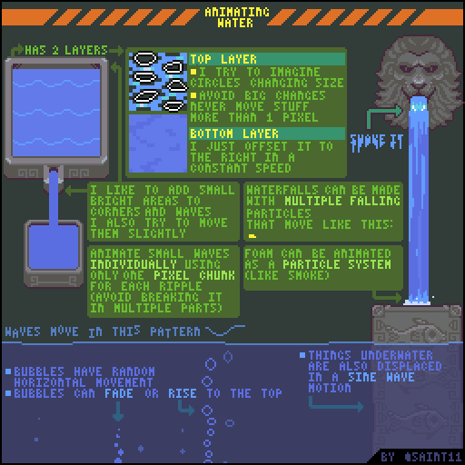
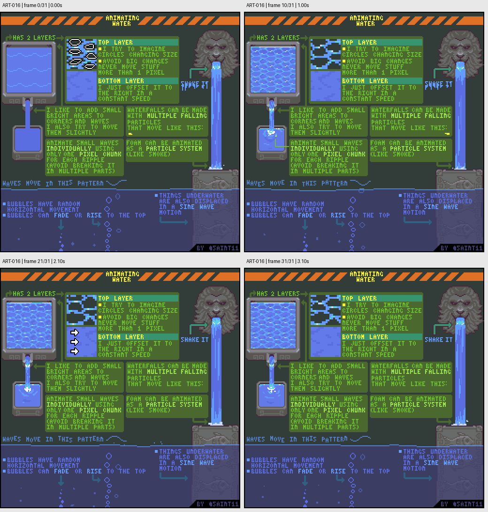

# ART-016 · 水面、波纹、瀑布和水下位移

把水拆成缓慢底层、局部波纹与泡沫等运动，使用小幅变化维持像素连续性。

## 使用前先读

**适用层级：** 进阶。**前置：** ART-001、知道逐帧动画的基本操作。

本篇依据原图中的主要说明和示例编写中文讲解，保留原始英文动态图；不是逐字全文OCR。原作者的经验性建议不自动等于所有项目的硬性规则。练习、验收与适用边界是整理者补充。

## 学习目标

- 分离水面不同运动层
- 用少量像素变化形成波动
- 区分瀑布、泡沫与水下折射

## 原始图文教程

图1：Pedro Medeiros / Saint11 原始GIF，512×512，32帧，总时长3.20秒。原文件未改像素或重编码。部分阅读器只显示首帧，请结合下面的静态图和说明。

图2：整理者从原GIF按时间抽取的静态辅助图，阅读顺序为左上→右上→左下→右下。只选取四个时间点，并不代表完整动画或所有中间步骤；原始帧未缩放，标签加在图外。

## 图示读法

左上竖向框分别说明两层运动；右上和右中演示喷口与瀑布粒子；左下有波形与气泡示例，右下展示水下图案被波动扭动。

## 关键概念

原图的水面方案有两层：顶部局部形状变化与底部持续偏移。它是一种可复用风格方案，不意味着所有水都只能采用两层。

## 根据原图整理的步骤

1. 先建立底层水色与缓慢偏移的纹理，再叠加顶部变化的波纹，避免所有信息同步移动。

2. 局部波纹尽量小幅变化。作者倾向每次不要让相关形状跳动超过1像素，以保持连续感。

3. 为角落或波峰添加小亮区，并让它们轻微移动；单独调整小波浪，避免整块形状同时破碎。

4. 瀑布可由多组细长下落片段组成，底端泡沫按类似烟雾的聚散处理；气泡允许随机横移、淡出或上浮。

5. 水下物件可以随波纹发生位移，使水面运动与下面的东西产生联系。实际效果应按项目视角与可读性选择。

## 实作练习（整理者补充）

整理者练习：制作32×32可循环池塘水面与16×48瀑布各一组，分别记录底层、波纹、泡沫的帧数与周期。先检查首尾衔接，再把池塘平铺为4×4观察同步感。

## 验收清单（整理者补充）

- [ ] 首尾切换没有明显跳变
- [ ] 相邻帧的波纹没有无故大幅跳跃
- [ ] 底层与表层运动可分辨
- [ ] 瀑布落点和泡沫方向一致

## 适用边界与常见误区（整理者补充）

单像素变化是作者的动画偏好，不是速度上限。高速水花可能需要更大位移或拖影，但应有明确运动设计。

## 来源与授权

- 原作者：**Pedro Medeiros（Saint11）**。
- 原图：[固定版本的 Water.gif](https://github.com/saint11/Saint11Tutorials/blob/ce1393eb2c46441d917134a9fd52e15575ee10a7/Water.gif)；[原始文件](https://raw.githubusercontent.com/saint11/Saint11Tutorials/ce1393eb2c46441d917134a9fd52e15575ee10a7/Water.gif)。
- 作者教程入口：[Pixel Art Tutorials](https://saint11.art/blog/pixel-art-tutorials/)。
- 授权：[Creative Commons Attribution 4.0 International](https://creativecommons.org/licenses/by/4.0/)。
- 授权证据：[仓库README固定版本](https://github.com/saint11/Saint11Tutorials/blob/ce1393eb2c46441d917134a9fd52e15575ee10a7/README.md)；[本地证据副本](../../licenses/saint11-README.md)。
- 固定提交：`ce1393eb2c46441d917134a9fd52e15575ee10a7`。收集日期：`2026-10-29`。
- 原始GIF SHA-256：`33fe3548de8dc69709ddb28c1bc83352fe8565567d7c0f5c53f4bf45a6b89c00`。
- 变更声明：原始GIF字节保留；新增中文解释性转述、练习、验收和适用范围说明；另从GIF抽帧生成静态辅助图。新增中文整理和派生图按CC BY 4.0提供，继续署名原作者并说明这些改动。
- 使用边界：这份开放授权针对仓库中的教程图文；教程中出现的软件名称和商标仍属于其权利人。授权不表示原作者认可本中文整理。
