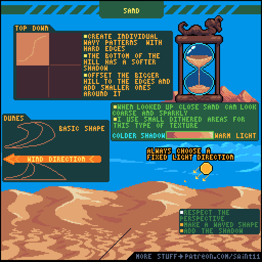
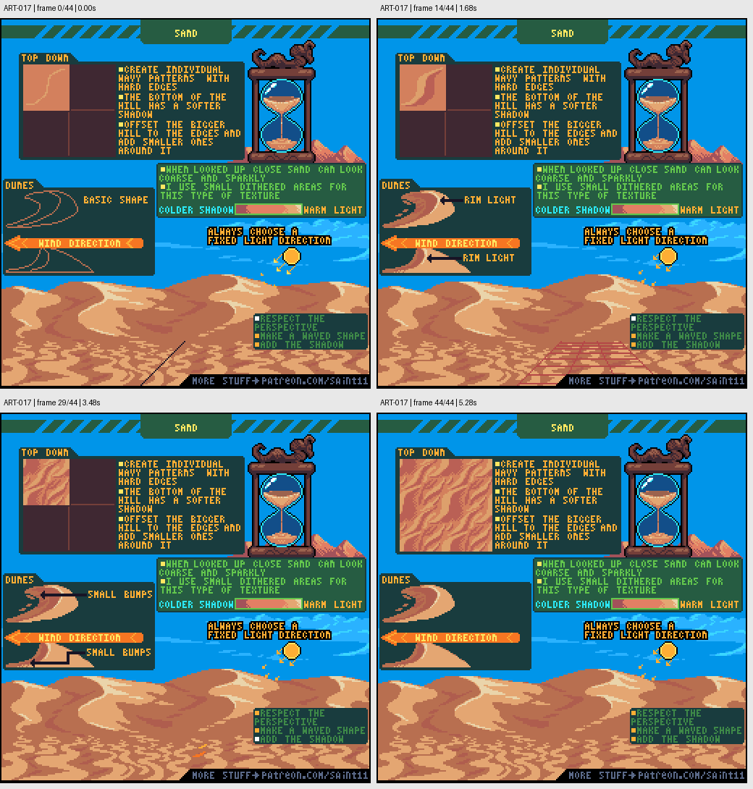

# ART-017 · 沙地与沙丘：风向、固定光源和纹理尺度

先建立受风影响的大沙丘形状，再添加有透视和尺度变化的细纹。

## 使用前先读

**适用层级：** 进阶。**前置：** ART-003、ART-007。

本篇依据原图中的主要说明和示例编写中文讲解，保留原始英文动态图；不是逐字全文OCR。原作者的经验性建议不自动等于所有项目的硬性规则。练习、验收与适用边界是整理者补充。

## 学习目标

- 让沙丘形状体现风向
- 保持固定光源方向
- 区分远处大纹理与近处砂砾质感

## 原始图文教程

图1：Pedro Medeiros / Saint11 原始GIF，512×512，45帧，总时长5.40秒。原文件未改像素或重编码。部分阅读器只显示首帧，请结合下面的静态图和说明。

图2：整理者从原GIF按时间抽取的静态辅助图，阅读顺序为左上→右上→左下→右下。只选取四个时间点，并不代表完整动画或所有中间步骤；原始帧未缩放，标签加在图外。

## 图示读法

左上俯视示例从单条丘线展开；左中用风向箭头比较沙丘形状；底部大场景同时展示固定光源与近大远小纹理。沙漏是另一种沙的运动与聚集示例。

## 关键概念

沙丘是大形体，沙粒是小纹理。原图分别展示俯视丘线、侧面弧形和近景颗粒，强调不要把两个尺度混为一谈。

## 根据原图整理的步骤

1. 确定光向，再画单独波状沙丘。图中较硬的边与底部较软的阴影形成高低感。

2. 让较大沙丘线条适度错位，在周围加入小丘线，避免完全等距平行的装饰条纹。

3. 用风向指导沙丘剖面变化，受光仍由同一个光源决定，不随着每条曲线任意翻转。

4. 近看沙面可使用小范围抖色表达粗糙或闪光，远看则保留更宽的大色块。

5. 在场景中按透视改变纹理尺度，先做波形与阴影，再做近处细节；可尝试较冷阴影和较暖亮部。

## 实作练习（整理者补充）

整理者练习：画一块64×64河岸沙地，固定右上光源和从左向右的风。做一个大波状隆起与三个小波纹；再输出无纹理版，确认只靠大明暗也能读出坡度。

## 验收清单（整理者补充）

- [ ] 所有沙丘的亮暗方向一致
- [ ] 波纹不是机械等距平行
- [ ] 近景细节比远景更明显
- [ ] 抖色集中在需要表现颗粒的区域

## 适用边界与常见误区（整理者补充）

风向控制形状，光向控制明暗，二者不能混同。教程配色只是一个选择，湿沙或夜景应重新判断。

## 来源与授权

- 原作者：**Pedro Medeiros（Saint11）**。
- 原图：[固定版本的 Sand.gif](https://github.com/saint11/Saint11Tutorials/blob/ce1393eb2c46441d917134a9fd52e15575ee10a7/Sand.gif)；[原始文件](https://raw.githubusercontent.com/saint11/Saint11Tutorials/ce1393eb2c46441d917134a9fd52e15575ee10a7/Sand.gif)。
- 作者教程入口：[Pixel Art Tutorials](https://saint11.art/blog/pixel-art-tutorials/)。
- 授权：[Creative Commons Attribution 4.0 International](https://creativecommons.org/licenses/by/4.0/)。
- 授权证据：[仓库README固定版本](https://github.com/saint11/Saint11Tutorials/blob/ce1393eb2c46441d917134a9fd52e15575ee10a7/README.md)；[本地证据副本](../../licenses/saint11-README.md)。
- 固定提交：`ce1393eb2c46441d917134a9fd52e15575ee10a7`。收集日期：`2026-10-29`。
- 原始GIF SHA-256：`dc0d90c87ddf7d9b8977537e2ff529ef0c9b5e697000e311427e4b8f53fc49d3`。
- 变更声明：原始GIF字节保留；新增中文解释性转述、练习、验收和适用范围说明；另从GIF抽帧生成静态辅助图。新增中文整理和派生图按CC BY 4.0提供，继续署名原作者并说明这些改动。
- 使用边界：这份开放授权针对仓库中的教程图文；教程中出现的软件名称和商标仍属于其权利人。授权不表示原作者认可本中文整理。
