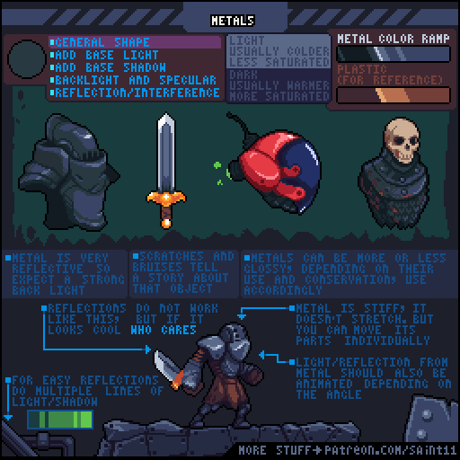
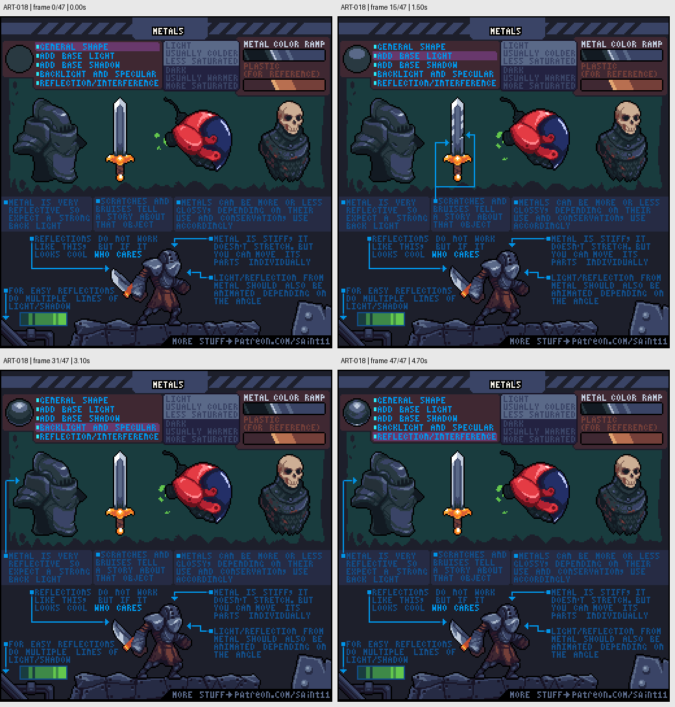

# ART-018 · 金属：强反差、高光与表面故事

通过块面、高光和环境反射区分金属与塑料，并用磨损说明工具的使用状态。

## 使用前先读

**适用层级：** 进阶。**前置：** ART-003。

本篇依据原图中的主要说明和示例编写中文讲解，保留原始英文动态图；不是逐字全文OCR。原作者的经验性建议不自动等于所有项目的硬性规则。练习、验收与适用边界是整理者补充。

## 学习目标

- 使用强反差表达反光材质
- 让高光随角度与形体变化
- 有目的地放置划痕与磕碰

## 原始图文教程

图1：Pedro Medeiros / Saint11 原始GIF，512×512，48帧，总时长4.80秒。原文件未改像素或重编码。部分阅读器只显示首帧，请结合下面的静态图和说明。

图2：整理者从原GIF按时间抽取的静态辅助图，阅读顺序为左上→右上→左下→右下。只选取四个时间点，并不代表完整动画或所有中间步骤；原始帧未缩放，标签加在图外。

## 图示读法

上部用头盔、剑和红色护具展示不同反射；右上色阶对比金属和塑料；下方铠甲人物与转动表面说明关节和高光随角度变化。

## 关键概念

金属的可读性依赖反射和大明暗对比，不只是灰色。原图把金属色阶与塑料作参照，并提醒材质会因用途与磨损改变光泽。

## 根据原图整理的步骤

1. 先画总体形状，依次加入基础受光、暗面、轮廓光和镜面高光，再考虑反射造成的色带。

2. 用较强明暗对比表达金属反射，尝试图中较冷、较低饱和的亮部与较暖暗部，但仍服从场景光色。

3. 依据表面角度改变高光，图中提示反光随着转动可以更宽或更窄，不应画成贴在表面的静态亮线。

4. 用划痕、擦伤和凹痕说明物件如何被使用；不要给所有区域平均加磨损。

5. 动画中把金属当作刚性材料，除非设计就是软金属或夸张形变；可以用分节结构允许铠甲活动。

## 实作练习（整理者补充）

整理者练习：画同一把32×32铁锄的新工具版和旧工具版。保持轮廓一致，只改变反射强弱及几个合理磨损点；再画一版灰塑料玩具锄比较材质读法。

## 验收清单（整理者补充）

- [ ] 去掉颜色后明暗仍能提示材质
- [ ] 高光位置与表面朝向有关
- [ ] 磨损集中在接触、刃口或握持相关区域
- [ ] 金属部件与木柄不会使用完全相同的受光方式

## 适用边界与常见误区（整理者补充）

原图某些反射明确为风格化效果，不能当物理精确公式。强反差也需要服务于小尺寸可读性。

## 来源与授权

- 原作者：**Pedro Medeiros（Saint11）**。
- 原图：[固定版本的 Metal.gif](https://github.com/saint11/Saint11Tutorials/blob/ce1393eb2c46441d917134a9fd52e15575ee10a7/Metal.gif)；[原始文件](https://raw.githubusercontent.com/saint11/Saint11Tutorials/ce1393eb2c46441d917134a9fd52e15575ee10a7/Metal.gif)。
- 作者教程入口：[Pixel Art Tutorials](https://saint11.art/blog/pixel-art-tutorials/)。
- 授权：[Creative Commons Attribution 4.0 International](https://creativecommons.org/licenses/by/4.0/)。
- 授权证据：[仓库README固定版本](https://github.com/saint11/Saint11Tutorials/blob/ce1393eb2c46441d917134a9fd52e15575ee10a7/README.md)；[本地证据副本](../../licenses/saint11-README.md)。
- 固定提交：`ce1393eb2c46441d917134a9fd52e15575ee10a7`。收集日期：`2026-10-29`。
- 原始GIF SHA-256：`289a5fde0017b29eeff630f491f682523472677101897043aeef8e4a84402dff`。
- 变更声明：原始GIF字节保留；新增中文解释性转述、练习、验收和适用范围说明；另从GIF抽帧生成静态辅助图。新增中文整理和派生图按CC BY 4.0提供，继续署名原作者并说明这些改动。
- 使用边界：这份开放授权针对仓库中的教程图文；教程中出现的软件名称和商标仍属于其权利人。授权不表示原作者认可本中文整理。
