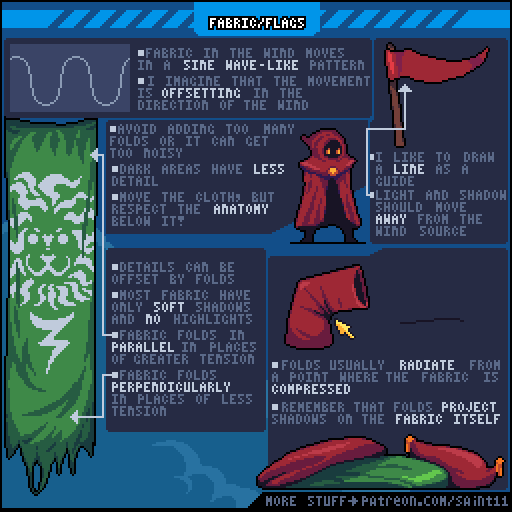
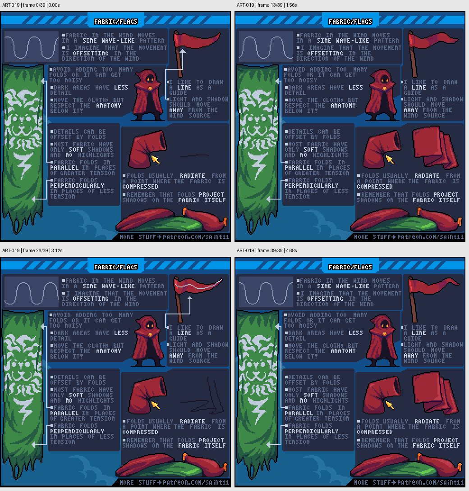

# ART-019 · 布料与旗帜：受力、褶皱和风中运动

从固定点、拉力和压缩位置组织褶皱，让布面明暗随波动移动。

## 使用前先读

**适用层级：** 进阶。**前置：** ART-003、知道动画帧与时间轴。

本篇依据原图中的主要说明和示例编写中文讲解，保留原始英文动态图；不是逐字全文OCR。原作者的经验性建议不自动等于所有项目的硬性规则。练习、验收与适用边界是整理者补充。

## 学习目标

- 用线条规划风中布料
- 按张力和压缩产生褶皱
- 控制布纹密度和暗部细节

## 原始图文教程

图1：Pedro Medeiros / Saint11 原始GIF，512×512，40帧，总时长4.80秒。原文件未改像素或重编码。部分阅读器只显示首帧，请结合下面的静态图和说明。

图2：整理者从原GIF按时间抽取的静态辅助图，阅读顺序为左上→右上→左下→右下。只选取四个时间点，并不代表完整动画或所有中间步骤；原始帧未缩放，标签加在图外。

## 图示读法

左上波形和右上旗帜对应风中变化；人物披风说明衣服仍需服从身体；中部袖子表现压缩点向外放射的褶皱；底部卷布示意自投影。

## 关键概念

褶皱源自支撑、张力与压缩，不是任意弧线。原图用正弦波般的导线解释风中旗帜，并强调高光、阴影要随形变一起移动。

## 根据原图整理的步骤

1. 先画固定点和一条运动引导线，想象布料受到风力后的波浪形；原图习惯让运动方向与风向区别处理，实际项目仍需观察参考。

2. 让明暗沿布的弯折一起移动，不要只有外轮廓变形而纹理与高光停在原地。

3. 衣服覆盖人物时保留下面的解剖和体块关系，别把整件衣服画成没有身体的波浪团。

4. 在受拉的区域组织平行折线，在松弛或压缩处安排不同方向；局部压缩点常形成放射状褶皱。

5. 用褶皱遮挡和偏移纹理，暗面细节更少；控制褶皱总量，多数布料不需要金属式尖锐高光。

## 实作练习（整理者补充）

整理者练习：画一条16×32挂在杆上的布旗和一个32×32麻布袋。先只画支点、受力线和褶皱线，再填明暗。旗帜做6帧循环，检查花纹与阴影是否一起变形。

## 验收清单（整理者补充）

- [ ] 褶皱能追溯到支撑、张力或压缩点
- [ ] 暗部纹理少于重点亮面
- [ ] 布旗图案随布面移动
- [ ] 布袋与金属工具在高光边缘上有差别

## 适用边界与常见误区（整理者补充）

原图中部分受力描述经过艺术简化；需要真实运动时用视频或实物参考校验，不把单张教程当布料模拟公式。

## 来源与授权

- 原作者：**Pedro Medeiros（Saint11）**。
- 原图：[固定版本的 Fabric.gif](https://github.com/saint11/Saint11Tutorials/blob/ce1393eb2c46441d917134a9fd52e15575ee10a7/Fabric.gif)；[原始文件](https://raw.githubusercontent.com/saint11/Saint11Tutorials/ce1393eb2c46441d917134a9fd52e15575ee10a7/Fabric.gif)。
- 作者教程入口：[Pixel Art Tutorials](https://saint11.art/blog/pixel-art-tutorials/)。
- 授权：[Creative Commons Attribution 4.0 International](https://creativecommons.org/licenses/by/4.0/)。
- 授权证据：[仓库README固定版本](https://github.com/saint11/Saint11Tutorials/blob/ce1393eb2c46441d917134a9fd52e15575ee10a7/README.md)；[本地证据副本](../../licenses/saint11-README.md)。
- 固定提交：`ce1393eb2c46441d917134a9fd52e15575ee10a7`。收集日期：`2026-10-29`。
- 原始GIF SHA-256：`3d03bc9cb4ca242125faba2be98ec4f41fd54fa8cc69d85ecb98ff2510f925f0`。
- 变更声明：原始GIF字节保留；新增中文解释性转述、练习、验收和适用范围说明；另从GIF抽帧生成静态辅助图。新增中文整理和派生图按CC BY 4.0提供，继续署名原作者并说明这些改动。
- 使用边界：这份开放授权针对仓库中的教程图文；教程中出现的软件名称和商标仍属于其权利人。授权不表示原作者认可本中文整理。
