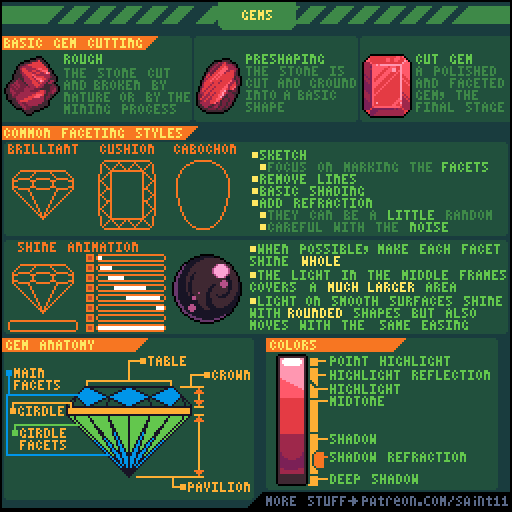
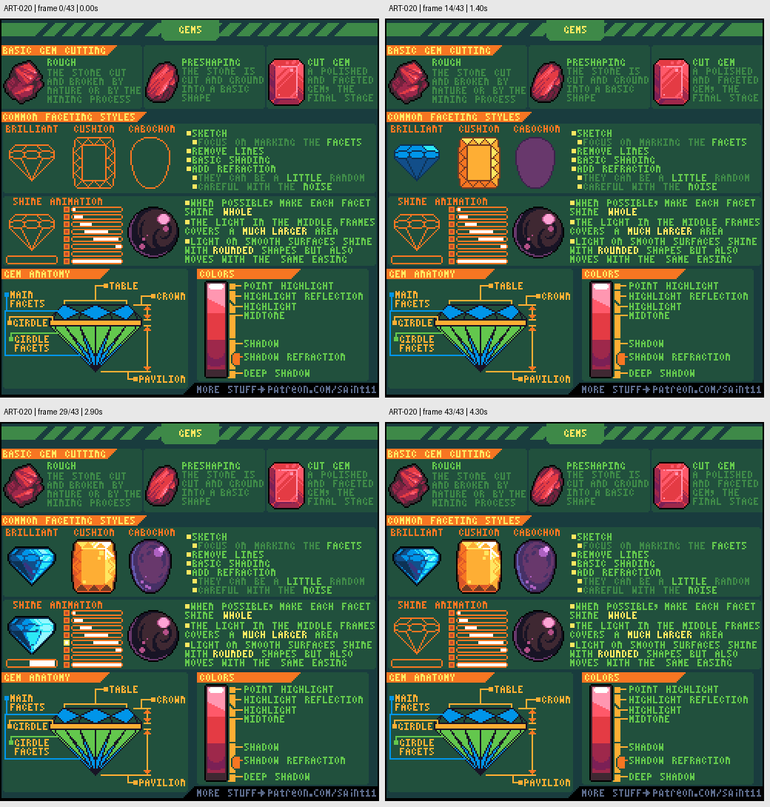

# ART-020 · 宝石：切面、色阶和闪光动画

以清楚的切面和受光变化表现宝石，区分原石、预切形状和抛光成品。

## 使用前先读

**适用层级：** 进阶。**前置：** ART-002、ART-003。

本篇依据原图中的主要说明和示例编写中文讲解，保留原始英文动态图；不是逐字全文OCR。原作者的经验性建议不自动等于所有项目的硬性规则。练习、验收与适用边界是整理者补充。

## 学习目标

- 使用切面组织宝石明暗
- 区分透明感与表面高光
- 为闪光安排连续帧

## 原始图文教程

图1：Pedro Medeiros / Saint11 原始GIF，512×512，44帧，总时长4.40秒。原文件未改像素或重编码。部分阅读器只显示首帧，请结合下面的静态图和说明。

图2：整理者从原GIF按时间抽取的静态辅助图，阅读顺序为左上→右上→左下→右下。只选取四个时间点，并不代表完整动画或所有中间步骤；原始帧未缩放，标签加在图外。

## 图示读法

顶行比较原石、预成形与抛光宝石；中上列出brilliant、cushion和cabochon轮廓；左下切面结构命名帮助理解桌面、冠部、腰围和底部的关系；右侧是颜色层次。

## 关键概念

原图展示rough、preshaping、cut gem三个阶段，并列出不同切型。宝石小图标仍需要切面结构，而非只加一个白色星点。

## 根据原图整理的步骤

1. 从轮廓和切型开始，决定是保留粗糙原石还是抛光切面；不要把两者表面规则混用。

2. 先画切面草图，再减少多余线条，把面转为基础明暗；避免每条面边都用黑线描死。

3. 在已有面上逐步细化，控制噪点。原图指出光可有变化，但应尽可能让每个切面接近纯色，保持阅读。

4. 用高光、反射高光、中间色、阴影和更深阴影组成色阶，区分面朝向和内部反射感。

5. 制作闪光时，让亮区经过相关面；图中间帧可以有更大的亮区。圆润抛光宝石可沿圆形表面移动亮区，维持同一视觉语言。

## 实作练习（整理者补充）

整理者练习：画三枚16×16游戏宝石，分别为方切、尖底和圆润款。共用调色范围，保留不同切面；为其中一枚做4帧闪光，明确哪一帧亮区最大。

## 验收清单（整理者补充）

- [ ] 原尺寸能区分三种切型
- [ ] 切面大多保持清楚色块
- [ ] 闪光沿表面移动而非随机闪点
- [ ] 白色高光没有吞没宝石轮廓

## 适用边界与常见误区（整理者补充）

本例是风格化图标，不应据此推断真实宝石的光学性质或价值。

## 来源与授权

- 原作者：**Pedro Medeiros（Saint11）**。
- 原图：[固定版本的 gems.gif](https://github.com/saint11/Saint11Tutorials/blob/ce1393eb2c46441d917134a9fd52e15575ee10a7/gems.gif)；[原始文件](https://raw.githubusercontent.com/saint11/Saint11Tutorials/ce1393eb2c46441d917134a9fd52e15575ee10a7/gems.gif)。
- 作者教程入口：[Pixel Art Tutorials](https://saint11.art/blog/pixel-art-tutorials/)。
- 授权：[Creative Commons Attribution 4.0 International](https://creativecommons.org/licenses/by/4.0/)。
- 授权证据：[仓库README固定版本](https://github.com/saint11/Saint11Tutorials/blob/ce1393eb2c46441d917134a9fd52e15575ee10a7/README.md)；[本地证据副本](../../licenses/saint11-README.md)。
- 固定提交：`ce1393eb2c46441d917134a9fd52e15575ee10a7`。收集日期：`2026-10-29`。
- 原始GIF SHA-256：`2aa9ecb01bc7497ab60b7f39795e7d5036ea3fd53c01cd8d8a45eb9066cdea2e`。
- 变更声明：原始GIF字节保留；新增中文解释性转述、练习、验收和适用范围说明；另从GIF抽帧生成静态辅助图。新增中文整理和派生图按CC BY 4.0提供，继续署名原作者并说明这些改动。
- 使用边界：这份开放授权针对仓库中的教程图文；教程中出现的软件名称和商标仍属于其权利人。授权不表示原作者认可本中文整理。
