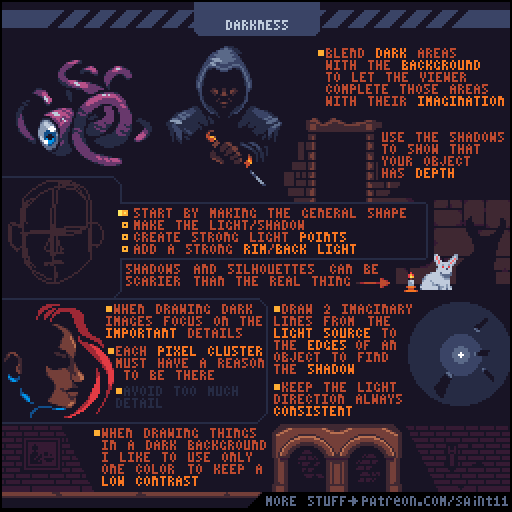
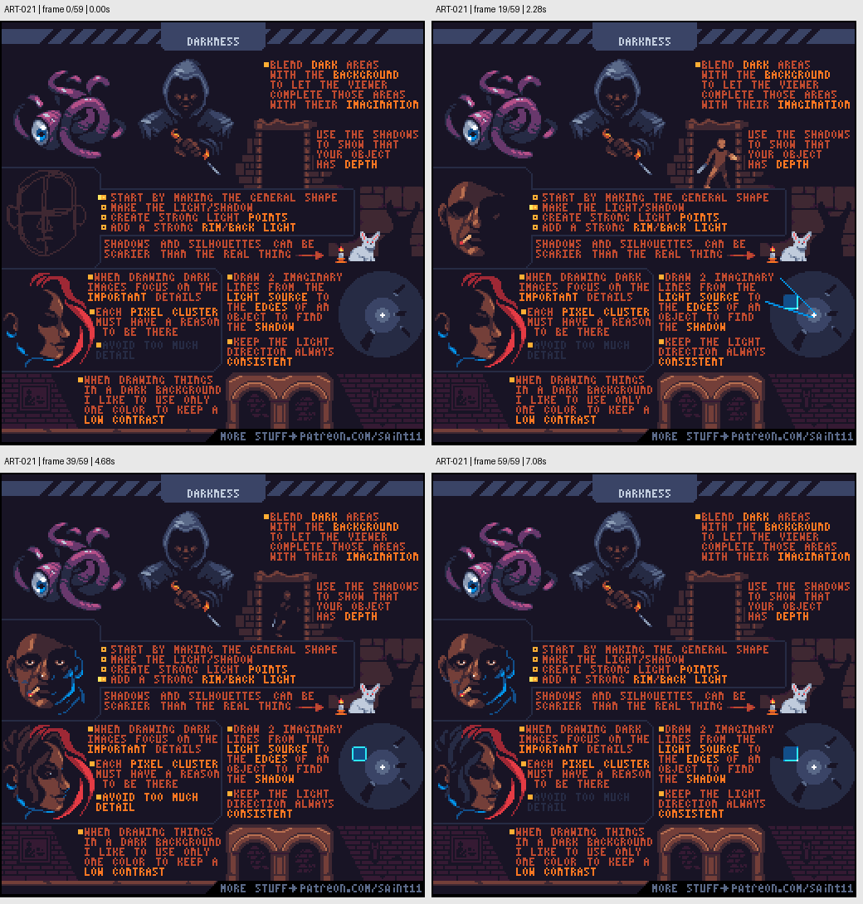

# ART-021 · 暗场景：保留信息、投影与有限亮点

让不重要暗面融入背景，保留少数有理由的亮点与轮廓，维持场景深度。

## 使用前先读

**适用层级：** 进阶。**前置：** ART-003、ART-005。

本篇依据原图中的主要说明和示例编写中文讲解，保留原始英文动态图；不是逐字全文OCR。原作者的经验性建议不自动等于所有项目的硬性规则。练习、验收与适用边界是整理者补充。

## 学习目标

- 用缺省信息制造暗部
- 让投影解释深度
- 限制暗场景中的细节和高光

## 原始图文教程

图1：Pedro Medeiros / Saint11 原始GIF，512×512，60帧，总时长7.20秒。原文件未改像素或重编码。部分阅读器只显示首帧，请结合下面的静态图和说明。

图2：整理者从原GIF按时间抽取的静态辅助图，阅读顺序为左上→右上→左下→右下。只选取四个时间点，并不代表完整动画或所有中间步骤；原始帧未缩放，标签加在图外。

## 图示读法

顶部怪物和披风角色用暗部融入背景；右侧门与墙上的影子说明空间深度；下方手、面具和建筑使用很少亮像素表达关键轮廓。

## 关键概念

暗部不必完整描出。原图鼓励把暗色与背景合并，让观者补全形体，同时用投影和少量亮点提供关键空间信息。

## 根据原图整理的步骤

1. 先画整体形状与大阴影，决定哪些部位可以消失在背景里，哪些是识别所必需。

2. 添加少数强亮点或背光，确保每个像素都承担形体、焦点或故事信息，避免暗处到处发亮。

3. 用投影显示门洞、墙壁或物体的深度；图中建议从光源向物体边缘想象连线，以判断阴影延伸。

4. 始终保持同一光向。需要悬念时，投影和剪影可以比露出完整对象更有效。

5. 背景物件采用低对比、甚至单色处理，限制细节，让前景的重要信息更容易被看到。

## 实作练习（整理者补充）

整理者练习：为一扇32×48农舍门制作白天与夜晚版本。夜晚只保留门缝暖光、门把和一段屋檐反光三个信息区；在深色背景中检查门仍能被找到。

## 验收清单（整理者补充）

- [ ] 暗部减少后仍能辨认主要对象
- [ ] 亮点数量受控且有理由
- [ ] 投影方向符合光源位置
- [ ] 背景不会比交互对象更抢眼

## 适用边界与常见误区（整理者补充）

游戏暗场景还需可玩性测试。气氛不能成为隐藏必要交互或降低辨识度的借口。

## 来源与授权

- 原作者：**Pedro Medeiros（Saint11）**。
- 原图：[固定版本的 Darkness.gif](https://github.com/saint11/Saint11Tutorials/blob/ce1393eb2c46441d917134a9fd52e15575ee10a7/Darkness.gif)；[原始文件](https://raw.githubusercontent.com/saint11/Saint11Tutorials/ce1393eb2c46441d917134a9fd52e15575ee10a7/Darkness.gif)。
- 作者教程入口：[Pixel Art Tutorials](https://saint11.art/blog/pixel-art-tutorials/)。
- 授权：[Creative Commons Attribution 4.0 International](https://creativecommons.org/licenses/by/4.0/)。
- 授权证据：[仓库README固定版本](https://github.com/saint11/Saint11Tutorials/blob/ce1393eb2c46441d917134a9fd52e15575ee10a7/README.md)；[本地证据副本](../../licenses/saint11-README.md)。
- 固定提交：`ce1393eb2c46441d917134a9fd52e15575ee10a7`。收集日期：`2026-10-29`。
- 原始GIF SHA-256：`a6d5bf291cd519c109c3aea327290d569164e36c5ebf3d43e612181d625d1ea1`。
- 变更声明：原始GIF字节保留；新增中文解释性转述、练习、验收和适用范围说明；另从GIF抽帧生成静态辅助图。新增中文整理和派生图按CC BY 4.0提供，继续署名原作者并说明这些改动。
- 使用边界：这份开放授权针对仓库中的教程图文；教程中出现的软件名称和商标仍属于其权利人。授权不表示原作者认可本中文整理。
