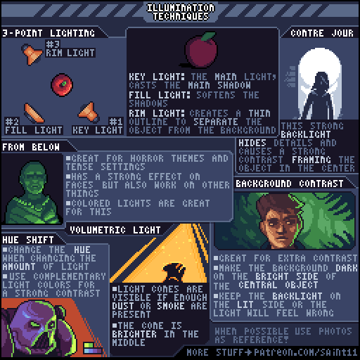
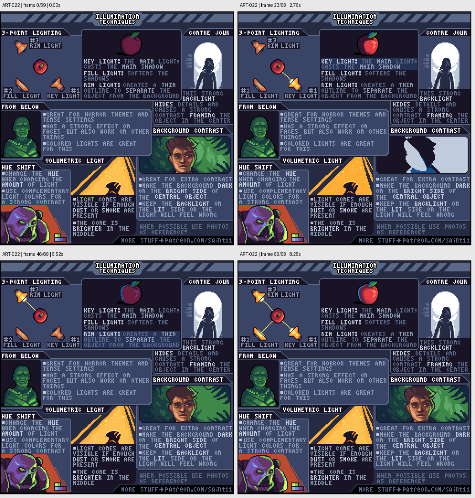

# ART-022 · 像素光照方案：主光、补光、轮廓光与逆光

为不同情绪选择清楚的照明结构，并通过背景对比强化主体。

## 使用前先读

**适用层级：** 进阶。**前置：** ART-003、ART-021。

本篇依据原图中的主要说明和示例编写中文讲解，保留原始英文动态图；不是逐字全文OCR。原作者的经验性建议不自动等于所有项目的硬性规则。练习、验收与适用边界是整理者补充。

## 学习目标

- 区分主光、补光和轮廓光
- 用背景反差分离主体
- 理解逆光、下照明和体积光的视觉作用

## 原始图文教程

图1：Pedro Medeiros / Saint11 原始GIF，512×512，70帧，总时长8.40秒。原文件未改像素或重编码。部分阅读器只显示首帧，请结合下面的静态图和说明。

图2：整理者从原GIF按时间抽取的静态辅助图，阅读顺序为左上→右上→左下→右下。只选取四个时间点，并不代表完整动画或所有中间步骤；原始帧未缩放，标签加在图外。

## 图示读法

左上以苹果与三盏灯解释三点照明；右上强背光制造剪影；左中绿色下照明改变面部感受；底部光束与背景反差示例解释环境参与照明。

## 关键概念

Key light决定主要阴影，fill light缓和阴影，rim light在边缘帮助主体与背景分开。多光源要有主次，不能把每个方向都照得一样亮。

## 根据原图整理的步骤

1. 先设置主光并明确主体的主要亮暗；再决定是否需要补光软化阴影，以及是否需要轮廓光分离背景。

2. 强逆光会隐藏内部细节和色彩，同时强化外形。图中的月亮与人物剪影展示这种做法。

3. 下方照明可制造紧张或不自然的气氛，用在脸上或物件上时都要检查体积是否仍然能读懂。

4. 运用背景对比：主体暗的一侧可对应较亮背景，亮的一侧对应较暗背景，增强分离而不必增加描线。

5. 光穿过足够烟尘时可显示束状体积光，图示中间较亮；不同光色也可通过色相变化表达。最好参考真实照片再做风格化简化。

## 实作练习（整理者补充）

整理者练习：用同一个32×32木雕头像做正面柔光、月光逆光、下方灯笼光三版。每版写明主光位置和要保留的识别特征；禁止通过修改轮廓补救光照问题。

## 验收清单（整理者补充）

- [ ] 主光与补光有明显强弱关系
- [ ] 轮廓光用于分离而非无处不在的描边
- [ ] 逆光版的剪影仍清楚
- [ ] 背景亮暗服务于主体阅读

## 适用边界与常见误区（整理者补充）

体积光需要烟尘等参与介质的视觉设定；不要在每个明亮区域都画不受场景条件影响的光柱。

## 来源与授权

- 原作者：**Pedro Medeiros（Saint11）**。
- 原图：[固定版本的 IlluminationTechniques.gif](https://github.com/saint11/Saint11Tutorials/blob/ce1393eb2c46441d917134a9fd52e15575ee10a7/IlluminationTechniques.gif)；[原始文件](https://raw.githubusercontent.com/saint11/Saint11Tutorials/ce1393eb2c46441d917134a9fd52e15575ee10a7/IlluminationTechniques.gif)。
- 作者教程入口：[Pixel Art Tutorials](https://saint11.art/blog/pixel-art-tutorials/)。
- 授权：[Creative Commons Attribution 4.0 International](https://creativecommons.org/licenses/by/4.0/)。
- 授权证据：[仓库README固定版本](https://github.com/saint11/Saint11Tutorials/blob/ce1393eb2c46441d917134a9fd52e15575ee10a7/README.md)；[本地证据副本](../../licenses/saint11-README.md)。
- 固定提交：`ce1393eb2c46441d917134a9fd52e15575ee10a7`。收集日期：`2026-10-29`。
- 原始GIF SHA-256：`863a7f0ffffaf7be2109eaaa06145c43ee35585b4da2e92a9f1769385ec1768c`。
- 变更声明：原始GIF字节保留；新增中文解释性转述、练习、验收和适用范围说明；另从GIF抽帧生成静态辅助图。新增中文整理和派生图按CC BY 4.0提供，继续署名原作者并说明这些改动。
- 使用边界：这份开放授权针对仓库中的教程图文；教程中出现的软件名称和商标仍属于其权利人。授权不表示原作者认可本中文整理。
