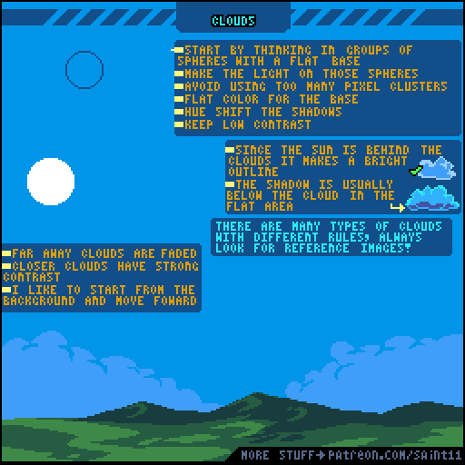
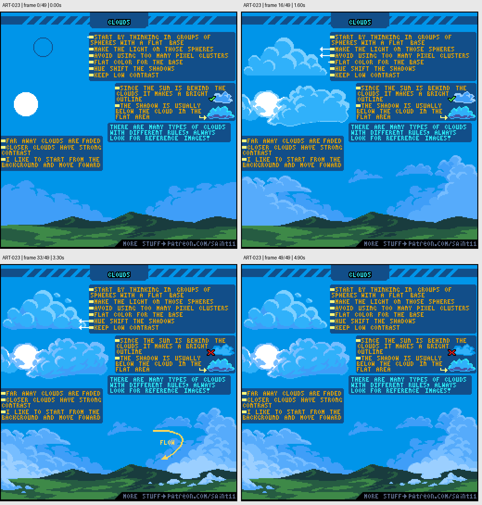

# ART-023 · 云朵：球团结构、逆光边缘与远近层次

把云视为带平底的球团组合，先安排大明暗和远近关系，再丰富轮廓。

## 使用前先读

**适用层级：** 入门。**前置：** ART-003。

本篇依据原图中的主要说明和示例编写中文讲解，保留原始英文动态图；不是逐字全文OCR。原作者的经验性建议不自动等于所有项目的硬性规则。练习、验收与适用边界是整理者补充。

## 学习目标

- 以大球团组织云形
- 保持云的低对比与有限色块
- 通过颜色和尺度安排前后层次

## 原始图文教程

图1：Pedro Medeiros / Saint11 原始GIF，512×512，50帧，总时长5.00秒。原文件未改像素或重编码。部分阅读器只显示首帧，请结合下面的静态图和说明。

图2：整理者从原GIF按时间抽取的静态辅助图，阅读顺序为左上→右上→左下→右下。只选取四个时间点，并不代表完整动画或所有中间步骤；原始帧未缩放，标签加在图外。

## 图示读法

上方动画从球形草图发展为一团云；右中有太阳在后时亮边的对错对比；下方场景从远云逐层向前展开，最后出现整体流动方向提示。

## 关键概念

原图的基本云形由球团和较平底部组成。它适合示例中的积云式外观；其他云型应查找不同参考，不能一概套用。

## 根据原图整理的步骤

1. 先组合几个大球状体，并明确较平的底部，而不是从一串小白边开始画。

2. 按这些球体安排光照，基础区域用较大平涂色块，限制碎小像素簇并保持较低对比。

3. 给阴影适当色相变化。示例中阴影通常集中在云底与背光区域。

4. 太阳位于云后时，使用沿相关边缘的亮轮廓；不要误把所有内部分块都加同样亮的边。

5. 先画远处淡云，再向前增加较近、对比更强的云。根据云型查看参考，并用整体走向组织天空。

## 实作练习（整理者补充）

整理者练习：画一张128×64天空背景，设置远、中、近三层云。每层先限制为两到三色，按同一太阳方向绘制；将前景角色放入预览，确保天空不抢主体。

## 验收清单（整理者补充）

- [ ] 云的形状来自大团而非小碎点
- [ ] 远云比近云低对比
- [ ] 太阳位置与亮边一致
- [ ] 背景云不会盖过主要游戏对象

## 适用边界与常见误区（整理者补充）

不能把所有云画成棉花球。教程也提醒不同云型有不同规则，需要参考实际云形。

## 来源与授权

- 原作者：**Pedro Medeiros（Saint11）**。
- 原图：[固定版本的 CLouds.gif](https://github.com/saint11/Saint11Tutorials/blob/ce1393eb2c46441d917134a9fd52e15575ee10a7/CLouds.gif)；[原始文件](https://raw.githubusercontent.com/saint11/Saint11Tutorials/ce1393eb2c46441d917134a9fd52e15575ee10a7/CLouds.gif)。
- 作者教程入口：[Pixel Art Tutorials](https://saint11.art/blog/pixel-art-tutorials/)。
- 授权：[Creative Commons Attribution 4.0 International](https://creativecommons.org/licenses/by/4.0/)。
- 授权证据：[仓库README固定版本](https://github.com/saint11/Saint11Tutorials/blob/ce1393eb2c46441d917134a9fd52e15575ee10a7/README.md)；[本地证据副本](../../licenses/saint11-README.md)。
- 固定提交：`ce1393eb2c46441d917134a9fd52e15575ee10a7`。收集日期：`2026-10-29`。
- 原始GIF SHA-256：`1076d0fa0db7fc0c48bd89b94622fbb991293f641d034d73143ee4374812ea94`。
- 变更声明：原始GIF字节保留；新增中文解释性转述、练习、验收和适用范围说明；另从GIF抽帧生成静态辅助图。新增中文整理和派生图按CC BY 4.0提供，继续署名原作者并说明这些改动。
- 使用边界：这份开放授权针对仓库中的教程图文；教程中出现的软件名称和商标仍属于其权利人。授权不表示原作者认可本中文整理。
