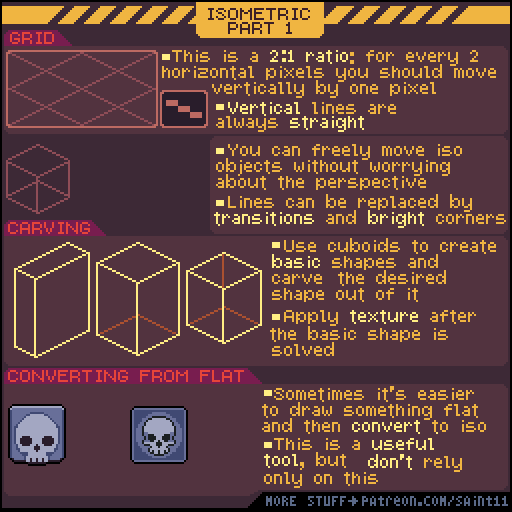
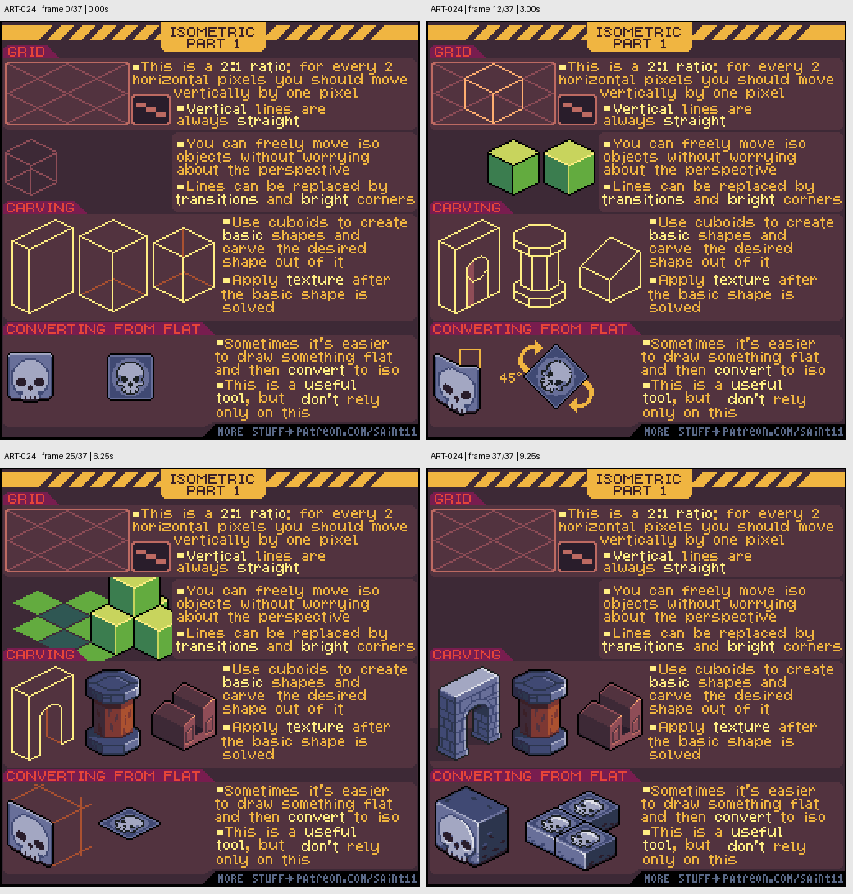

# ART-024 · 2:1像素等距风格网格与立体造型

用常见2:1像素斜线建立等距风格网格，通过切削盒体和明暗完成立体对象。

## 使用前先读

**适用层级：** 进阶。**前置：** ART-002、ART-003。

本篇依据原图中的主要说明和示例编写中文讲解，保留原始英文动态图；不是逐字全文OCR。原作者的经验性建议不自动等于所有项目的硬性规则。练习、验收与适用边界是整理者补充。

## 学习目标

- 遵循统一2:1像素步长
- 从立方体组合或切削出物体
- 避免把等距投影混入普通俯视资产

## 原始图文教程

图1：Pedro Medeiros / Saint11 原始GIF，512×512，38帧，总时长9.50秒。原文件未改像素或重编码。部分阅读器只显示首帧，请结合下面的静态图和说明。

图2：整理者从原GIF按时间抽取的静态辅助图，阅读顺序为左上→右上→左下→右下。只选取四个时间点，并不代表完整动画或所有中间步骤；原始帧未缩放，标签加在图外。

## 图示读法

上部网格与2:1阶梯说明像素步长；中部从长方体切掉一角形成新形体；下部骷髅平面图与转换后版本展示贴到斜面上的思路。

## 关键概念

教程称isometric，使用每水平2像素、垂直1像素的常见游戏等距风格。严格几何上，这种2:1画法通常属于二轴测风格，不等于所有轴完全等比例的真等距投影。

## 根据原图整理的步骤

1. 先建立2:1像素网格，斜向边每水平走2像素就升降1像素，竖直边保持竖直。

2. 用盒体确定物件占地与高度；在这种平行投影下，同类对象可平移而不改变透视尺寸。

3. 通过切削长方体得到目标轮廓，先解决形状与朝向，再进入纹理。

4. 用面之间的明暗过渡和较亮角边替代部分结构线，避免所有面都被黑色边框切开。

5. 必要时先把正面图案画平，再转换到等距面上并手工修整。原图提醒这是辅助方法，不能完全依赖自动转换。

## 实作练习（整理者补充）

整理者练习：制作等距风格的木箱、矮墙角和路牌各一件，统一2:1网格。用盒体线稿说明占地和高度；另存一个普通俯视示意，比较两种投影并在文件名中明确区分。

## 验收清单（整理者补充）

- [ ] 同方向斜边使用同一2:1步长
- [ ] 竖直边保持竖直
- [ ] 纹理在基础形体确认后才添加
- [ ] 资产元数据明确写出投影类型

## 适用边界与常见误区（整理者补充）

本课用于认识和制作另一套投影，不能把它的成品直接混入要求统一正面俯视的乡村资产库。

## 来源与授权

- 原作者：**Pedro Medeiros（Saint11）**。
- 原图：[固定版本的 Isometric.gif](https://github.com/saint11/Saint11Tutorials/blob/ce1393eb2c46441d917134a9fd52e15575ee10a7/Isometric.gif)；[原始文件](https://raw.githubusercontent.com/saint11/Saint11Tutorials/ce1393eb2c46441d917134a9fd52e15575ee10a7/Isometric.gif)。
- 作者教程入口：[Pixel Art Tutorials](https://saint11.art/blog/pixel-art-tutorials/)。
- 授权：[Creative Commons Attribution 4.0 International](https://creativecommons.org/licenses/by/4.0/)。
- 授权证据：[仓库README固定版本](https://github.com/saint11/Saint11Tutorials/blob/ce1393eb2c46441d917134a9fd52e15575ee10a7/README.md)；[本地证据副本](../../licenses/saint11-README.md)。
- 固定提交：`ce1393eb2c46441d917134a9fd52e15575ee10a7`。收集日期：`2026-10-29`。
- 原始GIF SHA-256：`197d5ba62996529abf9c42be117c0080480579978a955e8ab6be6a67dfd45861`。
- 变更声明：原始GIF字节保留；新增中文解释性转述、练习、验收和适用范围说明；另从GIF抽帧生成静态辅助图。新增中文整理和派生图按CC BY 4.0提供，继续署名原作者并说明这些改动。
- 使用边界：这份开放授权针对仓库中的教程图文；教程中出现的软件名称和商标仍属于其权利人。授权不表示原作者认可本中文整理。
