# 用节点与场景组织像素游戏

> 本文由 Godot 官方 4.5 版文档转换。下方中文导读、练习和验收是整理者的教学编排，英文正文是原教程主内容；不是官方中文逐句译文，也未声称已在引擎中执行全部练习。

## 适用任务

先理解节点树和可保存场景，再把角色、房屋、道具拆成可独立编辑的单位。

## 前提

- 能打开 Godot 4.5 编辑器

## 中文操作路线

1. 在新场景中添加根节点，观察场景树、检查器与二维视图各自负责什么。
2. 按原文建立带文字的最小场景，修改节点属性并观察视图中的变化。
3. 把场景保存成 .tscn；分别运行当前场景和整个项目，确认两者入口不同。
4. 把一个场景设为主场景；练习把角色显示节点和碰撞节点放在同一角色根节点之下。

## 图示怎么读

先沿英文正文的步骤阅读对应截图；截图来自同一版本页面，局部操作顺序以紧邻图片的文字为准。图片下载到本地，可离线打开并放大检查。截图中的示例美术用于说明引擎操作，不代表本库要求采用该画风。

## 动手练习

建立一个名为 Village 的场景，以及独立的 Signpost 场景。先用文本占位验证结构，再替换成你自己的像素素材。

## 验收清单

- [ ] 运行项目时进入指定主场景。
- [ ] 节点名称能反映职责，显示与交互子节点归在正确父节点下。
- [ ] 能解释节点是组成单位、场景是保存后的节点树。

## 版本与边界

本篇属于引擎基础，不会直接教绘画；像素素材的尺寸与锚点应在美术规范中另行固定。

本次来源固定为 Godot 4.5 文档分支，抓取日期为 2026-10-29；它不是“当前最新版本”的声明。升级引擎时应重新核对节点名、属性名和 API。

## 原教程正文（英文，Markdown 转换）

### Nodes and Scenes

In [Overview of Godot's key concepts](https://docs.godotengine.org/en/4.5/getting_started/introduction/key_concepts_overview.html#doc-key-concepts-overview), we saw that a Godot game is a tree of
scenes and that each scene is a tree of nodes. In this lesson, we explain a bit
more about them. You will also create your first scene.

#### Nodes

**Nodes are the fundamental building blocks of your game**. They are like the
ingredients in a recipe. There are dozens of kinds that can display an image,
play a sound, represent a camera, and much more.

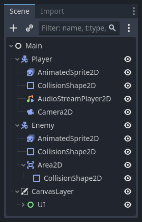

All nodes have the following characteristics:

- A name.
- Editable properties.
- They receive callbacks to update every frame.
- You can extend them with new properties and functions.
- You can add them to another node as a child.

The last characteristic is important. **Together, nodes form a tree**, which is a powerful
feature to organize projects. Since different nodes have different functions,
combining them produces more complex behavior. As we saw before, you can build a
playable character the camera follows using a [CharacterBody2D](https://docs.godotengine.org/en/4.5/classes/class_characterbody2d.html#class-characterbody2d)
node, a [Sprite2D](https://docs.godotengine.org/en/4.5/classes/class_sprite2d.html#class-sprite2d) node,
a [Camera2D](https://docs.godotengine.org/en/4.5/classes/class_camera2d.html#class-camera2d) node, and a [CollisionShape2D](https://docs.godotengine.org/en/4.5/classes/class_collisionshape2d.html#class-collisionshape2d) node.

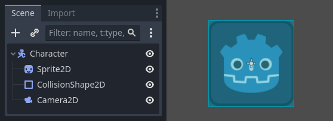

#### Scenes

When you organize nodes in a tree, like our character, we call this construct a
scene. Once saved, scenes work like new node types in the editor, where you can
add them as a child of an existing node. In that case, the instance of the scene
appears as a single node with its internals hidden.

Scenes allow you to structure your game's code however you want. You can
**compose nodes** to create custom and complex node types, like a game character
that runs and jumps, a life bar, a chest with which you can interact, and more.

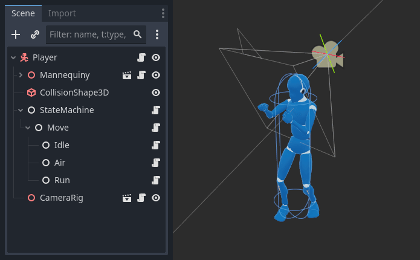

The Godot editor essentially is a **scene editor**. It has plenty of tools for
editing 2D and 3D scenes, as well as user interfaces. A Godot project can
contain as many of these scenes as you need. The engine only requires one as
your application's **main scene**. This is the scene Godot will first load when
you or a player runs the game.

On top of acting like nodes, scenes have the following characteristics:

1. They always have one root node, like the "Player" in our example.
2. You can save them to your local drive and load them later.
3. You can create as many instances of a scene as you'd like. You could have
   five or ten characters in your game, created from your Character scene.

#### Creating your first scene

Let's create our first scene with a single node. To do so, you will need to
[create a new project](https://docs.godotengine.org/en/4.5/tutorials/editor/project_manager.html#doc-creating-and-importing-projects) first. After
opening the project, you should see an empty editor.

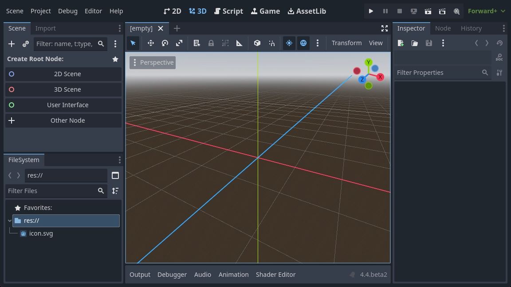

In an empty scene, the Scene dock on the left shows several options to add a
root node quickly. 2D Scene adds a [Node2D](https://docs.godotengine.org/en/4.5/classes/class_node2d.html#class-node2d) node,
3D Scene adds a [Node3D](https://docs.godotengine.org/en/4.5/classes/class_node3d.html#class-node3d) node,
and User Interface adds a [Control](https://docs.godotengine.org/en/4.5/classes/class_control.html#class-control) node.
These presets are here for convenience; they are not mandatory.
Other Node lets you select any node to be the root node.
In an empty scene, Other Node is equivalent to pressing the Add Child Node
button at the top-left of the Scene dock, which usually adds
a new node as a child of the currently selected node.

We're going to add a single [Label](https://docs.godotengine.org/en/4.5/classes/class_label.html#class-label) node to our scene. Its function is to draw
text on the screen.

Press the Add Child Node button or Other Node to create a
root node.

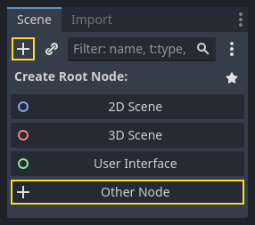

The Create New Node dialog opens, showing the long list of available nodes.

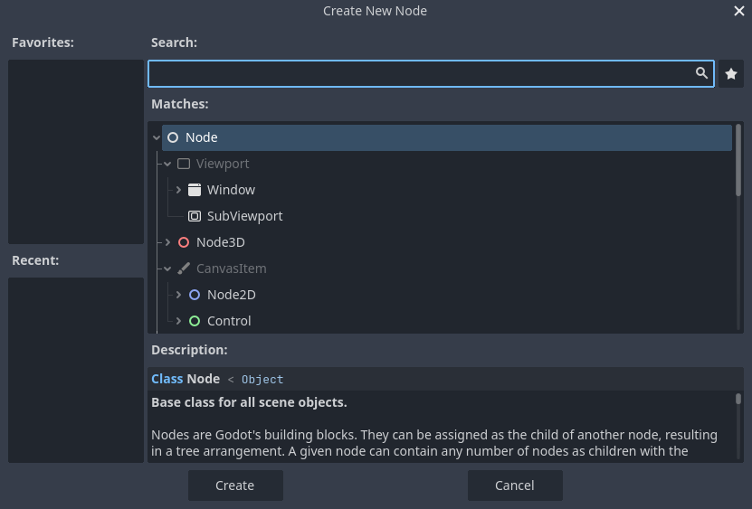

Select the Label node. You can type its name to filter down the list.

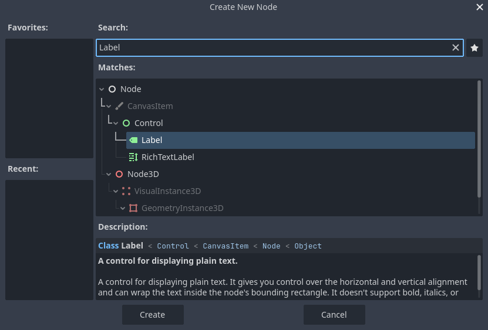

Click on the Label node to select it and click the Create button at
the bottom of the window.

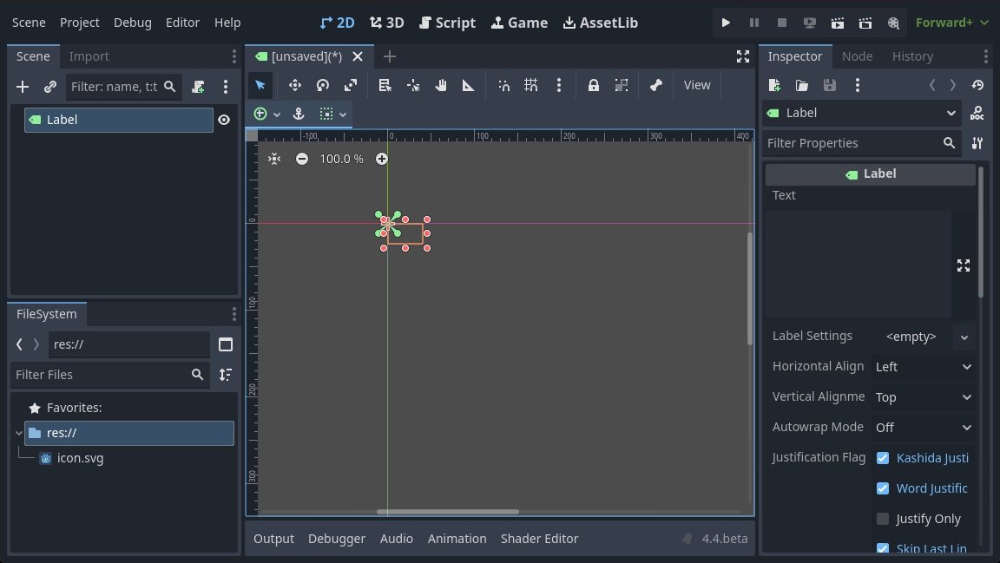

A lot happens when you add a scene's first node. The scene changes to the 2D
workspace because Label is a 2D node type. The Label appears, selected, in the
top-left corner of the viewport. The node appears in the Scene dock on the left,
and the node's properties appear in the Inspector dock on the right.

#### Changing a node's properties

The next step is to change the Label's Text property. Let's change
it to "Hello World".

Head to the Inspector dock on the right of the viewport. Click inside the field
below the Text property and type "Hello World".

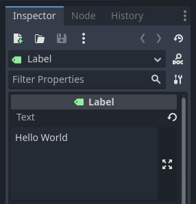

You will see the text draw in the viewport as you type.

See also

You can edit any property listed in the Inspector as we did with
the Text. For a complete reference of the Inspector dock, see
[Inspector Dock](https://docs.godotengine.org/en/4.5/tutorials/editor/inspector_dock.html#doc-editor-inspector-dock).

You can move your Label node in the viewport by selecting the move tool in the
toolbar.

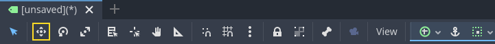

With the Label selected, click and drag anywhere in the viewport to
move it to the center of the view delimited by the rectangle.

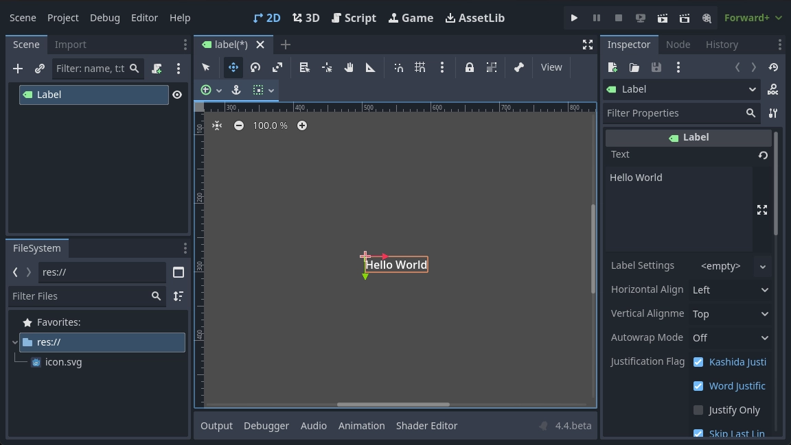

#### Running the scene

Everything's ready to run the scene! Press the Run Current Scene
button in the top-right of the screen or press `F6` (`Cmd + R` on
macOS).

A popup invites you to save the scene, which is required to run it. Click the
Save button in the file browser to save it as `label.tscn`.

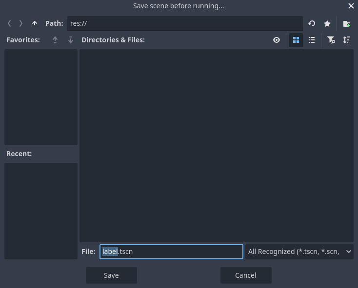

Note

The Save Scene As dialog, like other file dialogs in the editor, only
allows you to save files inside the project. The `res://` path at
the top of the window represents the project's root directory and
stands for "resource path". For more information about file paths in
Godot, see [File system](https://docs.godotengine.org/en/4.5/tutorials/scripting/filesystem.html#doc-filesystem).

The application should open in a new window and display the text "Hello World".

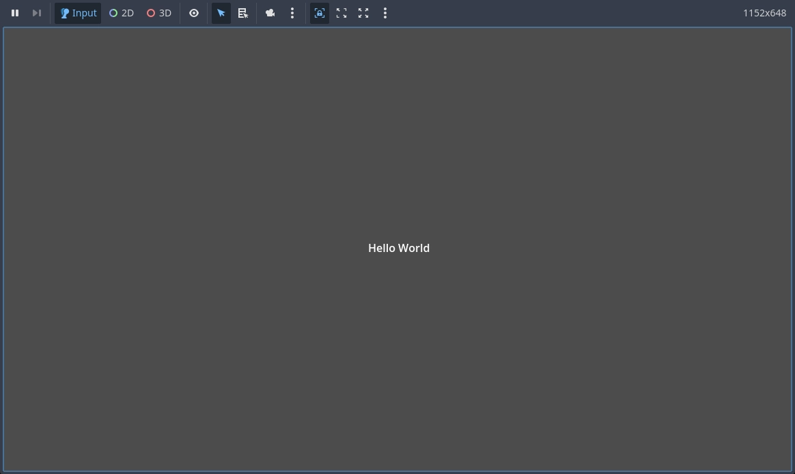

Close the window or press `F8` (`Cmd + .` on macOS) to quit the running scene.

#### Setting the main scene

To run our test scene, we used the Run Current Scene button. Another button
next to it, Run Project, allows you to set and run the project's
**main scene**. You can also press `F5` (`Cmd + B` on macOS) to do so.

Note

Running the project's *main scene* is distinct from running the
*current scene*. If you encounter unexpected behavior, check
to ensure you are running the correct scene.

A popup window appears and invites you to select the main scene.

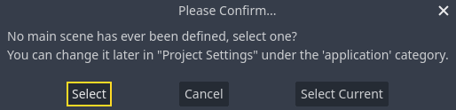

Click the Select button, and in the file dialog that appears, double
click on `label.tscn`.

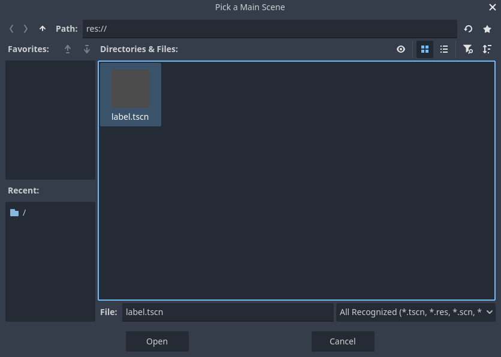

The demo should run again. Moving forward, every time you run the project, Godot
will use this scene as a starting point.

Note

The editor saves the main scene's path in a project.godot file in your
project's directory. While you can edit this text file directly to
change project settings, you can also use the Project > Project Settings
window to do so. For more information, see [Project Settings](https://docs.godotengine.org/en/4.5/tutorials/editor/project_settings.html#doc-project-settings).

In the next part, we will discuss another key concept in games and in Godot:
creating instances of a scene.

---

## 来源、配图与授权

- 原文：[Nodes and Scenes](https://docs.godotengine.org/en/4.5/getting_started/step_by_step/nodes_and_scenes.html)。
- 作者与署名：Juan Linietsky, Ariel Manzur and the Godot community。
- 文档许可：[CC BY 3.0](https://creativecommons.org/licenses/by/3.0/)；[官方仓库许可声明](https://github.com/godotengine/godot-docs/blob/4.5/README.md#license)。
- 许可全文：[godot-docs-4.5-LICENSE.txt](../../licenses/godot-docs-4.5-LICENSE.txt)。
- 本地原文主内容快照：[DEV-001.article.html](../../sources/game-development/DEV-001.article.html)。
- 变更：去除导航和用户评论入口，HTML 转 Markdown，图片改为相对路径，重复评级图标转成同义文字，新增中文导读、练习及验收。正文中的示例素材署名予以保留。
- 本整理稿的新增中文内容同样按 CC BY 3.0 提供，署名“Pixel Tutorial Library 整理者（Codex）”；不暗示原作者认可本整理稿。

| 本地图像 | 原图来源 | 图示语境 |
| --- | --- | --- |
| [nodes_and_scenes_nodes.webp](../../assets/game-development/DEV-001/nodes_and_scenes_nodes.webp) | [原图](https://docs.godotengine.org/en/4.5/_images/nodes_and_scenes_nodes.webp) | 原教程图示：Nodes — nodes_and_scenes_nodes.webp |
| [nodes_and_scenes_character_nodes.webp](../../assets/game-development/DEV-001/nodes_and_scenes_character_nodes.webp) | [原图](https://docs.godotengine.org/en/4.5/_images/nodes_and_scenes_character_nodes.webp) | 原教程图示：Nodes — nodes_and_scenes_character_nodes.webp |
| [nodes_and_scenes_3d_scene_example.webp](../../assets/game-development/DEV-001/nodes_and_scenes_3d_scene_example.webp) | [原图](https://docs.godotengine.org/en/4.5/_images/nodes_and_scenes_3d_scene_example.webp) | 原教程图示：Scenes — nodes_and_scenes_3d_scene_example.webp |
| [nodes_and_scenes_01_empty_editor.webp](../../assets/game-development/DEV-001/nodes_and_scenes_01_empty_editor.webp) | [原图](https://docs.godotengine.org/en/4.5/_images/nodes_and_scenes_01_empty_editor.webp) | 原教程图示：Creating your first scene — nodes_and_scenes_01_empty_editor.webp |
| [nodes_and_scenes_02_scene_dock.webp](../../assets/game-development/DEV-001/nodes_and_scenes_02_scene_dock.webp) | [原图](https://docs.godotengine.org/en/4.5/_images/nodes_and_scenes_02_scene_dock.webp) | 原教程图示：Creating your first scene — nodes_and_scenes_02_scene_dock.webp |
| [nodes_and_scenes_03_create_node_window.webp](../../assets/game-development/DEV-001/nodes_and_scenes_03_create_node_window.webp) | [原图](https://docs.godotengine.org/en/4.5/_images/nodes_and_scenes_03_create_node_window.webp) | 原教程图示：Creating your first scene — nodes_and_scenes_03_create_node_window.webp |
| [nodes_and_scenes_04_create_label_window.webp](../../assets/game-development/DEV-001/nodes_and_scenes_04_create_label_window.webp) | [原图](https://docs.godotengine.org/en/4.5/_images/nodes_and_scenes_04_create_label_window.webp) | 原教程图示：Creating your first scene — nodes_and_scenes_04_create_label_window.webp |
| [nodes_and_scenes_05_editor_with_label.webp](../../assets/game-development/DEV-001/nodes_and_scenes_05_editor_with_label.webp) | [原图](https://docs.godotengine.org/en/4.5/_images/nodes_and_scenes_05_editor_with_label.webp) | 原教程图示：Creating your first scene — nodes_and_scenes_05_editor_with_label.webp |
| [nodes_and_scenes_06_label_text.webp](../../assets/game-development/DEV-001/nodes_and_scenes_06_label_text.webp) | [原图](https://docs.godotengine.org/en/4.5/_images/nodes_and_scenes_06_label_text.webp) | 原教程图示：Changing a node's properties — nodes_and_scenes_06_label_text.webp |
| [nodes_and_scenes_07_move_tool.webp](../../assets/game-development/DEV-001/nodes_and_scenes_07_move_tool.webp) | [原图](https://docs.godotengine.org/en/4.5/_images/nodes_and_scenes_07_move_tool.webp) | 原教程图示：Changing a node's properties — nodes_and_scenes_07_move_tool.webp |
| [nodes_and_scenes_08_hello_world_text.webp](../../assets/game-development/DEV-001/nodes_and_scenes_08_hello_world_text.webp) | [原图](https://docs.godotengine.org/en/4.5/_images/nodes_and_scenes_08_hello_world_text.webp) | 原教程图示：Changing a node's properties — nodes_and_scenes_08_hello_world_text.webp |
| [nodes_and_scenes_09_play_scene_button.webp](../../assets/game-development/DEV-001/nodes_and_scenes_09_play_scene_button.webp) | [原图](https://docs.godotengine.org/en/4.5/_images/nodes_and_scenes_09_play_scene_button.webp) | 原教程图示：Running the scene — nodes_and_scenes_09_play_scene_button.webp |
| [nodes_and_scenes_10_save_scene_as.webp](../../assets/game-development/DEV-001/nodes_and_scenes_10_save_scene_as.webp) | [原图](https://docs.godotengine.org/en/4.5/_images/nodes_and_scenes_10_save_scene_as.webp) | 原教程图示：Running the scene — nodes_and_scenes_10_save_scene_as.webp |
| [nodes_and_scenes_11_final_result.webp](../../assets/game-development/DEV-001/nodes_and_scenes_11_final_result.webp) | [原图](https://docs.godotengine.org/en/4.5/_images/nodes_and_scenes_11_final_result.webp) | 原教程图示：Running the scene — nodes_and_scenes_11_final_result.webp |
| [nodes_and_scenes_12_play_button.webp](../../assets/game-development/DEV-001/nodes_and_scenes_12_play_button.webp) | [原图](https://docs.godotengine.org/en/4.5/_images/nodes_and_scenes_12_play_button.webp) | 原教程图示：Setting the main scene — nodes_and_scenes_12_play_button.webp |
| [nodes_and_scenes_13_main_scene_popup.webp](../../assets/game-development/DEV-001/nodes_and_scenes_13_main_scene_popup.webp) | [原图](https://docs.godotengine.org/en/4.5/_images/nodes_and_scenes_13_main_scene_popup.webp) | 原教程图示：Setting the main scene — nodes_and_scenes_13_main_scene_popup.webp |
| [nodes_and_scenes_14_select_main_scene.webp](../../assets/game-development/DEV-001/nodes_and_scenes_14_select_main_scene.webp) | [原图](https://docs.godotengine.org/en/4.5/_images/nodes_and_scenes_14_select_main_scene.webp) | 原教程图示：Setting the main scene — nodes_and_scenes_14_select_main_scene.webp |
