# 用场景实例复用树木、建筑和道具

> 本文由 Godot 官方 4.5 版文档转换。下方中文导读、练习和验收是整理者的教学编排，英文正文是原教程主内容；不是官方中文逐句译文，也未声称已在引擎中执行全部练习。

## 适用任务

掌握同一场景多个实例的共性与局部覆盖，避免复制节点后难以批量维护。

## 前提

- DEV-001

## 中文操作路线

1. 下载并打开原文的实例化练习项目，观察主场景如何引用独立的球场景。
2. 在主场景中放置多个同源实例，移动位置并运行检查。
3. 打开源场景修改共享属性，回到主场景观察所有实例的更新。
4. 对一个实例单独覆盖属性，再用恢复按钮取消覆盖；理解源场景值与实例值的区别。
5. 把同样方法用于树木或路灯：共用素材与交互结构，仅覆盖位置、颜色或交互参数。

## 图示怎么读

先沿英文正文的步骤阅读对应截图；截图来自同一版本页面，局部操作顺序以紧邻图片的文字为准。图片下载到本地，可离线打开并放大检查。截图中的示例美术用于说明引擎操作，不代表本库要求采用该画风。

## 动手练习

用一个 Tree.tscn 放置六棵树，统一修改树冠图层，再只改变其中一棵树的交互半径。

## 验收清单

- [ ] 源场景变化能传播到未覆盖该属性的实例。
- [ ] 局部覆盖不影响其他实例。
- [ ] 重复物件没有被维护成六份互不关联的节点树。

## 版本与边界

原文用物理小球演示复用；树木案例是整理者的迁移练习，并非原教程原图。

本次来源固定为 Godot 4.5 文档分支，抓取日期为 2026-10-29；它不是“当前最新版本”的声明。升级引擎时应重新核对节点名、属性名和 API。

## 原教程正文（英文，Markdown 转换）

### Creating instances

Note

This tutorial refers to instancing scenes in the editor. To learn how
to instance scenes from code, see [Nodes and scene instances](https://docs.godotengine.org/en/4.5/tutorials/scripting/nodes_and_scene_instances.html#doc-nodes-and-scene-instances).

Godot's approach to *instancing* described below should not be confused with
hardware instancing that can be used to render large amounts of similar
objects quickly. See [Optimization using MultiMeshes](https://docs.godotengine.org/en/4.5/tutorials/performance/using_multimesh.html#doc-using-multimesh) instead.

In the previous part, we saw that a scene is a collection of nodes organized in
a tree structure, with a single node as its root. You can split your project
into any number of scenes. This feature helps you break down and organize your
game's different components.

You can create as many scenes as you'd like and save them as files with the
`.tscn` extension, which stands for "text scene". The `label.tscn` file from
the previous lesson was an example. We call those files "Packed Scenes" as they
pack information about your scene's content.

Here's an example of a ball. It's composed of a [RigidBody2D](https://docs.godotengine.org/en/4.5/classes/class_rigidbody2d.html#class-rigidbody2d) node as its root named Ball, which allows the ball to fall
and bounce on walls, a [Sprite2D](https://docs.godotengine.org/en/4.5/classes/class_sprite2d.html#class-sprite2d) node, and a
[CollisionShape2D](https://docs.godotengine.org/en/4.5/classes/class_collisionshape2d.html#class-collisionshape2d).

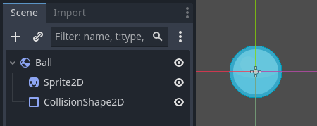

Once you have saved a scene, it works as a blueprint: you can reproduce it in other
scenes as many times as you'd like. Replicating an object from a template like
this is called **instancing**.

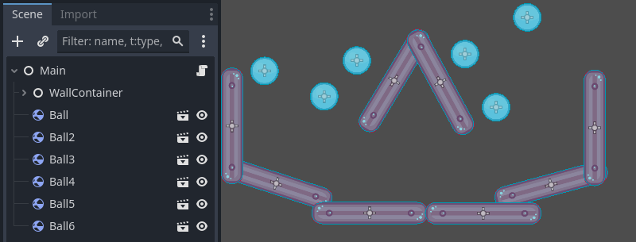

As we mentioned in the previous part, instanced scenes behave like a node: the
editor hides their content by default. When you instance the Ball, you only see
the Ball node. Notice also how each duplicate has a unique name.

Every instance of the Ball scene starts with the same structure and properties
as `ball.tscn`. However, you can modify each independently, such as changing
how they bounce, how heavy they are, or any property exposed by the source
scene.

#### In practice

Let's use instancing in practice to see how it works in Godot. We invite
you to download the ball's sample project we prepared for you:
[instancing_starter.zip](https://github.com/godotengine/godot-docs-project-starters/releases/download/latest-4.x/instancing_starter.zip).

Extract the archive on your computer. To import it, you need the Project Manager.
The Project Manager is accessed by opening Godot, or if you already have Godot
opened, click on Project > Quit to Project List (`Ctrl + Shift + Q`, `Ctrl + Option + Cmd + Q` on macOS)

In the Project Manager, click the Import button to import the project.

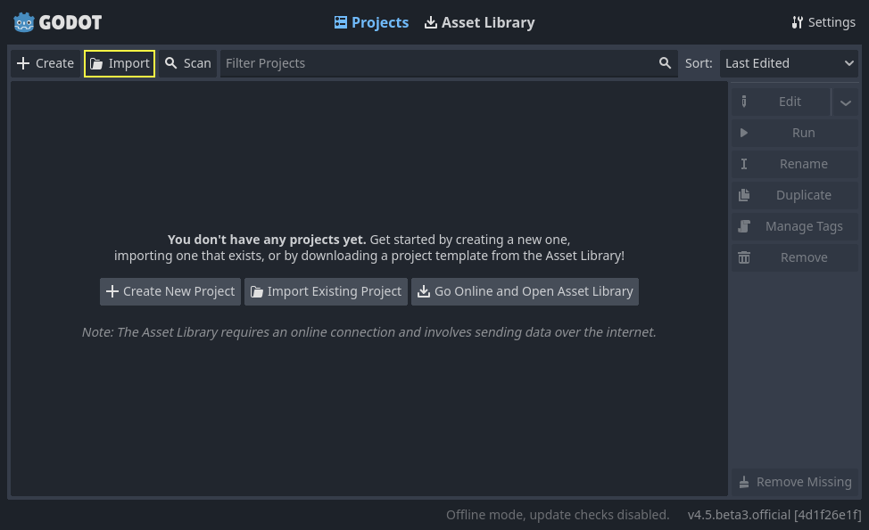

In the pop-up that appears navigate to the folder you extracted.
Double-click the `project.godot` file to open it.

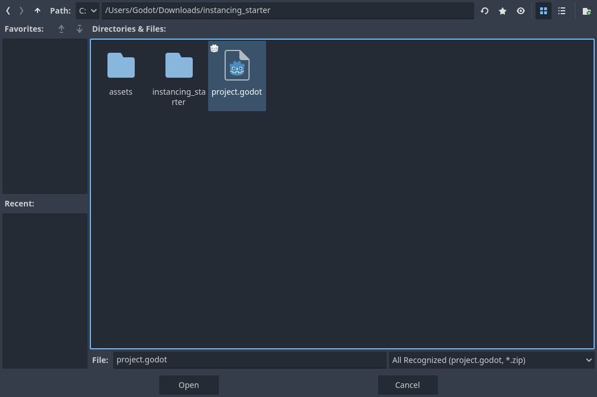

Finally, click the Import button.

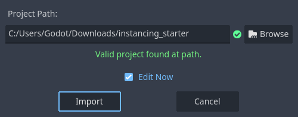

A window notifying you that the project was last opened in an older Godot version
may appear, that's not an issue. Click Ok to open the project.

The project contains two packed scenes: `main.tscn`, containing walls against
which the ball collides, and `ball.tscn`. The Main scene should open
automatically. If you're seeing an empty 3D scene instead of the main scene, click the 2D button at the top of the screen.

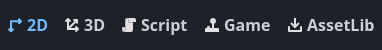
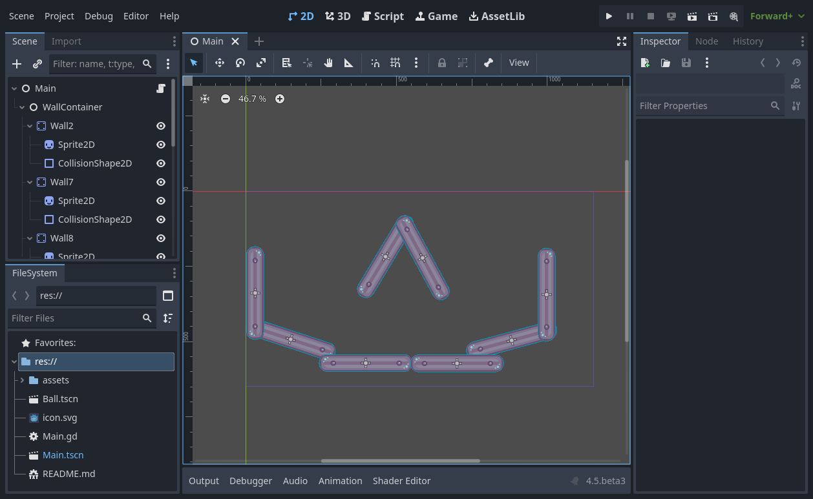

Let's add a ball as a child of the Main node. In the Scene dock, select the Main
node. Then, click the link icon at the top of the scene dock. This button allows
you to add an instance of a scene as a child of the currently selected node.

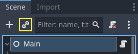

Double-click the ball scene to instance it.

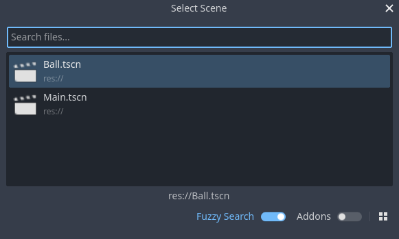

The ball appears in the top-left corner of the viewport.

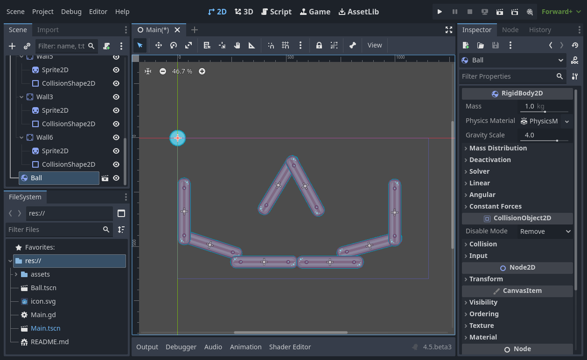

Click on it and drag it towards the center of the view.

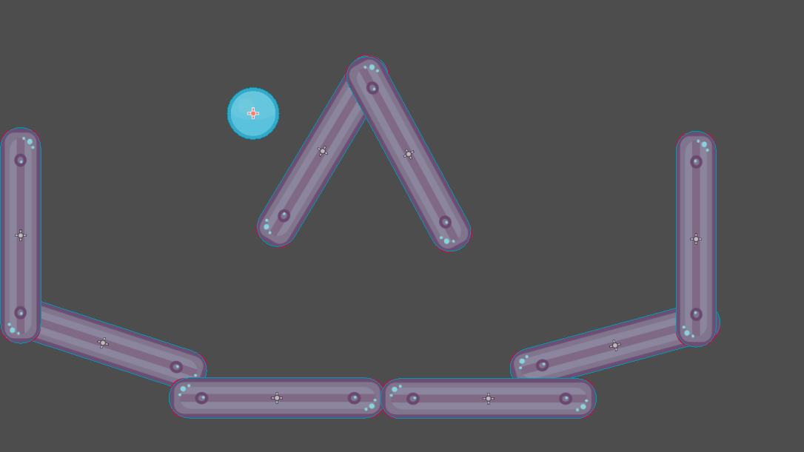

Play the game by pressing `F5` (`Cmd + B` on macOS). You should see it fall.

Now, we want to create more instances of the Ball node. With the ball still
selected, press `Ctrl + D` (`Cmd + D` on macOS) to call the duplicate
command. Click and drag to move the new ball to a different location.

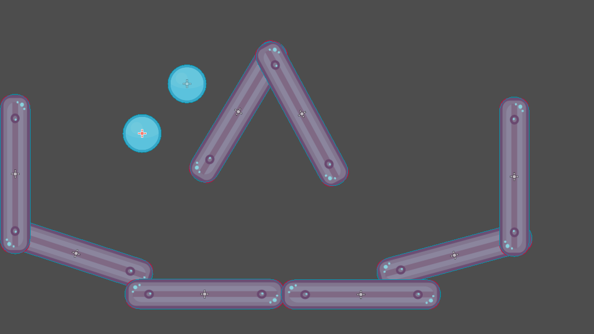

You can repeat this process until you have several in the scene.

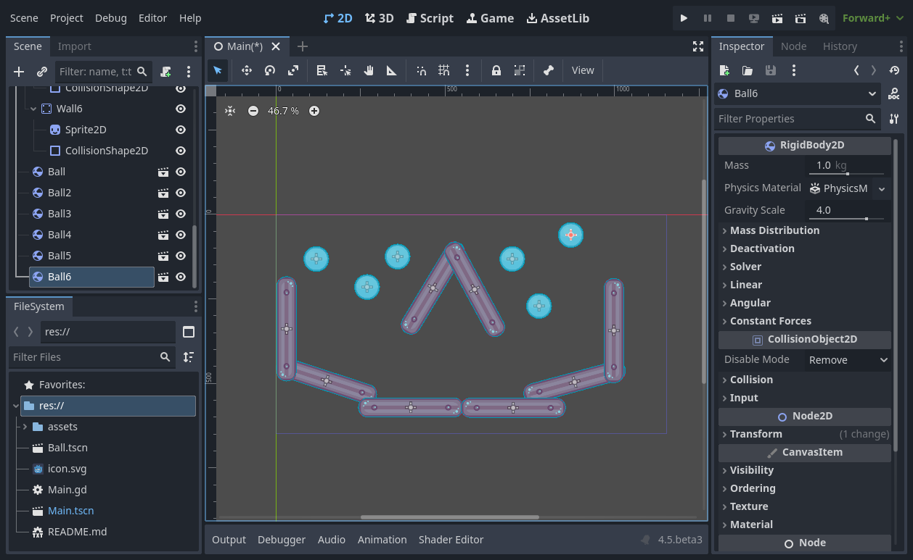

Play the game again. You should now see every ball fall independently from one
another. This is what instances do. Each is an independent reproduction of a
template scene.

#### Editing scenes and instances

There is more to instances. With this feature, you can:

1. Change the properties of one ball without affecting the others using the
   Inspector.
2. Change the default properties of every Ball by opening the `ball.tscn` scene
   and making a change to the Ball node there. Upon saving, all instances of the
   Ball in the project will see their values update.

Note

Changing a property on an instance always overrides values from the
corresponding packed scene.

Let's try this. Double-click `ball.tscn` in the FileSystem to open it.

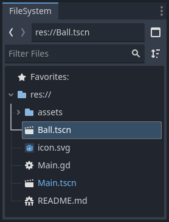

In the Scene dock on the left, select the Ball node. Then, in the Inspector on the
right, click on the PhysicsMaterial property to expand it.

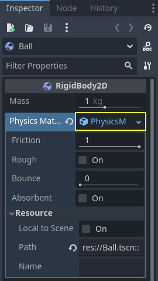

Set its Bounce property to `0.5` by clicking on the number field, typing `0.5`,
and pressing `Enter`.

Play the game by pressing `F5` (`Cmd + B` on macOS) and notice how all balls now bounce a lot
more. As the Ball scene is a template for all instances, modifying it and saving
causes all instances to update accordingly.

Let's now adjust an individual instance. Head back to the Main scene by clicking
on the corresponding tab above the viewport.

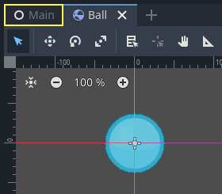

Select one of the instanced Ball nodes and, in the Inspector, set its
Gravity Scale value to `10`.

A grey "revert" button appears next to the adjusted property.

This icon indicates you are overriding a value from the source packed scene.
Even if you modify the property in the original scene, the value override will
be preserved in the instance. Clicking the revert icon will restore the
property to the value in the saved scene.

Rerun the game and notice how this ball now falls much faster than the others.

Note

You may notice you are unable to change the values of the PhysicsMaterial
of the ball. This is because PhysicsMaterial is a *resource*, and needs
to be made unique before you can edit it in a scene that is linking to its
original scene. To make a resource unique for one instance, right-click on
the Physics Material property in the Inspector and click Make Unique
in the context menu.

Resources are another essential building block of Godot games we will cover
in a later lesson.

#### Scene instances as a design language

Instances and scenes in Godot offer an excellent design language, setting the
engine apart from others out there. We designed Godot around this concept from
the ground up.

We recommend dismissing architectural code patterns when making games with
Godot, such as Model-View-Controller (MVC) or Entity-Relationship diagrams.
Instead, you can start by imagining the elements players will see in your game
and structure your code around them.

For example, you could break down a shooter game like so:

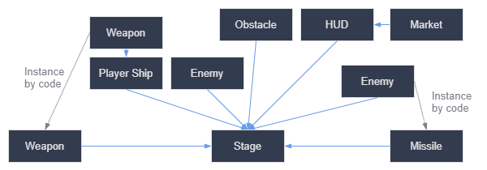

You can come up with a diagram like this for almost any type of game. Each
rectangle represents an entity that's visible in the game from the player's
perspective. The arrows point towards the instantiator of each scene.

Once you have a diagram, we recommend creating a scene for each element listed
in it to develop your game. You'll use instancing, either by code or directly in
the editor, to build your tree of scenes.

Programmers tend to spend a lot of time designing abstract architectures and
trying to fit components into it. Designing based on scenes makes development
faster and more straightforward, allowing you to focus on the game logic itself.
Because most game components map directly to a scene, using a design based on
scene instantiation means you need little other architectural code.

Here's the example of a scene diagram for an open-world game with tons of assets
and nested elements:

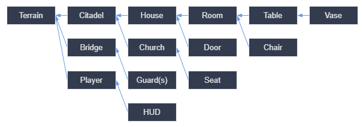

Imagine we started by creating the room. We could make a couple of different
room scenes, with unique arrangements of furniture in them. Later, we could make
a house scene that uses multiple room instances for the interior. We would
create a citadel out of many instanced houses and a large terrain on which we
would place the citadel. Each of these would be a scene instancing one or more sub-scenes.

Later, we could create scenes representing guards and add them to the citadel.
They would be indirectly added to the overall game world.

With Godot, it's easy to iterate on your game like this, as all you need to do
is create and instantiate more scenes. We designed the editor to be accessible
to programmers, designers, and artists alike. A typical team development process
can involve 2D or 3D artists, level designers, game designers, and animators,
all working with the Godot editor.

#### Summary

Instancing, the process of producing an object from a blueprint, has many handy
uses. With scenes, it gives you:

- The ability to divide your game into reusable components.
- A tool to structure and encapsulate complex systems.
- A language to think about your game project's structure in a natural way.

---

## 来源、配图与授权

- 原文：[Creating instances](https://docs.godotengine.org/en/4.5/getting_started/step_by_step/instancing.html)。
- 作者与署名：Juan Linietsky, Ariel Manzur and the Godot community。
- 文档许可：[CC BY 3.0](https://creativecommons.org/licenses/by/3.0/)；[官方仓库许可声明](https://github.com/godotengine/godot-docs/blob/4.5/README.md#license)。
- 许可全文：[godot-docs-4.5-LICENSE.txt](../../licenses/godot-docs-4.5-LICENSE.txt)。
- 本地原文主内容快照：[DEV-002.article.html](../../sources/game-development/DEV-002.article.html)。
- 变更：去除导航和用户评论入口，HTML 转 Markdown，图片改为相对路径，重复评级图标转成同义文字，新增中文导读、练习及验收。正文中的示例素材署名予以保留。
- 本整理稿的新增中文内容同样按 CC BY 3.0 提供，署名“Pixel Tutorial Library 整理者（Codex）”；不暗示原作者认可本整理稿。

| 本地图像 | 原图来源 | 图示语境 |
| --- | --- | --- |
| [instancing_ball_scene.webp](../../assets/game-development/DEV-002/instancing_ball_scene.webp) | [原图](https://docs.godotengine.org/en/4.5/_images/instancing_ball_scene.webp) | 原教程图示：Creating instances — instancing_ball_scene.webp |
| [instancing_ball_instances_example.webp](../../assets/game-development/DEV-002/instancing_ball_instances_example.webp) | [原图](https://docs.godotengine.org/en/4.5/_images/instancing_ball_instances_example.webp) | 原教程图示：Creating instances — instancing_ball_instances_example.webp |
| [instancing_import_button.webp](../../assets/game-development/DEV-002/instancing_import_button.webp) | [原图](https://docs.godotengine.org/en/4.5/_images/instancing_import_button.webp) | 原教程图示：In practice — instancing_import_button.webp |
| [instancing_import_project_file.webp](../../assets/game-development/DEV-002/instancing_import_project_file.webp) | [原图](https://docs.godotengine.org/en/4.5/_images/instancing_import_project_file.webp) | 原教程图示：In practice — instancing_import_project_file.webp |
| [instancing_import_and_edit_button.webp](../../assets/game-development/DEV-002/instancing_import_and_edit_button.webp) | [原图](https://docs.godotengine.org/en/4.5/_images/instancing_import_and_edit_button.webp) | 原教程图示：In practice — instancing_import_and_edit_button.webp |
| [instancing_2d_scene_select.webp](../../assets/game-development/DEV-002/instancing_2d_scene_select.webp) | [原图](https://docs.godotengine.org/en/4.5/_images/instancing_2d_scene_select.webp) | 原教程图示：In practice — instancing_2d_scene_select.webp |
| [instancing_main_scene.webp](../../assets/game-development/DEV-002/instancing_main_scene.webp) | [原图](https://docs.godotengine.org/en/4.5/_images/instancing_main_scene.webp) | 原教程图示：In practice — instancing_main_scene.webp |
| [instancing_scene_link_button.webp](../../assets/game-development/DEV-002/instancing_scene_link_button.webp) | [原图](https://docs.godotengine.org/en/4.5/_images/instancing_scene_link_button.webp) | 原教程图示：In practice — instancing_scene_link_button.webp |
| [instancing_instance_child_window.webp](../../assets/game-development/DEV-002/instancing_instance_child_window.webp) | [原图](https://docs.godotengine.org/en/4.5/_images/instancing_instance_child_window.webp) | 原教程图示：In practice — instancing_instance_child_window.webp |
| [instancing_ball_instanced.webp](../../assets/game-development/DEV-002/instancing_ball_instanced.webp) | [原图](https://docs.godotengine.org/en/4.5/_images/instancing_ball_instanced.webp) | 原教程图示：In practice — instancing_ball_instanced.webp |
| [instancing_ball_moved.webp](../../assets/game-development/DEV-002/instancing_ball_moved.webp) | [原图](https://docs.godotengine.org/en/4.5/_images/instancing_ball_moved.webp) | 原教程图示：In practice — instancing_ball_moved.webp |
| [instancing_ball_duplicated.webp](../../assets/game-development/DEV-002/instancing_ball_duplicated.webp) | [原图](https://docs.godotengine.org/en/4.5/_images/instancing_ball_duplicated.webp) | 原教程图示：In practice — instancing_ball_duplicated.webp |
| [instancing_main_scene_with_balls.webp](../../assets/game-development/DEV-002/instancing_main_scene_with_balls.webp) | [原图](https://docs.godotengine.org/en/4.5/_images/instancing_main_scene_with_balls.webp) | 原教程图示：In practice — instancing_main_scene_with_balls.webp |
| [instancing_ball_scene_open.webp](../../assets/game-development/DEV-002/instancing_ball_scene_open.webp) | [原图](https://docs.godotengine.org/en/4.5/_images/instancing_ball_scene_open.webp) | 原教程图示：Editing scenes and instances — instancing_ball_scene_open.webp |
| [instancing_physics_material_expand.webp](../../assets/game-development/DEV-002/instancing_physics_material_expand.webp) | [原图](https://docs.godotengine.org/en/4.5/_images/instancing_physics_material_expand.webp) | 原教程图示：Editing scenes and instances — instancing_physics_material_expand.webp |
| [instancing_property_bounce_updated.webp](../../assets/game-development/DEV-002/instancing_property_bounce_updated.webp) | [原图](https://docs.godotengine.org/en/4.5/_images/instancing_property_bounce_updated.webp) | 原教程图示：Editing scenes and instances — instancing_property_bounce_updated.webp |
| [instancing_scene_tabs.webp](../../assets/game-development/DEV-002/instancing_scene_tabs.webp) | [原图](https://docs.godotengine.org/en/4.5/_images/instancing_scene_tabs.webp) | 原教程图示：Editing scenes and instances — instancing_scene_tabs.webp |
| [instancing_property_gravity_scale.png](../../assets/game-development/DEV-002/instancing_property_gravity_scale.png) | [原图](https://docs.godotengine.org/en/4.5/_images/instancing_property_gravity_scale.png) | 原教程图示：Editing scenes and instances — instancing_property_gravity_scale.png |
| [instancing_property_revert_icon.png](../../assets/game-development/DEV-002/instancing_property_revert_icon.png) | [原图](https://docs.godotengine.org/en/4.5/_images/instancing_property_revert_icon.png) | 原教程图示：Editing scenes and instances — instancing_property_revert_icon.png |
| [instancing_diagram_shooter.png](../../assets/game-development/DEV-002/instancing_diagram_shooter.png) | [原图](https://docs.godotengine.org/en/4.5/_images/instancing_diagram_shooter.png) | 原教程图示：Scene instances as a design language — instancing_diagram_shooter.png |
| [instancing_diagram_open_world.png](../../assets/game-development/DEV-002/instancing_diagram_open_world.png) | [原图](https://docs.godotengine.org/en/4.5/_images/instancing_diagram_open_world.png) | 原教程图示：Scene instances as a design language — instancing_diagram_open_world.png |
