# 用信号连接按钮、计时器与游戏事件

> 本文由 Godot 官方 4.5 版文档转换。下方中文导读、练习和验收是整理者的教学编排，英文正文是原教程主内容；不是官方中文逐句译文，也未声称已在引擎中执行全部练习。

## 适用任务

学习编辑器连线和代码连接两种信号方式，让按钮、计时器和自定义事件触发逻辑。

## 前提

- DEV-001
- 基础 GDScript

## 中文操作路线

1. 按原文搭建按钮与移动图像的场景，选中按钮并打开信号面板。
2. 把 pressed 信号连接到接收节点的方法，在回调中切换运动。
3. 添加 Timer 并以代码连接 timeout，比较信号声明、连接和响应的不同职责。
4. 阅读完整脚本后创建自定义信号，把事件的必要数据作为参数传递。
5. 迁移到俯视场景时，让宝箱发出 opened 或 collected 信号，由关卡或背包系统接收。

## 图示怎么读

先沿英文正文的步骤阅读对应截图；截图来自同一版本页面，局部操作顺序以紧邻图片的文字为准。图片下载到本地，可离线打开并放大检查。截图中的示例美术用于说明引擎操作，不代表本库要求采用该画风。

## 动手练习

建立一个可点击的宝箱占位场景，第一次开启时发出包含道具名称的信号；第二次点击不重复发放。

## 验收清单

- [ ] 事件发出一次时接收函数只执行一次。
- [ ] 信号参数与接收函数一致。
- [ ] 宝箱场景不依赖某个固定 HUD 节点路径。

## 版本与边界

opened 等命名是整理者练习设计；官方原文以按钮和计时器示范。

本次来源固定为 Godot 4.5 文档分支，抓取日期为 2026-10-29；它不是“当前最新版本”的声明。升级引擎时应重新核对节点名、属性名和 API。

## 原教程正文（英文，Markdown 转换）

### Using signals

In this lesson, we will look at signals. They are messages that nodes emit when
something specific happens to them, like a button being pressed. Other nodes can
connect to that signal and call a function when the event occurs.

Signals are a delegation mechanism built into Godot that allows one game object to
react to a change in another without them referencing one another. Using signals
limits [coupling](https://en.wikipedia.org/wiki/Coupling_(computer_programming)) and keeps your
code flexible.

For example, you might have a life bar on the screen that represents the
player's health. When the player takes damage or uses a healing potion, you want
the bar to reflect the change. To do so, in Godot, you would use signals.

Like methods ([Callable](https://docs.godotengine.org/en/4.5/classes/class_callable.html#class-callable)), signals are a first-class type since Godot
4.0. This means you can pass them around as method arguments directly without
having to pass them as strings, which allows for better autocompletion and is
less error-prone. See the [Signal](https://docs.godotengine.org/en/4.5/classes/class_signal.html#class-signal) class reference for a list of
what you can do with the Signal type directly.

See also

As mentioned in the introduction, signals are Godot's version of the
observer pattern. You can learn more about it in
[Game Programming Patterns](https://gameprogrammingpatterns.com/observer.html).

We will now use a signal to make our Godot icon from the previous lesson
([Listening to player input](https://docs.godotengine.org/en/4.5/getting_started/step_by_step/scripting_player_input.html#doc-scripting-player-input)) move and stop by pressing a button.

Note

For this project, we will be following the Godot naming conventions.

- **GDScript**: Classes (nodes) use PascalCase, variables and
  functions use snake_case, and constants use ALL_CAPS (See
  [GDScript style guide](https://docs.godotengine.org/en/4.5/tutorials/scripting/gdscript/gdscript_styleguide.html#doc-gdscript-styleguide)).
- **C#**: Classes, export variables and methods use PascalCase,
  private fields use _camelCase, local variables and parameters use
  camelCase (See [C# style guide](https://docs.godotengine.org/en/4.5/tutorials/scripting/c_sharp/c_sharp_style_guide.html#doc-c-sharp-styleguide)). Be careful to type
  the method names precisely when connecting signals.

#### Scene setup

To add a button to our game, we will create a new scene which will include
both a [Button](https://docs.godotengine.org/en/4.5/classes/class_button.html#class-button) and the `sprite_2d.tscn` scene we created in
the [Creating your first script](https://docs.godotengine.org/en/4.5/getting_started/step_by_step/scripting_first_script.html#doc-scripting-first-script) lesson.

Create a new scene by going to the menu Scene > New Scene.

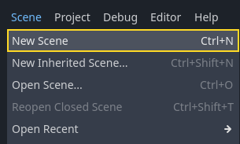

In the Scene dock, click the 2D Scene button. This will add
a [Node2D](https://docs.godotengine.org/en/4.5/classes/class_node2d.html#class-node2d) as our root.

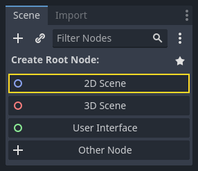

In the FileSystem dock, click and drag the `sprite_2d.tscn` file you saved
previously onto the Node2D to instantiate it.

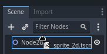

We want to add another node as a sibling of the Sprite2D. To do so, right-click
on Node2D and select Add Child Node.

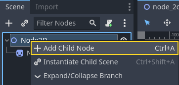

Search for the [Button](https://docs.godotengine.org/en/4.5/classes/class_button.html#class-button) node and add it.

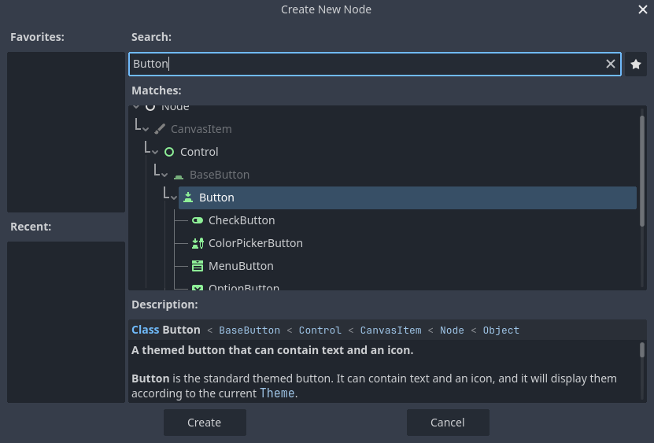

The node is small by default. Click and drag on the bottom-right handle of the
Button in the viewport to resize it.

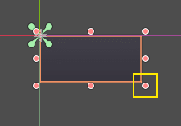

If you don't see the handles, ensure the select tool is active in the toolbar.

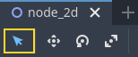

Click and drag on the button itself to move it closer to the sprite.

You can also write a label on the Button by editing its Text property
in the Inspector. Enter `Toggle motion`.

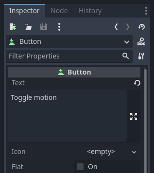

Your scene tree and viewport should look like this.

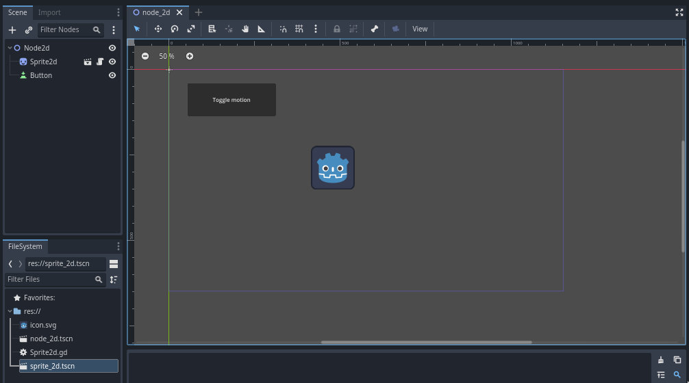

Save your newly created scene as `node_2d.tscn`, if you haven't already.
You can then run it with `F6` (`Cmd + R` on macOS).
At the moment, the button will be visible, but nothing will happen if you
press it.

#### Connecting a signal in the editor

Here, we want to connect the Button's "pressed" signal to our Sprite2D, and we
want to call a new function that will toggle its motion on and off. We need to
have a script attached to the Sprite2D node, which we do from the previous
lesson.

You can connect signals in the Node dock. Select the Button node and, on the
right side of the editor, click on the tab named Node next to the
Inspector.

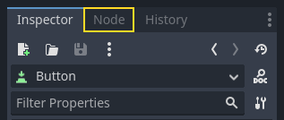

The dock displays a list of signals available on the selected node.

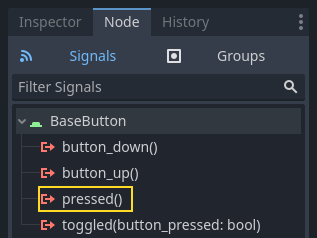

Double-click the "pressed" signal to open the node connection window.

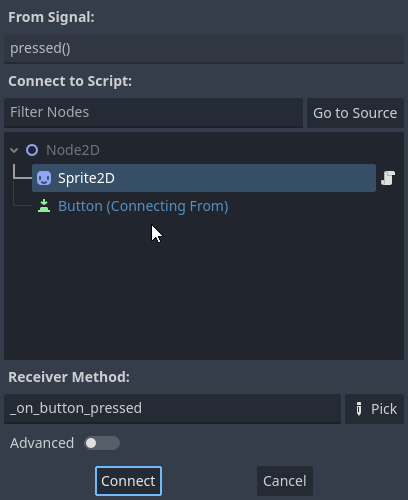

There, you can connect the signal to the Sprite2D node. The node needs a
receiver method, a function that Godot will call when the Button emits the
signal. The editor generates one for you. By convention, we name these callback
methods "_on_node_name_signal_name". Here, it'll be "_on_button_pressed".

Note

When connecting signals via the editor's Node dock, you can use two
modes. The simple one only allows you to connect to nodes that have a
script attached to them and creates a new callback function on them.

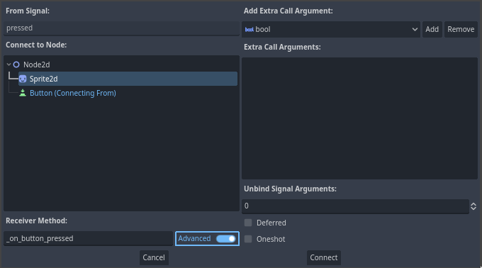

The advanced view lets you connect to any node and any built-in
function, add arguments to the callback, and set options. You can
toggle the mode in the window's bottom-right by clicking the Advanced
button.

Note

If you are using an external editor (such as VS Code), this
automatic code generation might not work. In this case, you need to connect
the signal via code as explained in the next section.

Click the Connect button to complete the signal connection and jump to the
Script workspace. You should see the new method with a connection icon in the
left margin.

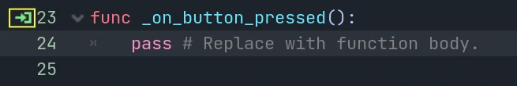

If you click the icon, a window pops up and displays information about the
connection. This feature is only available when connecting nodes in the editor.

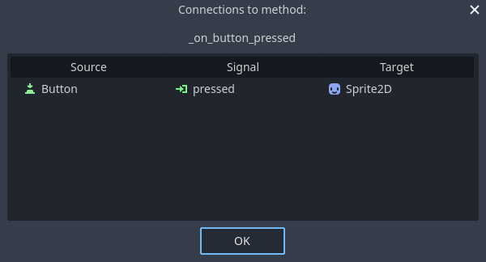

Let's replace the line with the `pass` keyword with code that'll toggle the
node's motion.

Our Sprite2D moves thanks to code in the `_process()` function. Godot provides
a method to toggle processing on and off: [Node.set_process()](https://docs.godotengine.org/en/4.5/classes/class_node.html#class-node-method-set-process). Another method of the Node class,
`is_processing()`, returns `true` if idle processing is active. We can use
the `not` keyword to invert the value.

```gdscript
func _on_button_pressed():
    set_process(not is_processing())
```

```csharp
// We also specified this function name in PascalCase in the editor's connection window.
private void OnButtonPressed()
{
    SetProcess(!IsProcessing());
}
```

This function will toggle processing and, in turn, the icon's motion on and off
upon pressing the button.

Before trying the game, we need to simplify our `_process()` function to move
the node automatically and not wait for user input. Replace it with the
following code, which we saw two lessons ago:

```gdscript
func _process(delta):
    rotation += angular_speed * delta
    var velocity = Vector2.UP.rotated(rotation) * speed
    position += velocity * delta
```

```csharp
public override void _Process(double delta)
{
    Rotation += _angularSpeed * (float)delta;
    var velocity = Vector2.Up.Rotated(Rotation) * _speed;
    Position += velocity * (float)delta;
}
```

Your complete `sprite_2d.gd` code should look like the following.

```gdscript
extends Sprite2D

var speed = 400
var angular_speed = PI


func _process(delta):
    rotation += angular_speed * delta
    var velocity = Vector2.UP.rotated(rotation) * speed
    position += velocity * delta


func _on_button_pressed():
    set_process(not is_processing())
```

```csharp
using Godot;

public partial class MySprite2D : Sprite2D
{
    private float _speed = 400;
    private float _angularSpeed = Mathf.Pi;

    public override void _Process(double delta)
    {
        Rotation += _angularSpeed * (float)delta;
        var velocity = Vector2.Up.Rotated(Rotation) * _speed;
        Position += velocity * (float)delta;
    }

    // We also specified this function name in PascalCase in the editor's connection window.
    private void OnButtonPressed()
    {
        SetProcess(!IsProcessing());
    }
}
```

Run the current scene by pressing `F6` (`Cmd + R` on macOS),
and click the button to see the sprite start and stop.

#### Connecting a signal via code

You can connect signals via code instead of using the editor. This is necessary
when you create nodes or instantiate scenes inside of a script.

Let's use a different node here. Godot has a [Timer](https://docs.godotengine.org/en/4.5/classes/class_timer.html#class-timer) node
that's useful to implement skill cooldown times, weapon reloading, and more.

Head back to the 2D workspace. You can either click the "2D" text at the top of
the window or press `Ctrl + F1` (`Ctrl + Cmd + 1` on macOS).

In the Scene dock, right-click on the Sprite2D node and add a new child node.
Search for Timer and add the corresponding node. Your scene should now look like
this.

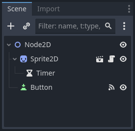

With the Timer node selected, go to the Inspector and enable the Autostart
property.

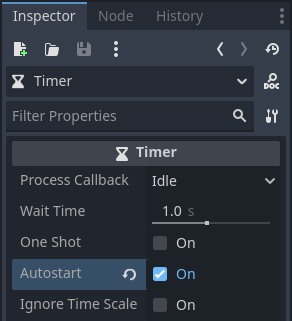

Click the script icon next to Sprite2D to jump back to the scripting workspace.

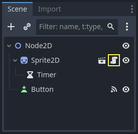

We need to do two operations to connect the nodes via code:

1. Get a reference to the Timer from the Sprite2D.
2. Call the `connect()` method on the Timer's "timeout" signal.

Note

To connect to a signal via code, you need to call the `connect()`
method of the signal you want to listen to. In this case, we want to
listen to the Timer's "timeout" signal.

We want to connect the signal when the scene is instantiated, and we can do that
using the [Node._ready()](https://docs.godotengine.org/en/4.5/classes/class_node.html#class-node-private-method-ready) built-in function,
which is called automatically by the engine when a node is fully instantiated.

To get a reference to a node relative to the current one, we use the method
[Node.get_node()](https://docs.godotengine.org/en/4.5/classes/class_node.html#class-node-method-get-node). We can store the reference
in a variable.

```gdscript
func _ready():
    var timer = get_node("Timer")
```

```csharp
public override void _Ready()
{
    var timer = GetNode<Timer>("Timer");
}
```

The function `get_node()` looks at the Sprite2D's children and gets nodes by
their name. For example, if you renamed the Timer node to "BlinkingTimer" in the
editor, you would have to change the call to `get_node("BlinkingTimer")`.

We can now connect the Timer to the Sprite2D in the `_ready()` function.

```gdscript
func _ready():
    var timer = get_node("Timer")
    timer.timeout.connect(_on_timer_timeout)
```

```csharp
public override void _Ready()
{
    var timer = GetNode<Timer>("Timer");
    timer.Timeout += OnTimerTimeout;
}
```

The line reads like so: we connect the Timer's "timeout" signal to the node to
which the script is attached. When the Timer emits `timeout`, we want to call
the function `_on_timer_timeout()`, that we need to define. Let's add it at the
bottom of our script and use it to toggle our sprite's visibility.

Note

By convention, we name these callback methods in GDScript as
"_on_node_name_signal_name" and in C# as "OnNodeNameSignalName".
Here, it'll be "_on_timer_timeout" for GDScript and OnTimerTimeout() for C#.

```gdscript
func _on_timer_timeout():
    visible = not visible
```

```csharp
private void OnTimerTimeout()
{
    Visible = !Visible;
}
```

The `visible` property is a boolean that controls the visibility of our node.
The line `visible = not visible` toggles the value. If `visible` is
`true`, it becomes `false`, and vice-versa.

If you run the Node2D scene now, you will see that the sprite blinks on and off, at one
second intervals.

#### Complete script

That's it for our little moving and blinking Godot icon demo!
Here is the complete `sprite_2d.gd` file for reference.

```gdscript
extends Sprite2D

var speed = 400
var angular_speed = PI


func _ready():
    var timer = get_node("Timer")
    timer.timeout.connect(_on_timer_timeout)


func _process(delta):
    rotation += angular_speed * delta
    var velocity = Vector2.UP.rotated(rotation) * speed
    position += velocity * delta


func _on_button_pressed():
    set_process(not is_processing())


func _on_timer_timeout():
    visible = not visible
```

```csharp
using Godot;

public partial class MySprite2D : Sprite2D
{
    private float _speed = 400;
    private float _angularSpeed = Mathf.Pi;

    public override void _Ready()
    {
        var timer = GetNode<Timer>("Timer");
        timer.Timeout += OnTimerTimeout;
    }

    public override void _Process(double delta)
    {
        Rotation += _angularSpeed * (float)delta;
        var velocity = Vector2.Up.Rotated(Rotation) * _speed;
        Position += velocity * (float)delta;
    }

    // We also specified this function name in PascalCase in the editor's connection window.
    private void OnButtonPressed()
    {
        SetProcess(!IsProcessing());
    }

    private void OnTimerTimeout()
    {
        Visible = !Visible;
    }
}
```

#### Custom signals

Note

This section is a reference on how to define and use your own signals,
and does not build upon the project created in previous lessons.

You can define custom signals in a script. Say, for example, that you want to
show a game over screen when the player's health reaches zero. To do so, you
could define a signal named "died" or "health_depleted" when their health
reaches 0.

```gdscript
extends Node2D

signal health_depleted

var health = 10
```

```csharp
using Godot;

public partial class MyNode2D : Node2D
{
    [Signal]
    public delegate void HealthDepletedEventHandler();

    private int _health = 10;
}
```

Note

As signals represent events that just occurred, we generally use an
action verb in the past tense in their names.

Your signals work the same way as built-in ones: they appear in the Node tab and
you can connect to them like any other.

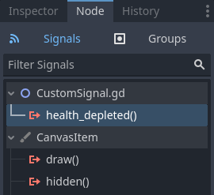

To emit a signal in your scripts, call `emit()` on the signal.

```gdscript
func take_damage(amount):
    health -= amount
    if health <= 0:
        health_depleted.emit()
```

```csharp
public void TakeDamage(int amount)
{
    _health -= amount;

    if (_health <= 0)
    {
        EmitSignal(SignalName.HealthDepleted);
    }
}
```

A signal can optionally declare one or more arguments. Specify the argument
names between parentheses:

```gdscript
extends Node2D

signal health_changed(old_value, new_value)

var health = 10
```

```csharp
using Godot;

public partial class MyNode : Node
{
    [Signal]
    public delegate void HealthChangedEventHandler(int oldValue, int newValue);

    private int _health = 10;
}
```

Note

The signal arguments show up in the editor's node dock, and Godot can use
them to generate callback functions for you. However, you can still emit any
number of arguments when you emit signals. So it's up to you to emit the
correct values.

To emit values along with the signal, add them as extra arguments to the
`emit()` function:

```gdscript
func take_damage(amount):
    var old_health = health
    health -= amount
    health_changed.emit(old_health, health)
```

```csharp
public void TakeDamage(int amount)
{
    int oldHealth = _health;
    _health -= amount;
    EmitSignal(SignalName.HealthChanged, oldHealth, _health);
}
```

#### Summary

Any node in Godot emits signals when something specific happens to them, like a
button being pressed. Other nodes can connect to individual signals and react to
selected events.

Signals have many uses. With them, you can react to a node entering or exiting
the game world, to a collision, to a character entering or leaving an area, to
an element of the interface changing size, and much more.

For example, an [Area2D](https://docs.godotengine.org/en/4.5/classes/class_area2d.html#class-area2d) representing a coin emits a
`body_entered` signal whenever the player's physics body enters its collision
shape, allowing you to know when the player collected it.

In the next section, [Your first 2D game](https://docs.godotengine.org/en/4.5/getting_started/first_2d_game/index.html#doc-your-first-2d-game), you'll create a complete 2D
game and put everything you learned so far into practice.

---

## 来源、配图与授权

- 原文：[Using signals](https://docs.godotengine.org/en/4.5/getting_started/step_by_step/signals.html)。
- 作者与署名：Juan Linietsky, Ariel Manzur and the Godot community。
- 文档许可：[CC BY 3.0](https://creativecommons.org/licenses/by/3.0/)；[官方仓库许可声明](https://github.com/godotengine/godot-docs/blob/4.5/README.md#license)。
- 许可全文：[godot-docs-4.5-LICENSE.txt](../../licenses/godot-docs-4.5-LICENSE.txt)。
- 本地原文主内容快照：[DEV-004.article.html](../../sources/game-development/DEV-004.article.html)。
- 变更：去除导航和用户评论入口，HTML 转 Markdown，图片改为相对路径，重复评级图标转成同义文字，新增中文导读、练习及验收。正文中的示例素材署名予以保留。
- 本整理稿的新增中文内容同样按 CC BY 3.0 提供，署名“Pixel Tutorial Library 整理者（Codex）”；不暗示原作者认可本整理稿。

| 本地图像 | 原图来源 | 图示语境 |
| --- | --- | --- |
| [signals_01_new_scene.webp](../../assets/game-development/DEV-004/signals_01_new_scene.webp) | [原图](https://docs.godotengine.org/en/4.5/_images/signals_01_new_scene.webp) | 原教程图示：Scene setup — signals_01_new_scene.webp |
| [signals_02_2d_scene.webp](../../assets/game-development/DEV-004/signals_02_2d_scene.webp) | [原图](https://docs.godotengine.org/en/4.5/_images/signals_02_2d_scene.webp) | 原教程图示：Scene setup — signals_02_2d_scene.webp |
| [signals_03_dragging_scene.png](../../assets/game-development/DEV-004/signals_03_dragging_scene.png) | [原图](https://docs.godotengine.org/en/4.5/_images/signals_03_dragging_scene.png) | 原教程图示：Scene setup — signals_03_dragging_scene.png |
| [signals_04_add_child_node.webp](../../assets/game-development/DEV-004/signals_04_add_child_node.webp) | [原图](https://docs.godotengine.org/en/4.5/_images/signals_04_add_child_node.webp) | 原教程图示：Scene setup — signals_04_add_child_node.webp |
| [signals_05_add_button.webp](../../assets/game-development/DEV-004/signals_05_add_button.webp) | [原图](https://docs.godotengine.org/en/4.5/_images/signals_05_add_button.webp) | 原教程图示：Scene setup — signals_05_add_button.webp |
| [signals_06_drag_button.png](../../assets/game-development/DEV-004/signals_06_drag_button.png) | [原图](https://docs.godotengine.org/en/4.5/_images/signals_06_drag_button.png) | 原教程图示：Scene setup — signals_06_drag_button.png |
| [signals_07_select_tool.webp](../../assets/game-development/DEV-004/signals_07_select_tool.webp) | [原图](https://docs.godotengine.org/en/4.5/_images/signals_07_select_tool.webp) | 原教程图示：Scene setup — signals_07_select_tool.webp |
| [signals_08_toggle_motion_text.webp](../../assets/game-development/DEV-004/signals_08_toggle_motion_text.webp) | [原图](https://docs.godotengine.org/en/4.5/_images/signals_08_toggle_motion_text.webp) | 原教程图示：Scene setup — signals_08_toggle_motion_text.webp |
| [signals_09_scene_setup.png](../../assets/game-development/DEV-004/signals_09_scene_setup.png) | [原图](https://docs.godotengine.org/en/4.5/_images/signals_09_scene_setup.png) | 原教程图示：Scene setup — signals_09_scene_setup.png |
| [signals_10_node_dock.webp](../../assets/game-development/DEV-004/signals_10_node_dock.webp) | [原图](https://docs.godotengine.org/en/4.5/_images/signals_10_node_dock.webp) | 原教程图示：Connecting a signal in the editor — signals_10_node_dock.webp |
| [signals_11_pressed_signals.webp](../../assets/game-development/DEV-004/signals_11_pressed_signals.webp) | [原图](https://docs.godotengine.org/en/4.5/_images/signals_11_pressed_signals.webp) | 原教程图示：Connecting a signal in the editor — signals_11_pressed_signals.webp |
| [signals_12_node_connection.webp](../../assets/game-development/DEV-004/signals_12_node_connection.webp) | [原图](https://docs.godotengine.org/en/4.5/_images/signals_12_node_connection.webp) | 原教程图示：Connecting a signal in the editor — signals_12_node_connection.webp |
| [signals_advanced_connection_window.png](../../assets/game-development/DEV-004/signals_advanced_connection_window.png) | [原图](https://docs.godotengine.org/en/4.5/_images/signals_advanced_connection_window.png) | 原教程图示：Connecting a signal in the editor — signals_advanced_connection_window.png |
| [signals_13_signals_connection_icon.webp](../../assets/game-development/DEV-004/signals_13_signals_connection_icon.webp) | [原图](https://docs.godotengine.org/en/4.5/_images/signals_13_signals_connection_icon.webp) | 原教程图示：Connecting a signal in the editor — signals_13_signals_connection_icon.webp |
| [signals_14_signals_connection_info.webp](../../assets/game-development/DEV-004/signals_14_signals_connection_info.webp) | [原图](https://docs.godotengine.org/en/4.5/_images/signals_14_signals_connection_info.webp) | 原教程图示：Connecting a signal in the editor — signals_14_signals_connection_info.webp |
| [signals_15_scene_tree.webp](../../assets/game-development/DEV-004/signals_15_scene_tree.webp) | [原图](https://docs.godotengine.org/en/4.5/_images/signals_15_scene_tree.webp) | 原教程图示：Connecting a signal via code — signals_15_scene_tree.webp |
| [signals_18_timer_autostart.webp](../../assets/game-development/DEV-004/signals_18_timer_autostart.webp) | [原图](https://docs.godotengine.org/en/4.5/_images/signals_18_timer_autostart.webp) | 原教程图示：Connecting a signal via code — signals_18_timer_autostart.webp |
| [signals_16_click_script.webp](../../assets/game-development/DEV-004/signals_16_click_script.webp) | [原图](https://docs.godotengine.org/en/4.5/_images/signals_16_click_script.webp) | 原教程图示：Connecting a signal via code — signals_16_click_script.webp |
| [signals_17_custom_signal.webp](../../assets/game-development/DEV-004/signals_17_custom_signal.webp) | [原图](https://docs.godotengine.org/en/4.5/_images/signals_17_custom_signal.webp) | 原教程图示：Custom signals — signals_17_custom_signal.webp |
