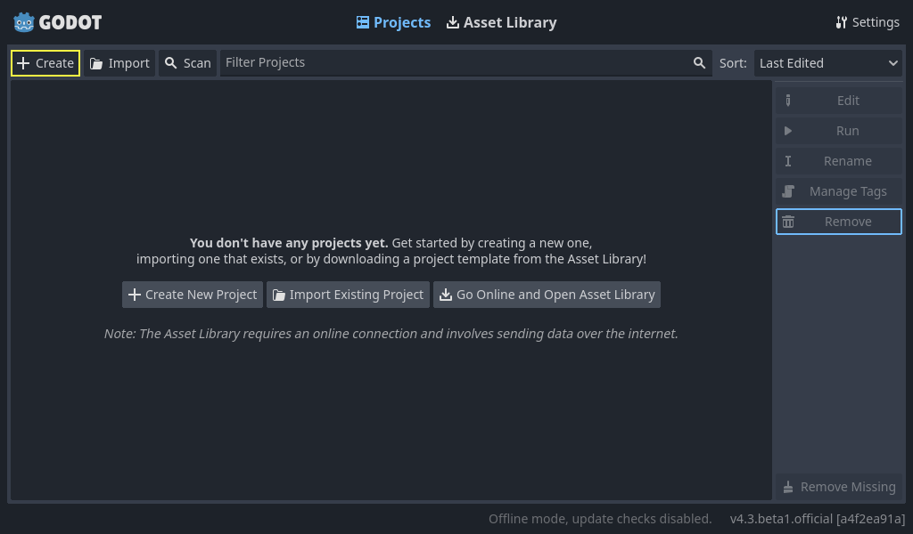
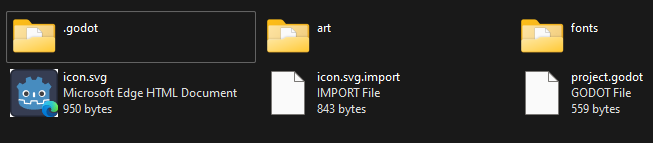
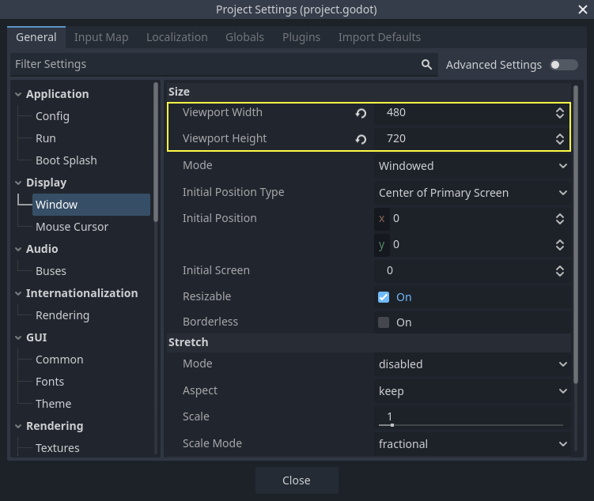
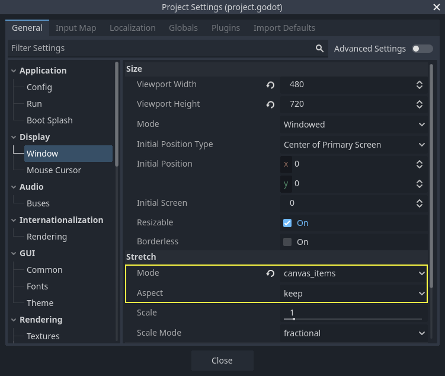
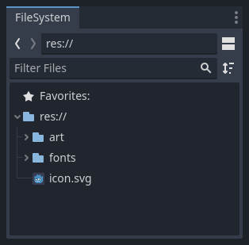

# 完整二维小游戏：项目与素材准备

> 本文由 Godot 官方 4.5 版文档转换。下方中文导读、练习和验收是整理者的教学编排，英文正文是原教程主内容；不是官方中文逐句译文，也未声称已在引擎中执行全部练习。

## 适用任务

开始官方 Dodge the Creeps 项目，建立资源目录、窗口设置和素材导入基础。

## 前提

- 完成 Godot 基础节点与脚本入门

## 中文操作路线

1. 新建项目，并按原文要求准备官方教学资源包。
2. 把资源解压到项目目录，等待编辑器导入后确认目录和资源名称。
3. 设置项目的窗口尺寸与拉伸参数，区分设计分辨率和实际窗口大小。
4. 把场景、脚本与素材按职责分开存放，再保存项目设置。

## 图示怎么读

先沿英文正文的步骤阅读对应截图；截图来自同一版本页面，局部操作顺序以紧邻图片的文字为准。图片下载到本地，可离线打开并放大检查。截图中的示例美术用于说明引擎操作，不代表本库要求采用该画风。

## 动手练习

建立项目目录清单，注明角色、敌人、字体、声音各自在哪里；保留原包的许可信息。

## 验收清单

- [ ] 素材导入没有丢失纹理或字体。
- [ ] 窗口方向和尺寸符合原教程。
- [ ] 后续章节引用资源时能定位到相同文件名。

## 版本与边界

官方项目的素材不是严格像素画，也不是俯视 RPG；这里学习完整游戏结构，像素清晰度另见 DEV-021。

本次来源固定为 Godot 4.5 文档分支，抓取日期为 2026-10-29；它不是“当前最新版本”的声明。升级引擎时应重新核对节点名、属性名和 API。

## 原教程正文（英文，Markdown 转换）

### Setting up the project

In this short first part, we'll set up and organize the project.

Launch Godot and create a new project.

When creating the new project, you only need to choose a valid *Project Path*. You can leave the other default settings alone.

Download [dodge_the_creeps_2d_assets.zip](https://github.com/godotengine/godot-docs-project-starters/releases/download/latest-4.x/dodge_the_creeps_2d_assets.zip).
The archive contains the images and sounds you'll be using
to make the game. Extract the archive and move the `art/`
and `fonts/` directories to your project's directory.

Download [dodge_the_creeps_2d_assets.zip](https://github.com/godotengine/godot-docs-project-starters/releases/download/latest-4.x/dodge_the_creeps_2d_assets.zip).
The archive contains the images and sounds you'll be using
to make the game. Extract the archive and move the `art/`
and `fonts/` directories to your project's directory.

Ensure that you have the required dependencies to use C# in Godot.
You need the latest stable .NET SDK, and an editor such as VS Code.
See [Prerequisites](https://docs.godotengine.org/en/4.5/tutorials/scripting/c_sharp/c_sharp_basics.html#doc-c-sharp-setup).

The C++ part of this tutorial wasn't rewritten for the new GDExtension system yet.

Your project folder should look like this.

This game is designed for portrait mode, so we need to adjust the size of the
game window. Click on *Project -> Project Settings* to open the project settings
window, in the left column open the *Display -> Window* tab. There, set
"Viewport Width" to `480` and "Viewport Height" to `720`. You can see the
"Project" menu on the upper left corner.

Also, under the **Stretch** options, set **Mode** to `canvas_items` and **Aspect** to `keep`.
This ensures that the game scales consistently on different sized screens.

#### Organizing the project

In this project, we will make 3 independent scenes: `Player`, `Mob`, and
`HUD`, which we will combine into the game's `Main` scene.

In a larger project, it might be useful to create folders to hold the various
scenes and their scripts, but for this relatively small game, you can save your
scenes and scripts in the project's root folder, identified by `res://`. You
can see your project folders in the FileSystem dock in the lower left corner:

With the project in place, we're ready to design the player scene in the next lesson.

---

## 来源、配图与授权

- 原文：[Setting up the project](https://docs.godotengine.org/en/4.5/getting_started/first_2d_game/01.project_setup.html)。
- 作者与署名：Juan Linietsky, Ariel Manzur and the Godot community。
- 文档许可：[CC BY 3.0](https://creativecommons.org/licenses/by/3.0/)；[官方仓库许可声明](https://github.com/godotengine/godot-docs/blob/4.5/README.md#license)。
- 许可全文：[godot-docs-4.5-LICENSE.txt](../../licenses/godot-docs-4.5-LICENSE.txt)。
- 本地原文主内容快照：[DEV-005.article.html](../../sources/game-development/DEV-005.article.html)。
- 变更：去除导航和用户评论入口，HTML 转 Markdown，图片改为相对路径，重复评级图标转成同义文字，新增中文导读、练习及验收。正文中的示例素材署名予以保留。
- 本整理稿的新增中文内容同样按 CC BY 3.0 提供，署名“Pixel Tutorial Library 整理者（Codex）”；不暗示原作者认可本整理稿。

| 本地图像 | 原图来源 | 图示语境 |
| --- | --- | --- |
| [new-project-button.webp](../../assets/game-development/DEV-005/new-project-button.webp) | [原图](https://docs.godotengine.org/en/4.5/_images/new-project-button.webp) | 原教程图示：Setting up the project — new-project-button.webp |
| [folder-content.webp](../../assets/game-development/DEV-005/folder-content.webp) | [原图](https://docs.godotengine.org/en/4.5/_images/folder-content.webp) | 原教程图示：Setting up the project — folder-content.webp |
| [setting-project-width-and-height.webp](../../assets/game-development/DEV-005/setting-project-width-and-height.webp) | [原图](https://docs.godotengine.org/en/4.5/_images/setting-project-width-and-height.webp) | 原教程图示：Setting up the project — setting-project-width-and-height.webp |
| [setting-stretch-mode.webp](../../assets/game-development/DEV-005/setting-stretch-mode.webp) | [原图](https://docs.godotengine.org/en/4.5/_images/setting-stretch-mode.webp) | 原教程图示：Setting up the project — setting-stretch-mode.webp |
| [filesystem_dock.webp](../../assets/game-development/DEV-005/filesystem_dock.webp) | [原图](https://docs.godotengine.org/en/4.5/_images/filesystem_dock.webp) | 原教程图示：Organizing the project — filesystem_dock.webp |
