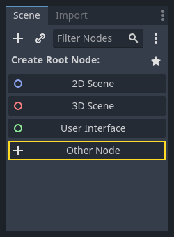
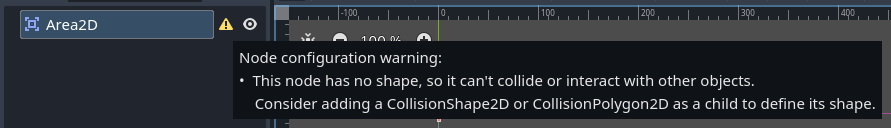
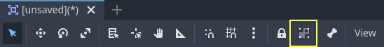
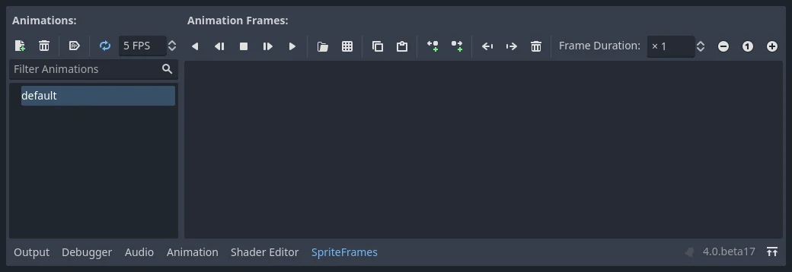
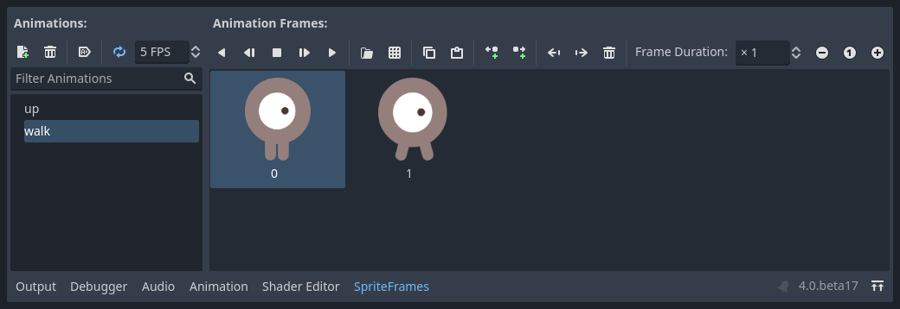
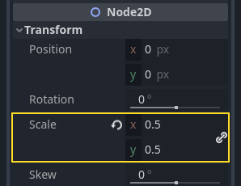
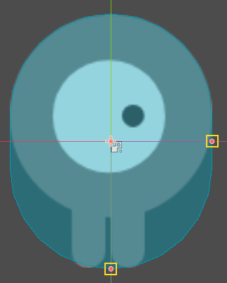
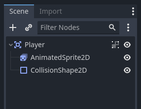

# 完整二维小游戏：玩家场景与动画资源

> 本文由 Godot 官方 4.5 版文档转换。下方中文导读、练习和验收是整理者的教学编排，英文正文是原教程主内容；不是官方中文逐句译文，也未声称已在引擎中执行全部练习。

## 适用任务

组合 Area2D、动画精灵与碰撞形状，制作可独立复用的玩家场景。

## 前提

- DEV-005

## 中文操作路线

1. 以 Area2D 建立玩家根节点，并按原文配置命名与分组方式。
2. 添加 AnimatedSprite2D，为 SpriteFrames 创建行走方向相关的动画。
3. 把素材帧放入正确动画并设置速度，使用编辑器预览播放。
4. 添加 CollisionShape2D，选择适合角色的形状并调整大小。
5. 保存玩家场景，确认它可以独立打开和后续被主场景实例化。

## 图示怎么读

先沿英文正文的步骤阅读对应截图；截图来自同一版本页面，局部操作顺序以紧邻图片的文字为准。图片下载到本地，可离线打开并放大检查。截图中的示例美术用于说明引擎操作，不代表本库要求采用该画风。

## 动手练习

为玩家准备一个额外 idle 动画，记录它与原行走帧共享的画布尺寸和底部锚点。

## 验收清单

- [ ] 动画帧没有因裁剪导致角色跳动。
- [ ] 碰撞形状覆盖实际接触区域。
- [ ] 节点名称与下一章脚本引用一致。

## 版本与边界

原教程玩家使用 Area2D 做重叠检测；需要撞墙和沿墙滑动的 RPG 玩家通常改用 CharacterBody2D。

本次来源固定为 Godot 4.5 文档分支，抓取日期为 2026-10-29；它不是“当前最新版本”的声明。升级引擎时应重新核对节点名、属性名和 API。

## 原教程正文（英文，Markdown 转换）

### Creating the player scene

With the project settings in place, we can start working on the
player-controlled character.

The first scene will define the `Player` object. One of the benefits of
creating a separate Player scene is that we can test it separately, even before
we've created other parts of the game.

#### Node structure

To begin, we need to choose a root node for the player object. As a general
rule, a scene's root node should reflect the object's desired functionality -
what the object *is*. In the upper-left corner, in the "Scene" tab, click the
"Other Node" button and add an [Area2D](https://docs.godotengine.org/en/4.5/classes/class_area2d.html#class-area2d) node to the scene.

When you add the `Area2D` node, Godot will display the following **warning icon**
next to it in the scene tree:

This warning tells us that the `Area2D` node requires a shape to detect collisions or overlaps.
We can **ignore the warning temporarily** because we will first set up the player's visuals
(using an animated sprite). Once the visuals are ready, we will add a collision shape as a child
node. This will allow us to accurately size and position the shape based on the sprite's appearance.

With `Area2D` we can detect objects that overlap or run into the player.
Change the node's name to `Player` by double-clicking on it. Now that we've
set the scene's root node, we can add additional nodes to give it more
functionality.

Before we add any children to the `Player` node, we want to make sure we don't
accidentally move or resize them by clicking on them. Select the node and click
the icon to the right of the lock. Its tooltip says "Groups the selected node
with its children. This causes the parent to be selected when any child
node is clicked in 2D and 3D view."

Save the scene as `player.tscn`. Click **Scene > Save**, or press `Ctrl + S`
on Windows/Linux or `Cmd + S` on macOS.

Note

For this project, we will be following the Godot naming conventions.

- **GDScript**: Classes (nodes) use PascalCase, variables and
  functions use snake_case, and constants use ALL_CAPS (See
  [GDScript style guide](https://docs.godotengine.org/en/4.5/tutorials/scripting/gdscript/gdscript_styleguide.html#doc-gdscript-styleguide)).
- **C#**: Classes, export variables and methods use PascalCase,
  private fields use _camelCase, local variables and parameters use
  camelCase (See [C# style guide](https://docs.godotengine.org/en/4.5/tutorials/scripting/c_sharp/c_sharp_style_guide.html#doc-c-sharp-styleguide)). Be careful to type
  the method names precisely when connecting signals.

#### Sprite animation

Click on the `Player` node and add (`Ctrl + A` on Windows/Linux or
`Cmd + A` on macOS) a child node [AnimatedSprite2D](https://docs.godotengine.org/en/4.5/classes/class_animatedsprite2d.html#class-animatedsprite2d). The `AnimatedSprite2D` will handle the
appearance and animations for our player. Notice that there is a warning symbol
next to the node. An `AnimatedSprite2D` requires a [SpriteFrames](https://docs.godotengine.org/en/4.5/classes/class_spriteframes.html#class-spriteframes) resource, which is a list of the animations it can
display. Make sure `AnimatedSprite2D` is selected and then find the `Sprite Frames` property under
the `Animation` section in the Inspector and click "[empty]" -> "New SpriteFrames":

Click on the `SpriteFrames` you just created to open the "SpriteFrames" panel:

On the left is a list of animations. Click the `default` one and rename it to
`walk`. Then click the **Add Animation** button to create a second animation
named `up`.

Find the player images in the FileSystem dock - they're in the `art` folder
you unzipped earlier. Drag the two images for each animation, into the
**Animation Frames** side of the panel for the corresponding animation:

- `playerGrey_walk1` and `playerGrey_walk2` for the `walk` animation
- `playerGrey_up1` and `playerGrey_up2` for the `up` animation

The player images are a bit too large for the game window, so we need to scale
them down. Click on the `AnimatedSprite2D` node and set the `Scale` property
to `(0.5, 0.5)`. You can find it in the Inspector under the `Node2D`
heading.

Finally, add a [CollisionShape2D](https://docs.godotengine.org/en/4.5/classes/class_collisionshape2d.html#class-collisionshape2d) as a child of
`Player`. This will determine the player's "hitbox", or the bounds of its
collision area. For this character, a `CapsuleShape2D` node gives the best
fit, so next to "Shape" in the Inspector, click "[empty]" -> "New
CapsuleShape2D". Using the two size handles, resize the shape to cover the
sprite:

When you're finished, your `Player` scene should look like this:

Once this is done, the warning on the `Area2D` node will disappear, as it now has
a shape assigned and can interact with other objects.

Make sure to save the scene again after these changes.

In the next part, we'll add a script to the player node to move and animate it.
Then, we'll set up collision detection to know when the player got hit by
something.

---

## 来源、配图与授权

- 原文：[Creating the player scene](https://docs.godotengine.org/en/4.5/getting_started/first_2d_game/02.player_scene.html)。
- 作者与署名：Juan Linietsky, Ariel Manzur and the Godot community。
- 文档许可：[CC BY 3.0](https://creativecommons.org/licenses/by/3.0/)；[官方仓库许可声明](https://github.com/godotengine/godot-docs/blob/4.5/README.md#license)。
- 许可全文：[godot-docs-4.5-LICENSE.txt](../../licenses/godot-docs-4.5-LICENSE.txt)。
- 本地原文主内容快照：[DEV-006.article.html](../../sources/game-development/DEV-006.article.html)。
- 变更：去除导航和用户评论入口，HTML 转 Markdown，图片改为相对路径，重复评级图标转成同义文字，新增中文导读、练习及验收。正文中的示例素材署名予以保留。
- 本整理稿的新增中文内容同样按 CC BY 3.0 提供，署名“Pixel Tutorial Library 整理者（Codex）”；不暗示原作者认可本整理稿。

| 本地图像 | 原图来源 | 图示语境 |
| --- | --- | --- |
| [add_node.webp](../../assets/game-development/DEV-006/add_node.webp) | [原图](https://docs.godotengine.org/en/4.5/_images/add_node.webp) | 原教程图示：Node structure — add_node.webp |
| [no_shape_warning.webp](../../assets/game-development/DEV-006/no_shape_warning.webp) | [原图](https://docs.godotengine.org/en/4.5/_images/no_shape_warning.webp) | 原教程图示：Node structure — no_shape_warning.webp |
| [lock_children.webp](../../assets/game-development/DEV-006/lock_children.webp) | [原图](https://docs.godotengine.org/en/4.5/_images/lock_children.webp) | 原教程图示：Node structure — lock_children.webp |
| [new_spriteframes.webp](../../assets/game-development/DEV-006/new_spriteframes.webp) | [原图](https://docs.godotengine.org/en/4.5/_images/new_spriteframes.webp) | 原教程图示：Sprite animation — new_spriteframes.webp |
| [spriteframes_panel.webp](../../assets/game-development/DEV-006/spriteframes_panel.webp) | [原图](https://docs.godotengine.org/en/4.5/_images/spriteframes_panel.webp) | 原教程图示：Sprite animation — spriteframes_panel.webp |
| [spriteframes_panel2.webp](../../assets/game-development/DEV-006/spriteframes_panel2.webp) | [原图](https://docs.godotengine.org/en/4.5/_images/spriteframes_panel2.webp) | 原教程图示：Sprite animation — spriteframes_panel2.webp |
| [player_scale.webp](../../assets/game-development/DEV-006/player_scale.webp) | [原图](https://docs.godotengine.org/en/4.5/_images/player_scale.webp) | 原教程图示：Sprite animation — player_scale.webp |
| [player_coll_shape.webp](../../assets/game-development/DEV-006/player_coll_shape.webp) | [原图](https://docs.godotengine.org/en/4.5/_images/player_coll_shape.webp) | 原教程图示：Sprite animation — player_coll_shape.webp |
| [player_scene_nodes.webp](../../assets/game-development/DEV-006/player_scene_nodes.webp) | [原图](https://docs.godotengine.org/en/4.5/_images/player_scene_nodes.webp) | 原教程图示：Sprite animation — player_scene_nodes.webp |
