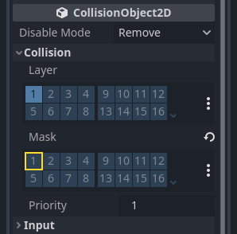
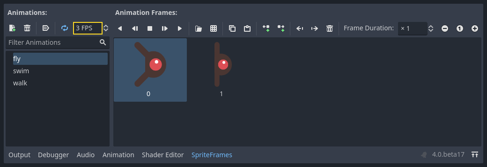

# 完整二维小游戏：敌人场景与离屏清理

> 本文由 Godot 官方 4.5 版文档转换。下方中文导读、练习和验收是整理者的教学编排，英文正文是原教程主内容；不是官方中文逐句译文，也未声称已在引擎中执行全部练习。

## 适用任务

为敌人建立可生成的独立场景，配置动画和离开画面后的释放逻辑。

## 前提

- DEV-006
- 基础 GDScript

## 中文操作路线

1. 建立 RigidBody2D 敌人根节点，并按原文设置碰撞与重力相关参数。
2. 添加动画精灵、碰撞形状和可见性通知节点，检查它们的相对位置。
3. 在初始化时从可用动画中选择外观，使同一场景能生成不同敌人。
4. 连接离开屏幕的信号，调用 queue_free 释放敌人实例。
5. 保存为独立场景，交给下一章主场景负责生成。

## 图示怎么读

先沿英文正文的步骤阅读对应截图；截图来自同一版本页面，局部操作顺序以紧邻图片的文字为准。图片下载到本地，可离线打开并放大检查。截图中的示例美术用于说明引擎操作，不代表本库要求采用该画风。

## 动手练习

记录一分钟内活动敌人数量；让敌人出屏后确认数量回落，而不是持续累积。

## 验收清单

- [ ] 敌人不会因默认重力朝错误方向下坠。
- [ ] 动画名称来自当前 SpriteFrames。
- [ ] 出屏实例会释放，场景树没有无界增长。

## 版本与边界

这是穿越屏幕的敌人示例，不包含寻路或追踪 AI。

本次来源固定为 Godot 4.5 文档分支，抓取日期为 2026-10-29；它不是“当前最新版本”的声明。升级引擎时应重新核对节点名、属性名和 API。

## 原教程正文（英文，Markdown 转换）

### Creating the enemy

Now it's time to make the enemies our player will have to dodge. Their behavior
will not be very complex: mobs will spawn randomly at the edges of the screen,
choose a random direction, and move in a straight line.

We'll create a `Mob` scene, which we can then *instance* to create any number
of independent mobs in the game.

#### Node setup

Click Scene -> New Scene from the top menu and add the following nodes:

- [RigidBody2D](https://docs.godotengine.org/en/4.5/classes/class_rigidbody2d.html#class-rigidbody2d) (named `Mob`)

  > - [AnimatedSprite2D](https://docs.godotengine.org/en/4.5/classes/class_animatedsprite2d.html#class-animatedsprite2d)
  > - [CollisionShape2D](https://docs.godotengine.org/en/4.5/classes/class_collisionshape2d.html#class-collisionshape2d)
  > - [VisibleOnScreenNotifier2D](https://docs.godotengine.org/en/4.5/classes/class_visibleonscreennotifier2d.html#class-visibleonscreennotifier2d)

Don't forget to set the children so they can't be selected, like you did with
the Player scene. This is done by selecting the parent node (`RigidBody2D`) in the
Scene tree dock, then using the Group button at the top of the 2D editor
(or pressing `Ctrl + G`).

Select the `Mob` node and set its `Gravity Scale`
property in the [RigidBody2D](https://docs.godotengine.org/en/4.5/classes/class_rigidbody2d.html#class-rigidbody2d)
section of the inspector to `0`.
This will prevent the mob from falling downwards.

In addition, under the [CollisionObject2D](https://docs.godotengine.org/en/4.5/classes/class_collisionobject2d.html#class-collisionobject2d)
section just beneath the **RigidBody2D** section,
expand the **Collision** group and
uncheck the `1` inside the `Mask` property.
This will ensure the mobs do not collide with each other.



Set up the [AnimatedSprite2D](https://docs.godotengine.org/en/4.5/classes/class_animatedsprite2d.html#class-animatedsprite2d) like you did for the
player. This time, we have 3 animations: `fly`, `swim`, and `walk`. There
are two images for each animation in the art folder.

The `Animation Speed` property has to be set for each individual animation. Adjust it to `3` for all 3 animations.



You can use the "Play Animation" buttons on the right of the `Animation Speed` input field to preview your animations.

We'll select one of these animations randomly so that the mobs will have some
variety.

Like the player images, these mob images need to be scaled down. Set the
`AnimatedSprite2D`'s `Scale` property to `(0.75, 0.75)`.

As in the `Player` scene, add a `CapsuleShape2D` for the collision. To align
the shape with the image, you'll need to set the `Rotation` property
to `90` (under "Transform" in the Inspector).

Save the scene.

#### Enemy script

Add a script to the `Mob` like this:

```gdscript
extends RigidBody2D
```

```csharp
using Godot;

public partial class Mob : RigidBody2D
{
    // Don't forget to rebuild the project.
}
```

Now let's look at the rest of the script. In `_ready()` we play the animation
and randomly choose one of the three animation types:

```gdscript
func _ready():
    var mob_types = Array($AnimatedSprite2D.sprite_frames.get_animation_names())
    $AnimatedSprite2D.animation = mob_types.pick_random()
    $AnimatedSprite2D.play()
```

```csharp
public override void _Ready()
{
    var animatedSprite2D = GetNode<AnimatedSprite2D>("AnimatedSprite2D");
    string[] mobTypes = animatedSprite2D.SpriteFrames.GetAnimationNames();
    animatedSprite2D.Play(mobTypes[GD.Randi() % mobTypes.Length]);
}
```

First, we get the list of animation names from the AnimatedSprite2D's `sprite_frames`
property. This returns an Array containing all three animation names: `["walk",
"swim", "fly"]`.

In the GDScript code, we use the [Array.pick_random](https://docs.godotengine.org/en/4.5/classes/class_array.html#class-array-method-pick-random) method
to select one of these animation names at random. Meanwhile, in the C# code, we pick a random number
between `0` and `2` to select one of these names from the list (array indices start at `0`). The
expression `GD.Randi() % n` selects a random integer between `0` and `n-1`.

Finally, we call `play()` to start playing the chosen animation.

The last piece is to make the mobs delete themselves when they leave the screen.
Connect the `screen_exited()` signal of the `VisibleOnScreenNotifier2D` node
to the `Mob` and add this code:

```gdscript
func _on_visible_on_screen_notifier_2d_screen_exited():
    queue_free()
```

```csharp
// We also specified this function name in PascalCase in the editor's connection window.
private void OnVisibleOnScreenNotifier2DScreenExited()
{
    QueueFree();
}
```

`queue_free()` is a function that essentially 'frees', or deletes, the node at the end of the frame.

This completes the Mob scene.

With the player and enemies ready, in the next part, we'll bring them together
in a new scene. We'll make enemies spawn randomly around the game board and move
forward, turning our project into a playable game.

---

## 来源、配图与授权

- 原文：[Creating the enemy](https://docs.godotengine.org/en/4.5/getting_started/first_2d_game/04.creating_the_enemy.html)。
- 作者与署名：Juan Linietsky, Ariel Manzur and the Godot community。
- 文档许可：[CC BY 3.0](https://creativecommons.org/licenses/by/3.0/)；[官方仓库许可声明](https://github.com/godotengine/godot-docs/blob/4.5/README.md#license)。
- 许可全文：[godot-docs-4.5-LICENSE.txt](../../licenses/godot-docs-4.5-LICENSE.txt)。
- 本地原文主内容快照：[DEV-008.article.html](../../sources/game-development/DEV-008.article.html)。
- 变更：去除导航和用户评论入口，HTML 转 Markdown，图片改为相对路径，重复评级图标转成同义文字，新增中文导读、练习及验收。正文中的示例素材署名予以保留。
- 本整理稿的新增中文内容同样按 CC BY 3.0 提供，署名“Pixel Tutorial Library 整理者（Codex）”；不暗示原作者认可本整理稿。

| 本地图像 | 原图来源 | 图示语境 |
| --- | --- | --- |
| [set_collision_mask.webp](../../assets/game-development/DEV-008/set_collision_mask.webp) | [原图](https://docs.godotengine.org/en/4.5/_images/set_collision_mask.webp) | 原教程图示：Node setup — set_collision_mask.webp |
| [mob_animations.webp](../../assets/game-development/DEV-008/mob_animations.webp) | [原图](https://docs.godotengine.org/en/4.5/_images/mob_animations.webp) | 原教程图示：Node setup — mob_animations.webp |
