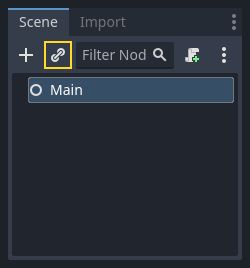
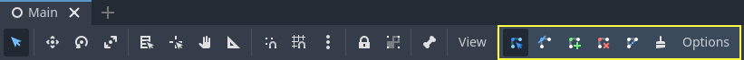
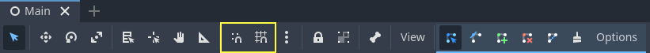
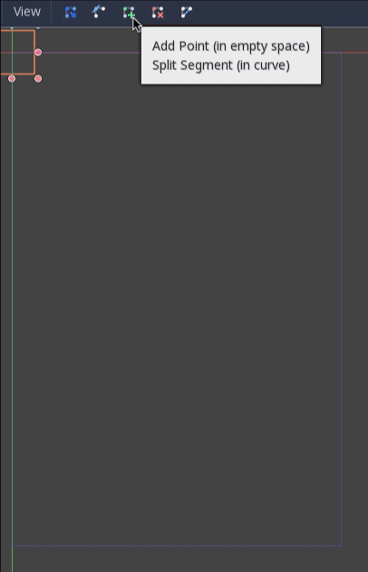
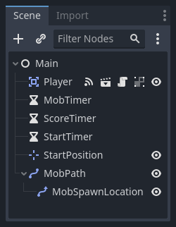

# 完整二维小游戏：生成、计分与回合循环

> 本文由 Godot 官方 4.5 版文档转换。下方中文导读、练习和验收是整理者的教学编排，英文正文是原教程主内容；不是官方中文逐句译文，也未声称已在引擎中执行全部练习。

## 适用任务

把玩家、敌人、计时器和边界路径组合成完整一局游戏。

## 前提

- DEV-007
- DEV-008

## 中文操作路线

1. 建立主场景，添加玩家实例、开始位置、计时器及用于生成敌人的路径。
2. 用 Path2D 定义生成边界，再用 PathFollow2D 选择边界上的生成位置。
3. 加载敌人 PackedScene，每次计时器触发时实例化并赋予位置与速度。
4. 实现 new_game 与 game_over，分别重置分数和启动或停止相关计时器。
5. 独立测试主场景后，把它设为项目入口，再接入 HUD。

## 图示怎么读

先沿英文正文的步骤阅读对应截图；截图来自同一版本页面，局部操作顺序以紧邻图片的文字为准。图片下载到本地，可离线打开并放大检查。截图中的示例美术用于说明引擎操作，不代表本库要求采用该画风。

## 动手练习

把敌人生成间隔改为三个档位，测量每局开始到首个敌人出现的延迟，并验证结束后不再生成。

## 验收清单

- [ ] 敌人从预期边缘进入画面。
- [ ] 开始新局时分数归零。
- [ ] 游戏结束停止生成和计分计时器。

## 版本与边界

随机性只负责生成位置、方向或速度的变化；不应据此推断游戏一定具有更强留存。

本次来源固定为 Godot 4.5 文档分支，抓取日期为 2026-10-29；它不是“当前最新版本”的声明。升级引擎时应重新核对节点名、属性名和 API。

## 原教程正文（英文，Markdown 转换）

### The main game scene

Now it's time to bring everything we did together into a playable game scene.

Create a new scene and add a [Node](https://docs.godotengine.org/en/4.5/classes/class_node.html#class-node) named `Main`.
(The reason we are using Node instead of Node2D is because this node will
be a container for handling game logic. It does not require 2D functionality itself.)

Click the **Instance** button (represented by a chain link icon) and select your saved
`player.tscn`.



Now, add the following nodes as children of `Main`, and name them as shown:

- [Timer](https://docs.godotengine.org/en/4.5/classes/class_timer.html#class-timer) (named `MobTimer`) - to control how often mobs
  spawn
- [Timer](https://docs.godotengine.org/en/4.5/classes/class_timer.html#class-timer) (named `ScoreTimer`) - to increment the score
  every second
- [Timer](https://docs.godotengine.org/en/4.5/classes/class_timer.html#class-timer) (named `StartTimer`) - to give a delay before
  starting
- [Marker2D](https://docs.godotengine.org/en/4.5/classes/class_marker2d.html#class-marker2d) (named `StartPosition`) - to indicate
  the player's start position

Set the `Wait Time` property of each of the `Timer` nodes as follows (values are in seconds):

- `MobTimer`: `0.5`
- `ScoreTimer`: `1`
- `StartTimer`: `2`

In addition, set the `One Shot` property of `StartTimer` to "On" and set
`Position` of the `StartPosition` node to `(240, 450)`.

#### Spawning mobs

The Main node will be spawning new mobs, and we want them to appear at a random
location on the edge of the screen. Click the `Main` node in the Scene dock, then
add a child [Path2D](https://docs.godotengine.org/en/4.5/classes/class_path2d.html#class-path2d) node named `MobPath`. When you select
`Path2D`, you will see some new buttons at the top of the editor:



Select the middle one ("Add Point") and draw the path by clicking to add the
points at the corners shown. To have the points snap to the grid, make sure "Use
Grid Snap" and "Use Smart Snap" are both selected. These options can be found to the
left of the "Lock" button, appearing as a magnet next to some dots and
intersecting lines, respectively.



Important

Draw the path in *clockwise* order, or your mobs will spawn
pointing *outwards* instead of *inwards*!



After placing point `4` in the image, click the "Close Curve" button and your
curve will be complete.

Now that the path is defined, add a [PathFollow2D](https://docs.godotengine.org/en/4.5/classes/class_pathfollow2d.html#class-pathfollow2d)
node as a child of `MobPath` and name it `MobSpawnLocation`. This node will
automatically rotate and follow the path as it moves, so we can use it to select
a random position and direction along the path.

Your scene should look like this:



#### Main script

Add a script to `Main`. At the top of the script, we use
`@export var mob_scene: PackedScene` to allow us to choose the Mob scene we want
to instance.

```gdscript
extends Node

@export var mob_scene: PackedScene
var score
```

```csharp
using Godot;

public partial class Main : Node
{
    // Don't forget to rebuild the project so the editor knows about the new export variable.

    [Export]
    public PackedScene MobScene { get; set; }

    private int _score;
}
```

Click the `Main` node and you will see the `Mob Scene` property in the Inspector
under "Main.gd".

You can assign this property's value in two ways:

- Drag `mob.tscn` from the "FileSystem" dock and drop it in the **Mob Scene**
  property.
- Click the down arrow next to "[empty]" and choose "Load". Select `mob.tscn`.

Next, select the instance of the `Player` scene under `Main` node in the Scene dock,
and access the Node dock on the sidebar. Make sure to have the Signals tab selected
in the Node dock.

You should see a list of the signals for the `Player` node. Find and
double-click the `hit` signal in the list (or right-click it and select
"Connect..."). This will open the signal connection dialog. We want to make a
new function named `game_over`, which will handle what needs to happen when a
game ends. Type "game_over" in the "Receiver Method" box at the bottom of the
signal connection dialog and click "Connect". You are aiming to have the `hit` signal
emitted from `Player` and handled in the `Main` script. Add the following code
to the new function, as well as a `new_game` function that will set
everything up for a new game:

```gdscript
func game_over():
    $ScoreTimer.stop()
    $MobTimer.stop()

func new_game():
    score = 0
    $Player.start($StartPosition.position)
    $StartTimer.start()
```

```csharp
public void GameOver()
{
    GetNode<Timer>("MobTimer").Stop();
    GetNode<Timer>("ScoreTimer").Stop();
}

public void NewGame()
{
    _score = 0;

    var player = GetNode<Player>("Player");
    var startPosition = GetNode<Marker2D>("StartPosition");
    player.Start(startPosition.Position);

    GetNode<Timer>("StartTimer").Start();
}
```

Now we'll connect the `timeout()` signal of each Timer node (`StartTimer`,
`ScoreTimer`, and `MobTimer`) to the main script. For each of the three
timers, select the timer in the Scene dock, open the Signals tab of the Node
dock, then double-click the `timeout()` signal in the list. This will open a new
signal connection dialog. The default settings in this dialog should be fine, so
select **Connect** to create a new signal connection.

Once all three timers have this set up, you should be able to see each timer
have a Signal connection for their respective `timeout()` signal, showing in
green, within their respective Signals tabs:

- (For MobTimer): `_on_mob_timer_timeout()`
- (For ScoreTimer): `_on_score_timer_timeout()`
- (For StartTimer): `_on_start_timer_timeout()`

Now we define how each of these timers operate by adding the code below. Notice
that `StartTimer` will start the other two timers, and that `ScoreTimer`
will increment the score by 1.

```gdscript
func _on_score_timer_timeout():
    score += 1

func _on_start_timer_timeout():
    $MobTimer.start()
    $ScoreTimer.start()
```

```csharp
// We also specified this function name in PascalCase in the editor's connection window.
private void OnScoreTimerTimeout()
{
    _score++;
}

// We also specified this function name in PascalCase in the editor's connection window.
private void OnStartTimerTimeout()
{
    GetNode<Timer>("MobTimer").Start();
    GetNode<Timer>("ScoreTimer").Start();
}
```

In `_on_mob_timer_timeout()`, we will create a mob instance, pick a random
starting location along the `Path2D`, and set the mob in motion. The
`PathFollow2D` node will automatically rotate as it follows the path, so we
will use that to select the mob's direction as well as its position.
When we spawn a mob, we'll pick a random value between `150.0` and
`250.0` for how fast each mob will move (it would be boring if they were
all moving at the same speed).

Note that a new instance must be added to the scene using `add_child()`.

```gdscript
func _on_mob_timer_timeout():
    # Create a new instance of the Mob scene.
    var mob = mob_scene.instantiate()

    # Choose a random location on Path2D.
    var mob_spawn_location = $MobPath/MobSpawnLocation
    mob_spawn_location.progress_ratio = randf()

    # Set the mob's position to the random location.
    mob.position = mob_spawn_location.position

    # Set the mob's direction perpendicular to the path direction.
    var direction = mob_spawn_location.rotation + PI / 2

    # Add some randomness to the direction.
    direction += randf_range(-PI / 4, PI / 4)
    mob.rotation = direction

    # Choose the velocity for the mob.
    var velocity = Vector2(randf_range(150.0, 250.0), 0.0)
    mob.linear_velocity = velocity.rotated(direction)

    # Spawn the mob by adding it to the Main scene.
    add_child(mob)
```

```csharp
// We also specified this function name in PascalCase in the editor's connection window.
private void OnMobTimerTimeout()
{
    // Create a new instance of the Mob scene.
    Mob mob = MobScene.Instantiate<Mob>();

    // Choose a random location on Path2D.
    var mobSpawnLocation = GetNode<PathFollow2D>("MobPath/MobSpawnLocation");
    mobSpawnLocation.ProgressRatio = GD.Randf();

    // Set the mob's direction perpendicular to the path direction.
    float direction = mobSpawnLocation.Rotation + Mathf.Pi / 2;

    // Set the mob's position to a random location.
    mob.Position = mobSpawnLocation.Position;

    // Add some randomness to the direction.
    direction += (float)GD.RandRange(-Mathf.Pi / 4, Mathf.Pi / 4);
    mob.Rotation = direction;

    // Choose the velocity.
    var velocity = new Vector2((float)GD.RandRange(150.0, 250.0), 0);
    mob.LinearVelocity = velocity.Rotated(direction);

    // Spawn the mob by adding it to the Main scene.
    AddChild(mob);
}
```

Important

Why `PI`? In functions requiring angles, Godot uses *radians*,
not degrees. Pi represents a half turn in radians, about
`3.1415` (there is also `TAU` which is equal to `2 * PI`).
If you're more comfortable working with degrees, you'll need to
use the `deg_to_rad()` and `rad_to_deg()` functions to
convert between the two.

#### Testing the scene

Let's test the scene to make sure everything is working. Add this `new_game`
call to `_ready()`:

```gdscript
func _ready():
    new_game()
```

```csharp
public override void _Ready()
{
    NewGame();
}
```

Let's also assign `Main` as our "Main Scene" - the one that runs automatically
when the game launches. Press the "Play" button and select `main.tscn` when
prompted.

Tip

If you had already set another scene as the "Main Scene", you can right
click `main.tscn` in the FileSystem dock and select "Set As Main Scene".

You should be able to move the player around, see mobs spawning, and see the
player disappear when hit by a mob.

When you're sure everything is working, remove the call to `new_game()` from
`_ready()` and replace it with `pass`.

What's our game lacking? Some user interface. In the next lesson, we'll add a
title screen and display the player's score.

---

## 来源、配图与授权

- 原文：[The main game scene](https://docs.godotengine.org/en/4.5/getting_started/first_2d_game/05.the_main_game_scene.html)。
- 作者与署名：Juan Linietsky, Ariel Manzur and the Godot community。
- 文档许可：[CC BY 3.0](https://creativecommons.org/licenses/by/3.0/)；[官方仓库许可声明](https://github.com/godotengine/godot-docs/blob/4.5/README.md#license)。
- 许可全文：[godot-docs-4.5-LICENSE.txt](../../licenses/godot-docs-4.5-LICENSE.txt)。
- 本地原文主内容快照：[DEV-009.article.html](../../sources/game-development/DEV-009.article.html)。
- 变更：去除导航和用户评论入口，HTML 转 Markdown，图片改为相对路径，重复评级图标转成同义文字，新增中文导读、练习及验收。正文中的示例素材署名予以保留。
- 本整理稿的新增中文内容同样按 CC BY 3.0 提供，署名“Pixel Tutorial Library 整理者（Codex）”；不暗示原作者认可本整理稿。

| 本地图像 | 原图来源 | 图示语境 |
| --- | --- | --- |
| [instance_scene.webp](../../assets/game-development/DEV-009/instance_scene.webp) | [原图](https://docs.godotengine.org/en/4.5/_images/instance_scene.webp) | 原教程图示：The main game scene — instance_scene.webp |
| [path2d_buttons.webp](../../assets/game-development/DEV-009/path2d_buttons.webp) | [原图](https://docs.godotengine.org/en/4.5/_images/path2d_buttons.webp) | 原教程图示：Spawning mobs — path2d_buttons.webp |
| [grid_snap_button.webp](../../assets/game-development/DEV-009/grid_snap_button.webp) | [原图](https://docs.godotengine.org/en/4.5/_images/grid_snap_button.webp) | 原教程图示：Spawning mobs — grid_snap_button.webp |
| [draw_path2d.gif](../../assets/game-development/DEV-009/draw_path2d.gif) | [原图](https://docs.godotengine.org/en/4.5/_images/draw_path2d.gif) | 原教程图示：Spawning mobs — draw_path2d.gif |
| [main_scene_nodes.webp](../../assets/game-development/DEV-009/main_scene_nodes.webp) | [原图](https://docs.godotengine.org/en/4.5/_images/main_scene_nodes.webp) | 原教程图示：Spawning mobs — main_scene_nodes.webp |
