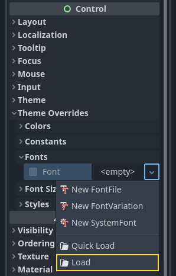
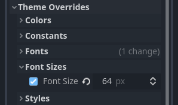
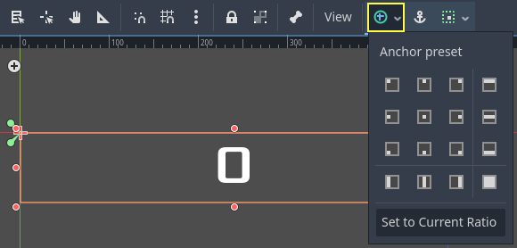
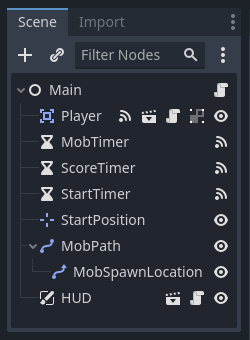
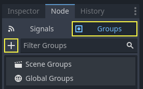
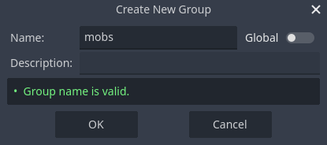
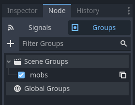

# 完整二维小游戏：HUD、开始按钮与重开

> 本文由 Godot 官方 4.5 版文档转换。下方中文导读、练习和验收是整理者的教学编排，英文正文是原教程主内容；不是官方中文逐句译文，也未声称已在引擎中执行全部练习。

## 适用任务

让分数、提示和开始按钮独立于游戏世界，连接开局、结束与清理流程。

## 前提

- DEV-009
- DEV-004

## 中文操作路线

1. 以 CanvasLayer 建立 HUD，添加分数标签、提示标签、开始按钮和消息计时器。
2. 设置控件锚点与布局，使不同窗口尺寸下仍处于预期位置。
3. 把按钮点击转换成 start_game 信号，让主场景响应新局请求。
4. 实现分数更新、短时提示和游戏结束提示，按顺序隐藏与显示按钮。
5. 新局开始前清理旧敌人，避免上一局实例留在场景中。

## 图示怎么读

先沿英文正文的步骤阅读对应截图；截图来自同一版本页面，局部操作顺序以紧邻图片的文字为准。图片下载到本地，可离线打开并放大检查。截图中的示例美术用于说明引擎操作，不代表本库要求采用该画风。

## 动手练习

连续输掉并重开三局，记录分数、按钮、消息和旧敌人的状态是否全部复位。

## 验收清单

- [ ] HUD 不随世界物体运动而漂移。
- [ ] 同一局只触发一次开始事件。
- [ ] 重开后没有旧敌人或上局分数残留。

## 版本与边界

HUD示例是结构练习。实际沉浸式像素游戏可减少屏幕控件数量，但不能省略必要状态反馈。

本次来源固定为 Godot 4.5 文档分支，抓取日期为 2026-10-29；它不是“当前最新版本”的声明。升级引擎时应重新核对节点名、属性名和 API。

## 原教程正文（英文，Markdown 转换）

### Heads up display

The final piece our game needs is a User Interface (UI) to display things like
score, a "game over" message, and a restart button.

Create a new scene, click the "Other Node" button and add a [CanvasLayer](https://docs.godotengine.org/en/4.5/classes/class_canvaslayer.html#class-canvaslayer) node named
`HUD`. "HUD" stands for "heads-up display", an informational display that
appears as an overlay on top of the game view.

The [CanvasLayer](https://docs.godotengine.org/en/4.5/classes/class_canvaslayer.html#class-canvaslayer) node lets us draw our UI elements on
a layer above the rest of the game, so that the information it displays isn't
covered up by any game elements like the player or mobs.

The HUD needs to display the following information:

- Score, changed by `ScoreTimer`.
- A message, such as "Game Over" or "Get Ready!"
- A "Start" button to begin the game.

The basic node for UI elements is [Control](https://docs.godotengine.org/en/4.5/classes/class_control.html#class-control). To create our
UI, we'll use two types of [Control](https://docs.godotengine.org/en/4.5/classes/class_control.html#class-control) nodes: [Label](https://docs.godotengine.org/en/4.5/classes/class_label.html#class-label) and [Button](https://docs.godotengine.org/en/4.5/classes/class_button.html#class-button).

Create the following as children of the `HUD` node:

- [Label](https://docs.godotengine.org/en/4.5/classes/class_label.html#class-label) named `ScoreLabel`.
- [Label](https://docs.godotengine.org/en/4.5/classes/class_label.html#class-label) named `Message`.
- [Button](https://docs.godotengine.org/en/4.5/classes/class_button.html#class-button) named `StartButton`.
- [Timer](https://docs.godotengine.org/en/4.5/classes/class_timer.html#class-timer) named `MessageTimer`.

Click on the `ScoreLabel` and type a number into the `Text` field in the
Inspector. The default font for `Control` nodes is small and doesn't scale
well. There is a font file included in the game assets called
"Xolonium-Regular.ttf". To use this font, do the following:

Under "Theme Overrides > Fonts", choose "Load" and select the "Xolonium-Regular.ttf" file.



The font size is still too small, increase it to `64` under "Theme Overrides > Font Sizes".
Once you've done this with the `ScoreLabel`, repeat the changes for the `Message` and `StartButton` nodes.



Note

**Anchors:** `Control` nodes have a position and size,
but they also have anchors. Anchors define the origin -
the reference point for the edges of the node.

Arrange the nodes as shown below.
You can drag the nodes to place them manually, or for more precise placement,
use "Anchor Presets".



#### ScoreLabel

1. Add the text `0`.
2. Set the "Horizontal Alignment" and "Vertical Alignment" to `Center`.
3. Choose the "Anchor Preset" `Center Top`.

#### Message

1. Add the text `Dodge the Creeps!`.
2. Set the "Horizontal Alignment" and "Vertical Alignment" to `Center`.
3. Set the "Autowrap Mode" to `Word`, otherwise the label will stay on one line.
4. Under "Control - Layout/Transform" set "Size X" to `480` to use the entire width of the screen.
5. Choose the "Anchor Preset" `Center`.

#### StartButton

1. Add the text `Start`.
2. Under "Control - Layout/Transform", set "Size X" to `200` and "Size Y" to `100`
   to add a little bit more padding between the border and text.
3. Choose the "Anchor Preset" `Center Bottom`.
4. Under "Control - Layout/Transform", set "Position Y" to `580`.

On the `MessageTimer`, set the `Wait Time` to `2` and set the `One Shot`
property to "On".

Now add this script to `HUD`:

```gdscript
extends CanvasLayer

# Notifies `Main` node that the button has been pressed
signal start_game
```

```csharp
using Godot;

public partial class HUD : CanvasLayer
{
    // Don't forget to rebuild the project so the editor knows about the new signal.

    [Signal]
    public delegate void StartGameEventHandler();
}
```

We now want to display a message temporarily,
such as "Get Ready", so we add the following code

```gdscript
func show_message(text):
    $Message.text = text
    $Message.show()
    $MessageTimer.start()
```

```csharp
public void ShowMessage(string text)
{
    var message = GetNode<Label>("Message");
    message.Text = text;
    message.Show();

    GetNode<Timer>("MessageTimer").Start();
}
```

We also need to process what happens when the player loses. The code below will show "Game Over" for 2 seconds, then return to the title screen and, after a brief pause, show the "Start" button.

```gdscript
func show_game_over():
    show_message("Game Over")
    # Wait until the MessageTimer has counted down.
    await $MessageTimer.timeout

    $Message.text = "Dodge the Creeps!"
    $Message.show()
    # Make a one-shot timer and wait for it to finish.
    await get_tree().create_timer(1.0).timeout
    $StartButton.show()
```

```csharp
async public void ShowGameOver()
{
    ShowMessage("Game Over");

    var messageTimer = GetNode<Timer>("MessageTimer");
    await ToSignal(messageTimer, Timer.SignalName.Timeout);

    var message = GetNode<Label>("Message");
    message.Text = "Dodge the Creeps!";
    message.Show();

    await ToSignal(GetTree().CreateTimer(1.0), SceneTreeTimer.SignalName.Timeout);
    GetNode<Button>("StartButton").Show();
}
```

Note

When you need to pause for a brief time, an alternative to using a
Timer node is to use the SceneTree's `create_timer()` function. This
can be very useful to add delays such as in the above code, where we
want to wait some time before showing the "Start" button.

Add the code below to `HUD` to update the score

```gdscript
func update_score(score):
    $ScoreLabel.text = str(score)
```

```csharp
public void UpdateScore(int score)
{
    GetNode<Label>("ScoreLabel").Text = score.ToString();
}
```

Connect the `pressed()` signal of `StartButton` and the `timeout()`
signal of `MessageTimer` to the `HUD` node, and add the following code to the new functions:

```gdscript
func _on_start_button_pressed():
    $StartButton.hide()
    start_game.emit()

func _on_message_timer_timeout():
    $Message.hide()
```

```csharp
// We also specified this function name in PascalCase in the editor's connection window.
private void OnStartButtonPressed()
{
    GetNode<Button>("StartButton").Hide();
    EmitSignal(SignalName.StartGame);
}

// We also specified this function name in PascalCase in the editor's connection window.
private void OnMessageTimerTimeout()
{
    GetNode<Label>("Message").Hide();
}
```

#### Connecting HUD to Main

Now that we're done creating the `HUD` scene, go back to `Main`. Instance
the `HUD` scene in `Main` like you did the `Player` scene. The scene tree
should look like this, so make sure you didn't miss anything:



Now we need to connect the `HUD` functionality to our `Main` script. This
requires a few additions to the `Main` scene:

In the Node tab, connect the HUD's `start_game` signal to the `new_game()`
function of the Main node by clicking the "Pick" button in the "Connect a Signal"
window and selecting the `new_game()` method or type "new_game" below "Receiver Method"
in the window. Verify that the green connection icon now appears next to
`func new_game()` in the script.

In `new_game()`, update the score display and show the "Get Ready" message:

```gdscript
$HUD.update_score(score)
$HUD.show_message("Get Ready")
```

```csharp
var hud = GetNode<HUD>("HUD");
hud.UpdateScore(_score);
hud.ShowMessage("Get Ready!");
```

In `game_over()` we need to call the corresponding `HUD` function:

```gdscript
$HUD.show_game_over()
```

```csharp
GetNode<HUD>("HUD").ShowGameOver();
```

Finally, add this to `_on_score_timer_timeout()` to keep the display in sync
with the changing score:

```gdscript
$HUD.update_score(score)
```

```csharp
GetNode<HUD>("HUD").UpdateScore(_score);
```

Warning

Remember to remove the call to `new_game()` from
`_ready()` if you haven't already, otherwise
your game will start automatically.

Now you're ready to play! Click the "Play the Project" button.

#### Removing old creeps

If you play until "Game Over" and then start a new game right away, the creeps
from the previous game may still be on the screen. It would be better if they
all disappeared at the start of a new game. We just need a way to tell *all* the
mobs to remove themselves. We can do this with the "group" feature.

In the `Mob` scene, select the root node and click the "Node" tab next to the
Inspector (the same place where you find the node's signals). Next to "Signals",
click "Groups" to open the group overview
and the "+" button to open the "Create New Group" dialog.



Name the group `mobs` and click "ok" to add a new scene group.



Now all mobs will be in the "mobs" group.



We can then add the following line to the `new_game()` function in `Main`:

```gdscript
get_tree().call_group("mobs", "queue_free")
```

```csharp
// Note that for calling Godot-provided methods with strings,
// we have to use the original Godot snake_case name.
GetTree().CallGroup("mobs", Node.MethodName.QueueFree);
```

The `call_group()` function calls the named function on every node in a
group - in this case we are telling every mob to delete itself.

The game's mostly done at this point. In the next and last part, we'll polish it
a bit by adding a background, looping music, and some keyboard shortcuts.

---

## 来源、配图与授权

- 原文：[Heads up display](https://docs.godotengine.org/en/4.5/getting_started/first_2d_game/06.heads_up_display.html)。
- 作者与署名：Juan Linietsky, Ariel Manzur and the Godot community。
- 文档许可：[CC BY 3.0](https://creativecommons.org/licenses/by/3.0/)；[官方仓库许可声明](https://github.com/godotengine/godot-docs/blob/4.5/README.md#license)。
- 许可全文：[godot-docs-4.5-LICENSE.txt](../../licenses/godot-docs-4.5-LICENSE.txt)。
- 本地原文主内容快照：[DEV-010.article.html](../../sources/game-development/DEV-010.article.html)。
- 变更：去除导航和用户评论入口，HTML 转 Markdown，图片改为相对路径，重复评级图标转成同义文字，新增中文导读、练习及验收。正文中的示例素材署名予以保留。
- 本整理稿的新增中文内容同样按 CC BY 3.0 提供，署名“Pixel Tutorial Library 整理者（Codex）”；不暗示原作者认可本整理稿。

| 本地图像 | 原图来源 | 图示语境 |
| --- | --- | --- |
| [custom_font_load_font.webp](../../assets/game-development/DEV-010/custom_font_load_font.webp) | [原图](https://docs.godotengine.org/en/4.5/_images/custom_font_load_font.webp) | 原教程图示：Heads up display — custom_font_load_font.webp |
| [custom_font_size.webp](../../assets/game-development/DEV-010/custom_font_size.webp) | [原图](https://docs.godotengine.org/en/4.5/_images/custom_font_size.webp) | 原教程图示：Heads up display — custom_font_size.webp |
| [ui_anchor.webp](../../assets/game-development/DEV-010/ui_anchor.webp) | [原图](https://docs.godotengine.org/en/4.5/_images/ui_anchor.webp) | 原教程图示：Heads up display — ui_anchor.webp |
| [completed_main_scene.webp](../../assets/game-development/DEV-010/completed_main_scene.webp) | [原图](https://docs.godotengine.org/en/4.5/_images/completed_main_scene.webp) | 原教程图示：Connecting HUD to Main — completed_main_scene.webp |
| [group_tab.webp](../../assets/game-development/DEV-010/group_tab.webp) | [原图](https://docs.godotengine.org/en/4.5/_images/group_tab.webp) | 原教程图示：Removing old creeps — group_tab.webp |
| [add_group_dialog.webp](../../assets/game-development/DEV-010/add_group_dialog.webp) | [原图](https://docs.godotengine.org/en/4.5/_images/add_group_dialog.webp) | 原教程图示：Removing old creeps — add_group_dialog.webp |
| [scene_group_mobs.webp](../../assets/game-development/DEV-010/scene_group_mobs.webp) | [原图](https://docs.godotengine.org/en/4.5/_images/scene_group_mobs.webp) | 原教程图示：Removing old creeps — scene_group_mobs.webp |
