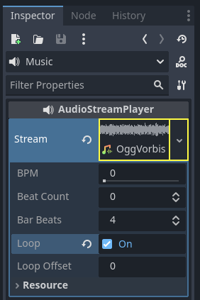
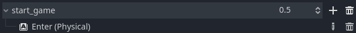
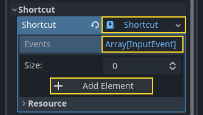
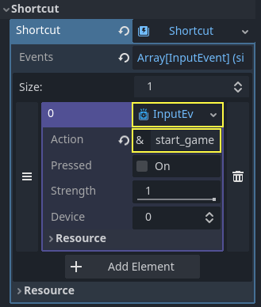
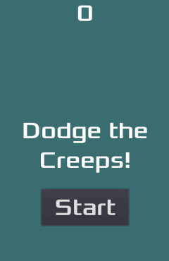

# 完整二维小游戏：声音、背景与交付检查

> 本文由 Godot 官方 4.5 版文档转换。下方中文导读、练习和验收是整理者的教学编排，英文正文是原教程主内容；不是官方中文逐句译文，也未声称已在引擎中执行全部练习。

## 适用任务

完成官方小游戏最后的声音和视觉设置，并把游戏循环作为整体检查。

## 前提

- DEV-010

## 中文操作路线

1. 按原文添加背景或调整背景色，确保角色和敌人具有足够对比。
2. 添加背景音乐和失败音效的音频播放器，并设置对应音频流。
3. 在开始和结束事件中控制音乐及音效播放，避免重复叠加。
4. 运行整个项目检查开始、游玩、失败、重开流程，再阅读官方后续学习建议。

## 图示怎么读

先沿英文正文的步骤阅读对应截图；截图来自同一版本页面，局部操作顺序以紧邻图片的文字为准。图片下载到本地，可离线打开并放大检查。截图中的示例美术用于说明引擎操作，不代表本库要求采用该画风。

## 动手练习

在静音与有声两种状态各完成一局，确保没有声音时也能理解开始和失败状态。

## 验收清单

- [ ] 重开不会叠加两层背景音乐。
- [ ] 失败音效在正确事件触发。
- [ ] 主场景能从干净启动进入完整回合。

## 版本与边界

本章完成的是入门项目的收尾；发布平台导出、签名与商店要求需要另查对应版本的导出文档。

本次来源固定为 Godot 4.5 文档分支，抓取日期为 2026-10-29；它不是“当前最新版本”的声明。升级引擎时应重新核对节点名、属性名和 API。

## 原教程正文（英文，Markdown 转换）

### Finishing up

We have now completed all the functionality for our game. Below are some
remaining steps to add a bit more "juice" to improve the game experience.

Feel free to expand the gameplay with your own ideas.

#### Background

The default gray background is not very appealing, so let's change its color.
One way to do this is to use a [ColorRect](https://docs.godotengine.org/en/4.5/classes/class_colorrect.html#class-colorrect) node. Make it
the first node under `Main` so that it will be drawn behind the other nodes.
`ColorRect` only has one property: `Color`. Choose a color you like and
select "Layout" -> "Anchors Preset" -> "Full Rect" either in the toolbar at the top of the viewport or in the inspector so that it covers the screen.

You could also add a background image, if you have one, by using a
[TextureRect](https://docs.godotengine.org/en/4.5/classes/class_texturerect.html#class-texturerect) node instead.

#### Sound effects

Sound and music can be the single most effective way to add appeal to the game
experience. In your game's **art** folder, you have two sound files: "House In a
Forest Loop.ogg" for background music, and "gameover.wav" for when the player
loses.

Add two [AudioStreamPlayer](https://docs.godotengine.org/en/4.5/classes/class_audiostreamplayer.html#class-audiostreamplayer) nodes as children of
`Main`. Name one of them `Music` and the other `DeathSound`. On each one,
click on the `Stream` property, select "Load", and choose the corresponding
audio file.

All audio is automatically imported with the `Loop` setting disabled.
If you want the music to loop seamlessly, click on the Stream file arrow,
select `Make Unique`, then click on the Stream file and check the `Loop` box.



To play the music, add `$Music.play()` in the `new_game()`
function and `$Music.stop()` in the `game_over()` function.

Finally, add `$DeathSound.play()` in the `game_over()` function.

```gdscript
func game_over():
    ...
    $Music.stop()
    $DeathSound.play()

func new_game():
    ...
    $Music.play()
```

```csharp
public void GameOver()
{
    ...
    GetNode<AudioStreamPlayer>("Music").Stop();
    GetNode<AudioStreamPlayer>("DeathSound").Play();
}

public void NewGame()
{
    ...
    GetNode<AudioStreamPlayer>("Music").Play();
}
```

#### Keyboard shortcut

Since the game is played with keyboard controls, it would be convenient if we
could also start the game by pressing a key on the keyboard. We can do this with
the "Shortcut" property of the `Button` node.

In a previous lesson, we created four input actions to move the character. We
will create a similar input action to map to the start button.

Select "Project" -> "Project Settings" and then click on the "Input Map"
tab. In the same way you created the movement input actions, create a new
input action called `start_game` and add a key mapping for the `Enter`
key.



Now would be a good time to add controller support if you have one available.
Attach or pair your controller and then under each input action that you wish
to add controller support for, click on the "+" button and press the corresponding
button, d-pad, or stick direction that you want to map to the respective input action.

In the `HUD` scene, select the `StartButton` and find its **Shortcut**
property in the Inspector. Create a new [Shortcut](https://docs.godotengine.org/en/4.5/classes/class_shortcut.html#class-shortcut) resource
by clicking within the box, open the **Events** array and add a new array element
to it by clicking on **Array[InputEvent] (size 0)**.



Create a new [InputEventAction](https://docs.godotengine.org/en/4.5/classes/class_inputeventaction.html#class-inputeventaction) and name it `start_game`.



Now when the start button appears, you can either click it or press `Enter`
to start the game.

And with that, you completed your first 2D game in Godot.



You got to make a player-controlled character, enemies that spawn randomly
around the game board, count the score, implement a game over and replay, user
interface, sounds, and more. Congratulations!

There's still much to learn, but you can take a moment to appreciate what you
achieved.

And when you're ready, you can move on to [Your first 3D game](https://docs.godotengine.org/en/4.5/getting_started/first_3d_game/index.html#doc-your-first-3d-game) to learn
to create a complete 3D game from scratch, in Godot.

#### Sharing the finished game with others

If you want people to try out your game without having to install Godot, you'll
need to export the project for each operating system you want the game to be
playable on. See [Exporting projects](https://docs.godotengine.org/en/4.5/tutorials/export/exporting_projects.html#doc-exporting-projects) for instructions.

After exporting the project, compress the exported executable and PCK file (not
the raw project files) to a ZIP file, then upload this ZIP file to a file
sharing website.

---

## 来源、配图与授权

- 原文：[Finishing up](https://docs.godotengine.org/en/4.5/getting_started/first_2d_game/07.finishing-up.html)。
- 作者与署名：Juan Linietsky, Ariel Manzur and the Godot community。
- 文档许可：[CC BY 3.0](https://creativecommons.org/licenses/by/3.0/)；[官方仓库许可声明](https://github.com/godotengine/godot-docs/blob/4.5/README.md#license)。
- 许可全文：[godot-docs-4.5-LICENSE.txt](../../licenses/godot-docs-4.5-LICENSE.txt)。
- 本地原文主内容快照：[DEV-011.article.html](../../sources/game-development/DEV-011.article.html)。
- 变更：去除导航和用户评论入口，HTML 转 Markdown，图片改为相对路径，重复评级图标转成同义文字，新增中文导读、练习及验收。正文中的示例素材署名予以保留。
- 本整理稿的新增中文内容同样按 CC BY 3.0 提供，署名“Pixel Tutorial Library 整理者（Codex）”；不暗示原作者认可本整理稿。

| 本地图像 | 原图来源 | 图示语境 |
| --- | --- | --- |
| [unique_resource_music.webp](../../assets/game-development/DEV-011/unique_resource_music.webp) | [原图](https://docs.godotengine.org/en/4.5/_images/unique_resource_music.webp) | 原教程图示：Sound effects — unique_resource_music.webp |
| [input-mapping-start_game.webp](../../assets/game-development/DEV-011/input-mapping-start_game.webp) | [原图](https://docs.godotengine.org/en/4.5/_images/input-mapping-start_game.webp) | 原教程图示：Keyboard shortcut — input-mapping-start_game.webp |
| [start_button_shortcut.webp](../../assets/game-development/DEV-011/start_button_shortcut.webp) | [原图](https://docs.godotengine.org/en/4.5/_images/start_button_shortcut.webp) | 原教程图示：Keyboard shortcut — start_button_shortcut.webp |
| [start_button_shortcut2.webp](../../assets/game-development/DEV-011/start_button_shortcut2.webp) | [原图](https://docs.godotengine.org/en/4.5/_images/start_button_shortcut2.webp) | 原教程图示：Keyboard shortcut — start_button_shortcut2.webp |
| [dodge_preview.gif](../../assets/game-development/DEV-011/dodge_preview.gif) | [原图](https://docs.godotengine.org/en/4.5/_images/dodge_preview.gif) | 原教程图示：Keyboard shortcut — dodge_preview.gif |
