# 俯视角色的八向移动、朝向与点击移动

> 本文由 Godot 官方 4.5 版文档转换。下方中文导读、练习和验收是整理者的教学编排，英文正文是原教程主内容；不是官方中文逐句译文，也未声称已在引擎中执行全部练习。

## 适用任务

对照四种二维控制方案，优先掌握适合俯视游戏的八向移动。

## 前提

- 项目已配置输入动作
- DEV-001

## 中文操作路线

1. 建立 CharacterBody2D 根节点，添加 Sprite2D 和 CollisionShape2D。
2. 在 Input Map 中建立 left、right、up、down 等动作，核对大小写。
3. 读取 Input.get_vector，将结果乘以速度写入 velocity，并在物理更新中调用 move_and_slide。
4. 比较旋转前进与鼠标朝向两种方案，确定角色朝向与运动方向是否需要分离。
5. 点击移动时存储目标坐标，并设置抵达距离阈值，避免越过目标后左右振荡。

## 图示怎么读

先沿英文正文的步骤阅读对应截图；截图来自同一版本页面，局部操作顺序以紧邻图片的文字为准。图片下载到本地，可离线打开并放大检查。截图中的示例美术用于说明引擎操作，不代表本库要求采用该画风。

## 动手练习

做一个四面有墙的小院，分别使用键盘八向与点击目标两种输入；要求抵达目标后停止。

## 验收清单

- [ ] 八向速度一致。
- [ ] 碰墙后不穿透。
- [ ] 点击目标靠近时不抖动。
- [ ] 输入名与原文脚本完全一致。

## 版本与边界

原文嵌入的 webm 动态演示保留本地原视频及静态抽帧辅助阅读；抽帧不等同于逐帧动作或语音转录，实际转存状态见本文来源说明。

本次来源固定为 Godot 4.5 文档分支，抓取日期为 2026-10-29；它不是“当前最新版本”的声明。升级引擎时应重新核对节点名、属性名和 API。

## 原教程正文（英文，Markdown 转换）

### 2D movement overview

#### Introduction

Every beginner has been there: "How do I move my character?" Depending on the
style of game you're making, you may have special requirements, but in general
the movement in most 2D games is based on a small number of designs.

We'll use [CharacterBody2D](https://docs.godotengine.org/en/4.5/classes/class_characterbody2d.html#class-characterbody2d) for these examples,
but the principles will apply to other node types (Area2D, RigidBody2D) as well.

#### Setup

Each example below uses the same scene setup. Start with a `CharacterBody2D` with two
children: `Sprite2D` and `CollisionShape2D`. You can use the Godot icon ("icon.png")
for the Sprite2D's texture or use any other 2D image you have.

Open `Project -> Project Settings` and select the "Input Map" tab. Add the following
input actions (see [InputEvent](https://docs.godotengine.org/en/4.5/tutorials/inputs/inputevent.html#doc-inputevent) for details):

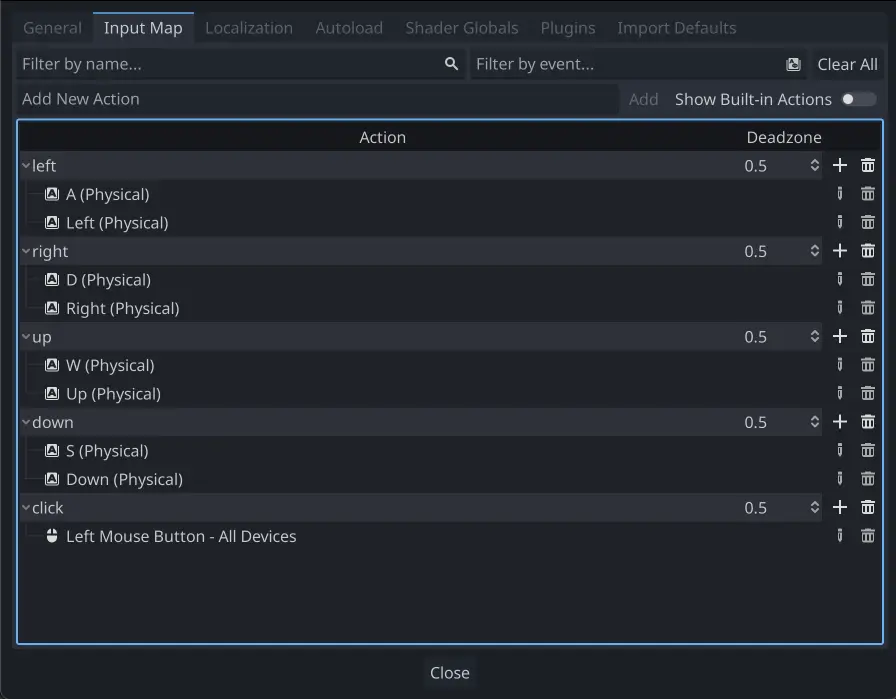

#### 8-way movement

In this scenario, you want the user to press the four directional keys (up/left/down/right
or W/A/S/D) and move in the selected direction. The name "8-way movement" comes from the
fact that the player can move diagonally by pressing two keys at the same time.

[8-way movement（本地原视频；下方为10%、50%、90%位置静态抽帧，未转录视频内容）](../../assets/game-development/DEV-012/movement_8way.webm)

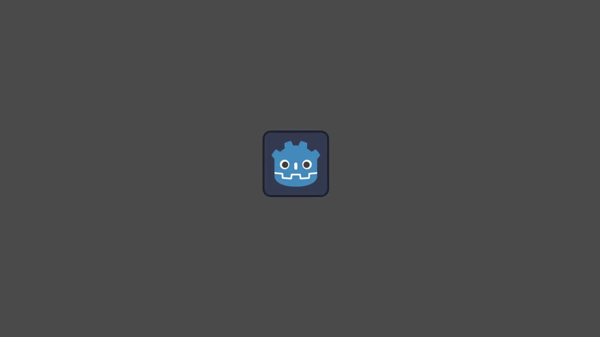

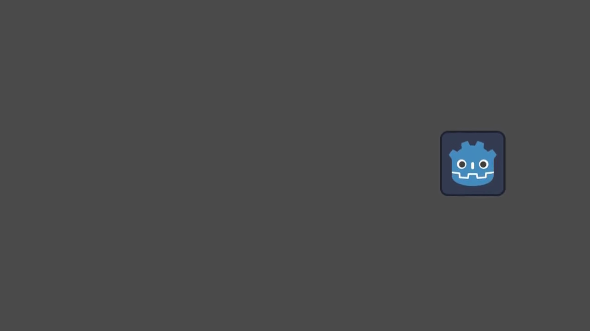

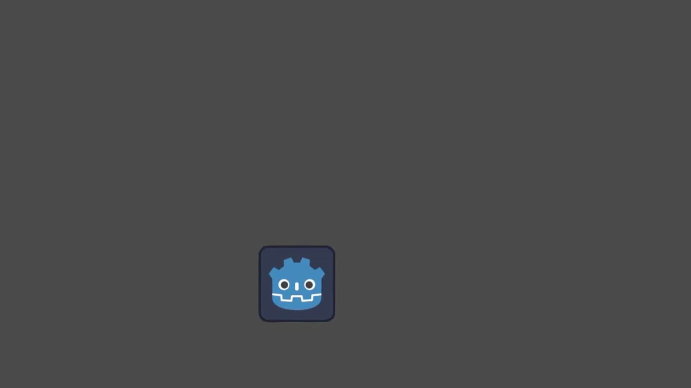

Add a script to the character body and add the following code:

```gdscript
extends CharacterBody2D

@export var speed = 400

func get_input():
    var input_direction = Input.get_vector("left", "right", "up", "down")
    velocity = input_direction * speed

func _physics_process(delta):
    get_input()
    move_and_slide()
```

```csharp
using Godot;

public partial class Movement : CharacterBody2D
{
    [Export]
    public int Speed { get; set; } = 400;

    public void GetInput()
    {

        Vector2 inputDirection = Input.GetVector("left", "right", "up", "down");
        Velocity = inputDirection * Speed;
    }

    public override void _PhysicsProcess(double delta)
    {
        GetInput();
        MoveAndSlide();
    }
}
```

In the `get_input()` function, we use [Input](https://docs.godotengine.org/en/4.5/classes/class_input.html#class-input) `get_vector()` to check for the
four key events and sum return a direction vector.

We can then set our velocity by multiplying this direction vector, which has a
length of `1`, by our desired speed.

Tip

If you've never used vector math before, or need a refresher,
you can see an explanation of vector usage in Godot at [Vector math](https://docs.godotengine.org/en/4.5/tutorials/math/vector_math.html#doc-vector-math).

Note

If the code above does nothing when you press the keys, double-check that
you've set up input actions correctly as described in the
[Setup](https://docs.godotengine.org/en/4.5/tutorials/2d/2d_movement.html#doc-2d-movement-setup) part of this tutorial.

#### Rotation + movement

This type of movement is sometimes called "Asteroids-style" because it resembles
how that classic arcade game worked. Pressing left/right rotates the character,
while up/down moves it forward or backward in whatever direction it's facing.

[Rotation + movement（本地原视频；下方为10%、50%、90%位置静态抽帧，未转录视频内容）](../../assets/game-development/DEV-012/movement_rotate_keyboard.webm)

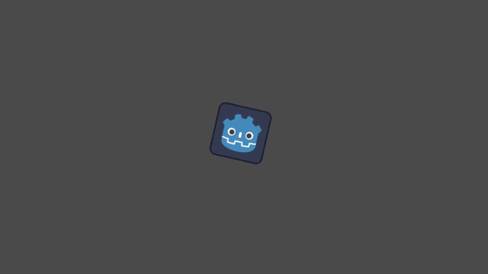

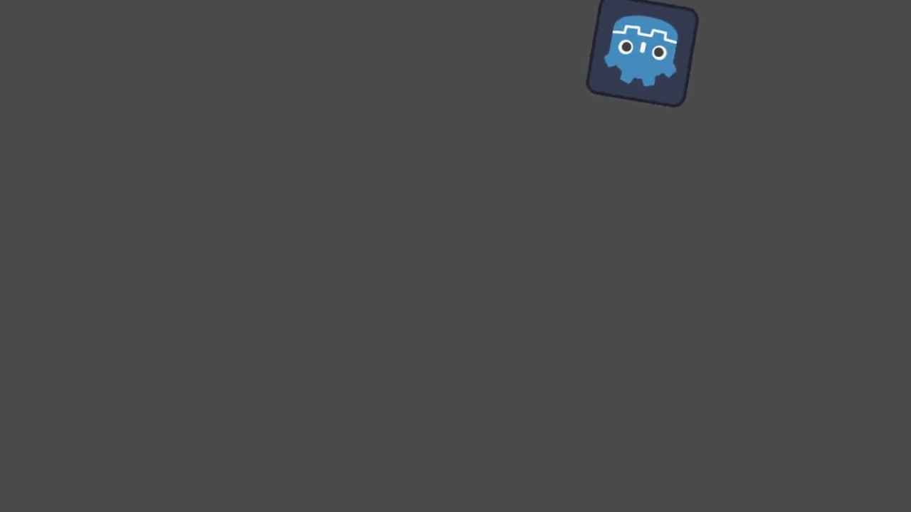

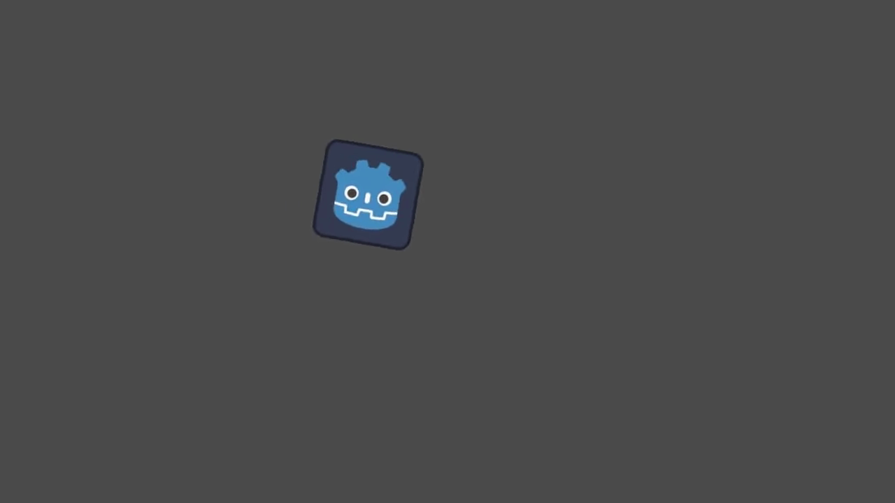

```gdscript
extends CharacterBody2D

@export var speed = 400
@export var rotation_speed = 1.5

var rotation_direction = 0

func get_input():
    rotation_direction = Input.get_axis("left", "right")
    velocity = transform.x * Input.get_axis("down", "up") * speed

func _physics_process(delta):
    get_input()
    rotation += rotation_direction * rotation_speed * delta
    move_and_slide()
```

```csharp
using Godot;

public partial class Movement : CharacterBody2D
{
    [Export]
    public int Speed { get; set; } = 400;

    [Export]
    public float RotationSpeed { get; set; } = 1.5f;

    private float _rotationDirection;

    public void GetInput()
    {
        _rotationDirection = Input.GetAxis("left", "right");
        Velocity = Transform.X * Input.GetAxis("down", "up") * Speed;
    }

    public override void _PhysicsProcess(double delta)
    {
        GetInput();
        Rotation += _rotationDirection * RotationSpeed * (float)delta;
        MoveAndSlide();
    }
}
```

Here we've added two variables to track our rotation direction and speed.
The rotation is applied directly to the body's `rotation` property.

To set the velocity, we use the body's `transform.x` which is a vector pointing
in the body's "forward" direction, and multiply that by the speed.

#### Rotation + movement (mouse)

This style of movement is a variation of the previous one. This time, the direction
is set by the mouse position instead of the keyboard. The character will always
"look at" the mouse pointer. The forward/back inputs remain the same, however.

[Rotation + movement (mouse)（本地原视频；下方为10%、50%、90%位置静态抽帧，未转录视频内容）](../../assets/game-development/DEV-012/movement_rotate_mouse.webm)

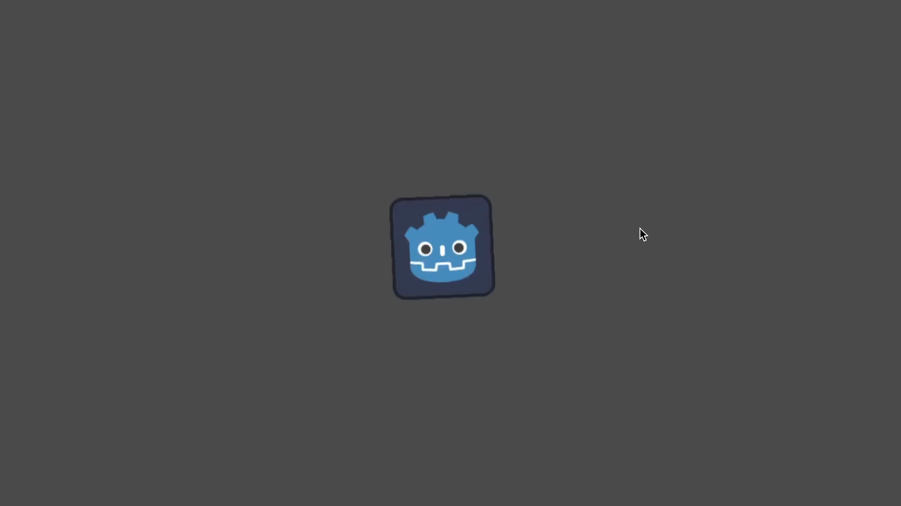

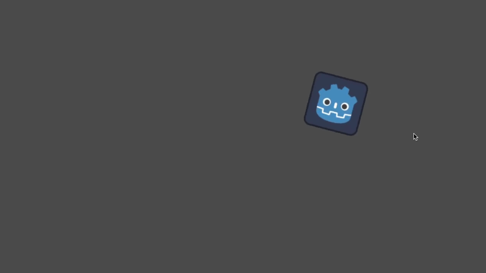

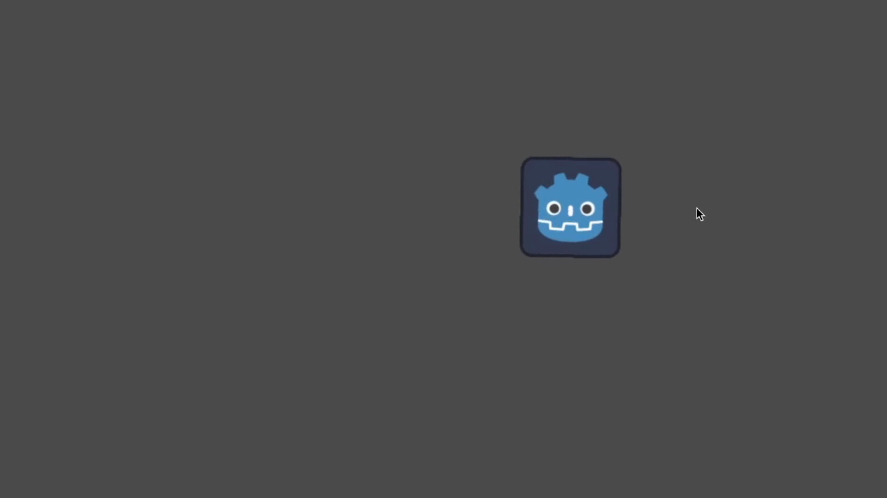

```gdscript
extends CharacterBody2D

@export var speed = 400

func get_input():
    look_at(get_global_mouse_position())
    velocity = transform.x * Input.get_axis("down", "up") * speed

func _physics_process(delta):
    get_input()
    move_and_slide()
```

```csharp
using Godot;

public partial class Movement : CharacterBody2D
{
    [Export]
    public int Speed { get; set; } = 400;

    public void GetInput()
    {
        LookAt(GetGlobalMousePosition());
        Velocity = Transform.X * Input.GetAxis("down", "up") * Speed;
    }

    public override void _PhysicsProcess(double delta)
    {
        GetInput();
        MoveAndSlide();
    }
}
```

Here we're using the [Node2D](https://docs.godotengine.org/en/4.5/classes/class_node2d.html#class-node2d) `look_at()` method to
point the player towards the mouse's position. Without this function, you
could get the same effect by setting the angle like this:

```gdscript
rotation = get_global_mouse_position().angle_to_point(position)
```

```csharp
var rotation = GetGlobalMousePosition().AngleToPoint(Position);
```

#### Click-and-move

This last example uses only the mouse to control the character. Clicking
on the screen will cause the player to move to the target location.

[Click-and-move（本地原视频；下方为10%、50%、90%位置静态抽帧，未转录视频内容）](../../assets/game-development/DEV-012/movement_click.webm)

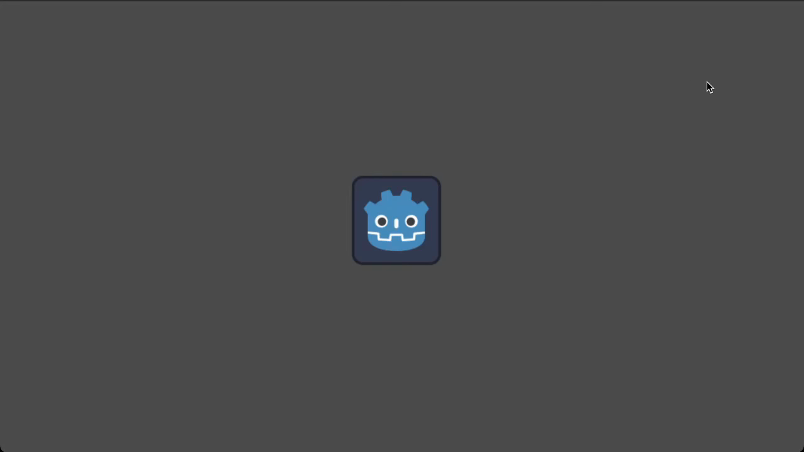

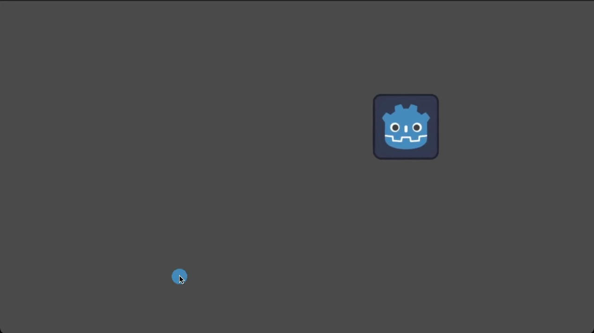

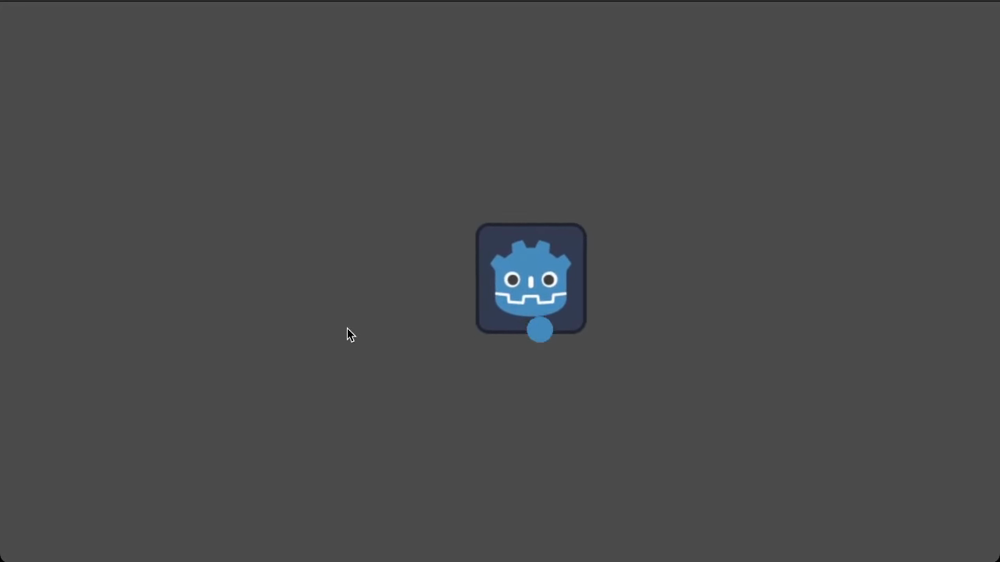

```gdscript
extends CharacterBody2D

@export var speed = 400

var target = position

func _input(event):
    # Use is_action_pressed to only accept single taps as input instead of mouse drags.
    if event.is_action_pressed(&"click"):
        target = get_global_mouse_position()

func _physics_process(delta):
    velocity = position.direction_to(target) * speed
    # look_at(target)
    if position.distance_to(target) > 10:
        move_and_slide()
```

```csharp
using Godot;

public partial class Movement : CharacterBody2D
{
    [Export]
    public int Speed { get; set; } = 400;

    private Vector2 _target;

    public override void _Input(InputEvent @event)
    {
        // Use IsActionPressed to only accept single taps as input instead of mouse drags.
        if (@event.IsActionPressed("click"))
        {
            _target = GetGlobalMousePosition();
        }
    }

    public override void _PhysicsProcess(double delta)
    {
        Velocity = Position.DirectionTo(_target) * Speed;
        // LookAt(_target);
        if (Position.DistanceTo(_target) > 10)
        {
            MoveAndSlide();
        }
    }
}
```

Note the `distance_to()` check we make prior to movement. Without this test,
the body would "jitter" upon reaching the target position, as it moves
slightly past the position and tries to move back, only to move too far and
repeat.

Uncommenting the `look_at()` line will also turn the body to point in its
direction of motion if you prefer.

Tip

This technique can also be used as the basis of a "following" character.
The `target` position can be that of any object you want to move to.

#### Summary

You may find these code samples useful as starting points for your own projects.
Feel free to use them and experiment with them to see what you can make.

You can download this sample project here:
[2d_movement_starter.zip](https://github.com/godotengine/godot-docs-project-starters/releases/download/latest-4.x/2d_movement_starter.zip)

---

## 来源、配图与授权

- 原文：[2D movement overview](https://docs.godotengine.org/en/4.5/tutorials/2d/2d_movement.html)。
- 作者与署名：Juan Linietsky, Ariel Manzur and the Godot community。
- 文档许可：[CC BY 3.0](https://creativecommons.org/licenses/by/3.0/)；[官方仓库许可声明](https://github.com/godotengine/godot-docs/blob/4.5/README.md#license)。
- 许可全文：[godot-docs-4.5-LICENSE.txt](../../licenses/godot-docs-4.5-LICENSE.txt)。
- 本地原文主内容快照：[DEV-012.article.html](../../sources/game-development/DEV-012.article.html)。
- 变更：去除导航和用户评论入口，HTML 转 Markdown，图片改为相对路径，重复评级图标转成同义文字，新增中文导读、练习及验收。正文中的示例素材署名予以保留。
- 本整理稿的新增中文内容同样按 CC BY 3.0 提供，署名“Pixel Tutorial Library 整理者（Codex）”；不暗示原作者认可本整理稿。
- 嵌入动态演示保存原始 webm，并按时长的10%、50%、90%提取静态帧辅助离线阅读；这是画面抽帧，不是语音、字幕或完整动作转录。

| 本地图像 | 原图来源 | 图示语境 |
| --- | --- | --- |
| [movement_inputs.webp](../../assets/game-development/DEV-012/movement_inputs.webp) | [原图](https://docs.godotengine.org/en/4.5/_images/movement_inputs.webp) | 原教程图示：Setup — movement_inputs.webp |
| [movement_8way-keyframe-1.png](../../assets/game-development/DEV-012/movement_8way-keyframe-1.png) | [原图](https://docs.godotengine.org/en/4.5/_images/movement_8way.webm) | 8-way movement：原视频抽帧 0.81 秒（静态观察，不是视频转录） |
| [movement_8way-keyframe-2.png](../../assets/game-development/DEV-012/movement_8way-keyframe-2.png) | [原图](https://docs.godotengine.org/en/4.5/_images/movement_8way.webm) | 8-way movement：原视频抽帧 4.05 秒（静态观察，不是视频转录） |
| [movement_8way-keyframe-3.png](../../assets/game-development/DEV-012/movement_8way-keyframe-3.png) | [原图](https://docs.godotengine.org/en/4.5/_images/movement_8way.webm) | 8-way movement：原视频抽帧 7.29 秒（静态观察，不是视频转录） |
| [movement_rotate_keyboard-keyframe-1.png](../../assets/game-development/DEV-012/movement_rotate_keyboard-keyframe-1.png) | [原图](https://docs.godotengine.org/en/4.5/_images/movement_rotate_keyboard.webm) | Rotation + movement：原视频抽帧 1.18 秒（静态观察，不是视频转录） |
| [movement_rotate_keyboard-keyframe-2.png](../../assets/game-development/DEV-012/movement_rotate_keyboard-keyframe-2.png) | [原图](https://docs.godotengine.org/en/4.5/_images/movement_rotate_keyboard.webm) | Rotation + movement：原视频抽帧 5.9 秒（静态观察，不是视频转录） |
| [movement_rotate_keyboard-keyframe-3.png](../../assets/game-development/DEV-012/movement_rotate_keyboard-keyframe-3.png) | [原图](https://docs.godotengine.org/en/4.5/_images/movement_rotate_keyboard.webm) | Rotation + movement：原视频抽帧 10.62 秒（静态观察，不是视频转录） |
| [movement_rotate_mouse-keyframe-1.png](../../assets/game-development/DEV-012/movement_rotate_mouse-keyframe-1.png) | [原图](https://docs.godotengine.org/en/4.5/_images/movement_rotate_mouse.webm) | Rotation + movement (mouse)：原视频抽帧 0.93 秒（静态观察，不是视频转录） |
| [movement_rotate_mouse-keyframe-2.png](../../assets/game-development/DEV-012/movement_rotate_mouse-keyframe-2.png) | [原图](https://docs.godotengine.org/en/4.5/_images/movement_rotate_mouse.webm) | Rotation + movement (mouse)：原视频抽帧 4.65 秒（静态观察，不是视频转录） |
| [movement_rotate_mouse-keyframe-3.png](../../assets/game-development/DEV-012/movement_rotate_mouse-keyframe-3.png) | [原图](https://docs.godotengine.org/en/4.5/_images/movement_rotate_mouse.webm) | Rotation + movement (mouse)：原视频抽帧 8.37 秒（静态观察，不是视频转录） |
| [movement_click-keyframe-1.png](../../assets/game-development/DEV-012/movement_click-keyframe-1.png) | [原图](https://docs.godotengine.org/en/4.5/_images/movement_click.webm) | Click-and-move：原视频抽帧 0.447 秒（静态观察，不是视频转录） |
| [movement_click-keyframe-2.png](../../assets/game-development/DEV-012/movement_click-keyframe-2.png) | [原图](https://docs.godotengine.org/en/4.5/_images/movement_click.webm) | Click-and-move：原视频抽帧 2.235 秒（静态观察，不是视频转录） |
| [movement_click-keyframe-3.png](../../assets/game-development/DEV-012/movement_click-keyframe-3.png) | [原图](https://docs.godotengine.org/en/4.5/_images/movement_click.webm) | Click-and-move：原视频抽帧 4.023 秒（静态观察，不是视频转录） |
