# 把角色帧图和精灵表接成二维动画

> 本文由 Godot 官方 4.5 版文档转换。下方中文导读、练习和验收是整理者的教学编排，英文正文是原教程主内容；不是官方中文逐句译文，也未声称已在引擎中执行全部练习。

## 适用任务

比较散帧、精灵表与属性动画三条导入路线，保证动作帧顺序和速度正确。

## 前提

- 有合法来源的散帧或 sprite sheet
- 了解角色场景

## 中文操作路线

1. 散帧方案：给 AnimatedSprite2D 创建 SpriteFrames，再把同一动作的图片按序加入。
2. 精灵表方案：用 Add frames from sprite sheet 设置横纵格数，按播放顺序选择帧。
3. 为动作命名并设置播放速度与循环状态，再在运行时调用 play 切换动作。
4. AnimationPlayer 方案：为 Sprite2D 配置横纵帧数，把 frame 属性插入关键帧轨道。
5. 接入角色控制脚本，分别检查移动、停下和方向翻转的表现。

## 图示怎么读

先沿英文正文的步骤阅读对应截图；截图来自同一版本页面，局部操作顺序以紧邻图片的文字为准。图片下载到本地，可离线打开并放大检查。截图中的示例美术用于说明引擎操作，不代表本库要求采用该画风。

## 动手练习

接入四向 idle 与 walk，每个方向都从固定锚点播放；用同一测试场景对比两种动画节点方案。

## 验收清单

- [ ] 没有采到相邻帧边缘。
- [ ] 切换动作不改变角色基准点。
- [ ] 循环动画首尾连续，非循环动作不会意外重播。

## 版本与边界

文中部分示例美术署名为 ansimuz 与 tgfcoder，保留原署名。软件截图的教程许可不自动等于所有素材包的单独使用许可。

本次来源固定为 Godot 4.5 文档分支，抓取日期为 2026-10-29；它不是“当前最新版本”的声明。升级引擎时应重新核对节点名、属性名和 API。

## 原教程正文（英文，Markdown 转换）

### 2D sprite animation

#### Introduction

In this tutorial, you'll learn how to create 2D animated
characters with the AnimatedSprite2D class and the AnimationPlayer.
Typically, when you create or download an animated character,
it will come in one of two ways: as individual images or as a single sprite sheet
containing all the animation's frames.
Both can be animated in Godot with the AnimatedSprite2D class.

First, we'll use [AnimatedSprite2D](https://docs.godotengine.org/en/4.5/classes/class_animatedsprite2d.html#class-animatedsprite2d) to
animate a collection of individual images.
Then we will animate a sprite sheet using this class.
Finally, we will learn another way to animate a sprite sheet
with [AnimationPlayer](https://docs.godotengine.org/en/4.5/classes/class_animationplayer.html#class-animationplayer) and the *Animation*
property of [Sprite2D](https://docs.godotengine.org/en/4.5/classes/class_sprite2d.html#class-sprite2d).

Note

Art for the following examples by <https://opengameart.org/users/ansimuz> and tgfcoder.

#### Individual images with AnimatedSprite2D

In this scenario, you have a collection of images, each containing one of your
character's animation frames. For this example, we'll use the following
animation:

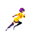

You can download the images here:
[2d_sprite_animation_assets.zip](https://github.com/godotengine/godot-docs-project-starters/releases/download/latest-4.x/2d_sprite_animation_assets.zip)

Unzip the images and place them in your project folder. Set up your scene tree
with the following nodes:

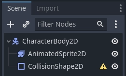

Note

The root node could also be [Area2D](https://docs.godotengine.org/en/4.5/classes/class_area2d.html#class-area2d) or
[RigidBody2D](https://docs.godotengine.org/en/4.5/classes/class_rigidbody2d.html#class-rigidbody2d). The animation will still be
made in the same way. Once the animation is completed, you can
assign a shape to the CollisionShape2D. See
[Physics Introduction](https://docs.godotengine.org/en/4.5/tutorials/physics/physics_introduction.html#doc-physics-introduction) for more
information.

Now select the `AnimatedSprite2D` and in its *SpriteFrames* property, select
"New SpriteFrames".

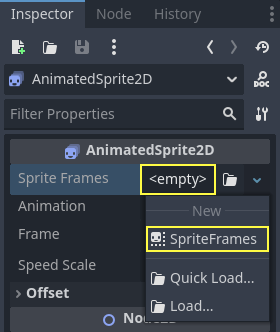

Click on the new SpriteFrames resource and you'll see a new panel appear at the
bottom of the editor window:

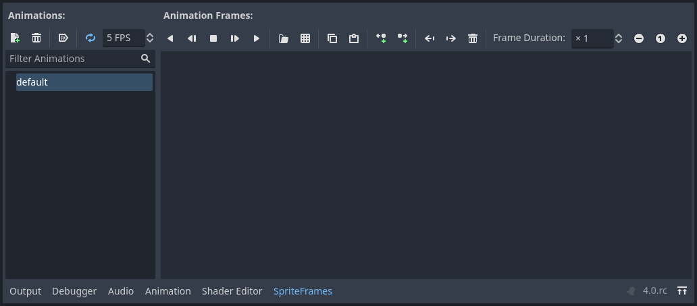

From the FileSystem dock on the left side, drag the 8 individual images into
the center part of the SpriteFrames panel. On the left side, change the name
of the animation from "default" to "run".

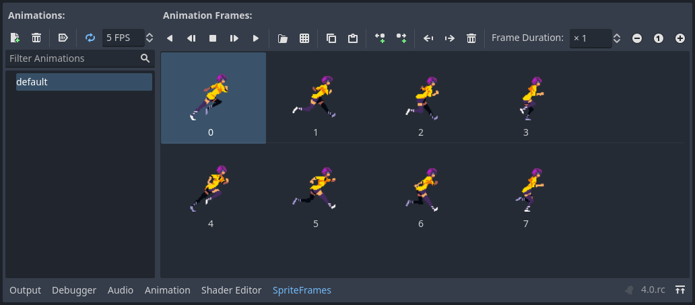

Use the "Play" buttons on the top-right of the *Filter Animations* input to preview the animation.
You should now see the animation playing in the viewport.
However, it is a bit slow. To fix this,
change the *Speed (FPS)* setting in the SpriteFrames panel to 10.

You can add additional animations by clicking the "Add Animation" button and
adding additional images.

##### Controlling the animation

Once the animation is complete, you can control the animation via code using
the `play()` and `stop()` methods. Here is a brief example to play the
animation while the right arrow key is held, and stop it when the key is
released.

```gdscript
extends CharacterBody2D

@onready var _animated_sprite = $AnimatedSprite2D

func _process(_delta):
    if Input.is_action_pressed("ui_right"):
        _animated_sprite.play("run")
    else:
        _animated_sprite.stop()
```

```csharp
using Godot;

public partial class Character : CharacterBody2D
{
    private AnimatedSprite2D _animatedSprite;

    public override void _Ready()
    {
        _animatedSprite = GetNode<AnimatedSprite2D>("AnimatedSprite2D");
    }

    public override void _Process(double delta)
    {
        if (Input.IsActionPressed("ui_right"))
        {
            _animatedSprite.Play("run");
        }
        else
        {
            _animatedSprite.Stop();
        }
    }
}
```

#### Sprite sheet with AnimatedSprite2D

You can also easily animate from a sprite sheet with the class `AnimatedSprite2D`.
We will use this public domain sprite sheet:

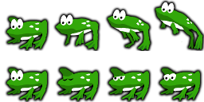

Right-click the image and choose "Save Image As" to download it,
and then copy the image into your project folder.

Set up your scene tree the same way you did previously when using individual images.
Select the `AnimatedSprite2D` and in its *SpriteFrames* property, select "New SpriteFrames".

Click on the new SpriteFrames resource.
This time, when the bottom panel appears, select "Add frames from a Sprite Sheet".

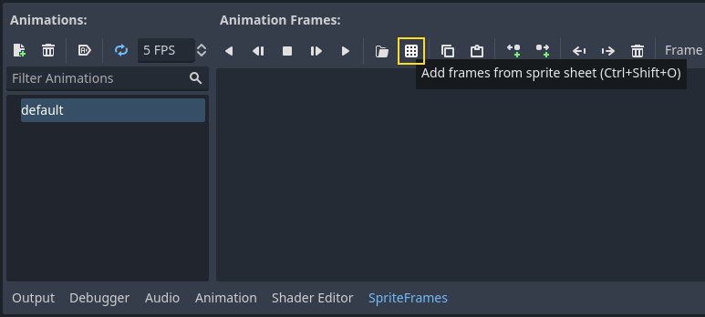

You will be prompted to open a file. Select your sprite sheet.

A new window will open, showing your sprite sheet.
The first thing you will need to do is to change the number of vertical and horizontal images in your sprite sheet.
In this sprite sheet, we have four images horizontally and two images vertically.

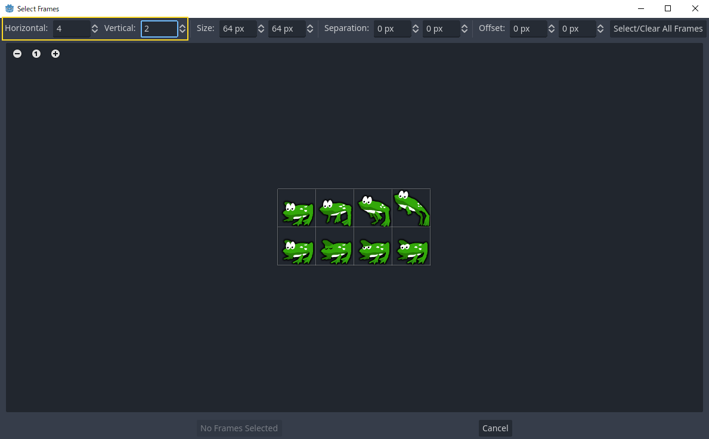

Next, select the frames from the sprite sheet that you want to include in your animation.
We will select the top four, then click "Add 4 frames" to create the animation.

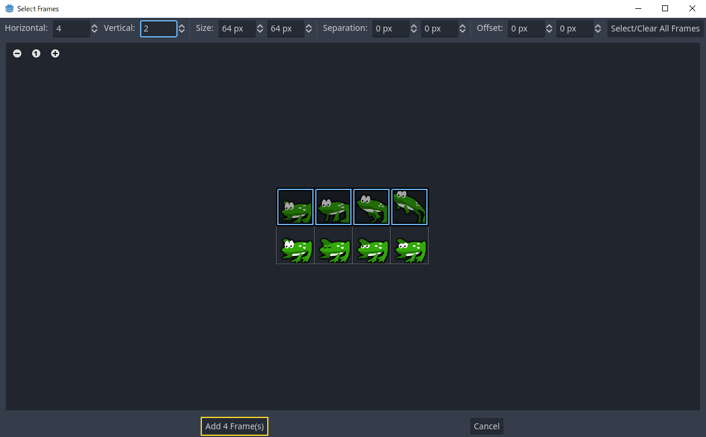

You will now see your animation under the list of animations in the bottom panel.
Double click on default to change the name of the animation to jump.

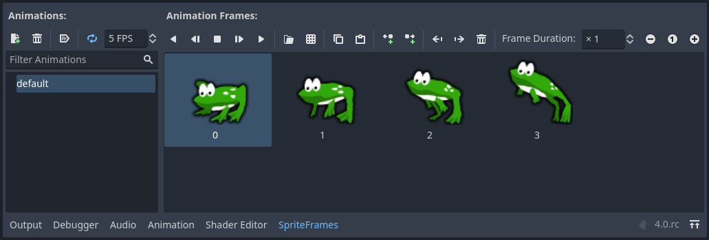

Finally, check the play button on the SpriteFrames editor to see your frog jump!

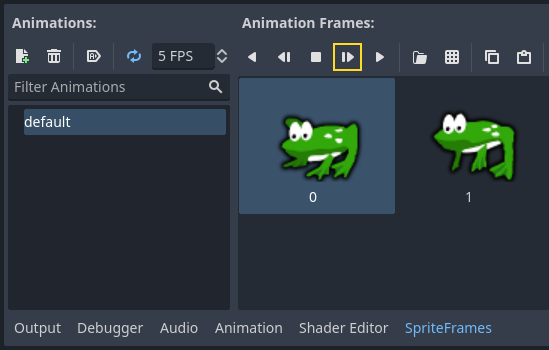

#### Sprite sheet with AnimationPlayer

Another way that you can animate when using a sprite sheet is to use a standard
[Sprite2D](https://docs.godotengine.org/en/4.5/classes/class_sprite2d.html#class-sprite2d) node to display the texture, and then animating the
change from texture to texture with [AnimationPlayer](https://docs.godotengine.org/en/4.5/classes/class_animationplayer.html#class-animationplayer).

Consider this sprite sheet, which contains 6 frames of animation:

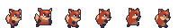

Right-click the image and choose "Save Image As" to download, then copy the
image into your project folder.

Our goal is to display these images one after another in a loop. Start by
setting up your scene tree:

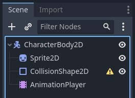

Note

The root node could also be [Area2D](https://docs.godotengine.org/en/4.5/classes/class_area2d.html#class-area2d) or
[RigidBody2D](https://docs.godotengine.org/en/4.5/classes/class_rigidbody2d.html#class-rigidbody2d). The animation will still be
made in the same way. Once the animation is completed, you can
assign a shape to the CollisionShape2D. See
[Physics Introduction](https://docs.godotengine.org/en/4.5/tutorials/physics/physics_introduction.html#doc-physics-introduction) for more
information.

Drag the spritesheet into the Sprite's *Texture* property, and you'll see the
whole sheet displayed on the screen. To slice it up into individual frames,
expand the *Animation* section in the Inspector and set the *Hframes* to `6`.
*Hframes* and *Vframes* are the number of horizontal and vertical frames in
your sprite sheet.

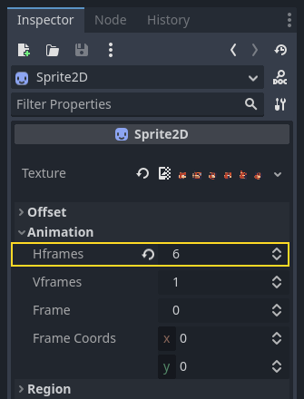

Now try changing the value of the *Frame* property. You'll see that it ranges
from `0` to `5` and the image displayed by the Sprite2D changes accordingly.
This is the property we'll be animating.

Select the `AnimationPlayer` and click the "Animation" button followed by
"New". Name the new animation "walk". Set the animation length to `0.6` and
click the "Loop" button so that our animation will repeat.

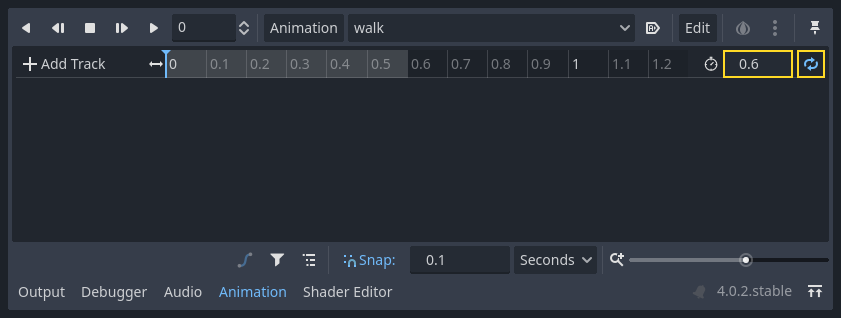

Now select the `Sprite2D` node and click the key icon to add a new track.

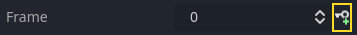

Continue adding frames at each point in the timeline (`0.1` seconds by
default), until you have all the frames from 0 to 5. You'll see the frames
actually appearing in the animation track:

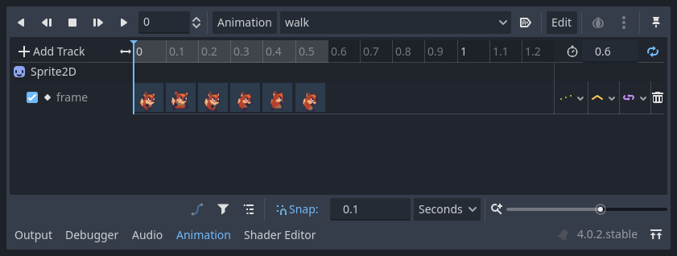

Press "Play" on the animation to see how it looks.

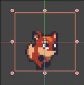

##### Controlling an AnimationPlayer animation

Like with AnimatedSprite2D, you can control the animation via code using
the `play()` and `stop()` methods. Again, here is an example to play the
animation while the right arrow key is held, and stop it when the key is
released.

```gdscript
extends CharacterBody2D

@onready var _animation_player = $AnimationPlayer

func _process(_delta):
    if Input.is_action_pressed("ui_right"):
        _animation_player.play("walk")
    else:
        _animation_player.stop()
```

```csharp
using Godot;

public partial class Character : CharacterBody2D
{
    private AnimationPlayer _animationPlayer;

    public override void _Ready()
    {
        _animationPlayer = GetNode<AnimationPlayer>("AnimationPlayer");
    }

    public override void _Process(double delta)
    {
        if (Input.IsActionPressed("ui_right"))
        {
            _animationPlayer.Play("walk");
        }
        else
        {
            _animationPlayer.Stop();
        }
    }
}
```

Note

If updating both an animation and a separate property at once
(for example, a platformer may update the sprite's `h_flip`/`v_flip`
properties when a character turns while starting a 'turning' animation),
it's important to keep in mind that `play()` isn't applied instantly.
Instead, it's applied the next time the [AnimationPlayer](https://docs.godotengine.org/en/4.5/classes/class_animationplayer.html#class-animationplayer) is processed.
This may end up being on the next frame, causing a 'glitch' frame,
where the property change was applied, but the animation was not.
If this turns out to be a problem, after calling `play()`, you can call `advance(0)`
to update the animation immediately.

#### Summary

These examples illustrate the two classes you can use in Godot for 2D animation.
`AnimationPlayer` is a bit more complex than `AnimatedSprite2D`,
but it provides additional functionality, since you can also
animate other properties like position or scale.
The class `AnimationPlayer` can also be used with an `AnimatedSprite2D`.
Experiment to see what works best for your needs.

---

## 来源、配图与授权

- 原文：[2D sprite animation](https://docs.godotengine.org/en/4.5/tutorials/2d/2d_sprite_animation.html)。
- 作者与署名：Juan Linietsky, Ariel Manzur and the Godot community。
- 文档许可：[CC BY 3.0](https://creativecommons.org/licenses/by/3.0/)；[官方仓库许可声明](https://github.com/godotengine/godot-docs/blob/4.5/README.md#license)。
- 许可全文：[godot-docs-4.5-LICENSE.txt](../../licenses/godot-docs-4.5-LICENSE.txt)。
- 本地原文主内容快照：[DEV-013.article.html](../../sources/game-development/DEV-013.article.html)。
- 变更：去除导航和用户评论入口，HTML 转 Markdown，图片改为相对路径，重复评级图标转成同义文字，新增中文导读、练习及验收。正文中的示例素材署名予以保留。
- 本整理稿的新增中文内容同样按 CC BY 3.0 提供，署名“Pixel Tutorial Library 整理者（Codex）”；不暗示原作者认可本整理稿。

| 本地图像 | 原图来源 | 图示语境 |
| --- | --- | --- |
| [2d_animation_run_preview.gif](../../assets/game-development/DEV-013/2d_animation_run_preview.gif) | [原图](https://docs.godotengine.org/en/4.5/_images/2d_animation_run_preview.gif) | 原教程图示：Individual images with AnimatedSprite2D — 2d_animation_run_preview.gif |
| [2d_animation_tree1.webp](../../assets/game-development/DEV-013/2d_animation_tree1.webp) | [原图](https://docs.godotengine.org/en/4.5/_images/2d_animation_tree1.webp) | 原教程图示：Individual images with AnimatedSprite2D — 2d_animation_tree1.webp |
| [2d_animation_new_spriteframes.webp](../../assets/game-development/DEV-013/2d_animation_new_spriteframes.webp) | [原图](https://docs.godotengine.org/en/4.5/_images/2d_animation_new_spriteframes.webp) | 原教程图示：Individual images with AnimatedSprite2D — 2d_animation_new_spriteframes.webp |
| [2d_animation_spriteframes.webp](../../assets/game-development/DEV-013/2d_animation_spriteframes.webp) | [原图](https://docs.godotengine.org/en/4.5/_images/2d_animation_spriteframes.webp) | 原教程图示：Individual images with AnimatedSprite2D — 2d_animation_spriteframes.webp |
| [2d_animation_spriteframes_done.webp](../../assets/game-development/DEV-013/2d_animation_spriteframes_done.webp) | [原图](https://docs.godotengine.org/en/4.5/_images/2d_animation_spriteframes_done.webp) | 原教程图示：Individual images with AnimatedSprite2D — 2d_animation_spriteframes_done.webp |
| [2d_animation_frog_spritesheet.png](../../assets/game-development/DEV-013/2d_animation_frog_spritesheet.png) | [原图](https://docs.godotengine.org/en/4.5/_images/2d_animation_frog_spritesheet.png) | 原教程图示：Sprite sheet with AnimatedSprite2D — 2d_animation_frog_spritesheet.png |
| [2d_animation_add_from_spritesheet.webp](../../assets/game-development/DEV-013/2d_animation_add_from_spritesheet.webp) | [原图](https://docs.godotengine.org/en/4.5/_images/2d_animation_add_from_spritesheet.webp) | 原教程图示：Sprite sheet with AnimatedSprite2D — 2d_animation_add_from_spritesheet.webp |
| [2d_animation_spritesheet_select_rows.webp](../../assets/game-development/DEV-013/2d_animation_spritesheet_select_rows.webp) | [原图](https://docs.godotengine.org/en/4.5/_images/2d_animation_spritesheet_select_rows.webp) | 原教程图示：Sprite sheet with AnimatedSprite2D — 2d_animation_spritesheet_select_rows.webp |
| [2d_animation_spritesheet_selectframes.webp](../../assets/game-development/DEV-013/2d_animation_spritesheet_selectframes.webp) | [原图](https://docs.godotengine.org/en/4.5/_images/2d_animation_spritesheet_selectframes.webp) | 原教程图示：Sprite sheet with AnimatedSprite2D — 2d_animation_spritesheet_selectframes.webp |
| [2d_animation_spritesheet_animation.webp](../../assets/game-development/DEV-013/2d_animation_spritesheet_animation.webp) | [原图](https://docs.godotengine.org/en/4.5/_images/2d_animation_spritesheet_animation.webp) | 原教程图示：Sprite sheet with AnimatedSprite2D — 2d_animation_spritesheet_animation.webp |
| [2d_animation_play_spritesheet_animation.webp](../../assets/game-development/DEV-013/2d_animation_play_spritesheet_animation.webp) | [原图](https://docs.godotengine.org/en/4.5/_images/2d_animation_play_spritesheet_animation.webp) | 原教程图示：Sprite sheet with AnimatedSprite2D — 2d_animation_play_spritesheet_animation.webp |
| [2d_animation_player-run.png](../../assets/game-development/DEV-013/2d_animation_player-run.png) | [原图](https://docs.godotengine.org/en/4.5/_images/2d_animation_player-run.png) | 原教程图示：Sprite sheet with AnimationPlayer — 2d_animation_player-run.png |
| [2d_animation_tree2.webp](../../assets/game-development/DEV-013/2d_animation_tree2.webp) | [原图](https://docs.godotengine.org/en/4.5/_images/2d_animation_tree2.webp) | 原教程图示：Sprite sheet with AnimationPlayer — 2d_animation_tree2.webp |
| [2d_animation_setframes.webp](../../assets/game-development/DEV-013/2d_animation_setframes.webp) | [原图](https://docs.godotengine.org/en/4.5/_images/2d_animation_setframes.webp) | 原教程图示：Sprite sheet with AnimationPlayer — 2d_animation_setframes.webp |
| [2d_animation_new_animation.webp](../../assets/game-development/DEV-013/2d_animation_new_animation.webp) | [原图](https://docs.godotengine.org/en/4.5/_images/2d_animation_new_animation.webp) | 原教程图示：Sprite sheet with AnimationPlayer — 2d_animation_new_animation.webp |
| [2d_animation_new_track.webp](../../assets/game-development/DEV-013/2d_animation_new_track.webp) | [原图](https://docs.godotengine.org/en/4.5/_images/2d_animation_new_track.webp) | 原教程图示：Sprite sheet with AnimationPlayer — 2d_animation_new_track.webp |
| [2d_animation_full_animation.webp](../../assets/game-development/DEV-013/2d_animation_full_animation.webp) | [原图](https://docs.godotengine.org/en/4.5/_images/2d_animation_full_animation.webp) | 原教程图示：Sprite sheet with AnimationPlayer — 2d_animation_full_animation.webp |
| [2d_animation_running.gif](../../assets/game-development/DEV-013/2d_animation_running.gif) | [原图](https://docs.godotengine.org/en/4.5/_images/2d_animation_running.gif) | 原教程图示：Sprite sheet with AnimationPlayer — 2d_animation_running.gif |
