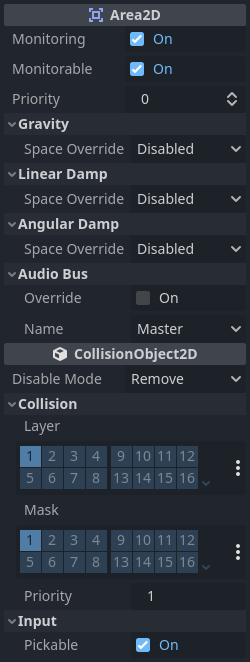
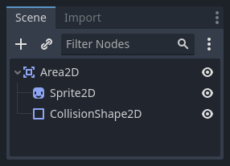
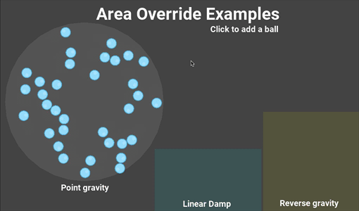

# Area2D：拾取物、门口、伤害区与区域影响

> 本文由 Godot 官方 4.5 版文档转换。下方中文导读、练习和验收是整理者的教学编排，英文正文是原教程主内容；不是官方中文逐句译文，也未声称已在引擎中执行全部练习。

## 适用任务

使用重叠检测和区域参数构建交互范围，区分检测区域与实体阻挡。

## 前提

- DEV-004
- 了解碰撞层与遮罩

## 中文操作路线

1. 建立 Area2D 和 CollisionShape2D，先用调试显示确认区域的位置与尺寸。
2. 配置 collision_layer 与 collision_mask，明确区域属于哪一层以及检测哪些层。
3. 按目标节点类型选择 body_entered 或 area_entered 等信号。
4. 在回调中核验进入者类型或组别，执行拾取、开门或伤害等逻辑。
5. 如果需要区域重力或阻尼，阅读覆盖模式并分开测试；普通拾取区不必启用这些影响。

## 图示怎么读

先沿英文正文的步骤阅读对应截图；截图来自同一版本页面，局部操作顺序以紧邻图片的文字为准。图片下载到本地，可离线打开并放大检查。截图中的示例美术用于说明引擎操作，不代表本库要求采用该画风。

## 动手练习

给院门设置一个只有玩家进入时才亮起的交互提示区，敌人经过时不触发。

## 验收清单

- [ ] 检测范围与可见提示一致。
- [ ] 错误层的对象不会触发逻辑。
- [ ] 离开区域时提示正确关闭。

## 版本与边界

Area2D 本身用于检测和影响，不等同于会阻挡角色的墙体。

本次来源固定为 Godot 4.5 文档分支，抓取日期为 2026-10-29；它不是“当前最新版本”的声明。升级引擎时应重新核对节点名、属性名和 API。

## 原教程正文（英文，Markdown 转换）

### Using Area2D

#### Introduction

Godot offers a number of collision objects to provide both collision detection
and response. Trying to decide which one to use for your project can be confusing.
You can avoid problems and simplify development if you understand how each of them
works and what their pros and cons are. In this tutorial, we'll look at the
[Area2D](https://docs.godotengine.org/en/4.5/classes/class_area2d.html#class-area2d) node and show some examples of how it can be used.

Note

This document assumes you're familiar with Godot's various physics
bodies. Please read [Physics introduction](https://docs.godotengine.org/en/4.5/tutorials/physics/physics_introduction.html#doc-physics-introduction) first.

#### What is an area?

An Area2D defines a region of 2D space. In this space you can detect other
[CollisionObject2D](https://docs.godotengine.org/en/4.5/classes/class_collisionobject2d.html#class-collisionobject2d) nodes overlapping, entering,
and exiting. Areas also allow for overriding local physics properties. We'll
explore each of these functions below.

#### Area properties

Areas have many properties you can use to customize their behavior.



The `Gravity`, `Linear Damp`, and `Angular Damp` sections
are used to configure the area's physics override behavior.
We'll look at how to use those in the *Area influence* section below.

`Monitoring` and `Monitorable` are used to enable and disable the area.

The `Audio Bus` section allows you to override audio in the area, for example to
apply an audio effect when the player moves through.

Note that Area2D extends [CollisionObject2D](https://docs.godotengine.org/en/4.5/classes/class_collisionobject2d.html#class-collisionobject2d), so it
also provides properties inherited from that class.
The `Collision` section of `CollisionObject2D` is where you configure the
area's collision layer(s) and mask(s).

#### Overlap detection

Perhaps the most common use of Area2D nodes is for contact and overlap detection.
When you need to know that two objects have touched, but don't need physical
collision, you can use an area to notify you of the contact.

For example, let's say we're making a coin for the player to pick up. The coin is
not a solid object - the player can't stand on it or push it - we just want it
to disappear when the player touches it.

Here's the node setup for the coin:



To detect the overlap, we'll connect the appropriate signal on the Area2D. Which
signal to use depends on the player's node type. If the player is another area,
use `area_entered`. However, let's assume our player is a `CharacterBody2D`
(and therefore a `CollisionObject2D` type), so we'll connect the
`body_entered` signal.

Note

If you're not familiar with using signals, see [Using signals](https://docs.godotengine.org/en/4.5/getting_started/step_by_step/signals.html#doc-signals) for
an introduction.

```gdscript
extends Area2D

func _on_coin_body_entered(body):
    queue_free()
```

```csharp
using Godot;

public partial class Coin : Area2D
{
    private void OnCoinBodyEntered(PhysicsBody2D body)
    {
        QueueFree();
    }
}
```

Now our player can collect the coins!

Some other usage examples:

- Areas are great for bullets and other projectiles that hit and deal damage, but don't need any other physics such as bouncing.
- Use a large circular area around an enemy to define its "detect" radius. When the player is outside the area, the enemy can't "see" it.
- "Security cameras" - In a large level with multiple cameras, attach areas to each camera and activate them when the player enters.

See the [Your first 2D game](https://docs.godotengine.org/en/4.5/getting_started/first_2d_game/index.html#doc-your-first-2d-game) for an example of using Area2D in a game.

#### Area influence

The second major use for area nodes is to alter physics. By default, the area
won't do this, but you can enable this with the `Space Override` property. When
areas overlap, they are processed in `Priority` order (higher priority areas are
processed first). There are four options for override:

- *Combine* - The area adds its values to what has been calculated so far.
- *Replace* - The area replaces physics properties, and lower priority areas are ignored.
- *Combine-Replace* - The area adds its gravity/damping values to whatever has been calculated so far (in priority order), ignoring any lower priority areas.
- *Replace-Combine* - The area replaces any gravity/damping calculated so far, but keeps calculating the rest of the areas.

Using these properties, you can create very complex behavior with multiple
overlapping areas.

The physics properties that can be overridden are:

- *Gravity* - Gravity's strength inside the area.
- *Gravity Direction* - This vector does not need to be normalized.
- *Linear Damp* - How quickly objects stop moving - linear velocity lost per second.
- *Angular Damp* - How quickly objects stop spinning - angular velocity lost per second.

##### Point gravity

The `Gravity Point` property allows you to create an "attractor". Gravity in the
area will be calculated towards a point, given by the `Point Center` property.
Values are relative to the Area2D, so for example using `(0, 0)` will attract
objects to the center of the area.

##### Examples

The example project attached below has three areas demonstrating physics
override.



You can download this project here:
[area_2d_starter.zip](https://github.com/godotengine/godot-docs-project-starters/releases/download/latest-4.x/area_2d_starter.zip)

---

## 来源、配图与授权

- 原文：[Using Area2D](https://docs.godotengine.org/en/4.5/tutorials/physics/using_area_2d.html)。
- 作者与署名：Juan Linietsky, Ariel Manzur and the Godot community。
- 文档许可：[CC BY 3.0](https://creativecommons.org/licenses/by/3.0/)；[官方仓库许可声明](https://github.com/godotengine/godot-docs/blob/4.5/README.md#license)。
- 许可全文：[godot-docs-4.5-LICENSE.txt](../../licenses/godot-docs-4.5-LICENSE.txt)。
- 本地原文主内容快照：[DEV-015.article.html](../../sources/game-development/DEV-015.article.html)。
- 变更：去除导航和用户评论入口，HTML 转 Markdown，图片改为相对路径，重复评级图标转成同义文字，新增中文导读、练习及验收。正文中的示例素材署名予以保留。
- 本整理稿的新增中文内容同样按 CC BY 3.0 提供，署名“Pixel Tutorial Library 整理者（Codex）”；不暗示原作者认可本整理稿。

| 本地图像 | 原图来源 | 图示语境 |
| --- | --- | --- |
| [area2d_properties.webp](../../assets/game-development/DEV-015/area2d_properties.webp) | [原图](https://docs.godotengine.org/en/4.5/_images/area2d_properties.webp) | 原教程图示：Area properties — area2d_properties.webp |
| [area2d_coin_nodes.webp](../../assets/game-development/DEV-015/area2d_coin_nodes.webp) | [原图](https://docs.godotengine.org/en/4.5/_images/area2d_coin_nodes.webp) | 原教程图示：Overlap detection — area2d_coin_nodes.webp |
| [area2d_override.gif](../../assets/game-development/DEV-015/area2d_override.gif) | [原图](https://docs.godotengine.org/en/4.5/_images/area2d_override.gif) | 原教程图示：Examples — area2d_override.gif |
