# TileMapLayer：分层绘图、图案与自动地形

> 本文由 Godot 官方 4.5 版文档转换。下方中文导读、练习和验收是整理者的教学编排，英文正文是原教程主内容；不是官方中文逐句译文，也未声称已在引擎中执行全部练习。

## 适用任务

用多个 TileMapLayer 组织地面、墙体和装饰，配合地形和图案快速制作俯视地图。

## 前提

- DEV-017

## 中文操作路线

1. 给 TileMapLayer 指定已配置的 TileSet，先确认画笔中可见的图块正确。
2. 将地面、实体障碍和上层装饰放在职责清晰的多个层中。
3. 分别尝试画笔、直线、矩形、填充与选择工具，留意连续区域填充条件。
4. 把重复的花坛或路口存成 patterns，再在地图上复用。
5. 切换 terrain 绘制，验证邻接关系；随机散布只用于适合随机变化的装饰。
6. 检查渲染排序、物理层和导航设置；对于角色经过树后或屋前的场景，按项目设计配置排序。

## 图示怎么读

先沿英文正文的步骤阅读对应截图；截图来自同一版本页面，局部操作顺序以紧邻图片的文字为准。图片下载到本地，可离线打开并放大检查。截图中的示例美术用于说明引擎操作，不代表本库要求采用该画风。

## 动手练习

绘制一个含入口、道路、水池和树木的 20×15 格庭院，保留可通行路径并检查遮挡关系。

## 验收清单

- [ ] 地面层不意外挡住角色。
- [ ] 重复图案的边缘没有缺角。
- [ ] 删除或改名资源后没有未处理的缺失图块。

## 版本与边界

此版本文档使用 TileMapLayer。旧 Godot 3 的 TileMap 与 Godot 4 早期教程界面不同，不要直接混套。

本次来源固定为 Godot 4.5 文档分支，抓取日期为 2026-10-29；它不是“当前最新版本”的声明。升级引擎时应重新核对节点名、属性名和 API。

## 原教程正文（英文，Markdown 转换）

### Using TileMaps

See also

This page assumes you have created or downloaded a TileSet already. If not,
please read [Using TileSets](https://docs.godotengine.org/en/4.5/tutorials/2d/using_tilesets.html#doc-using-tilesets) first as you will need a TileSet
to create a TileMap.

#### Introduction

A tilemap is a grid of tiles used to create a game's layout. There are several
benefits to using [TileMapLayer](https://docs.godotengine.org/en/4.5/classes/class_tilemaplayer.html#class-tilemaplayer) nodes to design your levels.
First, they make it possible to draw the layout by "painting" the tiles onto a
grid, which is much faster than placing individual [Sprite2D](https://docs.godotengine.org/en/4.5/classes/class_sprite2d.html#class-sprite2d)
nodes one by one. Second, they allow for much larger levels because they are
optimized for drawing large numbers of tiles. Finally, you can add collision,
occlusion, and navigation shapes to tiles, adding greater functionality to
the TileMap.

#### Specifying the TileSet in the TileMapLayer

If you've followed the previous page on [Using TileSets](https://docs.godotengine.org/en/4.5/tutorials/2d/using_tilesets.html#doc-using-tilesets), you should
have a TileSet resource that is built into the TileMapLayer node. This is good for
prototyping, but in a real world project, you will generally have multiple
levels reusing the same tileset.

The recommended way to reuse the same TileSet in several TileMapLayer nodes is to save
the TileSet to an external resource. To do so, click the dropdown next to the TileSet
resource and choose **Save**:

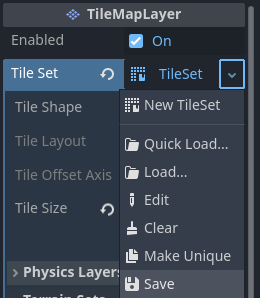

Saving the built-in TileSet resource to an external resource file

#### Multiple TileMapLayers and settings

When working with tilemaps it's generally advised that you use multiple TileMapLayer
nodes when appropriate. Using multiple layers can be advantageous, for example,
this allows you to distinguish foreground tiles from background tiles for better
organization. You can place one tile per layer at a given location, which allows you
to overlap several tiles together if you have more than one layer.

Each TileMapLayer node has several properties you can adjust:

- **Enabled:** If `true`, the layer is visible in the editor and when running
  the project.
- **TileSet** The tileset used by the TileMapLayer node.

##### Rendering

- **Y Sort Origin:** The vertical offset to use for Y-sorting on each tile (in pixels).
  Only effective if **Y Sort Enabled** under CanvasItem settings is `true`.
- **X Draw Order Reversed** Reverses the order tiles are drawn on the X axis. Requires
  that **Y Sort Enabled** under CanvasItem settings is `true`.
- **Rendering Quadrant Size** A quadrant is a group of tiles drawn together on a single
  CanvasItem for optimization purposes. This setting defines the length of a square's
  side in the map's coordinate system. The quadrant size does not apply to a Y sorted
  TileMapLayer since tiles are grouped by Y position in that case.

##### Physics

- **Collision Enabled** Enables or disables collision.
- **Use Kinematic Bodies** When true TileMapLayer collision shapes will be instantiated
  as kinematic bodies.
- **Collision Visibility Mode** Whether or not the TileMapLayer's collision shapes are
  visible. If set to default, then it depends on the show collision debug settings.

##### Navigation

- **Navigation Enabled** Whether or not navigation regions are enabled.
- **Navigation Visible** Whether or not the TileMapLayer's navigation meshes are
  visible. If set to default then it depends on the show navigation debug settings.

Tip

TileMap built-in navigation has many practical limitations that result in inferior pathfinding performance and pathfollowing quality.

After designing the TileMap consider baking it to a more optimized navigation mesh (and disabling the TileMap NavigationLayer) using a [NavigationRegion2D](https://docs.godotengine.org/en/4.5/classes/class_navigationregion2d.html#class-navigationregion2d) or the [NavigationServer2D](https://docs.godotengine.org/en/4.5/classes/class_navigationserver2d.html#class-navigationserver2d). See [Using navigation meshes](https://docs.godotengine.org/en/4.5/tutorials/navigation/navigation_using_navigationmeshes.html#doc-navigation-using-navigationmeshes) for additional information.

Warning

2D navigation meshes can not be "layered" or stacked on top of each other like visuals or physic shapes. Attempting to stack navigation meshes on the same navigation map will result in merge and logical errors that break the pathfinding.

##### Reordering layers

You can reorder layers by drag-and-dropping their node in the Scene tab. You can
also switch between which TileMapLayer node you're working on by using the buttons
in the top right corner of the TileMap editor.

Note

You can create, rename or reorder layers in the future without affecting
existing tiles. Be careful though, as *removing* a layer will also remove
all tiles that were placed on the layer.

#### Opening the TileMap editor

Select the TileMapLayer node, then open the TileMap panel at the bottom
of the editor:

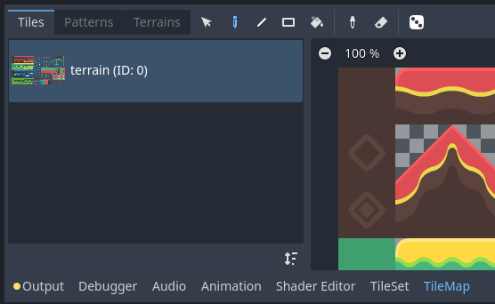

Opening the TileMap panel at the bottom of the editor. The TileMapLayer node must be selected first.

#### Selecting tiles to use for painting

First, if you've created additional layers above, make sure you've selected the
layer you wish to paint on:

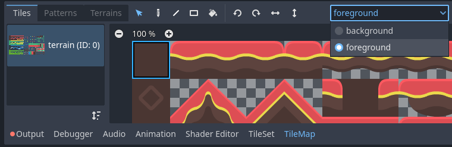

Selecting a layer to paint on in the TileMap editor

Tip

In the 2D editor, the layers you aren't currently editing from the same
TileMapLayer node will appear grayed out while in the TileMap editor. You can
disable this behavior by clicking the icon next to the layer selection menu
(**Highlight Selected TileMap Layer** tooltip).

You can skip the above step if you haven't created additional layers, as the
first layer is automatically selected when entering the TileMap editor.

Before you can place tiles in the 2D editor, you must select one or more tiles
in the TileMap panel located at the bottom of the editor. To do so, click a tile
in the TileMap panel, or hold down the mouse button to select multiple tiles:

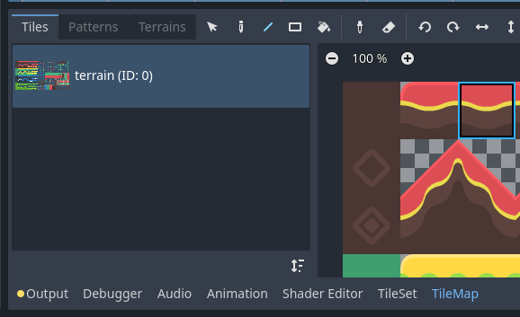

Selecting a tile in the TileMap editor by clicking it

Tip

Like in the 2D and TileSet editors, you can pan across the TileMap panel using
the middle or right mouse buttons, and zoom using the mouse wheel or buttons in
the top-left corner.

You can also hold down `Shift` to append to the current selection. When
selecting more than one tile, multiple tiles will be placed every time you
perform a painting operation. This can be used to paint structures composed of
multiple tiles in a single click (such as large platforms or trees).

The final selection does not have to be contiguous: if there is empty space
between selected tiles, it will be left empty in the pattern that will be
painted in the 2D editor.

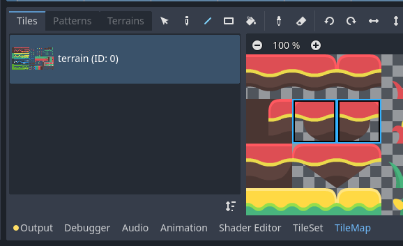

Selecting multiple tiles in the TileMap editor by holding down the left mouse button

If you've created alternative tiles in your TileSet, you can select them for
painting on the right of the base tiles:

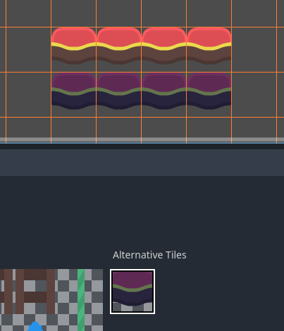

Selecting an alternative tile in the TileMap editor

Lastly, if you've created a *scenes collection* in the TileSet, you can place scene tiles in the TileMap:

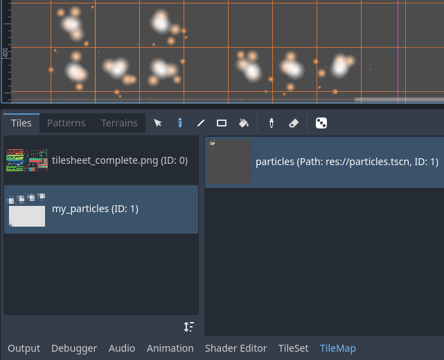

Placing a scene tile containing particles using the TileMap editor

#### Painting modes and tools

Using the toolbar at the top of the TileMap editor, you can choose between
several painting modes and tools. These modes affect operation when clicking in
the 2D editor, **not** the TileMap panel itself.

From left to right, the painting modes and tools you can choose are:

##### Selection

Select tiles by clicking a single tile, or by holding down the left mouse button to
select multiple with a rectangle in the 2D editor. Note that empty space cannot be
selected: if you create a rectangle selection, only non-empty tiles will be selected.

To append to the current selection, hold `Shift` then select a tile.
To remove from the current selection, hold `Ctrl` then select a tile.

The selection can then be used in any other painting mode to quickly create copies
of an already-placed pattern.

You can remove the selected tiles from the TileMap by pressing `Del`.

You can toggle this mode temporarily while in Paint mode by holding `Ctrl`
then performing a selection.

Tip

You can copy and paste tiles that were already placed by performing a
selection, pressing `Ctrl + C` then pressing `Ctrl + V`.
The selection will be pasted after left-clicking. You can press
`Ctrl + V` another time to perform more copies this way.
Right-click or press `Escape` to cancel pasting.

##### Paint

The standard Paint mode allows you to place tiles by clicking or holding
down the left mouse button.

If you right-click, the currently selected tile will be erased from the tilemap.
In other words, it will be replaced by empty space.

If you have selected multiple tiles in the TileMap or using the Selection tool,
they will be placed every time you click or drag the mouse while holding down
the left mouse button.

Tip

While in Paint mode, you can draw a line by holding `Shift` *before*
holding down the left mouse button, then dragging the mouse to the line's end
point. This is identical to using the Line tool described below.

You can also draw a rectangle by holding `Ctrl` and `Shift`
*before* holding down the left mouse button, then dragging the mouse to the
rectangle's end point. This is identical to using the Rectangle tool
described below.

Lastly, you can pick existing tiles in the 2D editor by holding `Ctrl`
then clicking on a tile (or holding and dragging the mouse).
This will switch the currently painted tile(s) to the tile(s) you've just clicked.
This is identical to using the Picker tool described below.

##### Line

After selecting Line Paint mode, you can draw in a line that is
always 1 tile thick (no matter its orientation).

If you right-click while in Line Paint mode, you will erase in a line.

If you have selected multiple tiles in the TileMap or using the Selection tool,
you can place them in a repeating pattern across the line.

You can toggle this mode temporarily while in Paint or Eraser mode by holding
`Shift` then drawing.

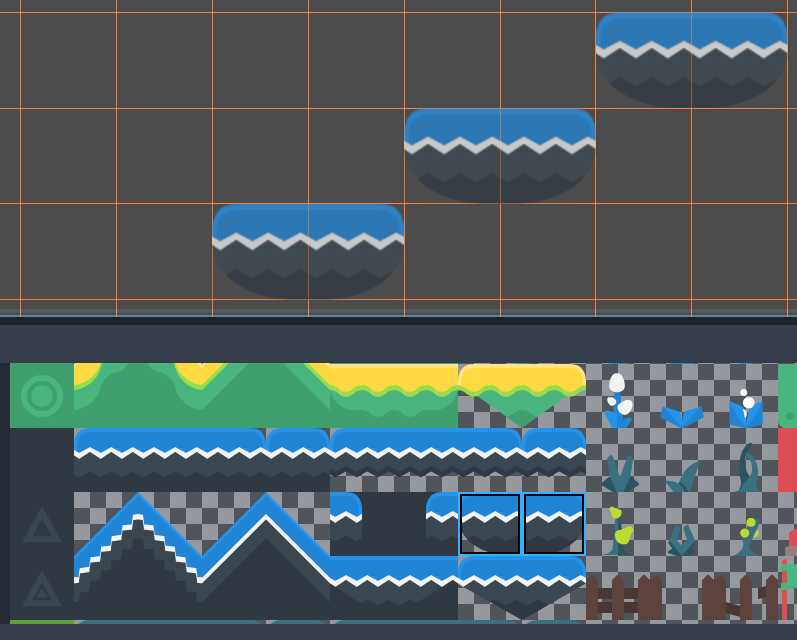

Using the line tool after selecting two tiles to draw platforms diagonally

##### Rectangle

After selecting Rectangle Paint mode, you can draw in an axis-aligned
rectangle.

If you right-click while in Rectangle Paint mode, you will erase in
an axis-aligned rectangle.

If you have selected multiple tiles in the TileMap or using the Selection tool,
you can place them in a repeating pattern within the rectangle.

You can toggle this mode temporarily while in Paint or Eraser mode by holding
`Ctrl` and `Shift` then drawing.

##### Bucket Fill

After selecting Bucket Fill mode, you can choose whether painting should be
limited to contiguous areas only by toggling the **Contiguous** checkbox that
appears on the right of the toolbar.

If you enable **Contiguous** (the default), only matching tiles that touch the
current selection will be replaced. This contiguous check is performed
horizontally and vertically, but *not* diagonally.

If you disable **Contiguous**, all tiles with the same ID in the entire TileMap will
be replaced by the currently selected tile. If selecting an empty tile with
**Contiguous** unchecked, all tiles in the rectangle that encompasses the
TileMap's effective area will be replaced instead.

If you right-click while in Bucket Fill mode, you will replace matching tiles
with empty tiles.

If you have selected multiple tiles in the TileMap or using the Selection tool,
you can place them in a repeating pattern within the filled area.

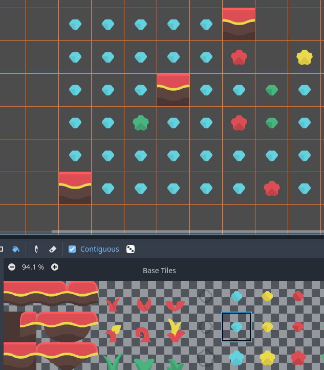

Using the Bucket Fill tool

##### Picker

After selecting Picker mode, you can pick existing tiles in the 2D editor by
holding `Ctrl` then clicking on a tile. This will switch the currently
painted tile to the tile you've just clicked. You can also pick multiple tiles
at once by holding down the left mouse button and forming a rectangle selection.
Only non-empty tiles can be picked.

You can toggle this mode temporarily while in Paint mode by holding `Ctrl`
then clicking or dragging the mouse.

##### Eraser

This mode is combined with any other painting mode (Paint, Line, Rectangle,
Bucket Fill). When eraser mode is enabled, tiles will be replaced by empty tiles
instead of drawing new lines when left-clicking.

You can toggle this mode temporarily while in any other mode by right-clicking
instead of left-clicking.

#### Painting randomly using scattering

While painting, you can optionally enable *randomization*. When enabled,
a random tile will be chosen between all the currently selected tiles when
painting. This is supported with the Paint, Line, Rectangle and Bucket Fill
tools. For effective paint randomization, you must select multiple tiles
in the TileMap editor or use scattering (both approaches can be combined).

If **Scattering** is set to a value greater than 0, there is a chance that no tile
will be placed when painting. This can be used to add occasional, non-repeating
detail to large areas (such as adding grass or crumbs on a large top-down
TileMap).

Example when using Paint mode:

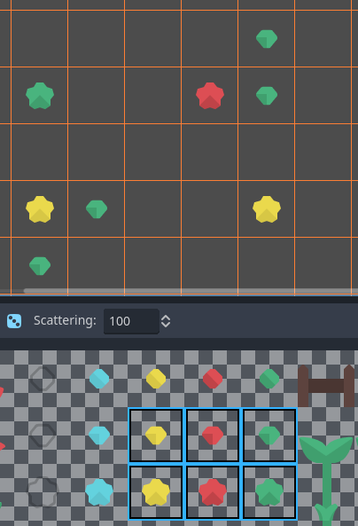

Selecting from several times to randomly choose, then painting by holding down the left mouse button

Example when using Bucket Fill mode:

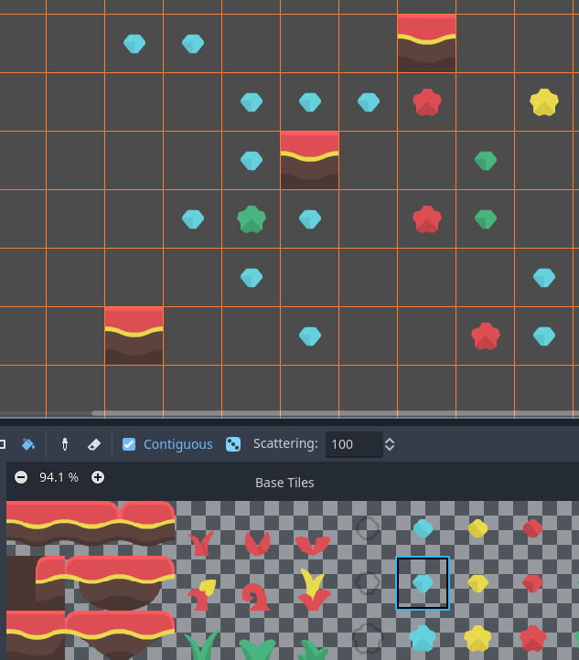

Using Bucket Fill tool with a single tile, but with randomization and scattering enabled

Note

Eraser mode does not take randomization and scattering into account.
All tiles within the selection are always removed.

#### Saving and loading premade tile placements using patterns

While you can copy and paste tiles while in Select mode, you may wish to save
premade *patterns* of tiles to place together in a go. This can be done on a
per-TileMap basis by choosing the **Patterns** tab of the TileMap editor.

To create a new pattern, switch to Select mode, perform a selection and press
`Ctrl + C`. Click on empty space within the Patterns tab (a blue focus
rectangle should appear around the empty space), then press `Ctrl + V`:

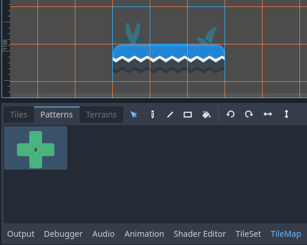

Creating a new pattern from a selection in the TileMap editor

To use an existing pattern, click its image in the **Patterns** tab, switch to
any painting mode, then left-click somewhere in the 2D editor:

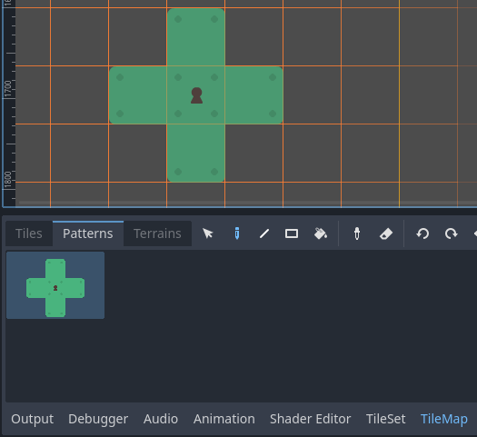

Placing an existing pattern using the TileMap editor

Like multi-tile selections, patterns will be repeated if used with the Line,
Rectangle or Bucket Fill painting modes.

Note

Despite being edited in the TileMap editor, patterns are stored in the
TileSet resource. This allows reusing patterns in different TileMapLayer nodes
after loading a TileSet resource saved to an external file.

#### Handling tile connections automatically using terrains

To use terrains, the TileMapLayer node must feature at least one terrain set and a
terrain within this terrain set. See
[Creating terrain sets (autotiling)](https://docs.godotengine.org/en/4.5/tutorials/2d/using_tilesets.html#doc-using-tilesets-creating-terrain-sets) if you haven't created a terrain
set for the TileSet yet.

There are 3 kinds of painting modes available for terrain connections:

- **Connect**, where tiles are connected to surrounding tiles on the same
  TileMapLayer.
- **Path**, where tiles are connected to tiles painted in the same stroke (until
  the mouse button is released).
- Tile-specific overrides to resolve conflicts or handle situations not covered
  by the terrain system.

The Connect mode is easier to use, but Path is more flexible as it allows for
more artist control during painting. For instance, Path can allow roads to be
directly adjacent to each other without being connected to each other, while
Connect will force both roads to be connected.

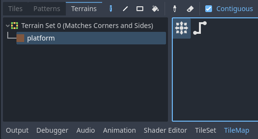

Selecting Connect mode in the TileMap editor's Terrains tab

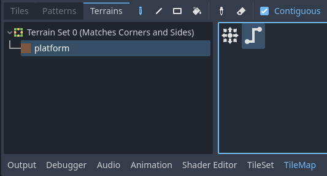

Selecting Path mode in the TileMap editor's Terrains tab

Lastly, you can select specific tiles from the terrain to resolve conflicts in
certain situations:

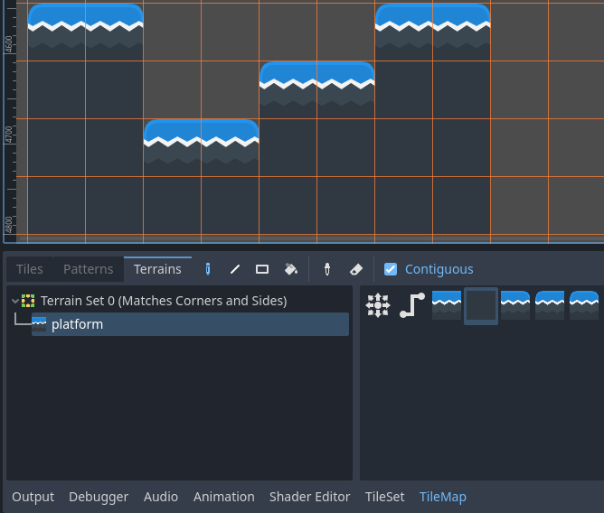

Painting with specific tiles in the TileMap editor's Terrains tab

Any tile that has at least one of its bits set to a value set to the
corresponding terrain ID will appear in the list of tiles to choose from.

#### Handling missing tiles

If you remove tiles in the TileSet that are referenced in a TileMap, the TileMap
will display a placeholder to indicate that an invalid tile ID is placed:

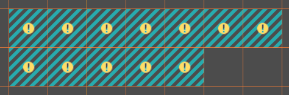

Missing tiles in the TileMap editor due to the TileSet reference being broken

These placeholders are **not** visible in the running project, but the tile data
is still persisted to disk. This allows you to safely close and reopen such
scenes. Once you re-add a tile with the matching ID, the tiles will appear with
the new tile's appearance.

Note

Missing tile placeholders may not be visible until you select the TileMapLayer
node and open the TileMap editor.

---

## 来源、配图与授权

- 原文：[Using TileMaps](https://docs.godotengine.org/en/4.5/tutorials/2d/using_tilemaps.html)。
- 作者与署名：Juan Linietsky, Ariel Manzur and the Godot community。
- 文档许可：[CC BY 3.0](https://creativecommons.org/licenses/by/3.0/)；[官方仓库许可声明](https://github.com/godotengine/godot-docs/blob/4.5/README.md#license)。
- 许可全文：[godot-docs-4.5-LICENSE.txt](../../licenses/godot-docs-4.5-LICENSE.txt)。
- 本地原文主内容快照：[DEV-018.article.html](../../sources/game-development/DEV-018.article.html)。
- 变更：去除导航和用户评论入口，HTML 转 Markdown，图片改为相对路径，重复评级图标转成同义文字，新增中文导读、练习及验收。正文中的示例素材署名予以保留。
- 本整理稿的新增中文内容同样按 CC BY 3.0 提供，署名“Pixel Tutorial Library 整理者（Codex）”；不暗示原作者认可本整理稿。

| 本地图像 | 原图来源 | 图示语境 |
| --- | --- | --- |
| [using_tilemaps_save_tileset_to_resource.webp](../../assets/game-development/DEV-018/using_tilemaps_save_tileset_to_resource.webp) | [原图](https://docs.godotengine.org/en/4.5/_images/using_tilemaps_save_tileset_to_resource.webp) | 原教程图示：Specifying the TileSet in the TileMapLayer — Saving the built-in TileSet resource to an external resource file |
| [using_tilemaps_open_tilemap_editor.webp](../../assets/game-development/DEV-018/using_tilemaps_open_tilemap_editor.webp) | [原图](https://docs.godotengine.org/en/4.5/_images/using_tilemaps_open_tilemap_editor.webp) | 原教程图示：Opening the TileMap editor — Opening the TileMap panel at the bottom of the editor. The TileMapLayer node must be selected first. |
| [using_tilemaps_select_layer.webp](../../assets/game-development/DEV-018/using_tilemaps_select_layer.webp) | [原图](https://docs.godotengine.org/en/4.5/_images/using_tilemaps_select_layer.webp) | 原教程图示：Selecting tiles to use for painting — Selecting a layer to paint on in the TileMap editor |
| [using_tilemaps_select_single_tile_from_tileset.webp](../../assets/game-development/DEV-018/using_tilemaps_select_single_tile_from_tileset.webp) | [原图](https://docs.godotengine.org/en/4.5/_images/using_tilemaps_select_single_tile_from_tileset.webp) | 原教程图示：Selecting tiles to use for painting — Selecting a tile in the TileMap editor by clicking it |
| [using_tilemaps_select_multiple_tiles_from_tileset.webp](../../assets/game-development/DEV-018/using_tilemaps_select_multiple_tiles_from_tileset.webp) | [原图](https://docs.godotengine.org/en/4.5/_images/using_tilemaps_select_multiple_tiles_from_tileset.webp) | 原教程图示：Selecting tiles to use for painting — Selecting multiple tiles in the TileMap editor by holding down the left mouse button |
| [using_tilemaps_use_alternative_tile.webp](../../assets/game-development/DEV-018/using_tilemaps_use_alternative_tile.webp) | [原图](https://docs.godotengine.org/en/4.5/_images/using_tilemaps_use_alternative_tile.webp) | 原教程图示：Selecting tiles to use for painting — Selecting an alternative tile in the TileMap editor |
| [using_tilemaps_placing_scene_tiles.webp](../../assets/game-development/DEV-018/using_tilemaps_placing_scene_tiles.webp) | [原图](https://docs.godotengine.org/en/4.5/_images/using_tilemaps_placing_scene_tiles.webp) | 原教程图示：Selecting tiles to use for painting — Placing a scene tile containing particles using the TileMap editor |
| [using_tilesets_line_tool_multiple_tiles.webp](../../assets/game-development/DEV-018/using_tilesets_line_tool_multiple_tiles.webp) | [原图](https://docs.godotengine.org/en/4.5/_images/using_tilesets_line_tool_multiple_tiles.webp) | 原教程图示：Line — Using the line tool after selecting two tiles to draw platforms diagonally |
| [using_tilemaps_bucket_fill.webp](../../assets/game-development/DEV-018/using_tilemaps_bucket_fill.webp) | [原图](https://docs.godotengine.org/en/4.5/_images/using_tilemaps_bucket_fill.webp) | 原教程图示：Bucket Fill — Using the Bucket Fill tool |
| [using_tilemaps_scatter_tiles.webp](../../assets/game-development/DEV-018/using_tilemaps_scatter_tiles.webp) | [原图](https://docs.godotengine.org/en/4.5/_images/using_tilemaps_scatter_tiles.webp) | 原教程图示：Painting randomly using scattering — Selecting from several times to randomly choose, then painting by holding down the left mouse button |
| [using_tilemaps_bucket_fill_scatter.webp](../../assets/game-development/DEV-018/using_tilemaps_bucket_fill_scatter.webp) | [原图](https://docs.godotengine.org/en/4.5/_images/using_tilemaps_bucket_fill_scatter.webp) | 原教程图示：Painting randomly using scattering — Using Bucket Fill tool with a single tile, but with randomization and scattering enabled |
| [using_tilemaps_create_pattern.webp](../../assets/game-development/DEV-018/using_tilemaps_create_pattern.webp) | [原图](https://docs.godotengine.org/en/4.5/_images/using_tilemaps_create_pattern.webp) | 原教程图示：Saving and loading premade tile placements using patterns — Creating a new pattern from a selection in the TileMap editor |
| [using_tilemaps_use_pattern.webp](../../assets/game-development/DEV-018/using_tilemaps_use_pattern.webp) | [原图](https://docs.godotengine.org/en/4.5/_images/using_tilemaps_use_pattern.webp) | 原教程图示：Saving and loading premade tile placements using patterns — Placing an existing pattern using the TileMap editor |
| [using_tilemaps_terrain_select_connect_mode.webp](../../assets/game-development/DEV-018/using_tilemaps_terrain_select_connect_mode.webp) | [原图](https://docs.godotengine.org/en/4.5/_images/using_tilemaps_terrain_select_connect_mode.webp) | 原教程图示：Handling tile connections automatically using terrains — Selecting Connect mode in the TileMap editor's Terrains tab |
| [using_tilemaps_terrain_select_path_mode.webp](../../assets/game-development/DEV-018/using_tilemaps_terrain_select_path_mode.webp) | [原图](https://docs.godotengine.org/en/4.5/_images/using_tilemaps_terrain_select_path_mode.webp) | 原教程图示：Handling tile connections automatically using terrains — Selecting Path mode in the TileMap editor's Terrains tab |
| [using_tilemaps_terrain_paint_specific_tiles.webp](../../assets/game-development/DEV-018/using_tilemaps_terrain_paint_specific_tiles.webp) | [原图](https://docs.godotengine.org/en/4.5/_images/using_tilemaps_terrain_paint_specific_tiles.webp) | 原教程图示：Handling tile connections automatically using terrains — Painting with specific tiles in the TileMap editor's Terrains tab |
| [using_tilemaps_missing_tiles.webp](../../assets/game-development/DEV-018/using_tilemaps_missing_tiles.webp) | [原图](https://docs.godotengine.org/en/4.5/_images/using_tilemaps_missing_tiles.webp) | 原教程图示：Handling missing tiles — Missing tiles in the TileMap editor due to the TileSet reference being broken |
