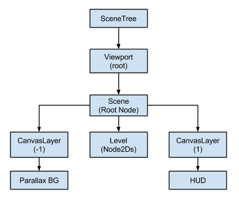

# CanvasLayer：分离游戏世界、背景与HUD

> 本文由 Godot 官方 4.5 版文档转换。下方中文导读、练习和验收是整理者的教学编排，英文正文是原教程主内容；不是官方中文逐句译文，也未声称已在引擎中执行全部练习。

## 适用任务

理解视口、CanvasItem 和 CanvasLayer 的关系，避免固定界面随镜头移动。

## 前提

- DEV-001
- 项目中存在 Camera2D 或 HUD

## 中文操作路线

1. 阅读视口和 CanvasItem 的关系图，先区分节点层级与渲染画布层。
2. 将场景物件留在世界画布，让 Camera2D 的变换影响它们。
3. 建立专门的 CanvasLayer 容纳 HUD，配置其 layer 值以控制覆盖顺序。
4. 让背景、世界、前景和界面各自承担单一职责，再用镜头移动验证关系。

## 图示怎么读

先沿英文正文的步骤阅读对应截图；截图来自同一版本页面，局部操作顺序以紧邻图片的文字为准。图片下载到本地，可离线打开并放大检查。截图中的示例美术用于说明引擎操作，不代表本库要求采用该画风。

## 动手练习

制作一个可移动镜头的小场景，左上角固定显示坐标，世界中的路牌随镜头移动。

## 验收清单

- [ ] HUD 位置不受世界镜头平移影响。
- [ ] 世界标签和固定界面没有放错画布。
- [ ] layer 值的覆盖关系可解释而非靠反复试数。

## 版本与边界

CanvasLayer 的 layer 与 CanvasItem 的 z_index 是不同维度；不要用碰撞层解决绘制顺序。

本次来源固定为 Godot 4.5 文档分支，抓取日期为 2026-10-29；它不是“当前最新版本”的声明。升级引擎时应重新核对节点名、属性名和 API。

## 原教程正文（英文，Markdown 转换）

### Canvas layers

#### Viewport and Canvas items

[CanvasItem](https://docs.godotengine.org/en/4.5/classes/class_canvasitem.html#class-canvasitem) is the base for all 2D nodes, be it regular
2D nodes, such as [Node2D](https://docs.godotengine.org/en/4.5/classes/class_node2d.html#class-node2d), or [Control](https://docs.godotengine.org/en/4.5/classes/class_control.html#class-control).
Both inherit from [CanvasItem](https://docs.godotengine.org/en/4.5/classes/class_canvasitem.html#class-canvasitem).
You can arrange canvas items in trees. Each item will inherit its parent's
transform: when the parent moves, its children move too.

CanvasItem nodes, and nodes inheriting from them, are direct or indirect children of a
[Viewport](https://docs.godotengine.org/en/4.5/classes/class_viewport.html#class-viewport), that displays them.

The Viewport's property
[Viewport.canvas_transform](https://docs.godotengine.org/en/4.5/classes/class_viewport.html#class-viewport-property-canvas-transform),
allows to apply a custom [Transform2D](https://docs.godotengine.org/en/4.5/classes/class_transform2d.html#class-transform2d)
transform to the CanvasItem hierarchy it contains. Nodes such as
[Camera2D](https://docs.godotengine.org/en/4.5/classes/class_camera2d.html#class-camera2d) work by changing that transform.

To achieve effects like scrolling, manipulating the canvas transform property is
more efficient than moving the root canvas item and the entire scene with it.

Usually though, we don't want *everything* in the game or app to be subject to the canvas
transform. For example:

- **Parallax Backgrounds**: Backgrounds that move slower than the rest
  of the stage.
- **UI**: Think of a user interface (UI) or head-up display (HUD) superimposed on our view of the game world. We want a life counter, score display and other elements to retain their screen positions even when our view of the game world changes.
- **Transitions**: We may want visual effects used for transitions (fades, blends) to remain at a fixed screen location.

How to solve these problems in a single scene tree?

#### CanvasLayers

The answer is [CanvasLayer](https://docs.godotengine.org/en/4.5/classes/class_canvaslayer.html#class-canvaslayer),
which is a node that adds a separate 2D rendering layer for all its
children and grand-children. Viewport children will draw by default at
layer "0", while a CanvasLayer will draw at any numeric layer. Layers
with a greater number will be drawn above those with a smaller number.
CanvasLayers also have their own transform and do not depend on the
transform of other layers. This allows the UI to be fixed in screen-space
while our view on the game world changes.

An example of this is creating a parallax background. This can be done
with a CanvasLayer at layer "-1". The screen with the points, life
counter and pause button can also be created at layer "1".

Here's a diagram of how it looks:

CanvasLayers are independent of tree order, and they only depend on
their layer number, so they can be instantiated when needed.

Note

CanvasLayers aren't necessary to control the drawing order of nodes.
The standard way to ensuring that a node is correctly drawn 'in front' or 'behind' others is to manipulate the
order of the nodes in the scene panel. Perhaps counterintuitively, the topmost nodes in the scene panel are drawn
on *behind* lower ones in the viewport. 2D nodes also have the [CanvasItem.z_index](https://docs.godotengine.org/en/4.5/classes/class_canvasitem.html#class-canvasitem-property-z-index)
property for controlling their drawing order.

---

## 来源、配图与授权

- 原文：[Canvas layers](https://docs.godotengine.org/en/4.5/tutorials/2d/canvas_layers.html)。
- 作者与署名：Juan Linietsky, Ariel Manzur and the Godot community。
- 文档许可：[CC BY 3.0](https://creativecommons.org/licenses/by/3.0/)；[官方仓库许可声明](https://github.com/godotengine/godot-docs/blob/4.5/README.md#license)。
- 许可全文：[godot-docs-4.5-LICENSE.txt](../../licenses/godot-docs-4.5-LICENSE.txt)。
- 本地原文主内容快照：[DEV-020.article.html](../../sources/game-development/DEV-020.article.html)。
- 变更：去除导航和用户评论入口，HTML 转 Markdown，图片改为相对路径，重复评级图标转成同义文字，新增中文导读、练习及验收。正文中的示例素材署名予以保留。
- 本整理稿的新增中文内容同样按 CC BY 3.0 提供，署名“Pixel Tutorial Library 整理者（Codex）”；不暗示原作者认可本整理稿。

| 本地图像 | 原图来源 | 图示语境 |
| --- | --- | --- |
| [canvaslayers.png](../../assets/game-development/DEV-020/canvaslayers.png) | [原图](https://docs.godotengine.org/en/4.5/_images/canvaslayers.png) | 原教程图示：CanvasLayers — canvaslayers.png |
