# Parallax2D：循环背景与多层视差

> 本文由 Godot 官方 4.5 版文档转换。下方中文导读、练习和验收是整理者的教学编排，英文正文是原教程主内容；不是官方中文逐句译文，也未声称已在引擎中执行全部练习。

## 适用任务

用分层滚动制造深度，检查重复范围和镜头移动时的接缝。

## 前提

- 有适合循环的背景素材
- 理解 Camera2D

## 中文操作路线

1. 建立 Parallax2D 并添加可见背景，先让相机运动验证基础跟随关系。
2. 用 scroll_scale 调整远近层相对相机的移动速度，逐层设置而非同时修改。
3. 配置 repeat_size 等重复参数，使重复范围覆盖正确的纹理尺寸。
4. 检查子节点偏移、缩放与可视窗口尺寸，避免重复时露出空白或错位。
5. 使用正反方向镜头运动与较大窗口测试循环边界。

## 图示怎么读

先沿英文正文的步骤阅读对应截图；截图来自同一版本页面，局部操作顺序以紧邻图片的文字为准。图片下载到本地，可离线打开并放大检查。截图中的示例美术用于说明引擎操作，不代表本库要求采用该画风。

## 动手练习

为村庄外景制作远山、云层、近景树影三个层，每层采用不同滚动比例并保持无缝循环。

## 验收清单

- [ ] 镜头反向移动时没有突然跳变。
- [ ] 接缝处纹理连续且不会露出空白。
- [ ] 视差不会使可交互前景的位置产生误导。

## 版本与边界

Parallax2D 的用法应按4.5页面操作；旧教程中的 ParallaxBackground/ParallaxLayer 结构不宜直接混用。

本次来源固定为 Godot 4.5 文档分支，抓取日期为 2026-10-29；它不是“当前最新版本”的声明。升级引擎时应重新核对节点名、属性名和 API。

## 原教程正文（英文，Markdown 转换）

### 2D Parallax

#### Introduction

Parallax is an effect used to simulate depth by having textures move at different speeds relative to the camera. Godot
provides the [Parallax2D](https://docs.godotengine.org/en/4.5/classes/class_parallax2d.html#class-parallax2d) node to achieve this effect. It can still be easy to get tripped
up though, so this page provides in-depth descriptions of some properties and how to fix some common mistakes.

Note

This page covers how to use [Parallax2D](https://docs.godotengine.org/en/4.5/classes/class_parallax2d.html#class-parallax2d), which is
recommended to use over the [ParallaxLayer](https://docs.godotengine.org/en/4.5/classes/class_parallaxlayer.html#class-parallaxlayer) and
[ParallaxBackground](https://docs.godotengine.org/en/4.5/classes/class_parallaxbackground.html#class-parallaxbackground) nodes.

#### Getting started

The parallax node supports adding nodes that render things as children, so you can use one or many nodes to make up each
layer. To begin, place each node or nodes you want to have scroll independently as a child of their own parallax node.
Make sure that the top left of the textures used are at the `(0, 0)` crossing, like in the image below. See the section
on [positioning](https://docs.godotengine.org/en/4.5/tutorials/2d/2d_parallax.html#doc-2d-parallax-positioning) for why this is important.

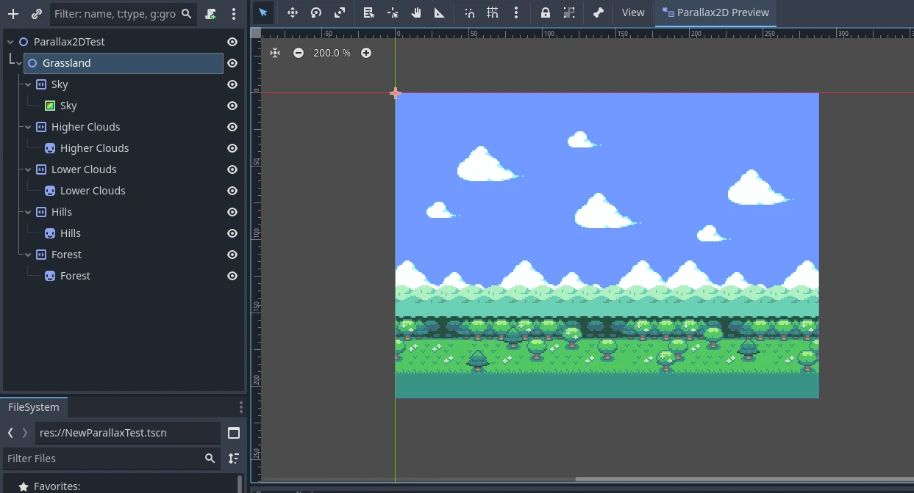

The scene above uses one prepared texture for the higher clouds in a [Sprite2D](https://docs.godotengine.org/en/4.5/classes/class_sprite2d.html#class-sprite2d), but you could
just as easily use multiple nodes spaced out to compose the layer.

#### Scroll scale

The backbone of the parallax effect is the [scroll_scale](https://docs.godotengine.org/en/4.5/classes/class_parallax2d.html#class-parallax2d-property-scroll-scale) property.
It works as a scroll-speed multiplier, allowing layers to move at a different speed than the camera for each axis set.
A value of 1 makes the parallax node scroll at the same speed as the camera. If you want your image to look further away
when scrolling, use a value lower than 1, with 0 bringing it to a complete stop. If you want something to appear closer
to the camera, use a value higher than 1, making it scroll faster.

The scene above is comprised of five layers. Some good [scroll_scale](https://docs.godotengine.org/en/4.5/classes/class_parallax2d.html#class-parallax2d-property-scroll-scale)
values might be:

- `(0.7, 1)` - Forest
- `(0.5, 1)` - Hills
- `(0.3, 1)` - Lower Clouds
- `(0.2, 1)` - Higher Clouds
- `(0.1, 1)` - Sky

The video below displays how these values affect scrolling while in-game:

[A scene with five layers scrolling at different speeds（本地原视频；下方为10%、50%、90%位置静态抽帧，未转录视频内容）](../../assets/game-development/DEV-024/2d_parallax_scroll_scale.webm)

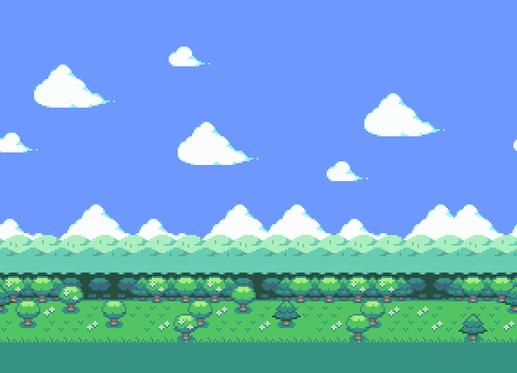

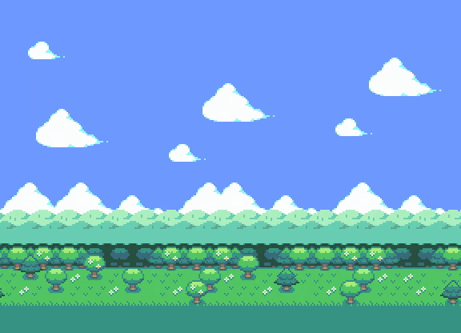

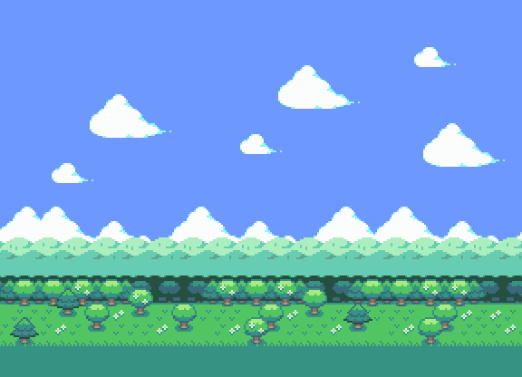

#### Infinite repeat

[Parallax2D](https://docs.godotengine.org/en/4.5/classes/class_parallax2d.html#class-parallax2d) provides a bonus effect that gives textures the illusion of repeating infinitely.
[repeat_size](https://docs.godotengine.org/en/4.5/classes/class_parallax2d.html#class-parallax2d-property-repeat-size) tells the node to snap its position forward or back when the
camera scrolls by the set value. This effect is achieved by adding a single repeat to all the child canvas items offset
by the value. While the camera scrolls between the image and its repeat, it invisibly snaps back giving the appearance
of a looping image.

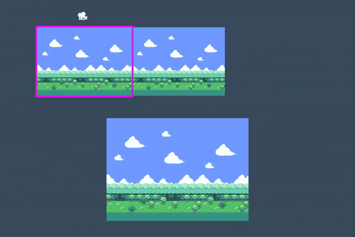

Being a delicate effect, it's easy for unfamiliar users to make mistakes with their setup. Let's go over the "how" and
"why" of a few common problems users encounter.

##### Poor sizing

The infinite repeat effect is easiest to work with when you have an image designed to repeat seamlessly and is the same
size or larger than your viewport **before** setting the [repeat_size](https://docs.godotengine.org/en/4.5/classes/class_parallax2d.html#class-parallax2d-property-repeat-size). If
you aren't able to obtain assets that are designed for this task, there are some other things you can do to better
prepare your image in regards to size.

Here is an example of a texture that is too small for its viewport:

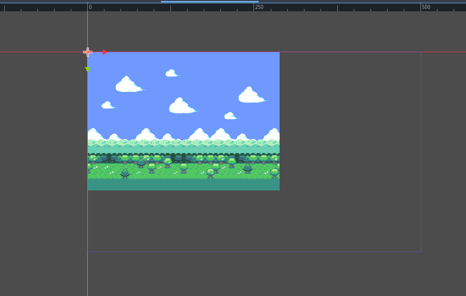

We can see that the viewport size is 500x300 but the texture is 288x208. If we set the
[repeat_size](https://docs.godotengine.org/en/4.5/classes/class_parallax2d.html#class-parallax2d-property-repeat-size) to the size of our image, the infinite repeat effect doesn't
scroll properly because the original texture doesn't cover the viewport. If we set the
[repeat_size](https://docs.godotengine.org/en/4.5/classes/class_parallax2d.html#class-parallax2d-property-repeat-size) to the size of the viewport, we have a large gap. What can we
do?

###### Make the viewport smaller

The simplest answer is to make the viewport the same size or smaller than your textures.
In **Project Settings > Display > Window**, change the
[Viewport Width](https://docs.godotengine.org/en/4.5/classes/class_projectsettings.html#class-projectsettings-property-display-window-size-viewport-width)
and [Viewport Height](https://docs.godotengine.org/en/4.5/classes/class_projectsettings.html#class-projectsettings-property-display-window-size-viewport-height)
settings to match your background.

###### Scale the Parallax2D

If you're not aiming for a pixel-perfect style, or don't mind a little blurriness, you may opt to scale the textures
larger to fit your screen. Set the [scale](https://docs.godotengine.org/en/4.5/classes/class_node2d.html#class-node2d-property-scale) of the [Parallax2D](https://docs.godotengine.org/en/4.5/classes/class_parallax2d.html#class-parallax2d),
and all child textures scale with it.

###### Scale the child nodes

Similar to scaling the [Parallax2D](https://docs.godotengine.org/en/4.5/classes/class_parallax2d.html#class-parallax2d), you can scale your [Sprite2D](https://docs.godotengine.org/en/4.5/classes/class_sprite2d.html#class-sprite2d) nodes to
be large enough to cover the screen. Keep in mind that some settings like
[Parallax2D.repeat_size](https://docs.godotengine.org/en/4.5/classes/class_parallax2d.html#class-parallax2d-property-repeat-size) and
[Sprite2D.region_rect](https://docs.godotengine.org/en/4.5/classes/class_sprite2d.html#class-sprite2d-property-region-rect) do not take scaling into account, so it's necessary to
adjust these values based on the scale.

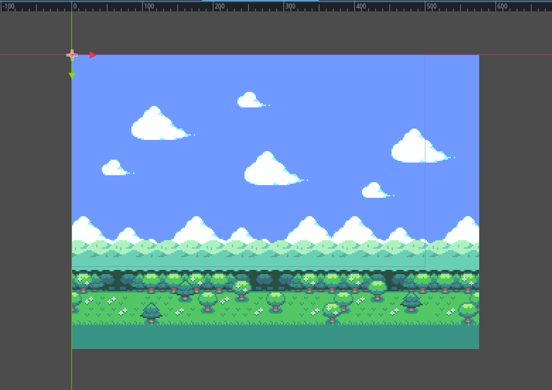

###### Repeat the textures

You can also start off on the right foot by preparing child nodes earlier in the process. If you have a
[Sprite2D](https://docs.godotengine.org/en/4.5/classes/class_sprite2d.html#class-sprite2d) you'd like to repeat, but is too small, you can do the following to repeat it:

- set [texture_repeat](https://docs.godotengine.org/en/4.5/classes/class_canvasitem.html#class-canvasitem-property-texture-repeat) to [CanvasItem.TEXTURE_REPEAT_ENABLED](https://docs.godotengine.org/en/4.5/classes/class_canvasitem.html#class-canvasitem-constant-texture-repeat-enabled)
- set [region_enabled](https://docs.godotengine.org/en/4.5/classes/class_sprite2d.html#class-sprite2d-property-region-enabled) to `true`
- set the [region_rect](https://docs.godotengine.org/en/4.5/classes/class_sprite2d.html#class-sprite2d-property-region-rect) to a multiple of the size of your texture large enough to cover the viewport.

Below, you can see that repeating the image twice makes it large enough to cover the screen.

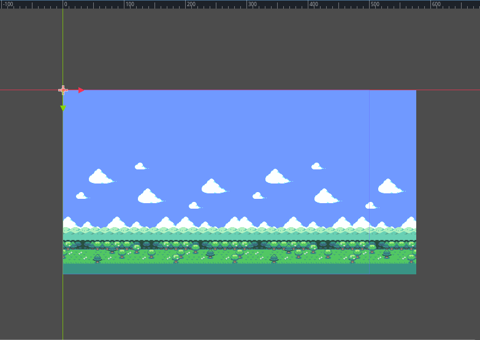

##### Poor positioning

It's common to see users mistakenly set all of their textures to be centered at `(0,0)`:

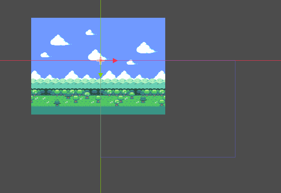

This creates problems with the infinite repeat effect and should be avoided. The "infinite repeat canvas" starts at
`(0,0)` and expands down and to the right to the size of the [repeat_size](https://docs.godotengine.org/en/4.5/classes/class_parallax2d.html#class-parallax2d-property-repeat-size)
value.

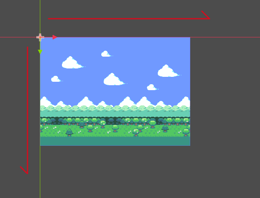

If the textures are centered on the `(0,0)` crossing, the infinite repeat canvas is only partly covered, so it
only partly repeats.

###### Would increasing `repeat_times` fix this?

Increasing [repeat_times](https://docs.godotengine.org/en/4.5/classes/class_parallax2d.html#class-parallax2d-property-repeat-times) technically *would* work in some scenarios, but
is a brute force solution and not the problem it is designed to solve (we'll go over this in a bit). A better fix is to
understand how the repeat effect works and set up the parallax textures appropriately to begin with.

First, check to see if any textures are spilling over onto the negative parts of the canvas. Make sure the textures
used in the parallax nodes fit inside the "infinite repeat canvas" starting at `(0,0)`. That way, if
[Parallax2D.repeat_size](https://docs.godotengine.org/en/4.5/classes/class_parallax2d.html#class-parallax2d-property-repeat-size) is set correctly, it should look something like
this, with one single loop of the image the same size or larger than the viewport:

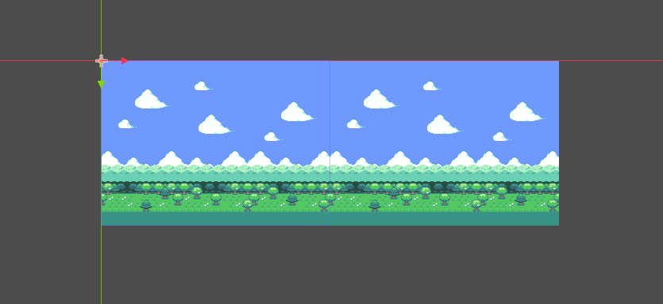

If you think of how the image scrolls across the screen, it starts by displaying what's inside the red rectangle
(determined by [repeat_size](https://docs.godotengine.org/en/4.5/classes/class_parallax2d.html#class-parallax2d-property-repeat-size)), and when it reaches what's inside the yellow
rectangle it zips the image forward to give the illusion of scrolling forever.

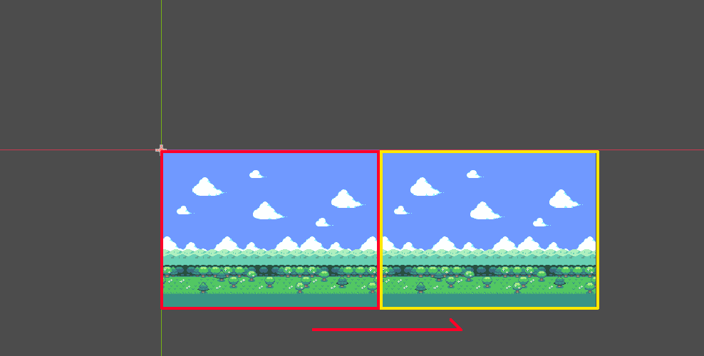

If you have the image positioned away from the "infinite repeat canvas", when the camera reaches the yellow rectangle,
half of the image is cut off before it jumps forward like in the image below:

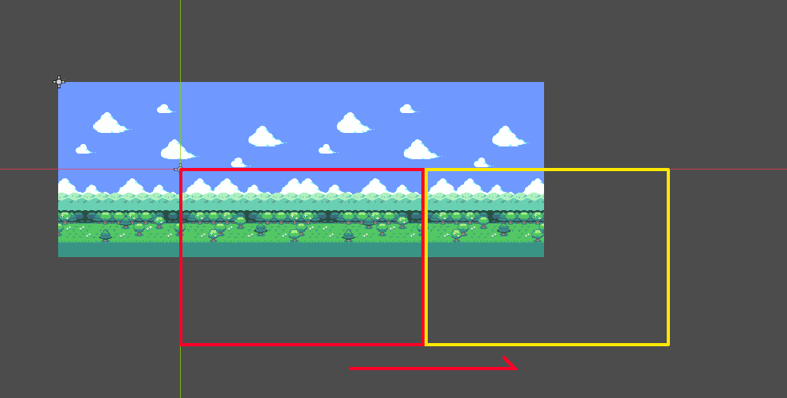

#### Scroll offset

If your parallax textures are already working correctly, but you prefer it to start at a different point,
[Parallax2D](https://docs.godotengine.org/en/4.5/classes/class_parallax2d.html#class-parallax2d) comes with a [scroll_offset](https://docs.godotengine.org/en/4.5/classes/class_parallax2d.html#class-parallax2d-property-scroll-offset) property
used to offset where the infinite repeat canvas starts. As an example, if your image is 288x208, setting
the [scroll_offset](https://docs.godotengine.org/en/4.5/classes/class_parallax2d.html#class-parallax2d-property-scroll-offset) to `(-144,0)` or `(144,0)` allows it to begin
halfway across the image.

#### Repeat times

Ideally, following this guide, your parallax textures are large enough to cover the screen even when zoomed out.
Until now, we have had a perfectly fitting 288x208 texture inside of a 288x208 viewport. However, problems
occur when we zoom out by setting the [Camera2D.zoom](https://docs.godotengine.org/en/4.5/classes/class_camera2d.html#class-camera2d-property-zoom) to `(0.5, 0.5)`:

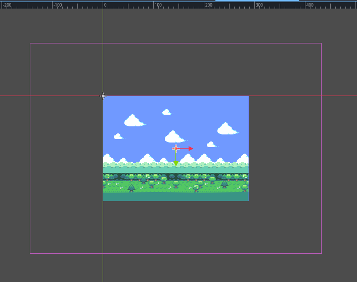

Even though everything is correctly set for the viewport at the default zoom level, zooming out makes it smaller than
the viewport, breaking the infinite repeat effect. This is where
[repeat_times](https://docs.godotengine.org/en/4.5/classes/class_parallax2d.html#class-parallax2d-property-repeat-times) can help out. Setting a value of `3` (one extra
repeat behind and in front), it is now large enough to accommodate the infinite repeat effect.

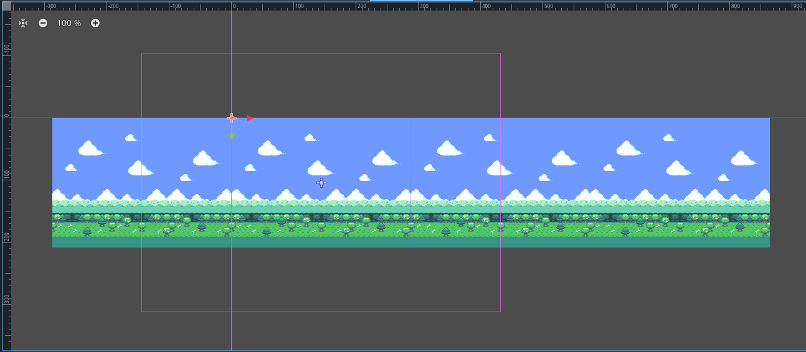

If these textures were meant to be repeated vertically, we would have specified a `y` value for the
[repeat_size](https://docs.godotengine.org/en/4.5/classes/class_parallax2d.html#class-parallax2d-property-repeat-size). The
[repeat_times](https://docs.godotengine.org/en/4.5/classes/class_parallax2d.html#class-parallax2d-property-repeat-times) would automatically add a repeat above and below as well.
This is only a horizontal parallax, so it leaves an empty block above and below the image. How do we solve this? We
need to get creative! In this example, we stretch the sky higher, and grass sprite lower. The textures now support the
normal zoom level and zooming out to half size.

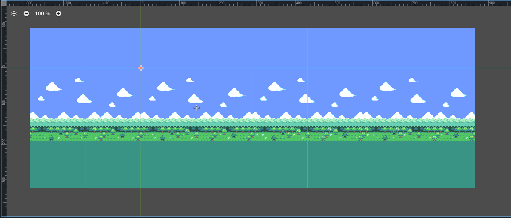

#### Split screen

Most tutorials for making a split screen game in Godot begin by writing a small script to assign
the [Viewport.world_2d](https://docs.godotengine.org/en/4.5/classes/class_viewport.html#class-viewport-property-world-2d) of the first SubViewport to the second, so they have a
shared display. Questions often pop up about how to share a parallax effect between both screens.

The parallax effect fakes a perspective by moving the positions of different textures in relation to the camera. This is
understandably problematic if you have multiple cameras, because your textures can't be in two places at once!

This is still achievable by cloning the parallax nodes into the second (or third or fourth)
[SubViewport](https://docs.godotengine.org/en/4.5/classes/class_subviewport.html#class-subviewport). Here's how a setup looks for a two player game:

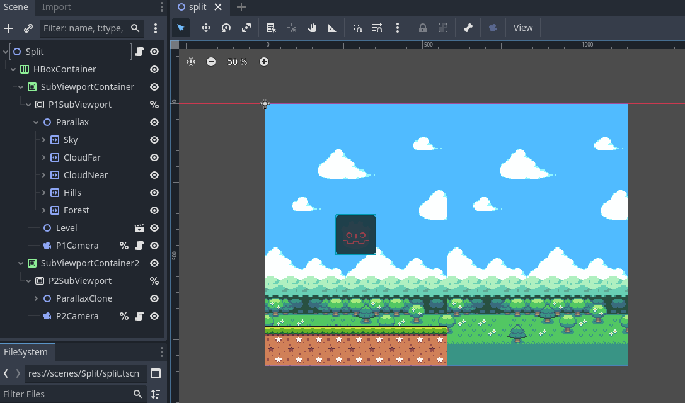

Of course, now both backgrounds show in both SubViewports. What we want is for each parallax to only show in their
corresponding viewport. We can achieve this by doing the following:

- Leave all parallax nodes at their default [visibility_layer](https://docs.godotengine.org/en/4.5/classes/class_canvasitem.html#class-canvasitem-property-visibility-layer) of 1.
- Set the first SubViewport's [canvas_cull_mask](https://docs.godotengine.org/en/4.5/classes/class_viewport.html#class-viewport-property-canvas-cull-mask) to only layers 1 and 2.
- Do the same for the second SubViewport but use layers 1 and 3.
- Give your parallax nodes in the first SubViewport a common parent and set its [visibility_layer](https://docs.godotengine.org/en/4.5/classes/class_canvasitem.html#class-canvasitem-property-visibility-layer) to 2.
- Do the same for the second SubViewport's parallax nodes, but use a layer of 3.

How does this work? If a canvas item has a [visibility_layer](https://docs.godotengine.org/en/4.5/classes/class_canvasitem.html#class-canvasitem-property-visibility-layer) that
doesn't match the SubViewport's [canvas_cull_mask](https://docs.godotengine.org/en/4.5/classes/class_viewport.html#class-viewport-property-canvas-cull-mask), it will hide all
children, even if they do. We use this to our advantage, letting the SubViewports cut off rendering of parallax nodes
whose parent doesn't have a supported [visibility_layer](https://docs.godotengine.org/en/4.5/classes/class_canvasitem.html#class-canvasitem-property-visibility-layer).

#### Previewing in the editor

Prior to 4.3, the recommendation was to place every layer in their own
[ParallaxBackground](https://docs.godotengine.org/en/4.5/classes/class_parallaxbackground.html#class-parallaxbackground), enable the
[follow_viewport_enabled](https://docs.godotengine.org/en/4.5/classes/class_canvaslayer.html#class-canvaslayer-property-follow-viewport-enabled) property, and scale the individual
layer. This method has always been tricky to get right, but is still achievable by using a
[CanvasLayer](https://docs.godotengine.org/en/4.5/classes/class_canvaslayer.html#class-canvaslayer) instead of a [ParallaxBackground](https://docs.godotengine.org/en/4.5/classes/class_parallaxbackground.html#class-parallaxbackground).

Note

Another recommendation is [KoBeWi's "Parallax2D Preview" addon](https://github.com/KoBeWi/Godot-Parallax2D-Preview).
It provides a few different preview modes and is very handy!

---

## 来源、配图与授权

- 原文：[2D Parallax](https://docs.godotengine.org/en/4.5/tutorials/2d/2d_parallax.html)。
- 作者与署名：Juan Linietsky, Ariel Manzur and the Godot community。
- 文档许可：[CC BY 3.0](https://creativecommons.org/licenses/by/3.0/)；[官方仓库许可声明](https://github.com/godotengine/godot-docs/blob/4.5/README.md#license)。
- 许可全文：[godot-docs-4.5-LICENSE.txt](../../licenses/godot-docs-4.5-LICENSE.txt)。
- 本地原文主内容快照：[DEV-024.article.html](../../sources/game-development/DEV-024.article.html)。
- 变更：去除导航和用户评论入口，HTML 转 Markdown，图片改为相对路径，重复评级图标转成同义文字，新增中文导读、练习及验收。正文中的示例素材署名予以保留。
- 本整理稿的新增中文内容同样按 CC BY 3.0 提供，署名“Pixel Tutorial Library 整理者（Codex）”；不暗示原作者认可本整理稿。
- 嵌入动态演示保存原始 webm，并按时长的10%、50%、90%提取静态帧辅助离线阅读；这是画面抽帧，不是语音、字幕或完整动作转录。

| 本地图像 | 原图来源 | 图示语境 |
| --- | --- | --- |
| [2d_parallax_size_viewport.webp](../../assets/game-development/DEV-024/2d_parallax_size_viewport.webp) | [原图](https://docs.godotengine.org/en/4.5/_images/2d_parallax_size_viewport.webp) | 原教程图示：Getting started — 2d_parallax_size_viewport.webp |
| [2d_parallax_scroll.gif](../../assets/game-development/DEV-024/2d_parallax_scroll.gif) | [原图](https://docs.godotengine.org/en/4.5/_images/2d_parallax_scroll.gif) | 原教程图示：Infinite repeat — 2d_parallax_scroll.gif |
| [2d_parallax_size_bad.webp](../../assets/game-development/DEV-024/2d_parallax_size_bad.webp) | [原图](https://docs.godotengine.org/en/4.5/_images/2d_parallax_size_bad.webp) | 原教程图示：Poor sizing — 2d_parallax_size_bad.webp |
| [2d_parallax_size_scale.webp](../../assets/game-development/DEV-024/2d_parallax_size_scale.webp) | [原图](https://docs.godotengine.org/en/4.5/_images/2d_parallax_size_scale.webp) | 原教程图示：Scale the child nodes — 2d_parallax_size_scale.webp |
| [2d_parallax_size_repeat.webp](../../assets/game-development/DEV-024/2d_parallax_size_repeat.webp) | [原图](https://docs.godotengine.org/en/4.5/_images/2d_parallax_size_repeat.webp) | 原教程图示：Repeat the textures — 2d_parallax_size_repeat.webp |
| [2d_parallax_single_centered.webp](../../assets/game-development/DEV-024/2d_parallax_single_centered.webp) | [原图](https://docs.godotengine.org/en/4.5/_images/2d_parallax_single_centered.webp) | 原教程图示：Poor positioning — 2d_parallax_single_centered.webp |
| [2d_parallax_single_expand.webp](../../assets/game-development/DEV-024/2d_parallax_single_expand.webp) | [原图](https://docs.godotengine.org/en/4.5/_images/2d_parallax_single_expand.webp) | 原教程图示：Poor positioning — 2d_parallax_single_expand.webp |
| [2d_parallax_repeat_good_norect.webp](../../assets/game-development/DEV-024/2d_parallax_repeat_good_norect.webp) | [原图](https://docs.godotengine.org/en/4.5/_images/2d_parallax_repeat_good_norect.webp) | 原教程图示：Would increasing repeat_times fix this? — 2d_parallax_repeat_good_norect.webp |
| [2d_parallax_repeat_good.webp](../../assets/game-development/DEV-024/2d_parallax_repeat_good.webp) | [原图](https://docs.godotengine.org/en/4.5/_images/2d_parallax_repeat_good.webp) | 原教程图示：Would increasing repeat_times fix this? — 2d_parallax_repeat_good.webp |
| [2d_parallax_repeat_bad.webp](../../assets/game-development/DEV-024/2d_parallax_repeat_bad.webp) | [原图](https://docs.godotengine.org/en/4.5/_images/2d_parallax_repeat_bad.webp) | 原教程图示：Would increasing repeat_times fix this? — 2d_parallax_repeat_bad.webp |
| [2d_parallax_zoom_single.webp](../../assets/game-development/DEV-024/2d_parallax_zoom_single.webp) | [原图](https://docs.godotengine.org/en/4.5/_images/2d_parallax_zoom_single.webp) | 原教程图示：Repeat times — 2d_parallax_zoom_single.webp |
| [2d_parallax_zoom_repeat_times.webp](../../assets/game-development/DEV-024/2d_parallax_zoom_repeat_times.webp) | [原图](https://docs.godotengine.org/en/4.5/_images/2d_parallax_zoom_repeat_times.webp) | 原教程图示：Repeat times — 2d_parallax_zoom_repeat_times.webp |
| [2d_parallax_zoom_repeat_adjusted.webp](../../assets/game-development/DEV-024/2d_parallax_zoom_repeat_adjusted.webp) | [原图](https://docs.godotengine.org/en/4.5/_images/2d_parallax_zoom_repeat_adjusted.webp) | 原教程图示：Repeat times — 2d_parallax_zoom_repeat_adjusted.webp |
| [2d_parallax_splitscreen.webp](../../assets/game-development/DEV-024/2d_parallax_splitscreen.webp) | [原图](https://docs.godotengine.org/en/4.5/_images/2d_parallax_splitscreen.webp) | 原教程图示：Split screen — 2d_parallax_splitscreen.webp |
| [2d_parallax_scroll_scale-keyframe-1.png](../../assets/game-development/DEV-024/2d_parallax_scroll_scale-keyframe-1.png) | [原图](https://docs.godotengine.org/en/4.5/_images/2d_parallax_scroll_scale.webm) | A scene with five layers scrolling at different speeds：原视频抽帧 0.96 秒（静态观察，不是视频转录） |
| [2d_parallax_scroll_scale-keyframe-2.png](../../assets/game-development/DEV-024/2d_parallax_scroll_scale-keyframe-2.png) | [原图](https://docs.godotengine.org/en/4.5/_images/2d_parallax_scroll_scale.webm) | A scene with five layers scrolling at different speeds：原视频抽帧 4.8 秒（静态观察，不是视频转录） |
| [2d_parallax_scroll_scale-keyframe-3.png](../../assets/game-development/DEV-024/2d_parallax_scroll_scale-keyframe-3.png) | [原图](https://docs.godotengine.org/en/4.5/_images/2d_parallax_scroll_scale.webm) | A scene with five layers scrolling at different speeds：原视频抽帧 8.64 秒（静态观察，不是视频转录） |
