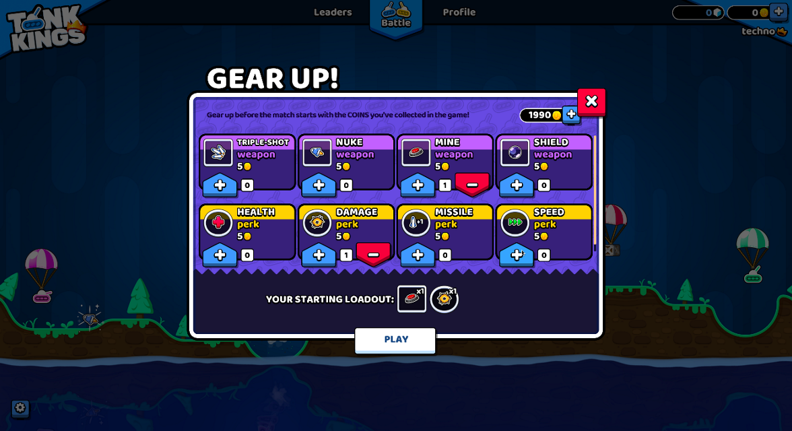
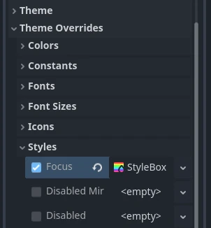

# 游戏UI主题：颜色、字体、图标与状态外观的统一

> 本文由 Godot 官方 4.5 版文档转换。下方中文导读、练习和验收是整理者的教学编排，英文正文是原教程主内容；不是官方中文逐句译文，也未声称已在引擎中执行全部练习。

## 适用任务

使用Theme资源统一项目界面的颜色、字体、图标与StyleBox，并理解局部覆盖的优先级。

## 前提

- DEV-001
- 基本Control节点

## 中文操作路线

1. 先列出按钮、标签和面板在项目中共享的颜色、字体大小、图标和背景外观。
2. 创建共享Theme资源，在项目级或Control分支根节点应用，并在各独立场景预览。
3. 使用type variation区分Header等语义角色，避免每个节点重复局部修改。
4. 焦点StyleBox覆盖在基础状态上；设计为边缘或适当透明的框，避免遮住普通/按下外观。
5. 出现不一致时先检查local override，再查最近的父Control主题和项目主题，避免误改全局资源。

## 图示怎么读

先沿英文正文的步骤阅读对应截图；截图来自同一版本页面，局部操作顺序以紧邻图片的文字为准。图片下载到本地，可离线打开并放大检查。截图中的示例美术用于说明引擎操作，不代表本库要求采用该画风。

## 动手练习

整理者练习：用同一Theme做背包、商店与设置三张面板，修改一个字体参数后检查三处都更新；刻意保留一个局部覆盖并解释其例外原因。

## 验收清单

- [ ] 组件状态语义一致
- [ ] 局部覆盖有明确理由
- [ ] 焦点可见且不掩盖按下状态
- [ ] 长中文文案可读

## 版本与边界

本篇是主题机制，原站游戏示例图不等于可直接复用的UI成品素材。

本次来源固定为 Godot 4.5 文档分支，抓取日期为 2026-10-29；它不是“当前最新版本”的声明。升级引擎时应重新核对节点名、属性名和 API。

## 原教程正文（英文，Markdown 转换）

### Introduction to GUI skinning

It is essential for a game to provide clear, informative, and yet visually
pleasing user interface to its players. While [Control](https://docs.godotengine.org/en/4.5/classes/class_control.html#class-control)
nodes come with a decently functional look out of the box, there is always
room for uniqueness and case-specific tuning. For this purpose Godot engine
includes a system for GUI skinning (or theming), which allows you to customize
the look of every control in your user interface, including your custom controls.

Here is an example of this system in action — a game with the GUI that is
radically different from the default UI theme of the engine:




A "Gear Up!" screen in Tank Kings, courtesy of Winterpixel Games

Beyond achieving a unique look for your game, this system also enables developers
to provide customization options to the end users, including accessibility settings.
UI themes are applied in a cascading manner (i.e. they propagate from parent
controls to their children), which means that font settings or adjustments for
colorblind users can be applied in a single place and affect the entire UI tree.
Of course this system can also be used for gameplay purposes: your hero-based game
can change its style for the selected player character, or you can give different
flavors to the sides in your team-based project.

#### Basics of themes

The skinning system is driven by the [Theme](https://docs.godotengine.org/en/4.5/classes/class_theme.html#class-theme) resource. Every
Godot project has an inherent default theme that contains the settings used by
the built-in control nodes. This is what gives the controls their distinct look
out of the box. A theme only describes the configuration, however, and it is still
the job of each individual control to use that configuration in the way it requires
to display itself. This is important to remember when implementing
[your own custom controls](https://docs.godotengine.org/en/4.5/tutorials/ui/custom_gui_controls.html#doc-custom-gui-controls).

Note

Even the Godot editor itself relies on the default theme. But it doesn't look the
same as a Godot project, because it applies its own heavily customized theme on top
of the default one. In principle, this works exactly like it would in your game
as explained [below](https://docs.godotengine.org/en/4.5/tutorials/ui/gui_skinning.html#doc-gui-theme-in-project).

##### Theme items

The configuration that is stored in a theme consists of theme items. Each item has
a unique name and must be one of the following data types:

- **Color**

  A [color](https://docs.godotengine.org/en/4.5/classes/class_color.html#class-color) value, which is often used for fonts
  and backgrounds. Colors can also be used for modulation of controls
  and icons.
- **Constant**

  An integer value, which can be used either for numeric properties of
  controls (such as the item separation in a [BoxContainer](https://docs.godotengine.org/en/4.5/classes/class_boxcontainer.html#class-boxcontainer)),
  or for boolean flags (such as the drawing of relationship lines in a [Tree](https://docs.godotengine.org/en/4.5/classes/class_tree.html#class-tree)).
- **Font**

  A [font](https://docs.godotengine.org/en/4.5/classes/class_font.html#class-font) resource, which is used by controls that
  display text. Fonts contain most text rendering settings, except for
  its size and color. On top of that, alignment and text direction are
  controlled by individual controls.
- **Font size**

  An integer value, which is used alongside a font to determine the
  size at which the text should be displayed.
- **Icon**

  A [texture](https://docs.godotengine.org/en/4.5/classes/class_texture2d.html#class-texture2d) resource, which is normally used
  to display an icon (on a [Button](https://docs.godotengine.org/en/4.5/classes/class_button.html#class-button), for example).
- **StyleBox**

  A [StyleBox](https://docs.godotengine.org/en/4.5/classes/class_stylebox.html#class-stylebox) resource, a collection of configuration
  options which define the way a UI panel should be displayed. This is
  not limited to the [Panel](https://docs.godotengine.org/en/4.5/classes/class_panel.html#class-panel) control, as styleboxes
  are used by many controls for their backgrounds and overlays.

  Different controls will apply StyleBoxes in a different manner. Most notably,
  `focus` styleboxes are drawn as an *overlay* to other styleboxes (such as
  `normal` or `pressed`) to allow the base stylebox to remain visible.
  This means the focus stylebox should be designed as an outline or translucent
  box, so that its background can remain visible.

##### Theme types

To help with the organization of its items each theme is separated into types,
and each item must belong to a single type. In other words, each theme item
is defined by its name, its data type and its theme type. This combination
must be unique within the theme. For example, there cannot be two color items named
`font_color` in a type called `Label`, but there can be another `font_color`
item in a type `LineEdit`.

The default Godot theme comes with multiple theme types already defined,
one for every built-in control node that uses UI skinning. The example above
contains actual theme items present in the default theme. You can refer to the
**Theme Properties** section in the class reference for each control to see
which items are available to it and its child classes.

Note

Child classes can use theme items defined for their parent class (`Button`
and its derivatives being a good example of that). In fact, every control can
use every theme item of any theme type, if it needs to (but for the clarity and
predictability we try to avoid that in the engine).

It is important to remember that for child classes that process is automated.
Whenever a built-in control requests a theme item from the theme it can omit
the theme type, and its class name will be used instead. On top of that,
the class names of its parent classes will also be used in turn. This allows
changes to the parent class, such as `Button`, to affect all derived
classes without the need to customize every one of them.

You can also define your own theme types, and additionally customize both built-in
controls and your own controls. Because built-in controls have no knowledge of
your custom theme types, you must utilize scripts to access those items. All control
nodes have several methods that allow you to fetch theme items from the theme that
is applied to them. Those methods accept the theme type as one of the arguments.

```gdscript
var accent_color = get_theme_color("accent_color", "MyType")
label.add_theme_color_override("font_color", accent_color)
```

```csharp
Color accentColor = GetThemeColor("accent_color", "MyType");
label.AddThemeColorOverride("font_color", accentColor);
```

To give more customization opportunities types can also be linked together as
type variations. This is another use-case for custom theme types. For example,
a theme can contain a type `Header` which can be marked as a variation of
the base `Label` type. An individual `Label` control can then be set to
use the `Header` variation for its type, and every time a theme item is
requested from a theme this variation will be used before any other type. This
allows to store various presets of theme items for the same class of the
control node in the single `Theme` resource.

Warning

Only variations available from the default theme or defined in the custom
project theme are shown in the Inspector dock as options. You can still
input manually the name of a variation that is defined outside of those
two places, but it is recommended to keep all variations to the project theme.

You can learn more about creating and using theme type variations in a
[dedicated article](https://docs.godotengine.org/en/4.5/tutorials/ui/gui_theme_type_variations.html#doc-gui-theme-type-variations).

#### Customizing a control

Each control node can be customized directly without the use of themes. This
is called local overrides. Every theme property from the control's class
reference can be overridden directly on the control itself, using either
the Inspector dock, or scripts. This allows to make granular changes to a
particular part of the UI, while not affecting anything else in the project,
including this control's children.



Local overrides are less useful for the visual flair of your user interface,
especially if you aim for consistency. However, for layout nodes these are
essential. Nodes such as [BoxContainer](https://docs.godotengine.org/en/4.5/classes/class_boxcontainer.html#class-boxcontainer) and
[GridContainer](https://docs.godotengine.org/en/4.5/classes/class_gridcontainer.html#class-gridcontainer) use theme constants for defining
separation between their children, and [MarginContainer](https://docs.godotengine.org/en/4.5/classes/class_margincontainer.html#class-margincontainer)
stores its customizable margins in its theme items.

Whenever a control has a local theme item override, this is the value that
it uses. Values provided by the theme are ignored.

#### Customizing a project

Out of the box each project adopts the default project theme provided by Godot. The
default theme itself is constant and cannot be changed, but its items can be overridden
with a custom theme. Custom themes can be applied in two ways: as a project setting,
and as a node property throughout the tree of control nodes.

There are two project settings that can be adjusted to affect your entire project:
[GUI > Theme > Custom](https://docs.godotengine.org/en/4.5/classes/class_projectsettings.html#class-projectsettings-property-gui-theme-custom) allows you to
set a custom project-wide theme, and [GUI > Theme > Custom Font](https://docs.godotengine.org/en/4.5/classes/class_projectsettings.html#class-projectsettings-property-gui-theme-custom-font)
does the same to the default fallback font. When a theme item is requested by a control
node the custom project theme, if present, is checked first. Only if it doesn't have
the item the default theme is checked.

This allows you to configure the default look of every Godot control with a single
theme resource, but you can go more granular than that. Every control node also has
a [theme](https://docs.godotengine.org/en/4.5/classes/class_control.html#class-control-property-theme) property, which allows you to set a
custom theme for the branch of nodes starting with that control. This means that the
control and all of its children, and their children in turn, would first check that
custom theme resource before falling back on the project and the default themes.

Note

Instead of changing the project setting you can set the custom theme resource to the
root-most control node of your entire UI branch to almost the same effect. While in the
running project it will behave as expected, individual scenes will still display
using the default theme when previewing or running them directly. To fix that you
can set the same theme resource to the root control of each individual scene.

For example, you can have a certain style for buttons in your project theme, but want
a different look for buttons inside of a popup dialog. You can set a custom theme
resource to the root control of your popup and define a different style for buttons
within that resource. As long as the chain of control nodes between the root of
the popup and the buttons is uninterrupted, those buttons will use the styles defined
in the theme resource that is closest to them. All other controls will still be styled
using the project-wide theme and the default theme styles.

To sum it up, for an arbitrary control its theme item lookup would look something
like this:

1. Check for local overrides of the same data type and name.
2. Using control's type variation, class name and parent class names:

   1. Check every control starting from itself and see if it has a theme property set;
   2. If it does, check that theme for the matching item of the same name, data and theme type;
   3. If there is no custom theme or it doesn't have the item, move to the parent control;
   4. Repeat steps a-c. until the root of the tree is reached, or a non-control node is reached.
3. Using control's type variation, class name and parent class names check the project-wide theme, if it's present.
4. Using control's type variation, class name and parent class names check the default theme.

Even if the item doesn't exist in any theme, a corresponding default value for that
data type will be returned.

#### Beyond controls

Naturally, themes are an ideal type of resource for storing configuration for
something visual. While the support for theming is built into control nodes,
other nodes can use them as well, just like any other resource.

An example of using themes for something beyond controls can be a modulation
of sprites for the same units on different teams in a strategy game. A theme
resource can define a collection of colors, and sprites (with a help from scripts)
can use those colors to draw the texture. The main benefit being that you
could make different themes using the same theme items for red, blue, and
green teams, and swap them with a single resource change.

---

## 来源、配图与授权

- 原文：[Introduction to GUI skinning](https://docs.godotengine.org/en/4.5/tutorials/ui/gui_skinning.html)。
- 作者与署名：Juan Linietsky, Ariel Manzur and the Godot community。
- 文档许可：[CC BY 3.0](https://creativecommons.org/licenses/by/3.0/)；[官方仓库许可声明](https://github.com/godotengine/godot-docs/blob/4.5/README.md#license)。
- 许可全文：[godot-docs-4.5-LICENSE.txt](../../licenses/godot-docs-4.5-LICENSE.txt)。
- 本地原文主内容快照：[UI-002.article.html](../../sources/game-development/UI-002.article.html)。
- 变更：去除导航和用户评论入口，HTML 转 Markdown，图片改为相对路径，重复评级图标转成同义文字，新增中文导读、练习及验收。正文中的示例素材署名予以保留。
- 本整理稿的新增中文内容同样按 CC BY 3.0 提供，署名“Pixel Tutorial Library 整理者（Codex）”；不暗示原作者认可本整理稿。

| 本地图像 | 原图来源 | 图示语境 |
| --- | --- | --- |
| [tank-kings-by-winterpixel-games.png](../../assets/game-development/UI-002/tank-kings-by-winterpixel-games.png) | [原图](https://docs.godotengine.org/en/4.5/_images/tank-kings-by-winterpixel-games.png) | 原教程图示：Introduction to GUI skinning — tank-kings-by-winterpixel-games.png |
| [themecheck.webp](../../assets/game-development/UI-002/themecheck.webp) | [原图](https://docs.godotengine.org/en/4.5/_images/themecheck.webp) | 原教程图示：Customizing a control — themecheck.webp |
