# 游戏UI布局：容器、物品网格、长文本与可变尺寸

> 本文由 Godot 官方 4.5 版文档转换。下方中文导读、练习和验收是整理者的教学编排，英文正文是原教程主内容；不是官方中文逐句译文，也未声称已在引擎中执行全部练习。

## 适用任务

用布局容器组织背包网格、属性行与可滚动说明，避免图文重叠。

## 前提

- UI-002

## 中文操作路线

1. 选择适合信息结构的HBox/VBox/Grid或Margin等容器，不先把每个子控件固定到绝对位置。
2. 加入Container的Control子节点由父容器管理位置；手工拖动结果可能在下一次布局时被覆盖。
3. 分别检查横向和纵向的Fill、Expand和Shrink设置，控制谁获得剩余空间。
4. 用嵌套容器组合物品网格、说明区和底部操作；用PanelContainer保留面板样式边距。
5. 加入最长名称、最大数量和最低支持窗口尺寸；必要时滚动或重排，避免把全部文本缩得更小。

## 图示怎么读

先沿英文正文的步骤阅读对应截图；截图来自同一版本页面，局部操作顺序以紧邻图片的文字为准。图片下载到本地，可离线打开并放大检查。截图中的示例美术用于说明引擎操作，不代表本库要求采用该画风。

## 动手练习

整理者练习：做一个4列背包和物品说明面板；使用短名、长中文名、99与9999数量以及空物品栏测试。

## 验收清单

- [ ] 容器调整时不覆盖文字
- [ ] 按钮仍在可视区域
- [ ] 扩展与收缩行为能解释
- [ ] 九宫格装饰不占正文空间

## 版本与边界

容器决定布局，不决定美术风格。原文提及某些工具式UI，不要求把游戏改成网页仪表盘。

本次来源固定为 Godot 4.5 文档分支，抓取日期为 2026-10-29；它不是“当前最新版本”的声明。升级引擎时应重新核对节点名、属性名和 API。

## 原教程正文（英文，Markdown 转换）

### Using Containers

[Anchors](https://docs.godotengine.org/en/4.5/tutorials/ui/size_and_anchors.html#doc-size-and-anchors) are an efficient way to handle
different aspect ratios for basic multiple resolution handling in GUIs.

For more complex user interfaces, they can become difficult to use.

This is often the case of games, such as RPGs, online chats, tycoons or simulations. Another
common case where more advanced layout features may be required is in-game tools (or simply just tools).

All these situations require a more capable OS-like user interface, with advanced layout and formatting.
For that, [Containers](https://docs.godotengine.org/en/4.5/classes/class_container.html#class-container) are more useful.

#### Container layout

Containers provide a huge amount of layout power (as an example, the Godot editor user interface is entirely done using them):

> 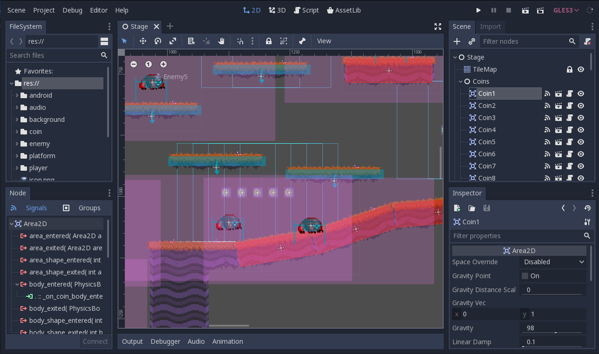

When a [Container](https://docs.godotengine.org/en/4.5/classes/class_container.html#class-container)-derived node is used, all children [Control](https://docs.godotengine.org/en/4.5/classes/class_control.html#class-control) nodes give up their
own positioning ability. This means the *Container* will control their positioning and any attempt to manually alter these
nodes will be either ignored or invalidated the next time their parent is resized.

Likewise, when a *Container* derived node is resized, all its children will be re-positioned according to it,
with a behavior based on the type of container used:

> 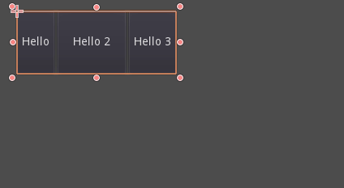

Example of *HBoxContainer* resizing children buttons.

The real strength of containers is that they can be nested (as nodes), allowing the creation of very complex layouts that resize effortlessly.

#### Sizing options

When adding a node to a container, the way the container treats each child depends mainly on their *container sizing options*. These options
can be found by inspecting the layout of any *Control* that is a child of a *Container*.

> 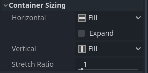

Sizing options are independent for vertical and horizontal sizing and not all containers make use of them (but most do):

- **Fill**: Ensures the control *fills* the designated area within the container. No matter if
  a control *expands* or not (see below), it will only *fill* the designated area when this is toggled on (it is by default).
- **Expand**: Attempts to use as much space as possible in the parent container (in each axis).
  Controls that don't expand will be pushed away by those that do. Between expanding controls, the
  amount of space they take from each other is determined by the *Stretch Ratio* (see below).
  This option is only available when the parent Container is of the right type, for example the *HBoxContainer* has this option
  for horizontal sizing.
- **Shrink Begin** When expanding, try to remain at the left or top of the expanded
  area.
- **Shrink Center** When expanding, try to remain at the center of the expanded
  area.
- **Shrink End** When expanding, try to remain at the right or bottom of the expanded
  area.
- **Stretch Ratio**: The ratio of how much expanded controls take up the available space in relation to each
  other. A control with "2", will take up twice as much available space as one with "1".

Experimenting with these flags and different containers is recommended to get a better grasp on how they work.

#### Container types

Godot provides several container types out of the box as they serve different purposes:

##### Box Containers

Arranges child controls vertically or horizontally (via [HBoxContainer](https://docs.godotengine.org/en/4.5/classes/class_hboxcontainer.html#class-hboxcontainer) and
[VBoxContainer](https://docs.godotengine.org/en/4.5/classes/class_vboxcontainer.html#class-vboxcontainer)). In the opposite of the designated direction
(as in, vertical for a horizontal container), it just expands the children.

> 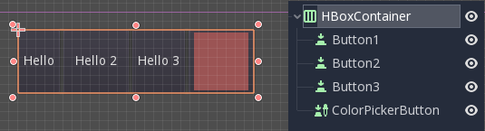

These containers make use of the *Stretch Ratio* property for children with the *Expand* flag set.

##### Grid Container

Arranges child controls in a grid layout (via [GridContainer](https://docs.godotengine.org/en/4.5/classes/class_gridcontainer.html#class-gridcontainer), amount
of columns must be specified). Uses both the vertical and horizontal expand flags.

> 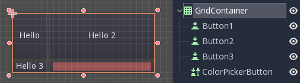

##### Margin Container

Child controls are expanded towards the bounds of this control (via
[MarginContainer](https://docs.godotengine.org/en/4.5/classes/class_margincontainer.html#class-margincontainer)). Padding will be added on the margins
depending on the theme configuration.

> 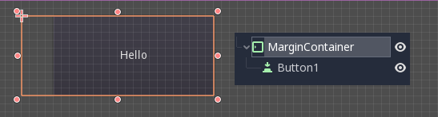

Again, keep in mind that the margins are a *Theme* value, so they need to be edited from the
constants overrides section of each control:

> 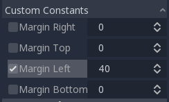

##### Tab Container

Allows you to place several child controls stacked on top of each other (via
[TabContainer](https://docs.godotengine.org/en/4.5/classes/class_tabcontainer.html#class-tabcontainer)), with only the *current* one visible.

> 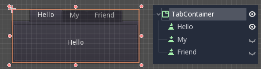

Changing the *current* one is done via tabs located at the top of the container, via clicking:

> 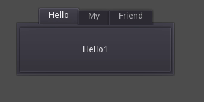

The titles are generated from the node names by default (although they can be overridden via *TabContainer* API).

Settings such as tab placement and *StyleBox* can be modified in the *TabContainer* theme overrides.

##### Split Container

Accepts only one or two children controls, then places them side to side with a divisor
(via [HSplitContainer](https://docs.godotengine.org/en/4.5/classes/class_hsplitcontainer.html#class-hsplitcontainer) and [VSplitContainer](https://docs.godotengine.org/en/4.5/classes/class_vsplitcontainer.html#class-vsplitcontainer)).
Respects both horizontal and vertical flags, as well as *Ratio*.

> 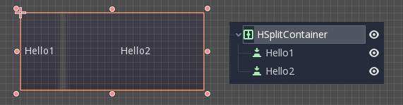

The divisor can be dragged around to change the size relation between both children:

> 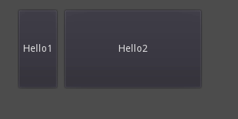

##### PanelContainer

A container that draws a *StyleBox*, then expands children to cover its whole area
(via [PanelContainer](https://docs.godotengine.org/en/4.5/classes/class_panelcontainer.html#class-panelcontainer), respecting the *StyleBox* margins).
It respects both the horizontal and vertical sizing options.

> 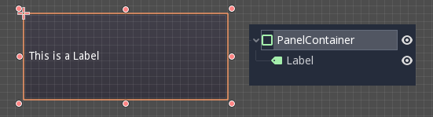

This container is useful as a top-level control, or just to add custom backgrounds to sections of a layout.

##### FoldableContainer

A container that can be expanded/collapsed
(via [FoldableContainer](https://docs.godotengine.org/en/4.5/classes/class_foldablecontainer.html#class-foldablecontainer)).
Child controls are hidden when it is collapsed.

##### ScrollContainer

Accepts a single child node. If the child node is bigger than the container, scrollbars will be added
to allow panning the node around (via [ScrollContainer](https://docs.godotengine.org/en/4.5/classes/class_scrollcontainer.html#class-scrollcontainer)). Both
vertical and horizontal size options are respected, and the behavior can be turned on or off
per axis in the properties.

> 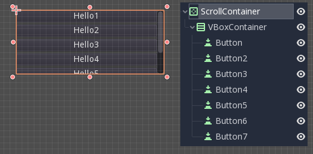

Mouse wheel and touch drag (when touch is available) are also valid ways to pan the child control around.

> 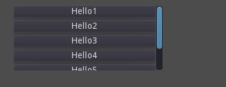

As in the example above, one of the most common ways to use this container is together with a *VBoxContainer* as child.

##### AspectRatioContainer

A container type that arranges its child controls in a way that preserves their proportions
automatically when the container is resized.
(via [AspectRatioContainer](https://docs.godotengine.org/en/4.5/classes/class_aspectratiocontainer.html#class-aspectratiocontainer)).
It has multiple stretch modes, providing options for adjusting the child controls' sizes concerning the container:
"fill," "width control height," "height control width," and "cover."

> 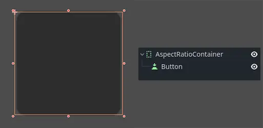

It is useful when you have a container that needs to be dynamic and responsive to different screen sizes,
and you want the child elements to scale proportionally without losing their intended shapes.

> 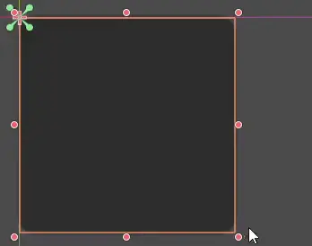

##### FlowContainer

FlowContainer is a container that arranges its child controls either horizontally or vertically
(via [HFlowContainer](https://docs.godotengine.org/en/4.5/classes/class_hflowcontainer.html#class-hflowcontainer) and via [VFlowContainer](https://docs.godotengine.org/en/4.5/classes/class_vflowcontainer.html#class-vflowcontainer)).
When the available space runs out, it wraps the children to the next line or column, similar to how text wraps in a book.

> 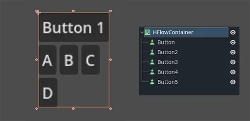

It is useful for creating flexible layouts where the child controls adjust automatically to the available space without overlapping.

> 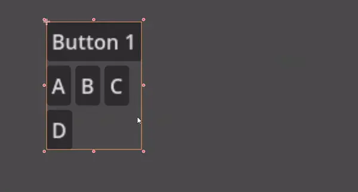

##### CenterContainer

CenterContainer is a container that automatically keeps all of its child controls centered within it at their minimum size.
It ensures that the child controls are always aligned to the center, making it easier to create centered layouts without manual positioning
(via [CenterContainer](https://docs.godotengine.org/en/4.5/classes/class_centercontainer.html#class-centercontainer)).

> 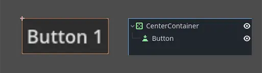
> 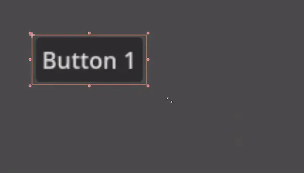

##### SubViewportContainer

This is a special control that will only accept a single *Viewport* node as child, and it will display
it as if it was an image (via [SubViewportContainer](https://docs.godotengine.org/en/4.5/classes/class_subviewportcontainer.html#class-subviewportcontainer)).

#### Creating custom Containers

It is possible to create a custom container using a script.
Here is an example of a container that fits children to its size:

```gdscript
extends Container

func _notification(what):
    if what == NOTIFICATION_SORT_CHILDREN:
        # Must re-sort the children
        for c in get_children():
            # Fit to own size
            fit_child_in_rect(c, Rect2(Vector2(), size))

func set_some_setting():
    # Some setting changed, ask for children re-sort.
    queue_sort()
```

```csharp
using Godot;

public partial class CustomContainer : Container
{
    public override void _Notification(int what)
    {
        if (what == NotificationSortChildren)
        {
            // Must re-sort the children
            foreach (Control c in GetChildren())
            {
                // Fit to own size
                FitChildInRect(c, new Rect2(new Vector2(), Size));
            }
        }
    }

    public void SetSomeSetting()
    {
        // Some setting changed, ask for children re-sort.
        QueueSort();
    }
}
```

---

## 来源、配图与授权

- 原文：[Using Containers](https://docs.godotengine.org/en/4.5/tutorials/ui/gui_containers.html)。
- 作者与署名：Juan Linietsky, Ariel Manzur and the Godot community。
- 文档许可：[CC BY 3.0](https://creativecommons.org/licenses/by/3.0/)；[官方仓库许可声明](https://github.com/godotengine/godot-docs/blob/4.5/README.md#license)。
- 许可全文：[godot-docs-4.5-LICENSE.txt](../../licenses/godot-docs-4.5-LICENSE.txt)。
- 本地原文主内容快照：[UI-003.article.html](../../sources/game-development/UI-003.article.html)。
- 变更：去除导航和用户评论入口，HTML 转 Markdown，图片改为相对路径，重复评级图标转成同义文字，新增中文导读、练习及验收。正文中的示例素材署名予以保留。
- 本整理稿的新增中文内容同样按 CC BY 3.0 提供，署名“Pixel Tutorial Library 整理者（Codex）”；不暗示原作者认可本整理稿。

| 本地图像 | 原图来源 | 图示语境 |
| --- | --- | --- |
| [godot_containers.png](../../assets/game-development/UI-003/godot_containers.png) | [原图](https://docs.godotengine.org/en/4.5/_images/godot_containers.png) | 原教程图示：Container layout — godot_containers.png |
| [container_example.gif](../../assets/game-development/UI-003/container_example.gif) | [原图](https://docs.godotengine.org/en/4.5/_images/container_example.gif) | 原教程图示：Container layout — container_example.gif |
| [container_sizing_options.webp](../../assets/game-development/UI-003/container_sizing_options.webp) | [原图](https://docs.godotengine.org/en/4.5/_images/container_sizing_options.webp) | 原教程图示：Sizing options — container_sizing_options.webp |
| [containers_box.png](../../assets/game-development/UI-003/containers_box.png) | [原图](https://docs.godotengine.org/en/4.5/_images/containers_box.png) | 原教程图示：Box Containers — containers_box.png |
| [containers_grid.png](../../assets/game-development/UI-003/containers_grid.png) | [原图](https://docs.godotengine.org/en/4.5/_images/containers_grid.png) | 原教程图示：Grid Container — containers_grid.png |
| [containers_margin.png](../../assets/game-development/UI-003/containers_margin.png) | [原图](https://docs.godotengine.org/en/4.5/_images/containers_margin.png) | 原教程图示：Margin Container — containers_margin.png |
| [containers_margin_constants.png](../../assets/game-development/UI-003/containers_margin_constants.png) | [原图](https://docs.godotengine.org/en/4.5/_images/containers_margin_constants.png) | 原教程图示：Margin Container — containers_margin_constants.png |
| [containers_tab.png](../../assets/game-development/UI-003/containers_tab.png) | [原图](https://docs.godotengine.org/en/4.5/_images/containers_tab.png) | 原教程图示：Tab Container — containers_tab.png |
| [containers_tab_click.gif](../../assets/game-development/UI-003/containers_tab_click.gif) | [原图](https://docs.godotengine.org/en/4.5/_images/containers_tab_click.gif) | 原教程图示：Tab Container — containers_tab_click.gif |
| [containers_split.png](../../assets/game-development/UI-003/containers_split.png) | [原图](https://docs.godotengine.org/en/4.5/_images/containers_split.png) | 原教程图示：Split Container — containers_split.png |
| [containers_split_drag.gif](../../assets/game-development/UI-003/containers_split_drag.gif) | [原图](https://docs.godotengine.org/en/4.5/_images/containers_split_drag.gif) | 原教程图示：Split Container — containers_split_drag.gif |
| [containers_panel.png](../../assets/game-development/UI-003/containers_panel.png) | [原图](https://docs.godotengine.org/en/4.5/_images/containers_panel.png) | 原教程图示：PanelContainer — containers_panel.png |
| [containers_scroll.png](../../assets/game-development/UI-003/containers_scroll.png) | [原图](https://docs.godotengine.org/en/4.5/_images/containers_scroll.png) | 原教程图示：ScrollContainer — containers_scroll.png |
| [containers_center_pan.gif](../../assets/game-development/UI-003/containers_center_pan.gif) | [原图](https://docs.godotengine.org/en/4.5/_images/containers_center_pan.gif) | 原教程图示：ScrollContainer — containers_center_pan.gif |
| [containers_aspectratio.webp](../../assets/game-development/UI-003/containers_aspectratio.webp) | [原图](https://docs.godotengine.org/en/4.5/_images/containers_aspectratio.webp) | 原教程图示：AspectRatioContainer — containers_aspectratio.webp |
| [containers_aspectratio_drag.webp](../../assets/game-development/UI-003/containers_aspectratio_drag.webp) | [原图](https://docs.godotengine.org/en/4.5/_images/containers_aspectratio_drag.webp) | 原教程图示：AspectRatioContainer — containers_aspectratio_drag.webp |
| [containers_hflow.webp](../../assets/game-development/UI-003/containers_hflow.webp) | [原图](https://docs.godotengine.org/en/4.5/_images/containers_hflow.webp) | 原教程图示：FlowContainer — containers_hflow.webp |
| [containers_hflow_drag.webp](../../assets/game-development/UI-003/containers_hflow_drag.webp) | [原图](https://docs.godotengine.org/en/4.5/_images/containers_hflow_drag.webp) | 原教程图示：FlowContainer — containers_hflow_drag.webp |
| [containers_center.webp](../../assets/game-development/UI-003/containers_center.webp) | [原图](https://docs.godotengine.org/en/4.5/_images/containers_center.webp) | 原教程图示：CenterContainer — containers_center.webp |
| [containers_center_drag.webp](../../assets/game-development/UI-003/containers_center_drag.webp) | [原图](https://docs.godotengine.org/en/4.5/_images/containers_center_drag.webp) | 原教程图示：CenterContainer — containers_center_drag.webp |
