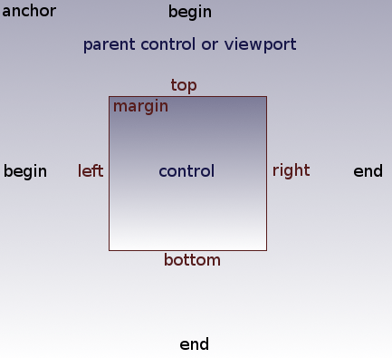
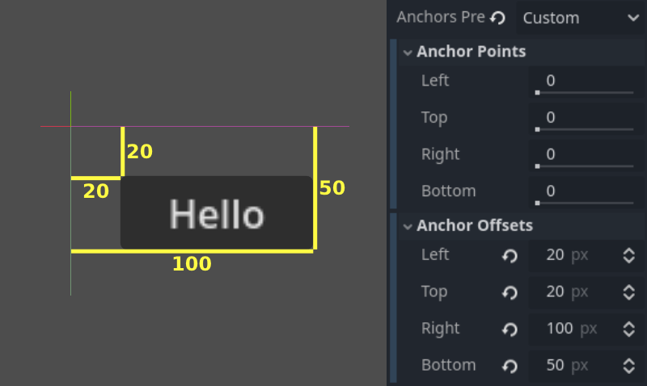
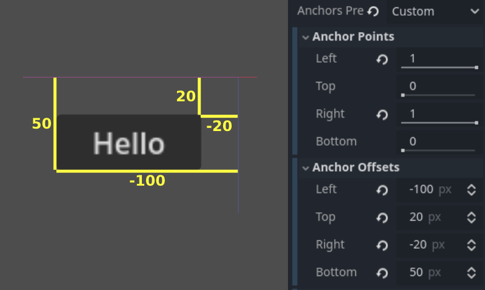
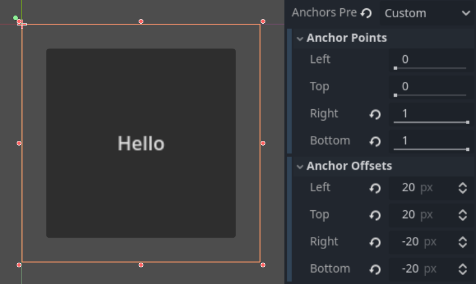
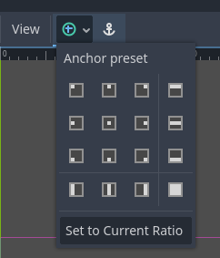

# 游戏HUD锚点：宽高比变化中的定位与安全边距

> 本文由 Godot 官方 4.5 版文档转换。下方中文导读、练习和验收是整理者的教学编排，英文正文是原教程主内容；不是官方中文逐句译文，也未声称已在引擎中执行全部练习。

## 适用任务

让角落HUD、居中弹窗和边缘控件在窗口变化时维持合理关系。

## 前提

- DEV-020

## 中文操作路线

1. 确认Control以父Control或视口作为参考。
2. 用0到1的anchor位置表示相对边缘，用offset描述相对于anchor的像素距离。
3. 固定在右下角的控件按右/下锚点设置偏移；居中控件可采用0.5锚点与半尺寸的正负偏移。
4. 使用编辑器Anchor预设提高效率，再检查是否需要容器接管复杂排布。
5. 在多个宽高比和界面倍率下检查四角HUD、居中面板、文字与安全边距。

## 图示怎么读

先沿英文正文的步骤阅读对应截图；截图来自同一版本页面，局部操作顺序以紧邻图片的文字为准。图片下载到本地，可离线打开并放大检查。截图中的示例美术用于说明引擎操作，不代表本库要求采用该画风。

## 动手练习

整理者练习：为像素村庄做左上状态、右下快捷栏和居中对话框，改变窗口宽高比并记录它们各自的参考边。

## 验收清单

- [ ] 关键HUD未出屏
- [ ] 弹窗居中且文字未截断
- [ ] offset与anchor的意义清楚
- [ ] 游戏世界像素倍率与UI阅读倍率分别考虑

## 版本与边界

锚点是布局关系，不是整数像素缩放的替代方案；清晰度还需DEV-021与DEV-022。

本次来源固定为 Godot 4.5 文档分支，抓取日期为 2026-10-29；它不是“当前最新版本”的声明。升级引擎时应重新核对节点名、属性名和 API。

## 原教程正文（英文，Markdown 转换）

### Size and anchors

If a game was always going to be run on the same device and at the same
resolution, positioning controls would be a simple matter of setting the
position and size of each one of them. Unfortunately, that is rarely the
case.

While some configurations may be more common than others, devices like
phones, tablets and portable gaming consoles can vary greatly. Therefore,
we often have to account for different aspect ratios, resolutions and user
scaling.

There are several ways to account for this, but for now, let's just imagine
that the screen resolution has changed and the controls need to be
re-positioned. Some will need to follow the bottom of the screen, others
the top of the screen, or maybe the right or left margins.



This is done by editing the *anchor offsets* of controls, which behave similar
to a margin. To access these settings, you will first need to select the *Custom*
anchor preset.

Each control has four anchor offsets: left, right, bottom, and top, which correspond
to the respective edges of the control. By default, all of
them represent a distance in pixels relative to the top-left corner of
the parent control or (in case there is no parent control) the viewport.



So to make the control wider you can make the right offset larger and/or
make the left offset smaller. This lets you set the exact placement
and shape of the control.

The *anchor* properties adjust where the offsets are relative *to*.
Each offset has an individual anchor that can be adjusted from the
beginning to the end of the parent. So the vertical (top, bottom) anchors
adjust from `0.0` (top of parent) to `1.0` (bottom of parent) with `0.5` being
the center, and the control offsets will be placed relative to that
point. The horizontal (left, right) anchors similarly adjust from left to
right of the parent.

Note that when you wish the edge of a control to be above or left of the
anchor point, you must change the offset value to be negative.

For example: when horizontal anchors are changed to `1.0`, the offset values
become relative to the top-right corner of the parent control or viewport.



Adjusting the two horizontal or the two vertical anchors to different
values will make the control change size when the parent control does.
Here, the control is set to anchor its bottom-right corner to the
parent's bottom-right, while the top-left control offsets are still
anchored to the top-left of the parent, so when re-sizing the parent,
the control will always cover it, leaving a 20 pixel offset:



#### Centering a control

To center a control in its parent, set its anchors to `0.5` and each offset
to half of its relevant dimension. For example, the code below shows how
a TextureRect can be centered in its parent:

```gdscript
var rect = TextureRect.new()
rect.texture = load("res://icon.png")
rect.anchor_left = 0.5
rect.anchor_right = 0.5
rect.anchor_top = 0.5
rect.anchor_bottom = 0.5
var texture_size = rect.texture.get_size()
rect.offset_left = -texture_size.x / 2
rect.offset_right = texture_size.x / 2
rect.offset_top = -texture_size.y / 2
rect.offset_bottom = texture_size.y / 2
add_child(rect)
```

```csharp
var rect = new TextureRect();

rect.Texture = ResourceLoader.Load<Texture>("res://icon.png");
rect.AnchorLeft = 0.5f;
rect.AnchorRight = 0.5f;
rect.AnchorTop = 0.5f;
rect.AnchorBottom = 0.5f;

var textureSize = rect.Texture.GetSize();

rect.OffsetLeft = -textureSize.X / 2;
rect.OffsetRight = textureSize.X / 2;
rect.OffsetTop = -textureSize.Y / 2;
rect.OffsetBottom = textureSize.Y / 2;
AddChild(rect);
```

Setting each anchor to `0.5` moves the reference point for the offsets to
the center of its parent. From there, we set negative offsets so that
the control gets its natural size.

#### Anchor Presets

Instead of manually adjusting the offset and anchor values, you can use the
toolbar's Anchor menu, above the viewport. Besides centering, it gives you many
options to align and resize control nodes.



---

## 来源、配图与授权

- 原文：[Size and anchors](https://docs.godotengine.org/en/4.5/tutorials/ui/size_and_anchors.html)。
- 作者与署名：Juan Linietsky, Ariel Manzur and the Godot community。
- 文档许可：[CC BY 3.0](https://creativecommons.org/licenses/by/3.0/)；[官方仓库许可声明](https://github.com/godotengine/godot-docs/blob/4.5/README.md#license)。
- 许可全文：[godot-docs-4.5-LICENSE.txt](../../licenses/godot-docs-4.5-LICENSE.txt)。
- 本地原文主内容快照：[UI-004.article.html](../../sources/game-development/UI-004.article.html)。
- 变更：去除导航和用户评论入口，HTML 转 Markdown，图片改为相对路径，重复评级图标转成同义文字，新增中文导读、练习及验收。正文中的示例素材署名予以保留。
- 本整理稿的新增中文内容同样按 CC BY 3.0 提供，署名“Pixel Tutorial Library 整理者（Codex）”；不暗示原作者认可本整理稿。

| 本地图像 | 原图来源 | 图示语境 |
| --- | --- | --- |
| [anchors.png](../../assets/game-development/UI-004/anchors.png) | [原图](https://docs.godotengine.org/en/4.5/_images/anchors.png) | 原教程图示：Size and anchors — anchors.png |
| [offset.webp](../../assets/game-development/UI-004/offset.webp) | [原图](https://docs.godotengine.org/en/4.5/_images/offset.webp) | 原教程图示：Size and anchors — offset.webp |
| [offset_end.webp](../../assets/game-development/UI-004/offset_end.webp) | [原图](https://docs.godotengine.org/en/4.5/_images/offset_end.webp) | 原教程图示：Size and anchors — offset_end.webp |
| [offset_around.webp](../../assets/game-development/UI-004/offset_around.webp) | [原图](https://docs.godotengine.org/en/4.5/_images/offset_around.webp) | 原教程图示：Size and anchors — offset_around.webp |
| [anchor_presets.webp](../../assets/game-development/UI-004/anchor_presets.webp) | [原图](https://docs.godotengine.org/en/4.5/_images/anchor_presets.webp) | 原教程图示：Anchor Presets — anchor_presets.webp |
