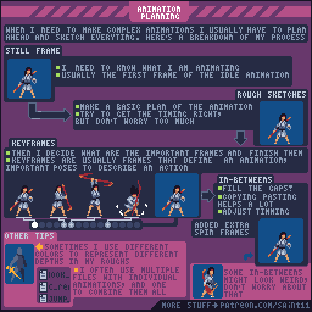
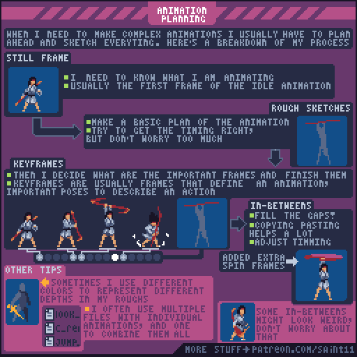

# 复杂动画规划：草稿、关键姿势与中间帧

先确定动作含义和节奏，再投入细节与插帧。

## 原图与静态辅助图

## 读图

图从静止姿势流向粗稿、关键帧、中间帧、额外帧；底部提示以颜色区分深度，并可将不同动作分别存放。

## 根据原图整理的步骤

1. 先明确正在制作哪个角色、对象与动作；原图从待机的第一帧作为基准。
2. 画粗略动画草稿，建立基本动作和时间感，暂时不追求所有细节。
3. 选择最能描述动作的关键姿势并完成它们。
4. 补充关键姿势之间的空缺；使用局部复制等方法辅助，但以动作节奏为验收。
5. 最后增加额外中间帧，再调时序；草稿可用颜色区分不同深度，复杂动作也可分别管理文件。

## 练习（整理者补充）

整理者练习：为挥锄动作提交粗稿GIF、关键帧版、完成版三个阶段，每阶段记录修改动作原因。

## 验收（整理者补充）

- [ ] 关键帧即可看懂动作
- [ ] 增加帧数没有掩盖错误姿势
- [ ] 所有阶段保留同一画布与锚点

## 适用边界

原图是工作习惯建议，不意味着必须把每个动画拆到多个文件；项目工具和团队约定可以决定组织方式。 原图为教学材料；不可把阅读或插入参考图说成已制作游戏美术。

## 来源与许可

作者Pedro Medeiros（Saint11），[固定来源](https://github.com/saint11/Saint11Tutorials/blob/ce1393eb2c46441d917134a9fd52e15575ee10a7/Planning.gif)。仓库[README许可声明](https://github.com/saint11/Saint11Tutorials/blob/ce1393eb2c46441d917134a9fd52e15575ee10a7/README.md)为[CC BY 4.0](https://creativecommons.org/licenses/by/4.0/)。原GIF保持原样；PNG为抽帧；中文为人工读图整理而非逐字OCR；练习与验收为整理者补充。新增内容继续按CC BY 4.0提供并保留原作者署名。
