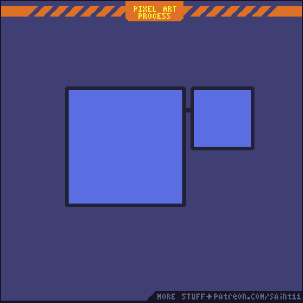
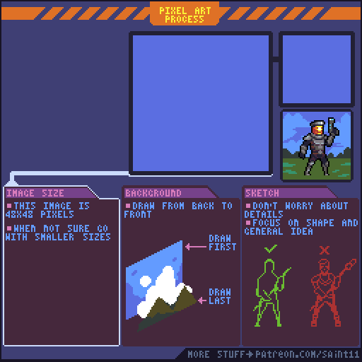
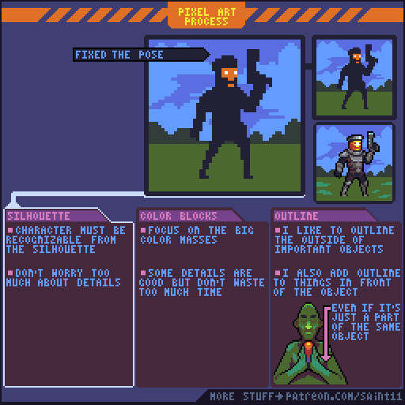
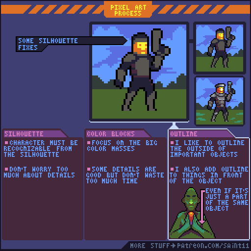
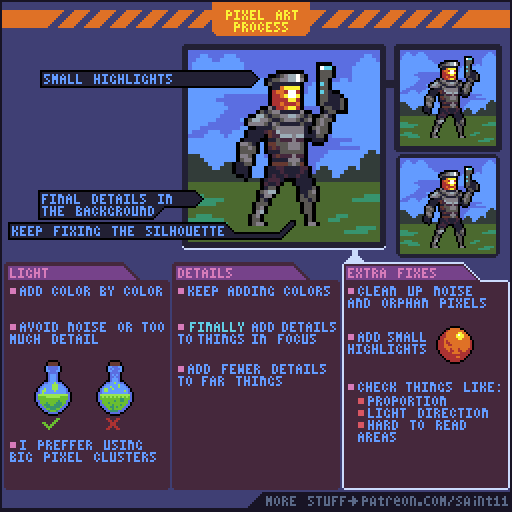

# 像素美术制作顺序：剪影、色块、轮廓与精修

先建立剪影和大色块，再上光与细节，持续回看姿势和整体阅读。

## 原图与静态辅助图

## 读图

动态图先演示完整绘制，再以箭头和下方卡片回顾阶段；仅看首帧的空白画布无法理解。本文附后期关键帧供静态阅读。

## 根据原图整理的步骤

1. 先让角色在剪影里可识别；暂不担心细小装饰。
2. 组织大的颜色块；画细节时仍继续保持大色块的主次。
3. 为重要物体与前景加入轮廓分离，必要时在同一对象内也使用内轮廓区分结构。
4. 逐色加入光影，控制噪点；原作者偏好较大的像素簇。
5. 细节阶段继续修剪影、姿势与背景；末尾清理噪点，检查颜色、光源方向和难读区域。

## 练习（整理者补充）

整理者练习：做一组村民道具，每件分别保存剪影、色块、光影、精修四版。每轮先对比整组光源与颜色，再继续加细节。

## 验收（整理者补充）

- [ ] 剪影阶段已经可识别
- [ ] 细节不会破坏大色块
- [ ] 光源方向一致
- [ ] 最终检查包含原始尺寸阅读

## 适用边界

教程中过程GIF的演示人物是教学参考，不是本skill自动生成的成品素材。 原图为教学材料；不可把阅读或插入参考图说成已制作游戏美术。

## 来源与许可

作者Pedro Medeiros（Saint11），[固定来源](https://github.com/saint11/Saint11Tutorials/blob/ce1393eb2c46441d917134a9fd52e15575ee10a7/Pipeline.gif)。仓库[README许可声明](https://github.com/saint11/Saint11Tutorials/blob/ce1393eb2c46441d917134a9fd52e15575ee10a7/README.md)为[CC BY 4.0](https://creativecommons.org/licenses/by/4.0/)。原GIF保持原样；PNG为抽帧；中文为人工读图整理而非逐字OCR；练习与验收为整理者补充。新增内容继续按CC BY 4.0提供并保留原作者署名。
