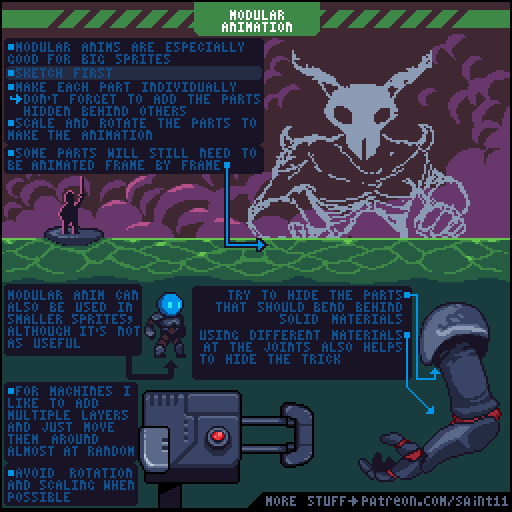
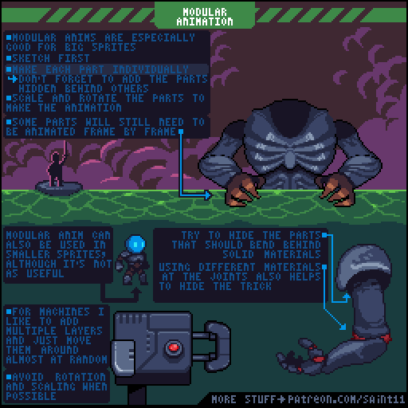
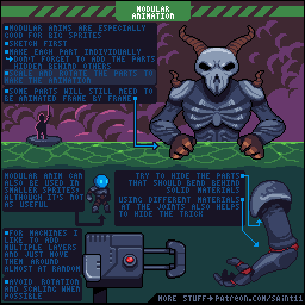

# 模块化像素动画：部件拆分、遮挡与局部逐帧

按部件制作较大像素角色，利用遮挡隐藏接缝，并保留需要逐帧重画的部分。

## 原图与静态辅助图

## 读图

大怪物展示部件与遮挡；下方小人物说明小素材也可用但收益有限；机械臂和靴子示范关节材质与旋转连接。

## 根据原图整理的步骤

1. 先画整体草图，确认各部件如何组合及遮挡。
2. 单独制作部件，隐藏在其他部件后方的区域也需补完整。
3. 移动和旋转部件构建动作；并非所有部件都能免于逐帧动画。
4. 把需要弯曲的接缝藏到其他部件后，或用关节材质帮助解释连接处。
5. 机械部件可以加入多层与旋转点附近的细节；避免没有可见支点的旋转。

## 练习（整理者补充）

整理者练习：拆分一只两节机械臂，给旋转关节预留遮挡区域，并在几个关键角度检查像素旋转后的边缘。

## 验收（整理者补充）

- [ ] 隐藏部分有足够延展
- [ ] 关节没有裂缝
- [ ] 旋转点可被结构解释
- [ ] 需要逐帧修整的区域有记录

## 适用边界

部件旋转可能改变像素节奏；引擎实时变换与手工像素动画是不同取舍，不能自动宣称所有角度都保持像素完美。 原图为教学材料；不可把阅读或插入参考图说成已制作游戏美术。

## 来源与许可

作者Pedro Medeiros（Saint11），[固定来源](https://github.com/saint11/Saint11Tutorials/blob/ce1393eb2c46441d917134a9fd52e15575ee10a7/Modular.gif)。仓库[README许可声明](https://github.com/saint11/Saint11Tutorials/blob/ce1393eb2c46441d917134a9fd52e15575ee10a7/README.md)为[CC BY 4.0](https://creativecommons.org/licenses/by/4.0/)。原GIF保持原样；PNG为抽帧；中文为人工读图整理而非逐字OCR；练习与验收为整理者补充。新增内容继续按CC BY 4.0提供并保留原作者署名。
