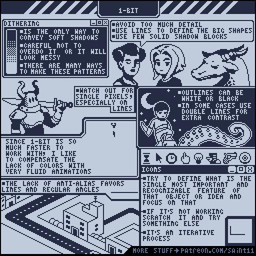
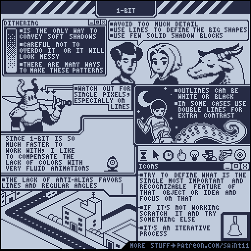
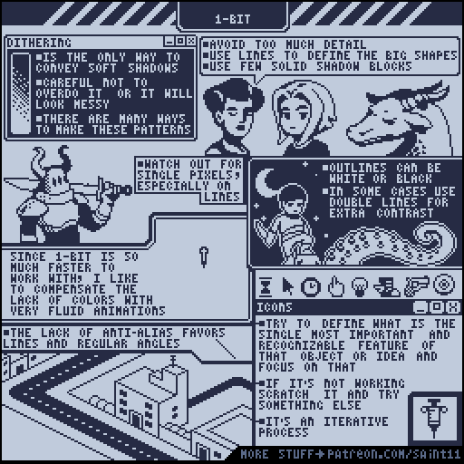

# 双色1-bit画法：形状、抖色与图标辨识

用两个可见颜色组织大形、阴影和图标，不依赖连续色阶。

## 原图与静态辅助图

## 读图

上左讲抖色；上右用脸部对比细节密度；中间展示描边分离与线条黏连；底部是图标简化和规则角度示例。

## 根据原图整理的步骤

1. 先用轮廓和少量实心阴影块定义大形；原图提示避免过多细节。
2. 需要软阴影观感时可使用规则抖色；过量抖色容易混乱，应在原尺寸检查。
3. 用白描边、黑描边，必要时双层线来分离背景；注意细线意外黏连。
4. 做图标时先选最能代表物体或概念的一个特征；无法识别时从草图重新迭代。
5. 像素抗锯齿空间有限时，直线和规律角度通常更容易组织；也可通过流畅动画补充表达。

## 练习（整理者补充）

整理者练习：仅用两个不透明颜色绘制镰刀、水壶、钥匙、木材四个16×16图标，透明底单独计算；不借助文字让人辨认。

## 验收（整理者补充）

- [ ] 可见颜色只有约定两色
- [ ] 图标在最终尺寸仍可识别
- [ ] 抖色没有吞没主轮廓
- [ ] 必要孔洞保留

## 适用边界

这是双色画法配方，不等同某一历史机器的完整硬件限制；透明色、UI文字色和特效例外应单独写进合同。 原图为教学材料；不可把阅读或插入参考图说成已制作游戏美术。

## 来源与许可

作者Pedro Medeiros（Saint11），[固定来源](https://github.com/saint11/Saint11Tutorials/blob/ce1393eb2c46441d917134a9fd52e15575ee10a7/1-bit.gif)。仓库[README许可声明](https://github.com/saint11/Saint11Tutorials/blob/ce1393eb2c46441d917134a9fd52e15575ee10a7/README.md)为[CC BY 4.0](https://creativecommons.org/licenses/by/4.0/)。原GIF保持原样；PNG为抽帧；中文为人工读图整理而非逐字OCR；练习与验收为整理者补充。新增内容继续按CC BY 4.0提供并保留原作者署名。
