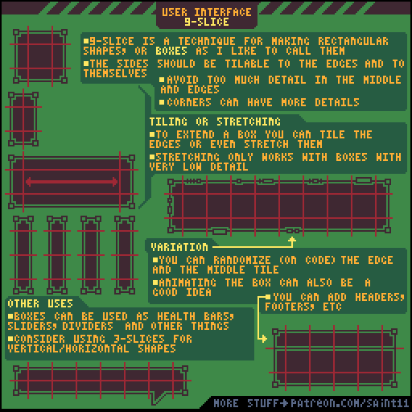
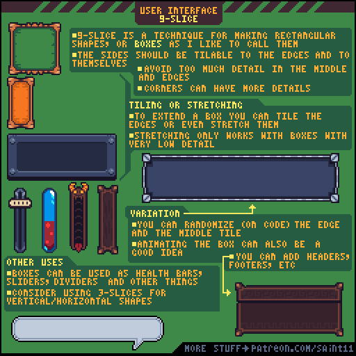
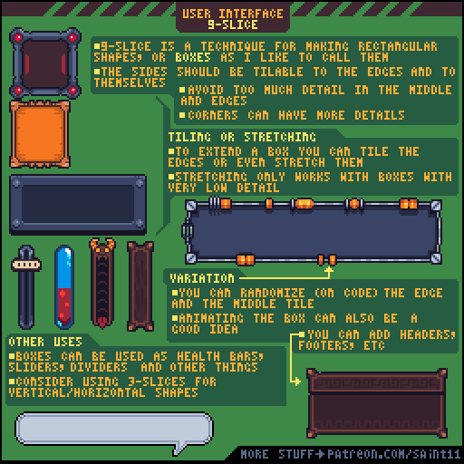
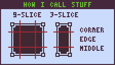
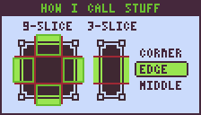
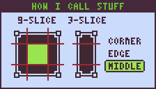

# 像素UI九宫格：固定角、可平铺边与文字区

让一个像素面板覆盖不同宽高，同时保留角部与边缘的像素结构。

## 原图与静态辅助图

## 读图

第一张原图展示九宫格、横竖扩展、标题/页脚变体和三段条形；第二张是同一教程的corner、edge、middle命名图，不另计新教程。

## 根据原图整理的步骤

1. 把矩形拆成4个角、4条边和中心；角部保持尺寸，横边只沿横向扩展，竖边只沿纵向扩展。
2. 原图建议边缘能与角及自身重复衔接；中心与边缘少放高频细节，角部可以更丰富。
3. 边缘优先重复平铺。原作者提醒拉伸只适合很少细节的边；像素图仍要检查实际显示后的网格。
4. 给标题、页脚或特殊顶部另作变体，不必强迫所有面板共用一个外框。
5. 细长的血条、滑块和分隔条可以用三段切片；是否横向或竖向由伸展方向决定。

## 练习（整理者补充）

整理者练习：为背包做窄提示框、宽物品说明框和高列表框，复用同一组角与边；把真实长中文描述放入中部安静区域。

## 验收（整理者补充）

- [ ] 角部没有拉伸变形
- [ ] 相邻边重复无明显接缝
- [ ] 文字没有压到纹理与装饰
- [ ] 选中、按下、焦点和禁用仍可区分

## 适用边界

原图讲的是切片结构，不提供输入逻辑、可访问性认证或引擎按钮状态实现。 原图为教学材料；不可把阅读或插入参考图说成已制作游戏美术。

## 来源与许可

作者Pedro Medeiros（Saint11），[固定来源](https://github.com/saint11/Saint11Tutorials/blob/ce1393eb2c46441d917134a9fd52e15575ee10a7/UI-9-Slice.gif)。仓库[README许可声明](https://github.com/saint11/Saint11Tutorials/blob/ce1393eb2c46441d917134a9fd52e15575ee10a7/README.md)为[CC BY 4.0](https://creativecommons.org/licenses/by/4.0/)。原GIF保持原样；PNG为抽帧；中文为人工读图整理而非逐字OCR；练习与验收为整理者补充。新增内容继续按CC BY 4.0提供并保留原作者署名。
