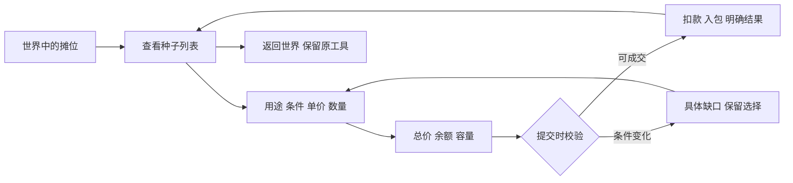

# 游戏 UI：16 类系统的界面与内容设计

这16个系统模式是本库的原创任务型设计综合，不是学界或平台发布的互斥分类，也不是每个游戏都必须具备的功能。一个系统可跨多屏，一屏可服务多个系统；风格、叙事位置、输入方式需另行选择。source_ids只支持来源清单中写明的局部约束，不为整套原创模式背书。

## 先分清系统、界面、内容与风格

| 层次 | 要回答的问题 | 以种子商店为例 |
|---|---|---|
| 游戏系统 | 有什么规则和状态改变？ | 价格、库存、购买、背包接收、退款规则 |
| 玩家任务 | 玩家此刻要决定什么？ | 这批种子是否适合计划，买几份，钱与容量够不够 |
| 界面/流程 | 哪些信息需要同屏，怎样进入退出？ | 商品列表、详情、数量、交易结果；不必各占一整屏 |
| 内容模型 | 需要哪些真实字段及口径？ | 名称、用途、播种条件、单价、数量、总价、余额、容量、失败原因 |
| 视觉与交互表现 | 如何让结构可感知、可操作？ | 纸质货签或平面列表；鼠标点选、手柄焦点；明确买入动作 |

拟物化可以给控件提供熟悉的外观或物件隐喻，但不能自动补齐内容结构。反过来，同一个“列表—详情—数量—结果”流程可以采用纸张、终端或朴素平面表达。选择风格应在任务和内容明确之后，与世界关系及输入条件一起决定。理论与风格轴另见 [设计基础](ui-design-foundations.md)。

## 用一个具体决策链检查设计完整性

下例是**说明性设计样例，不是对现有游戏机制的修改或声称**。假设玩家买三份种子，单价12，持有100：界面应能让玩家核对总价36与剩余64。播种季节属于用途条件；除非游戏规则规定，否则“当前不是播种季节”不应被擅自变成“禁止购买”。

这个流程至少联系三个系统：商店决定交易、背包决定接收、农事系统解释用途。表现为三页还是同一屏的分区，应按内容量与输入代价验证，而不能按后端模块机械分成三个页签。

## 模式目录

| ID | 系统 | 核心决定 |
|---|---|---|
| `hud` | [世界内行动与常驻 HUD](#hud) | 继续当前行动、切换工具还是先处理危险；不要求玩家为瞬时状态离开世界。 |
| `inventory-equipment` | [背包、仓储与装备比较](#inventory-equipment) | 判断物品用途与代价，再决定装备、使用、移动、拆分或丢弃。 |
| `shop-trade` | [商店、出售与交易](#shop-trade) | 比较商品价值、支付成本与容量，决定买卖什么以及多少。 |
| `crafting` | [制作、配方与生产队列](#crafting) | 确认产物是否有用、材料来自哪里、能做多少，以及是否开始或取消生产。 |
| `building-placement` | [建造、摆放与地形编辑](#building-placement) | 判断一个对象放在哪里、朝哪个方向，是否满足连通和成本条件，再决定提交或撤销。 |
| `map-navigation` | [地图、标记与导航](#map-navigation) | 理解自己、目标和障碍的位置关系，选择目的地或路线，而不是仅看一张漂亮地图。 |
| `quest-journal` | [任务、日程与委托日志](#quest-journal) | 找出下一步该做什么、为什么做、何时到期，以及完成条件是否已满足。 |
| `dialogue-choice` | [对话、字幕与选择](#dialogue-choice) | 识别谁在说什么，理解可选回应，然后决定继续、回看或选择。 |
| `progression` | [能力成长、技能树与解锁](#progression) | 理解当前能力与可达选项，比较投入和收益，再决定升级路径。 |
| `collection-codex` | [图鉴、收藏与成就记录](#collection-codex) | 找出已认识或仍缺少的内容，理解可行动的获取线索，并查看真实完成记录。 |
| `social-party` | [伙伴、队伍与社交协作](#social-party) | 判断谁可参与、各自状态与职责，再安排伙伴或协作；单机关系页与在线组队不应混用状态。 |
| `menu-save` | [主菜单、暂停与存档管理](#menu-save) | 明确将进入哪个世界/存档，是否保留当前进度，再执行继续、新建、保存、载入或退出。 |
| `settings-accessibility` | [设置、输入与可访问性](#settings-accessibility) | 理解某个选项会改变什么，调整到自己能感知和操作的状态，并能恢复。 |
| `onboarding` | [新手引导、上下文帮助与教程](#onboarding) | 知道当前要尝试什么、如何操作、成功是什么，再通过行动建立理解。 |
| `battle-command` | [战斗命令、目标选择与风险预览](#battle-command) | 比较可用行动的成本、范围和可能后果，选择目标并提交。 |
| `results-recovery` | [结算、奖励与失败恢复](#results-recovery) | 理解刚才发生了什么、损益是否已结算，再决定领取、重试或改变方案。 |

## 使用方式与证据边界

1. 只选择本项目实际存在的系统；不要为了填满分类而新增游戏机制。
2. 从玩家决定反推真实字段，分清当前状态、预览与提交后的结果。
3. 明确面板是否暂停世界、谁拥有输入、取消回哪一层，以及中断后如何恢复。
4. 再选视觉语言；用真实最长文本、最密集内容与关键异常状态制作一屏小样。
5. 用实际输入执行该模式的验收项；只读过规范或看过静态图时，标记“未运行验证”。

下列每节是本库原创设计综合。来源链接支持的是导航、上下文、输入、错误等局部约束；具体字段和布局方案仍应根据游戏规则调整。配套案例为空表示当前资料库未提供该系统的真实屏幕证据。

**适用条件：** 各模式的内容字段、状态和动作是按任务核对的候选项，只启用项目真实存在且按设计允许披露的部分。不要为满足条目新增定位、追踪、来源提示、撤销或其他机制；探索、推理与叙事设计中的有意信息缺口须单独记录，不能自动判为界面缺陷。

## 世界内行动与常驻 HUD

**玩家决定：** 继续当前行动、切换工具还是先处理危险；不要求玩家为瞬时状态离开世界。

### 进入与退出

- 随世界活动显示；探索、战斗、放置等情境切换时只改变必要内容。
- 打开面板前记录当前工具与目标；关闭后恢复操作情境，时间是否暂停按实际机制说明。

### 必须确认的内容字段

- 当前生命/体力与警戒条件；仅显示游戏实际存在的资源。
- 当前工具、可用动作、目标对象及作用范围。
- 会改变当前决定的时间、天气或地点；次要统计可按需查看。
- 紧迫事件的性质、方向、持续时间；不只给红闪。

### 信息结构

- 按决策时效分成常驻、情境和事件三层，不把所有系统指标常驻。
- 将目标提示贴近目标或操作点，长说明移到稳定阅读区域。
- 数量变化后保留可读的当前值；反馈动画不能遮住结果。

### 组件

- 生命/体力指示、工具快捷栏、情境动作提示、事件提示队列

### 状态

- 正常、临界、耗尽；颜色之外还有图形或文字区别。
- 工具不可用、无目标、目标越界；分别解释原因。
- 面板打开期间世界操作被占用；是否仍受攻击需明确。

### 输入路径

- 切换工具→观察当前选中→对准目标→看到可执行动作→执行→确认资源与世界变化。
- 键鼠和手柄提示使用当前绑定；同一按键在菜单和世界中的责任不能同时生效。

### 异常与恢复

- 提示同时到达时按风险排序，合并可合并的重复事件，保留事件历史入口。
- 目标消失则移除旧提示；不让上一物体的动作残留。

### 视觉与世界关系

- 先在繁密植被、夜景和特效帧上确认可读性，再决定透明度与装饰。
- 世界内指示与屏幕叠层可以混合；只因要求沉浸而隐藏必要状态没有充分依据。

### 常见反例

- 每种资源套一个等权重卡片。
- 所有告警持续闪烁，或把负面状态只做成红色。

### 实际验收

- 记录一次高压力操作中玩家是否能找到当前工具和危险来源。
- 最忙场景下没有关键目标被 HUD 遮挡；运动关闭时仍保留状态结果。
- 不同输入下快捷栏操作不触发角色移动。

**乡村俯视应用：** 农耕状态保留时间、体力和当前工具；天气若只影响次日计划可放在展开信息中，避免全天占用主要视野。

**局部约束来源：** [Xbox Accessibility Guideline 114: UI context](https://learn.microsoft.com/en-us/xbox/accessibility/xbox-accessibility-guidelines/114) · [Steam Input: Action Set Layers](https://partner.steamgames.com/doc/features/steam_controller/action_set_layers) · [Godot 4.5: Keyboard/Controller Navigation and Focus](https://docs.godotengine.org/en/4.5/tutorials/ui/gui_navigation.html)。适用范围见文末来源表。

**配套教程：** `DEV-010`, `DEV-020`, `DEV-021`。

**真实画面参考：** `UI-CASE-002`, `UI-CASE-004`, `UI-CASE-011`，见 [案例分析](ui-case-studies.md)。仅参考所选截图覆盖的部分。

## 背包、仓储与装备比较

**玩家决定：** 判断物品用途与代价，再决定装备、使用、移动、拆分或丢弃。

### 进入与退出

- 从快捷键、箱子或角色页进入；若是双容器，清楚标出来源与目的地。
- 返回时保留筛选、滚动和仍存在的选中物品；被消耗的物品需要合理后继焦点。

### 必须确认的内容字段

- 物品身份、数量、堆叠上限、占格或重量；只展示实际采用的容量机制。
- 装备部位、当前装备、候选变化与使用条件。
- 使用效果、消耗数量、冷却/耐久等实际限制。
- 锁定、任务物品、已装备等状态，及对应动作是否可用。

### 信息结构

- 列表或网格服务检索，详情服务理解，动作区服务执行；不要让每个槽同时塞完整说明。
- 比较面板按同一属性顺序展示当前值与变化，正负号与单位明确。
- 排序/筛选改变视图时维持选择语义，避免相同坐标突然指向另一个物品。

### 组件

- 物品槽、筛选器、详情/比较区、数量选择器、容器标题与容量条

### 状态

- 焦点、选中、已装备、锁定为不同维度；不能共用一个含糊边框。
- 空容器、筛选无结果、满容量、部分可转移数量。
- 拖动中、有效落点、无效落点；手柄替代路径等价。

### 输入路径

- 选物品→读效果/条件→选动作→必要时定数量→看到变更。
- 拖拽是可选捷径；提供选择来源→选择目的格/容器→确认的离散输入路径。

### 异常与恢复

- 移入容器已满时说明限制和可移动数量，不静默丢失余量。
- 装备替换或批量出售涉及重要资产时提供可理解的预览与适当恢复机制；是否可撤销必须符合游戏规则。

### 视觉与世界关系

- 物品图标与世界对象的关键形状、颜色和材质语义保持对应；尺寸与细节抽象程度按最终UI可读性另定，状态层可更简洁。
- 拟物书页/背包轮廓不得挤掉名称、比较属性与数量输入。

### 常见反例

- 把稀有度、焦点、已装备全部表示成同色描边。
- 排序后焦点停在原坐标，却默认执行另一物品的动作。

### 实际验收

- 用最长中文名、大堆叠数、满仓和任务物品检查。
- 只用数字按键/方向键完成跨容器移动与数量拆分。
- 使用最后一件后焦点仍可见、动作区不保留失效按钮。

**乡村俯视应用：** 农具、种子、收获物按玩家使用场景分组；“放入箱子”与“丢弃到地上”需要不同名称和后果提示。

**局部约束来源：** [Xbox Accessibility Guideline 107: Input](https://learn.microsoft.com/en-us/xbox/accessibility/xbox-accessibility-guidelines/107) · [Xbox Accessibility Guideline 113: UI focus handling](https://learn.microsoft.com/en-us/xbox/accessibility/xbox-accessibility-guidelines/113) · [Xbox Accessibility Guideline 115: Error messages and destructive actions](https://learn.microsoft.com/en-us/xbox/accessibility/xbox-accessibility-guidelines/115)。适用范围见文末来源表。

**配套教程：** `UI-001`, `UI-003`, `UI-004`。

**真实画面参考：** `UI-CASE-003`, `UI-CASE-004`, `UI-CASE-006`, `UI-CASE-010`, `UI-CASE-011`，见 [案例分析](ui-case-studies.md)。仅参考所选截图覆盖的部分。

## 商店、出售与交易

**玩家决定：** 比较商品价值、支付成本与容量，决定买卖什么以及多少。

### 进入与退出

- 进入时说明商家、买入/卖出模式与使用的货币；从详情返回保留商品位置。
- 退出未提交交易是否丢弃暂存选择需可预期；不默认存在购物车。

### 必须确认的内容字段

- 商品名称、效果/属性、数量、单价与总价。
- 持有货币、库存、购买限制、背包剩余容量。
- 卖出所得及不可恢复后果；出售已装备/珍贵物品时明确标识。
- 折扣或比较价仅在实际机制和数据支持时展示。

### 信息结构

- 商品列表→选中详情→数量/总额→交易动作构成连续读序。
- 买入成本与卖出收益采用不同动词和单位说明。
- 多种货币时逐项列清，不仅显示一个看似总额的数字。

### 组件

- 商品列表、详情、数量选择、成本摘要、交易结果提示

### 状态

- 可买、缺钱、缺货、容量不足、限制未满足；各有具体原因。
- 处理中防止重复提交；成功后的库存与余额同步。
- 筛选空结果与商家真正无货分开说明。

### 输入路径

- 选择商品→看总额和余额变化→调整数量→执行购买/出售→确认结果。
- 手柄从数量调整进入确认前不得误触商品列表；取消回到原商品。

### 异常与恢复

- 商品价格或库存变化时重新显示最新条件，不以旧预览扣费。
- 失败保留选择并说明是否已扣款/转移物品；结果不能只靠消失的弹窗。

### 视觉与世界关系

- 柜台、账本、纸签可以提供语义，但价格与动作不应伪装成不可辨的场景细节。
- 成交强调限于相关商品与余额，避免每次低价值购买整屏庆祝。

### 常见反例

- 只写“确定”，不说明购买、出售还是兑换。
- 让数量选择、总价和确认按钮相距很远。

### 实际验收

- 分别测试刚好够钱、差一单位、数量上限、满背包和重复确认。
- 玩家在执行前能说出付出什么、得到什么、剩余多少。
- 交易失败后账面数据一致，焦点和选择可继续操作。

**乡村俯视应用：** 乡村集市可用摊位与货签建立世界关系；购买种子时同时露出播种季节等真实限制，而不强迫玩家返回图鉴查询。

**局部约束来源：** [Xbox Accessibility Guideline 114: UI context](https://learn.microsoft.com/en-us/xbox/accessibility/xbox-accessibility-guidelines/114) · [Xbox Accessibility Guideline 115: Error messages and destructive actions](https://learn.microsoft.com/en-us/xbox/accessibility/xbox-accessibility-guidelines/115) · [Xbox Accessibility Guideline 112: UI navigation](https://learn.microsoft.com/en-us/xbox/accessibility/xbox-accessibility-guidelines/112)。适用范围见文末来源表。

**配套教程：** `UI-002`, `UI-003`。

**真实画面参考：** `UI-CASE-003`, `UI-CASE-006`，见 [案例分析](ui-case-studies.md)。仅参考所选截图覆盖的部分。

## 制作、配方与生产队列

**玩家决定：** 确认产物是否有用、材料来自哪里、能做多少，以及是否开始或取消生产。

### 进入与退出

- 从工作台或配方页进入，标明可用工位和材料取用范围。
- 离开后生产是否继续、能否取消以及去哪里领取，需要与实际模拟规则一致。

### 必须确认的内容字段

- 产物、每批数量、品质/随机结果规则（若有）及用途。
- 材料需求/可用量、来源容器和替代材料规则。
- 工位、技能、燃料、时长、容量等真实门槛。
- 批次数、总消耗、预计产量、队列次序和取消损失。

### 信息结构

- 配方检索→产物预览→需求清单→批次汇总→开始动作。
- “未知配方”“已知但缺材料”“工位不符”分组，不都灰成不可读一块。
- 生产中显示队列与阻塞原因，避免用开始前的静态配方页替代生产状态。

### 组件

- 配方目录、材料行、批次数量器、生产队列、领取区

### 状态

- 未发现、锁定、可制作、材料不足、制作中、暂停/阻塞、完成待领取。
- 同一材料可用量变化时同步更新总消耗与最大批次。

### 输入路径

- 选配方→确定材料范围与批次→确认成本→开始→查看/领取结果。
- 手柄以固定次序走目录、材料详情、数量和队列，不把焦点困在循环图标中。

### 异常与恢复

- 材料被其他系统消耗后重新校验，并说明缺少项；不留下假进度。
- 领取时容量不足应保留产物或按已定义规则处理，不能无提示吞掉。
- 取消是否退款、返还比例由机制决定，在提交前说明。

### 视觉与世界关系

- 配方可呈现为图谱或工作手册，但依赖箭头必须有清楚方向。
- 材料状态用数值和图形配合颜色；纹理避开分子/分母。

### 常见反例

- 在材料数量与来源已知且项目允许披露时，只显示红图标，不说明具体缺口或已有的来源线索；有意未知的获取方式不强制揭示。
- 数量变了但总成本/产量未变，或把每件时长写成整批时长。

### 实际验收

- 检查仓储范围变化、队列满、燃料不足和满背包领取。
- 用一批与十批对照核算成本、产量和时长显示。
- 暂停/取消/重进界面后队列状态与实际生产一致。

**乡村俯视应用：** 竹编、酿造、烹饪可共用配方结构，但不同工序的等待、燃料和领取方式须有不同状态说明。

**局部约束来源：** [Xbox Accessibility Guideline 114: UI context](https://learn.microsoft.com/en-us/xbox/accessibility/xbox-accessibility-guidelines/114) · [Xbox Accessibility Guideline 115: Error messages and destructive actions](https://learn.microsoft.com/en-us/xbox/accessibility/xbox-accessibility-guidelines/115) · [Steam Input: Action Set Layers](https://partner.steamgames.com/doc/features/steam_controller/action_set_layers)。适用范围见文末来源表。

**配套教程：** `UI-003`, `UI-004`。

**真实画面参考：** `UI-CASE-003`, `UI-CASE-011`，见 [案例分析](ui-case-studies.md)。仅参考所选截图覆盖的部分。

## 建造、摆放与地形编辑

**玩家决定：** 判断一个对象放在哪里、朝哪个方向，是否满足连通和成本条件，再决定提交或撤销。

### 进入与退出

- 从建造目录进入预览模式，世界仍是主要画布；明确预览尚未建成。
- 退出模式取消未提交预览；已提交操作能否撤销按机制告知。

### 必须确认的内容字段

- 对象名称、用途、资源成本、库存、占地与方向。
- 有效区域、地形/道路/距离/室内外等放置约束。
- 拆除或搬迁的返还、占用物品和连带损失。
- 当前模式、网格吸附、旋转/确认/取消的绑定。

### 信息结构

- 目录负责选型；世界预览负责空间决定；紧邻预览提供阻挡原因和总成本。
- 预览、待施工与已完成对象在表现上分开。
- 批量铺设时显示整体范围、总消耗和会影响的对象。

### 组件

- 建造目录、落点/占地预览、旋转提示、约束提示、成本摘要

### 状态

- 可放置、地形不符、阻挡、缺材料、超范围；禁止只用红绿区分。
- 单件/连续放置、拆除、搬迁必须标识当前模式。
- 提交后施工中或完成应与实际机制相符。

### 输入路径

- 选对象→定位/旋转→读约束与成本→提交→保留连续放置或返回目录。
- 离散输入可按格移动；镜头移动和物件移动需独立可辨。

### 异常与恢复

- 放置导致门口或通路阻断时给具体空间证据；是否禁止取决于设计规则。
- 点击提交时世界条件改变则保留预览并解释失败。
- 批量操作部分成功时明确已建/未建范围与已消耗量。

### 视觉与世界关系

- 预览与世界一致视角、比例和底部接地点；有效性覆盖层不伪装成成品材质。
- 可用场景内标记加小型屏幕提示，不必为了拟物化把成本刻进地面。

### 常见反例

- 只显示“不能放置”，没有对应阻挡位置。
- 装饰预览正确但实际碰撞或占地偏移。

### 实际验收

- 在边界、遮挡、非方形对象和各旋转方向核对占地与接地。
- 建造模式中的确认不会同时触发攻击/对话。
- 批量成本、部分失败和撤销结果与世界状态一致。

**乡村俯视应用：** 农田、水渠、篱笆与房屋共享网格表达，但水路连通、门口通行和农作物占格应分别给原因。

**局部约束来源：** [Steam Input: Action Set Layers](https://partner.steamgames.com/doc/features/steam_controller/action_set_layers) · [Godot 4.5: Keyboard/Controller Navigation and Focus](https://docs.godotengine.org/en/4.5/tutorials/ui/gui_navigation.html) · [Xbox Accessibility Guideline 107: Input](https://learn.microsoft.com/en-us/xbox/accessibility/xbox-accessibility-guidelines/107)。适用范围见文末来源表。

**配套教程：** `DEV-017`, `DEV-018`, `UI-004`。

**真实画面参考：** 当前没有直接对应的画面案例；此模式仍需在项目中验证。

## 地图、标记与导航

**玩家决定：** 理解自己、目标和障碍的位置关系，选择目的地或路线，而不是仅看一张漂亮地图。

### 进入与退出

- 由世界打开后定位当前位置，并说明当前地图层级/区域。
- 关闭后保留标记；返回世界的朝向与地图朝向规则需可预期。

### 必须确认的内容字段

- 按探索设计已知的当前位置、朝向、目标位置、区域名称和地图层级；有意未知的位置不新增定位能力。
- 标记图例、已探索/未知范围、可达性或路线信息的可信范围。
- 距离或预计代价的单位；若仅直线距离要说明。
- 快速旅行的解锁条件、消耗及目的地。

### 信息结构

- 地图空间为主；图例、筛选、目标详情作为可收起的辅助层。
- 区域→局部层级保留定位关联，避免缩放后丢失目标。
- 图标聚合与解聚合需要保留数量/类别语义。

### 组件

- 地图画布、图例筛选、当前位置标记、目标详情、缩放/重定位控件

### 状态

- 已知、未探索、不可达、可传送、当前追踪；不混成一类灰图标。
- 筛选后目标隐藏、地图离线/未拥有、跨区域目标。

### 输入路径

- 定位当前区域→筛选或查找目标→查看详情→设置标记/发起旅行→返回世界。
- 按实际导航任务提供离散操作等替代路径，不把缩放拖拽作为唯一操作；只有地图已知玩家位置且支持定位时，才提供“回到我”动作。

### 异常与恢复

- 目标变化或消失时更新/解除旧标记并告知。
- 不把直线指示当作已计算可行路径；路线不可用时说明。

### 视觉与世界关系

- 拟物纸地图适合方向与地标，但道路、层级和图例不能被做旧纹理覆盖。
- 俯视场景与地图可使用不同抽象尺度，需用稳定符号保持对应。

### 常见反例

- 地图上所有兴趣点同等显眼，关键目标埋在图标云里。
- 屏幕北向和角色朝向不断切换却没有方向指示。

### 实际验收

- 核对跨区域目标、最高/最低缩放和过滤无结果；若支持定位，应能返回当前位置；若有意不提供定位，退出、清除筛选和原有导航方式仍可用。
- 让测试者不看攻略指出自己、目标与可行下一步。
- 未知区域的信息披露符合探索设计。

**乡村俯视应用：** 村庄地图优先区分住所、田地、集市与山路；地名及地标比未经解释的抽象小图标更有助于认路。

**局部约束来源：** [Xbox Accessibility Guideline 107: Input](https://learn.microsoft.com/en-us/xbox/accessibility/xbox-accessibility-guidelines/107) · [Xbox Accessibility Guideline 114: UI context](https://learn.microsoft.com/en-us/xbox/accessibility/xbox-accessibility-guidelines/114)。适用范围见文末来源表。

**配套教程：** `UI-004`, `DEV-020`。

**真实画面参考：** `UI-CASE-010`, `UI-CASE-011`, `UI-CASE-013`，见 [案例分析](ui-case-studies.md)。仅参考所选截图覆盖的部分。

## 任务、日程与委托日志

**玩家决定：** 找出下一步该做什么、为什么做、何时到期，以及完成条件是否已满足。

### 进入与退出

- 从提示或日志入口进入当前相关任务；允许从通知直达详情。
- 关闭日志后保留追踪目标；改追踪不应误提交/放弃任务。

### 必须确认的内容字段

- 任务名、委托者、当前阶段、具体目标及计数。
- 地点/时间窗口、依赖条件和实际期限。
- 奖励、交付消耗、失败/放弃后果；保留设计上有意未知的内容。
- 完成后是否需交付/领取，与“条件已满足”分开。

### 信息结构

- 进行中、可交付、已完成及过期分开；剧情回顾与行动目标有不同阅读层级。
- 详情优先给当前下一步，再提供背景、历史和完整条件。
- 多目标展示并且/或者关系，避免只有散落勾选框。

### 组件

- 任务列表、目标清单、日程时间轴（确实需要时）、追踪开关、交付/放弃动作

### 状态

- 新任务、进行中、暂时不可达、条件满足待交付、已完成、过期/失败。
- 新标记表示新增内容，不等同任务未完成。

### 输入路径

- 定位任务→阅读当前目标→追踪或前往→世界中完成条件→交付/领取。
- 任务更新后保留用户正在读的位置，相关变化用局部标记呈现。

### 异常与恢复

- 物品数量下降导致条件不满足时同步更新，不继续显示可交付。
- 期限经过后说明任务结果及还有哪些可行行动，保留必要回顾。

### 视觉与世界关系

- 手账、公告板或信件都可承载委托；正文与期限不应被邮戳装饰遮住。
- 重要期限兼有文字/图形提示，不仅用红字。

### 常见反例

- 当日志承担明确行动提示任务、且目标允许披露时，只有背景段落而缺少必要行动信息；推理或探索任务有意保留的线索缺口不自动判为缺陷。
- 完成条件满足即伪装成已经领取奖励。

### 实际验收

- 测试多阶段、多个目标、期限边界及交付物品被使用的情况。
- 阅读同一任务时世界更新不会突然跳到列表首项。
- 所有提示里的任务名、进度与日志一致。

**乡村俯视应用：** 村民委托与季节日程可以共用时间语义，但长期目标和当天集市营业时间不应都变成催促型倒计时。

**局部约束来源：** [Xbox Accessibility Guideline 114: UI context](https://learn.microsoft.com/en-us/xbox/accessibility/xbox-accessibility-guidelines/114) · [Xbox Accessibility Guideline 112: UI navigation](https://learn.microsoft.com/en-us/xbox/accessibility/xbox-accessibility-guidelines/112)。适用范围见文末来源表。

**配套教程：** `UI-003`, `UI-004`。

**真实画面参考：** `UI-CASE-010`，见 [案例分析](ui-case-studies.md)。仅参考所选截图覆盖的部分。

## 对话、字幕与选择

**玩家决定：** 识别谁在说什么，理解可选回应，然后决定继续、回看或选择。

### 进入与退出

- 从交互或剧情触发；进入时防止用于接近/确认的按键穿透成第一条选择。
- 结束时清楚回到世界或下一场景，恢复相应输入；自动播放/跳过策略独立。

### 必须确认的内容字段

- 说话者、正文、重要语气或来源说明（适用时）。
- 可选回应与实际不可选条件；是否会提交重要决定。
- 继续、回看、自动播放、跳过等确实支持的动作与当前状态。
- 语音之外承载玩法信息的声音应有适当文字/视觉替代。

### 信息结构

- 说话者和正文稳定分区；多选回应区别于已经说出的台词。
- 选择摘要要能代表实际回应意图，不以模糊短词隐藏关键后果。
- 历史回看与当前选择分离，避免回看时意外提交。

### 组件

- 对白框/气泡、说话者标识、选项列表、对话记录、字幕设置入口

### 状态

- 逐字显示、完整可继续、等待选择、条件不符、自动播放、已选择。
- “显示完整句”与“进入下一句”要避免同次输入连续触发。

### 输入路径

- 听/读正文→必要时展开全文→审阅选项→确认选择→看角色回应。
- 支持没有语音也能理解核心信息；选择焦点与当前说话者高亮分开。

### 异常与恢复

- 长文本分页不应截断选项；缺字时使用合格备用字体。
- 突然中断对话时，是否可重开/回看依据实际剧情规则说明，不假定可撤回分支。

### 视觉与世界关系

- 气泡便于连结说话人，屏幕对白框便于长文；依据镜头、遮挡和文本量选用。
- 拟物信纸是视觉表现，除非角色确实读写该物件，不能据此称为世界内对话界面。

### 常见反例

- 用头像颜色作为唯一说话者身份。
- 对白未完整显示时同一确认键直接提交默认选项。

### 实际验收

- 最长中文台词、名称、两行选项与多说话者切换均不溢出。
- 关闭语音、自动播放和逐字动画仍能读懂并选择。
- 触发对话的输入不会穿透，回看不改变分支状态。

**乡村俯视应用：** 村民交谈可用头像对白；远处闲聊可用短气泡。两者共用角色命名规则，但不要让气泡遮挡农田操作目标。

**局部约束来源：** [Xbox Accessibility Guideline 104: Subtitles and captions](https://learn.microsoft.com/en-us/xbox/accessibility/xbox-accessibility-guidelines/104) · [Xbox Accessibility Guideline 107: Input](https://learn.microsoft.com/en-us/xbox/accessibility/xbox-accessibility-guidelines/107) · [Xbox Accessibility Guideline 113: UI focus handling](https://learn.microsoft.com/en-us/xbox/accessibility/xbox-accessibility-guidelines/113)。适用范围见文末来源表。

**配套教程：** `UI-001`, `UI-003`, `UI-004`。

**真实画面参考：** `UI-CASE-001`, `UI-CASE-002`，见 [案例分析](ui-case-studies.md)。仅参考所选截图覆盖的部分。

## 能力成长、技能树与解锁

**玩家决定：** 理解当前能力与可达选项，比较投入和收益，再决定升级路径。

### 进入与退出

- 从升级提示或角色页进入；优先定位新增可用选择而不是任意第一节点。
- 离开时说明预览是否已经生效，未应用投入是否保留。

### 必须确认的内容字段

- 当前等级/能力、可用点数、下一阶段所需条件。
- 能力效果、前后变化、适用对象与触发条件。
- 前置节点、互斥关系、上限、消耗和重置代价。
- 长期未知节点按真实披露策略处理，不能为了装满树伪造内容。

### 信息结构

- 先使“现在能选什么”清楚，再支持观察长期路线。
- 树用于表达依赖；简单线性成长不必画复杂节点网络。
- 同维度升级使用可比较的数值与单位，效果描述避免混合不同口径。

### 组件

- 能力列表/依赖图、点数余额、效果对照、升级/应用/重置动作

### 状态

- 已获得、可购买、缺前置、缺资源、互斥、已满级、暂存预览。
- 线条代表依赖关系，不代表已经购买；焦点不能伪装成解锁。

### 输入路径

- 选能力→读效果与依赖→看消耗/剩余→投入或应用→核对新状态。
- 若使用暂存方案，明确应用与放弃；即时生效方案则不放一个虚假的“应用”按钮。

### 异常与恢复

- 资源变化或重置条件不足时不允许产生负余额。
- 修改前置导致后续失效时明确列出影响；是否允许这样修改由机制决定。

### 视觉与世界关系

- 幻想纹章可用于节点身份，但连线方向、资源与效果说明优先。
- 大型奖励界面可增加留白与庆祝，选择仍需有稳定焦点。

### 常见反例

- 用更亮的节点同时表示可购买、已购买和当前焦点。
- 只写“+10%”却没有基准、适用范围或是否叠加说明。

### 实际验收

- 测试点数不足、互斥、满级、重置前后与重新进入。
- 测试者能分辨当前状态和本次升级后的预览。
- 无鼠标时可按可解释路径遍历节点，不跳到不可见处。

**乡村俯视应用：** 农耕、钓鱼和手艺成长可围绕行动能力组织；不需要把每个统计值都扩大成一个天赋分支。

**局部约束来源：** [Xbox Accessibility Guideline 114: UI context](https://learn.microsoft.com/en-us/xbox/accessibility/xbox-accessibility-guidelines/114) · [Xbox Accessibility Guideline 113: UI focus handling](https://learn.microsoft.com/en-us/xbox/accessibility/xbox-accessibility-guidelines/113) · [Xbox Accessibility Guideline 115: Error messages and destructive actions](https://learn.microsoft.com/en-us/xbox/accessibility/xbox-accessibility-guidelines/115)。适用范围见文末来源表。

**配套教程：** `UI-003`, `UI-004`。

**真实画面参考：** `UI-CASE-005`, `UI-CASE-009`, `UI-CASE-012`，见 [案例分析](ui-case-studies.md)。仅参考所选截图覆盖的部分。

## 图鉴、收藏与成就记录

**玩家决定：** 找出已认识或仍缺少的内容，理解可行动的获取线索，并查看真实完成记录。

### 进入与退出

- 从新发现提示或图鉴目录进入对应条目。
- 返回保留分类与筛选；新发现标记的消失规则清楚。

### 必须确认的内容字段

- 条目名称、图像、发现/持有/提交状态及各自定义。
- 获取地点、季节、条件等已知信息；未知部分符合探索披露策略。
- 完成进度与统计口径，是否含隐藏内容。
- 收藏提交成本、奖励与是否消耗物品。

### 信息结构

- 按玩家查询方式分类，如地域、季节、用途；标签可跨类但实体条目保持唯一。
- 发现记录与当前库存分开，避免误以为已发现就仍持有。
- 详细长文放在条目页，目录提供有意义的状态概览。

### 组件

- 分类/筛选、条目网格、图鉴详情、完成度摘要、提交/领取动作

### 状态

- 未发现、已发现、已持有、已提交、奖励可领/已领；只启用实际存在的状态。
- 筛选无结果、隐藏条目、新发现未读。

### 输入路径

- 选分类→按条件检索→查看条目→跟踪获取线索或提交→确认状态。
- 从发现弹窗跳入后可返回原世界情境。

### 异常与恢复

- 统计总数或隐藏条目变化需能解释，不无故使进度倒退。
- 提交前指出将消耗什么；最后一件关键物品的规则要明确。

### 视觉与世界关系

- 标本册、邮票册、博物馆柜可作为内容隐喻；目录结构依然由查询任务决定。
- 未发现剪影不要无意泄露设计上应保密的身份。

### 常见反例

- 把“未读”“未收集”“未领取”全部画同一个红点。
- 用虚构稀有度或未经证实的百分比制造成就感。

### 实际验收

- 同一对象在发现、持有、提交三个阶段的文案一致且可区别。
- 组合筛选无结果时能清除条件；不误显示为整个图鉴为空。
- 完成度口径与实际记录一致，隐藏内容不被意外剧透。

**乡村俯视应用：** 植物、鱼类和手艺品可按季节/水域/用途检索；把“已捐给村史馆”与“仓库仍有”分别记录。

**局部约束来源：** [Xbox Accessibility Guideline 114: UI context](https://learn.microsoft.com/en-us/xbox/accessibility/xbox-accessibility-guidelines/114) · [Xbox Accessibility Guideline 112: UI navigation](https://learn.microsoft.com/en-us/xbox/accessibility/xbox-accessibility-guidelines/112)。适用范围见文末来源表。

**配套教程：** `UI-003`, `UI-004`。

**真实画面参考：** `UI-CASE-008`, `UI-CASE-012`，见 [案例分析](ui-case-studies.md)。仅参考所选截图覆盖的部分。

## 伙伴、队伍与社交协作

**玩家决定：** 判断谁可参与、各自状态与职责，再安排伙伴或协作；单机关系页与在线组队不应混用状态。

### 进入与退出

- 从伙伴名册、村民详情或联机大厅进入；标题说明当前对象是角色还是玩家。
- 退出界面与离开队伍是不同动作；待发送邀请与已加入状态分开。

### 必须确认的内容字段

- 身份、可用状态、关系/职责（游戏确有时）、当前所在情境。
- 队伍容量、成员权限、准备状态与开始条件。
- 邀请、加入、移除、分配任务的对象及后果。
- 联机时另需网络状态、可见范围与沟通控制；单机不应凭空出现在线功能。

### 信息结构

- 成员列表与选中成员详情分开；队伍整体准备状态靠近开始动作。
- 关系背景和立即可执行动作分层，避免把全部人物生平常驻。
- 管理操作只在有对应权限时提供，未获权限要有可理解原因。

### 组件

- 名册/成员列表、成员详情、职责或准备控件、邀请/离队动作

### 状态

- 可用、忙碌、受伤/外出等角色状态；在线、离线、邀请中等网络状态另设维度。
- 成员焦点、被选中管理对象、队长身份不是同一高亮。

### 输入路径

- 选择成员→检查状态/权限→分配或邀请→看到待处理/成功结果。
- 邀请待发送、等待回应和已经入队分别表示；关闭成员详情不能伪装为取消已成功发送的邀请。

### 异常与恢复

- 成员离开或断线后保留队伍剩余结构，明确是否影响开始。
- 移除伙伴/放弃任务的不可逆代价在操作前说明。

### 视觉与世界关系

- 头像与世界角色保持对应；状态标记不要遮掉关键识别特征。
- 纸质名册可以呈现单机伙伴；在线连接错误不能只写成含糊剧情台词。

### 常见反例

- “关闭”按钮同时让玩家离队。
- 使用同一个绿色圆点表示友好、在线、就绪和已选择。

### 实际验收

- 权限不足、队伍满员、邀请失败和成员中途退出时可恢复。
- 单机状态不出现虚假的网络反馈。
- 准备/开始动作在任何输入方式下都清楚关联当前队伍。

**乡村俯视应用：** 村民关系与雇工安排可共享身份信息，情感关系、当日行程和劳动分配仍应分别表达，避免把人全部简化为资源条。

**局部约束来源：** [Xbox Accessibility Guideline 114: UI context](https://learn.microsoft.com/en-us/xbox/accessibility/xbox-accessibility-guidelines/114) · [Xbox Accessibility Guideline 115: Error messages and destructive actions](https://learn.microsoft.com/en-us/xbox/accessibility/xbox-accessibility-guidelines/115) · [Xbox Accessibility Guideline 112: UI navigation](https://learn.microsoft.com/en-us/xbox/accessibility/xbox-accessibility-guidelines/112)。适用范围见文末来源表。

**配套教程：** `UI-002`, `UI-003`。

**真实画面参考：** 当前没有直接对应的画面案例；此模式仍需在项目中验证。

## 主菜单、暂停与存档管理

**玩家决定：** 明确将进入哪个世界/存档，是否保留当前进度，再执行继续、新建、保存、载入或退出。

### 进入与退出

- 首次启动即能访问必要设置；暂停菜单说明世界是否真的暂停。
- 返回游戏恢复控制；退出到标题与退出程序使用不同动作名称。

### 必须确认的内容字段

- 存档名/角色、地点、游戏内进度、保存时间及必要版本信息。
- 继续按钮指向的具体存档；空槽、自动档、手动档的区别。
- 未保存变化、覆盖对象、不可撤回后果。
- 失败时保存是否成功、旧档是否可用；不只显示旋转图标。

### 信息结构

- 常用继续/返回优先，管理与删除分层；删除不与频繁动作紧邻混淆。
- 比较存档时保留关键摘要，必要截图作辅助而非唯一识别信息。
- 云端与本地冲突时并列来源与时间，不能用一个含糊“最新”掩盖未知。

### 组件

- 继续/新游戏入口、存档列表、槽位摘要、保存反馈、覆盖/退出对话

### 状态

- 无存档、可载入、保存中、成功、失败、版本不兼容、冲突、未保存变化。
- 处理中的重复输入不能产生多个覆盖操作。

### 输入路径

- 选择明确槽位→读取摘要→按风险确认→载入→获得进入世界的反馈。
- 返回/取消保留选中槽；危险对话关闭后焦点回到合理位置。

### 异常与恢复

- 空间不足或写入失败时保留已有存档与当前可恢复状态，具体实现由存储系统负责。
- 覆盖/删除前说明对象；提供恢复是否可行依据项目规则。

### 视觉与世界关系

- 场景化标题菜单可建立氛围，但可读按钮、当前存档和输入焦点必须独立可见。
- 保留时间/地点等易辨认文本，避免只靠相似缩略图。

### 常见反例

- “继续”默认打开错误角色或错误存档。
- 失败后仍显示“已保存”，或将无响应动画当作完成证据。

### 实际验收

- 测试首次启动、损坏/不兼容档、覆盖取消和保存失败。
- 用户能在载入前说出将进入哪一份进度。
- 保存和退出过程不会把焦点送入被遮住的底层世界。

**乡村俯视应用：** 村庄名称、季节日期和当前位置是有用的存档摘要；保存机制若绑定睡觉，应在相关入口清楚解释，不能假装任意时刻可手动保存。

**局部约束来源：** [Xbox Accessibility Guideline 115: Error messages and destructive actions](https://learn.microsoft.com/en-us/xbox/accessibility/xbox-accessibility-guidelines/115) · [Xbox Accessibility Guideline 113: UI focus handling](https://learn.microsoft.com/en-us/xbox/accessibility/xbox-accessibility-guidelines/113) · [Xbox Accessibility Guideline 114: UI context](https://learn.microsoft.com/en-us/xbox/accessibility/xbox-accessibility-guidelines/114)。适用范围见文末来源表。

**配套教程：** `UI-003`, `UI-004`。

**真实画面参考：** 当前没有直接对应的画面案例；此模式仍需在项目中验证。

## 设置、输入与可访问性

**玩家决定：** 理解某个选项会改变什么，调整到自己能感知和操作的状态，并能恢复。

### 进入与退出

- 必要设置应在首次长剧情和操作门槛之前可达。
- 关闭时明确已应用、尚未应用或需重启；保留未保存变化的可恢复路径。

### 必须确认的内容字段

- 设置名称、当前值、效果说明、支持范围与生效时机。
- 实际输入绑定及冲突；恢复默认的作用范围。
- 字幕/说明、文字大小、对比、动效、输入需求等与本游戏有关的选项。
- 显示模式这类可能让用户无法继续操作的变更需安全回退方案。

### 信息结构

- 按玩家调整目标分组，不按技术模块或内部变量命名。
- 预览与设置靠近；选项间依赖通过原因说明，不能只灰掉。
- 音频、视觉、输入等角色可并列；不要把全部辅助功能藏在最深子页。

### 组件

- 开关、滑杆、选项组、重映射控件、预览区、按范围恢复默认

### 状态

- 当前、已修改待应用、已应用、不可用及原因、冲突、恢复预览。
- 焦点与当前选项均清楚；调整值不使焦点丢失。

### 输入路径

- 找到目标设置→读效果→调整→在预览或实际情境验证→应用/返回。
- 输入替代不仅是换键，还要考虑连续按、长按和精确指针要求。

### 异常与恢复

- 重映射冲突应可修正/取消，保留可用的返回操作。
- 显示变更失败或不可见时按安全机制自动回退，不要求玩家盲找按钮。

### 视觉与世界关系

- 同样的世界材质可以保留在标题/边缘，密集设置正文优先稳定可读。
- 文本尺寸预览必须反映最终显示效果，而不是只改预览窗口自身比例。

### 常见反例

- 用音频教用户如何打开字幕，却未提供文字路径。
- “恢复默认”不说明只重置本页还是所有设置。

### 实际验收

- 从首次启动仅用替代输入进入设置并完成调整。
- 长中文、最大支持字号、字幕背景和最坏场景对比需实际检查。
- 应用、取消、重启和恢复默认的作用与文案一致。

**乡村俯视应用：** 像素风不应强迫正文使用难读的小点阵；允许独立清楚文字层，保留整体色彩和边框语言。

**局部约束来源：** [Xbox Accessibility Guideline 107: Input](https://learn.microsoft.com/en-us/xbox/accessibility/xbox-accessibility-guidelines/107) · [Xbox Accessibility Guideline 104: Subtitles and captions](https://learn.microsoft.com/en-us/xbox/accessibility/xbox-accessibility-guidelines/104) · [Xbox Accessibility Guideline 112: UI navigation](https://learn.microsoft.com/en-us/xbox/accessibility/xbox-accessibility-guidelines/112) · [Xbox Accessibility Guideline 115: Error messages and destructive actions](https://learn.microsoft.com/en-us/xbox/accessibility/xbox-accessibility-guidelines/115)。适用范围见文末来源表。

**配套教程：** `UI-002`, `UI-003`, `UI-004`。

**真实画面参考：** `UI-CASE-014`，见 [案例分析](ui-case-studies.md)。仅参考所选截图覆盖的部分。

## 新手引导、上下文帮助与教程

**玩家决定：** 知道当前要尝试什么、如何操作、成功是什么，再通过行动建立理解。

### 进入与退出

- 在首次相关情境出现；若中断当前任务，应说明原因并提供适当退出。
- 成功后回到正常流程；已学说明应能从帮助或再次触发处找回。

### 必须确认的内容字段

- 一个明确学习目标、当前真实输入绑定、操作对象与完成条件。
- 必要原因或机制解释，不只说按哪个键。
- 跳过、重看、重置练习的实际规则。
- 学习失败后的具体差距和下一次可尝试动作。

### 信息结构

- 先显示当前动作所需信息，再逐步暴露依赖内容；不假定固定条数就是认知容量。
- 提示靠近相关对象但避开操作区域；复杂内容进入稳定帮助页。
- 成功反馈由真实状态触发，不能按经过时间推定玩家已经学会。

### 组件

- 对象提示、简短说明、演示/练习区（确实提供时）、帮助索引

### 状态

- 待触发、已展示、练习中、完成、跳过、再次查看。
- 弹窗焦点与世界目标一致；模态帮助和非模态提示的输入责任分开。

### 输入路径

- 读目标→执行实际操作→观察结果→确认理解→继续。
- 操作提示随重映射/输入设备变化；退出帮助不会触发底层动作。

### 异常与恢复

- 玩家用其他正确方法完成时也应识别，不锁死唯一演示路径。
- 误操作后提供练习恢复；正式存档中的后果不能被假装为无损练习。

### 视觉与世界关系

- 教程标记可以比常规世界物件更显著，但结束后撤掉临时干扰层。
- 导师角色台词可以承载动机；精确操作要求仍应清楚。

### 常见反例

- 一次展示所有快捷键，之后不再允许查看。
- 要求玩家用尚未解释的输入关闭教学窗口。

### 实际验收

- 首次玩家能够复述目标并独立完成下一次同类操作。
- 跳过、返回、重映射和不同正确操作路径不会卡住教程。
- 完成状态与游戏真实行为对应，而非仅与关闭弹窗对应。

**乡村俯视应用：** 先教一次实际播种及其条件，再在首次浇水、收获情境补充；不要用一大本农事说明替代第一次可操作循环。

**局部约束来源：** [Xbox Accessibility Guideline 114: UI context](https://learn.microsoft.com/en-us/xbox/accessibility/xbox-accessibility-guidelines/114) · [Xbox Accessibility Guideline 107: Input](https://learn.microsoft.com/en-us/xbox/accessibility/xbox-accessibility-guidelines/107) · [Godot 4.5: Keyboard/Controller Navigation and Focus](https://docs.godotengine.org/en/4.5/tutorials/ui/gui_navigation.html)。适用范围见文末来源表。

**配套教程：** `UI-003`, `UI-004`。

**真实画面参考：** 当前没有直接对应的画面案例；此模式仍需在项目中验证。

## 战斗命令、目标选择与风险预览

**玩家决定：** 比较可用行动的成本、范围和可能后果，选择目标并提交。

### 进入与退出

- 轮到行动者或打开命令菜单时清楚标记操作者。
- 取消目标选择回到命令，而非直接结束回合；回到世界输入的时机明确。

### 必须确认的内容字段

- 当前行动者、行动资源、可用技能与限制。
- 目标对象、范围、方向、可执行条件。
- 伤害/效果预览的确定性；概率或区间必须来自实际规则。
- 友军影响、环境连锁与结束回合的未用行动（游戏确有时）。

### 信息结构

- 命令→目标→后果预览→执行形成有返回路径的决策层次。
- 全局回合、角色状态、格子/目标详情在稳定区域各司其职。
- 预测和已经发生的结果使用不同表达，不混为同一数值。

### 组件

- 命令菜单、行动资源、目标指示、范围/路线覆盖、后果预览、回合结束动作

### 状态

- 待选命令、选目标、合法/非法目标、资源不足、执行中、结果、回合结束。
- 焦点对象、当前目标和受影响对象需要不同标识。

### 输入路径

- 选命令→读成本→选目标→检查结果与风险→提交→核对结果。
- 取消逐层返回；重复确认不得跨越目标选择直接提交另一动作。

### 异常与恢复

- 目标移动/消失或规则变化时重新校验。
- 预览不确定则表达范围/条件，不给不成立的精确承诺。

### 视觉与世界关系

- 战术覆盖层应清楚区分方向、范围和顺序；不要只用多种颜色。
- 世界动作与界面可采用不同细节密度，但关键标记要在特效中可见。

### 常见反例

- 只显示好看的技能图标，却藏掉资源消耗和作用对象。
- 动画未完成时已切到下一角色的焦点，导致误操作。

### 实际验收

- 测试非法目标、取消链、资源不足、连锁效果与重复输入。
- 玩家能区分预测值与实测结果。
- 减少运动和静音时关键行动结果仍清楚。

**乡村俯视应用：** 若乡村游戏只有轻度战斗，可保留少量即时信息；不因参考战棋而凭空增加复杂命令面板。

**局部约束来源：** [Xbox Accessibility Guideline 114: UI context](https://learn.microsoft.com/en-us/xbox/accessibility/xbox-accessibility-guidelines/114) · [Xbox Accessibility Guideline 107: Input](https://learn.microsoft.com/en-us/xbox/accessibility/xbox-accessibility-guidelines/107) · [Steam Input: Action Set Layers](https://partner.steamgames.com/doc/features/steam_controller/action_set_layers)。适用范围见文末来源表。

**配套教程：** `UI-003`, `UI-004`, `DEV-020`。

**真实画面参考：** `UI-CASE-004`, `UI-CASE-005`, `UI-CASE-013`，见 [案例分析](ui-case-studies.md)。仅参考所选截图覆盖的部分。

## 结算、奖励与失败恢复

**玩家决定：** 理解刚才发生了什么、损益是否已结算，再决定领取、重试或改变方案。

### 进入与退出

- 由明确完成/失败事件进入，说明世界与输入是否暂停。
- 退出到哪个地点、是否保留本次成果、重试将重置什么必须明确。

### 必须确认的内容字段

- 真实结果、主要原因或统计解释（数据可支持时）。
- 已获得与可选择奖励、成本/损失、是否已写入存档。
- 领取去向、背包容量及溢出处理。
- 继续、重试、返回、查看细节各自的后果。

### 信息结构

- 先给结果与最重要变化，再给明细；不要让庆祝动画挡住下一步。
- 待选择奖励与已发放奖励分开，避免重复领取的错觉。
- 失败页提供可执行恢复路径，不只展示负面评分。

### 组件

- 结果摘要、收益/损失列表、选择奖励、领取反馈、重试/返回动作

### 状态

- 结算中、已结算、待选择、待领取、已领取、容量不足、保存失败。
- 重复打开或网络重试不得重复发放，UI反映真实结算标识。

### 输入路径

- 读结果→必要时比较奖励→领取/确认→选择下一步→看到实际去向。
- 可跳过装饰演出，但应保留可回看的结算内容。

### 异常与恢复

- 奖励放不下时保留可恢复领取路径或按明确规则处理。
- 重试前说明会失去哪部分进度；不能把返回与重试都写成“继续”。

### 视觉与世界关系

- 庆祝可强化具体成就和世界主题；不编造掉率、排名或稀有度。
- 关闭动效后仍有完整静态结果，成功不能只表现为烟花。

### 常见反例

- 分数逐个滚动且不能跳过，阻塞重复短循环。
- 显示已领取但库存/存档未更新，或失败无任何恢复动作。

### 实际验收

- 检查重复领取、满背包、重进结算和保存失败。
- 静态页面足以说明发生了什么、已得到什么和下一步。
- 重试/返回的存档与资源结果符合明确文案。

**乡村俯视应用：** 收获、节庆、订单结算可共享摘要规则，但应突出真实事件；普通采摘不必每次弹出阻断世界的奖励页。

**局部约束来源：** [Xbox Accessibility Guideline 115: Error messages and destructive actions](https://learn.microsoft.com/en-us/xbox/accessibility/xbox-accessibility-guidelines/115) · [Xbox Accessibility Guideline 114: UI context](https://learn.microsoft.com/en-us/xbox/accessibility/xbox-accessibility-guidelines/114) · [Xbox Accessibility Guideline 113: UI focus handling](https://learn.microsoft.com/en-us/xbox/accessibility/xbox-accessibility-guidelines/113)。适用范围见文末来源表。

**配套教程：** `UI-003`, `UI-004`。

**真实画面参考：** 当前没有直接对应的画面案例；此模式仍需在项目中验证。

## 一手来源及适用范围

来源核对日期：2026-10-29。Microsoft XAG 是设计指导，Valve/Godot 是具体实现文档；它们不能单独证明某个完整游戏达到可访问性要求或具有更好的用户表现。

### SYS-XAG-112

[Xbox Accessibility Guideline 112: UI navigation](https://learn.microsoft.com/en-us/xbox/accessibility/xbox-accessibility-guidelines/112) · Microsoft Xbox · `platform-design-guideline`

支持：支持跨界面的导航规则一致、可预期的焦点次序，以及首次进入时可访问必要设置。

边界：这是导航建议；不规定固定菜单层数、统一按钮位置或本库16类系统。

### SYS-XAG-113

[Xbox Accessibility Guideline 113: UI focus handling](https://learn.microsoft.com/en-us/xbox/accessibility/xbox-accessibility-guidelines/113) · Microsoft Xbox · `platform-design-guideline`

支持：支持明显且屏幕内可见的焦点；模态对话开启时焦点应处于可操作的对话内容。

边界：焦点可见不等于界面已通过完整无障碍或手柄可用性测试。

### SYS-XAG-114

[Xbox Accessibility Guideline 114: UI context](https://learn.microsoft.com/en-us/xbox/accessibility/xbox-accessibility-guidelines/114) · Microsoft Xbox · `platform-design-guideline`

支持：支持使界面用途、控件作用和上下文变化可理解，标签与对应控件建立清楚关联。

边界：不直接规定某游戏必须展示哪些经济、任务或战斗数据；本库字段选择是任务分析。

### SYS-XAG-115

[Xbox Accessibility Guideline 115: Error messages and destructive actions](https://learn.microsoft.com/en-us/xbox/accessibility/xbox-accessibility-guidelines/115) · Microsoft Xbox · `platform-design-guideline`

支持：支持在重要或破坏性操作前让玩家发现和纠正误输入，并给错误与恢复方向。

边界：不是要求每次低风险行动都弹确认框；应按后果与可恢复性选保护方式。

### SYS-XAG-107

[Xbox Accessibility Guideline 107: Input](https://learn.microsoft.com/en-us/xbox/accessibility/xbox-accessibility-guidelines/107) · Microsoft Xbox · `platform-design-guideline`

支持：支持替代输入路径，并将速度、连按、长按与精确指针等输入要求纳入检查。

边界：按键重映射不自动解决全部运动能力障碍；是否等价需要实际任务测试。

### SYS-XAG-104

[Xbox Accessibility Guideline 104: Subtitles and captions](https://learn.microsoft.com/en-us/xbox/accessibility/xbox-accessibility-guidelines/104) · Microsoft Xbox · `platform-design-guideline`

支持：区分对白字幕和更广的音频说明；支持说话者辨识、重要非语音信息的替代呈现及开场前的可达设置。

边界：不是把所有声音逐项堆在屏幕上；内容的重要性、空间指向与呈现负荷需结合具体场景。

### SYS-VALVE-LAYERS

[Steam Input: Action Set Layers](https://partner.steamgames.com/doc/features/steam_controller/action_set_layers) · Valve · `official-api-documentation`

支持：动作层可在基础动作集合上作局部绑定改变；层次顺序影响冲突覆盖，宜随明确游戏状态进入和退出。

边界：API说明只适用于相应Steam Input实现；本库推广为“明确情境输入责任”是设计综合，不是所有引擎必须用此API。

### SYS-GODOT-FOCUS

[Godot 4.5: Keyboard/Controller Navigation and Focus](https://docs.godotengine.org/en/4.5/tutorials/ui/gui_navigation.html) · Godot Engine contributors · `versioned-engine-documentation`

支持：支持配置初始焦点与方向邻居；隐藏控件可能失焦；UI导航输入不应同时承担世界玩法代码。

边界：版本固定4.5。引擎能自动猜测邻居并不保证复杂界面路径正确，仍需实际操作。

机器可读数据：[ui-system-patterns.json](ui-system-patterns.json) · [ui-system-sources.json](ui-system-sources.json)。
